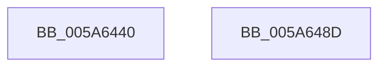

# PnpSaveGlobalsToMinidump

- RVA: `0x005A6440`–`0x005A648E` (길이 `78` bytes)
- VA: `0x00000001405A6440`
- 실행 섹션: `.text`
- PDB 이름 있음: `예`; PDB Function 태그: `아니요`
- unwind 정보 RVA: `0x0005C788`
- 디코드: `16`개 명령, `78/78` bytes 표시
- 미해석 바이트: `0` (있으면 어셈블리에 `.byte`로 보존)

> 이 문서는 커널 이미지의 기계어와 PDB 기호를 분석해 생성했습니다. 4번과 5번은 함수 원형과 자료형을 바이너리 사용 방식에서 추정한 C 해석이며 원본 소스 복구 결과는 아닙니다.

## 1. Dependencies

- 직접 호출 지점: **4**; 고유 호출 대상: **1**
- 직접 호출자로 확인된 함수: **1**
- RIP 상대 이미지 참조: **4**

### Outgoing calls
- `0x005A6450` → [IoAddTriageDumpDataBlock](../42/IoAddTriageDumpDataBlock_function_00428374.md) (function, `0x00428374`)
- `0x005A6461` → [IoAddTriageDumpDataBlock](../42/IoAddTriageDumpDataBlock_function_00428374.md) (function, `0x00428374`)
- `0x005A6472` → [IoAddTriageDumpDataBlock](../42/IoAddTriageDumpDataBlock_function_00428374.md) (function, `0x00428374`)
- `0x005A6483` → [IoAddTriageDumpDataBlock](../42/IoAddTriageDumpDataBlock_function_00428374.md) (function, `0x00428374`)

### Direct callers
- [IopAddBugcheckTriageDataFromParameters](../59/IopAddBugcheckTriageDataFromParameters_function_00593E54.md) at `0x00593F74`
- [IopAddBugcheckTriageDataFromParameters](../59/IopAddBugcheckTriageDataFromParameters_function_00593E54.md) at `0x0059401A`
- [IopAddBugcheckTriageDataFromParameters](../59/IopAddBugcheckTriageDataFromParameters_function_00593E54.md) at `0x00594098`

### Static image references
- `0x005A6449` → RVA `0x00E663B0` (`.data`; read)
- `0x005A645A` → RVA `0x00E663B8` (`.data`; read)
- `0x005A646B` → RVA `0x00F8CB20` (`.data`; read)
- `0x005A647C` → RVA `0x00F8C300` (`.data`; read)

## 2. Other-region calls and transfers

- 다른 실행 섹션으로 향하는 call: **0**
- 별도 외부 분기/꼬리 이동을 확인하지 못했습니다.

## 3. Assembly (complete function range)

```asm
005A6440  48 83 EC 28                     sub rsp, 0x28
005A6444  BA 08 00 00 00                  mov edx, 8
005A6449  48 8D 0D 60 FF 8B 00            lea rcx, [rip + 0x8bff60]
005A6450  E8 1F 1F E8 FF                  call 0x140428374
005A6455  BA 08 00 00 00                  mov edx, 8
005A645A  48 8D 0D 57 FF 8B 00            lea rcx, [rip + 0x8bff57]
005A6461  E8 0E 1F E8 FF                  call 0x140428374
005A6466  BA 08 00 00 00                  mov edx, 8
005A646B  48 8D 0D AE 66 9E 00            lea rcx, [rip + 0x9e66ae]
005A6472  E8 FD 1E E8 FF                  call 0x140428374
005A6477  BA 50 00 00 00                  mov edx, 0x50
005A647C  48 8D 0D 7D 5E 9E 00            lea rcx, [rip + 0x9e5e7d]
005A6483  E8 EC 1E E8 FF                  call 0x140428374
005A6488  48 83 C4 28                     add rsp, 0x28
005A648C  C3                              ret
005A648D  CC                              int3
```

## 4. C-style interpretation (structured pseudocode)

```c
__int64 __fastcall PnpSaveGlobalsToMinidump(void)
{
    __int64 result;
    __int64 v_rsp;

    v_rsp = (v_rsp) - (40);
    result = IoAddTriageDumpDataBlock(v_rip + 9174880, 8, a3, a4);
    result = IoAddTriageDumpDataBlock(v_rip + 9174871, 8, a3, a4);
    result = IoAddTriageDumpDataBlock(v_rip + 10380974, 8, a3, a4);
    result = IoAddTriageDumpDataBlock(v_rip + 10378877, 80, a3, a4);
    v_rsp = (v_rsp) + (40);
    return result;
}
```

## 5. (Beta) C Style

```c
void PnpSaveGlobalsToMinidump(void)
{
    int64_t result;
    int64_t local_rsp;

    local_rsp = (local_rsp) - (40);
    result = IoAddTriageDumpDataBlock(v_rip + 9174880, 8, a3, a4);
    result = IoAddTriageDumpDataBlock(v_rip + 9174871, 8, a3, a4);
    result = IoAddTriageDumpDataBlock(v_rip + 10380974, 8, a3, a4);
    result = IoAddTriageDumpDataBlock(v_rip + 10378877, 80, a3, a4);
    local_rsp = (local_rsp) + (40);
    return result;
}
```

## 6. Execution-region graph

[열기: 2D/3D 그래프와 함수 탐색 컨트롤 패널](../../../control-panel.html?section=text&rva=0x005A6440&view=graph)

- 2D 그래프는 위에서 아래로 흐르고, 3D 그래프는 빈 공간을 드래그해 회전합니다. Shift+드래그는 이동, 휠은 확대·축소, 함수 노드 선택은 대상 보고서 이동입니다.

### Static fallback


