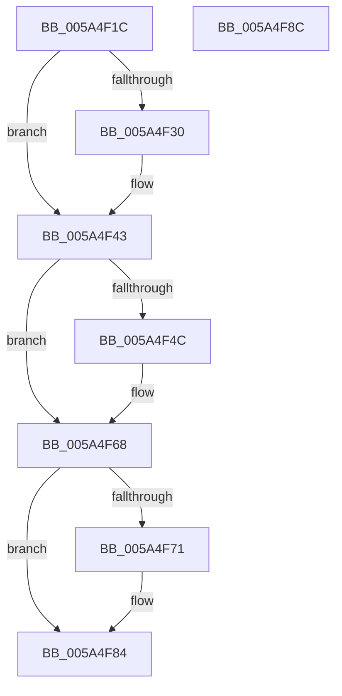

# PnpSerializeBoot

- RVA: `0x005A4F1C`–`0x005A4F8D` (길이 `113` bytes)
- VA: `0x00000001405A4F1C`
- 실행 섹션: `.text`
- PDB 이름 있음: `예`; PDB Function 태그: `아니요`
- unwind 정보 RVA: `0x00064C80`
- 디코드: `27`개 명령, `113/113` bytes 표시
- 미해석 바이트: `0` (있으면 어셈블리에 `.byte`로 보존)

> 이 문서는 커널 이미지의 기계어와 PDB 기호를 분석해 생성했습니다. 4번과 5번은 함수 원형과 자료형을 바이너리 사용 방식에서 추정한 C 해석이며 원본 소스 복구 결과는 아닙니다.

## 1. Dependencies

- 직접 호출 지점: **3**; 고유 호출 대상: **2**
- 직접 호출자로 확인된 함수: **2**
- RIP 상대 이미지 참조: **6**

### Outgoing calls
- `0x005A4F3E` → [McTemplateK0_EtwWriteTransfer](../59/McTemplateK0_EtwWriteTransfer_function_00596B24.md) (function, `0x00596B24`)
- `0x005A4F61` → [KeWaitForSingleObject](../20/KeWaitForSingleObject_function_0020E6B0.md) (function, `0x0020E6B0`)
- `0x005A4F7F` → [McTemplateK0_EtwWriteTransfer](../59/McTemplateK0_EtwWriteTransfer_function_00596B24.md) (function, `0x00596B24`)

### Direct callers
- [NtSerializeBoot](../../page/83/NtSerializeBoot_function_0083C940.md) at `0x0083C975`
- [IoInitSystem](../../init/C2/IoInitSystem_function_00C2ABB8.md) at `0x00C2AC0B`

### Static image references
- `0x005A4F22` → RVA `0x00EF0128` (`.data`; read)
- `0x005A4F30` → RVA `0x00027580` (`.rdata`; read)
- `0x005A4F37` → RVA `0x00E06DA0` (`.data`; read)
- `0x005A4F43` → RVA `0x00F8C5FA` (`.data`; read)
- `0x005A4F52` → RVA `0x00F8CFC0` (`.data`; read)
- `0x005A4F71` → RVA `0x00026EC0` (`.rdata`; read)

## 2. Other-region calls and transfers

- 다른 실행 섹션으로 향하는 call: **0**
- 별도 외부 분기/꼬리 이동을 확인하지 못했습니다.

## 3. Assembly (complete function range)

```asm
005A4F1C  40 53                           push rbx
005A4F1E  48 83 EC 30                     sub rsp, 0x30
005A4F22  F6 05 FF B1 94 00 01            test byte ptr [rip + 0x94b1ff], 1
005A4F29  BB 01 00 00 C0                  mov ebx, 0xc0000001
005A4F2E  74 13                           je 0x1405a4f43
005A4F30  48 8D 15 49 26 A8 FF            lea rdx, [rip - 0x57d9b7]
005A4F37  48 8D 0D 62 1E 86 00            lea rcx, [rip + 0x861e62]
005A4F3E  E8 E1 1B FF FF                  call 0x140596b24
005A4F43  80 3D B0 76 9E 00 00            cmp byte ptr [rip + 0x9e76b0], 0
005A4F4A  74 1C                           je 0x1405a4f68
005A4F4C  48 83 64 24 20 00               and qword ptr [rsp + 0x20], 0
005A4F52  48 8D 0D 67 80 9E 00            lea rcx, [rip + 0x9e8067]
005A4F59  45 33 C9                        xor r9d, r9d
005A4F5C  45 33 C0                        xor r8d, r8d
005A4F5F  33 D2                           xor edx, edx
005A4F61  E8 4A 97 C6 FF                  call 0x14020e6b0
005A4F66  8B D8                           mov ebx, eax
005A4F68  F6 05 B9 B1 94 00 01            test byte ptr [rip + 0x94b1b9], 1
005A4F6F  74 13                           je 0x1405a4f84
005A4F71  48 8D 15 48 1F A8 FF            lea rdx, [rip - 0x57e0b8]
005A4F78  48 8D 0D 21 1E 86 00            lea rcx, [rip + 0x861e21]
005A4F7F  E8 A0 1B FF FF                  call 0x140596b24
005A4F84  8B C3                           mov eax, ebx
005A4F86  48 83 C4 30                     add rsp, 0x30
005A4F8A  5B                              pop rbx
005A4F8B  C3                              ret
005A4F8C  CC                              int3
```

## 4. C-style interpretation (structured pseudocode)

```c
__int64 __fastcall PnpSerializeBoot(__int64 a1, __int64 a2, int a3, int a4)
{
    __int64 result;
    __int64 v_rbx;
    __int64 v_rsp;
    unsigned __int64 v_stack_m18;

    v_rsp = (v_rsp) - (48);
    if (((*(unsigned __int8 *)(v_rip + 9744895)) & (1)) != 0) {
        a2 = v_rip - 5757367;
        a1 = v_rip + 8789602;
        result = McTemplateK0_EtwWriteTransfer(a1, a2, a3, a4);
    }
    v_rbx = (unsigned int)(0xC0000001ULL);
    if ((*(unsigned __int8 *)(v_rip + 10385072)) != 0) {
        a1 = v_rip + 10387559;
        a4 = 0;
        a3 = 0;
        a2 = 0;
        result = KeWaitForSingleObject(a1, a2, a3, a4);
        v_rbx = (unsigned int)(result);
    }
    if (((*(unsigned __int8 *)(v_rip + 9744825)) & (1)) != 0) {
        a2 = v_rip - 5759160;
        a1 = v_rip + 8789537;
        result = McTemplateK0_EtwWriteTransfer(a1, a2, a3, a4);
    }
    v_rsp = (v_rsp) + (48);
    return (unsigned int)((unsigned int)(v_rbx));
}
```

## 5. (Beta) C Style

```c
int64_t PnpSerializeBoot(int64_t Arg1, int64_t Arg2, int32_t Arg3, int32_t Arg4)
{
    int64_t result;
    int64_t local_rbx;
    int64_t local_rsp;
    uint64_t v_stack_m18;

    local_rsp = (local_rsp) - (48);
    if (((*(uint8_t *)(v_rip + 0x94B1FF)) & (1)) != 0) {
        Arg2 = v_rip - 5757367;
        Arg1 = v_rip + 8789602;
        result = McTemplateK0_EtwWriteTransfer(Arg1, Arg2, Arg3, Arg4);
    }
    local_rbx = (uint32_t)(0xC0000001ULL);
    if ((*(uint8_t *)(v_rip + 0x9E76B0)) != 0) {
        Arg1 = v_rip + 10387559;
        Arg4 = 0;
        Arg3 = 0;
        Arg2 = 0;
        result = KeWaitForSingleObject(Arg1, Arg2, Arg3, Arg4);
        local_rbx = (uint32_t)(result);
    }
    if (((*(uint8_t *)(v_rip + 0x94B1B9)) & (1)) != 0) {
        Arg2 = v_rip - 5759160;
        Arg1 = v_rip + 8789537;
        result = McTemplateK0_EtwWriteTransfer(Arg1, Arg2, Arg3, Arg4);
    }
    local_rsp = (local_rsp) + (48);
    return (uint32_t)((uint32_t)(local_rbx));
}
```

## 6. Execution-region graph

[열기: 2D/3D 그래프와 함수 탐색 컨트롤 패널](../../../control-panel.html?section=text&rva=0x005A4F1C&view=graph)

- 2D 그래프는 위에서 아래로 흐르고, 3D 그래프는 빈 공간을 드래그해 회전합니다. Shift+드래그는 이동, 휠은 확대·축소, 함수 노드 선택은 대상 보고서 이동입니다.

### Static fallback


