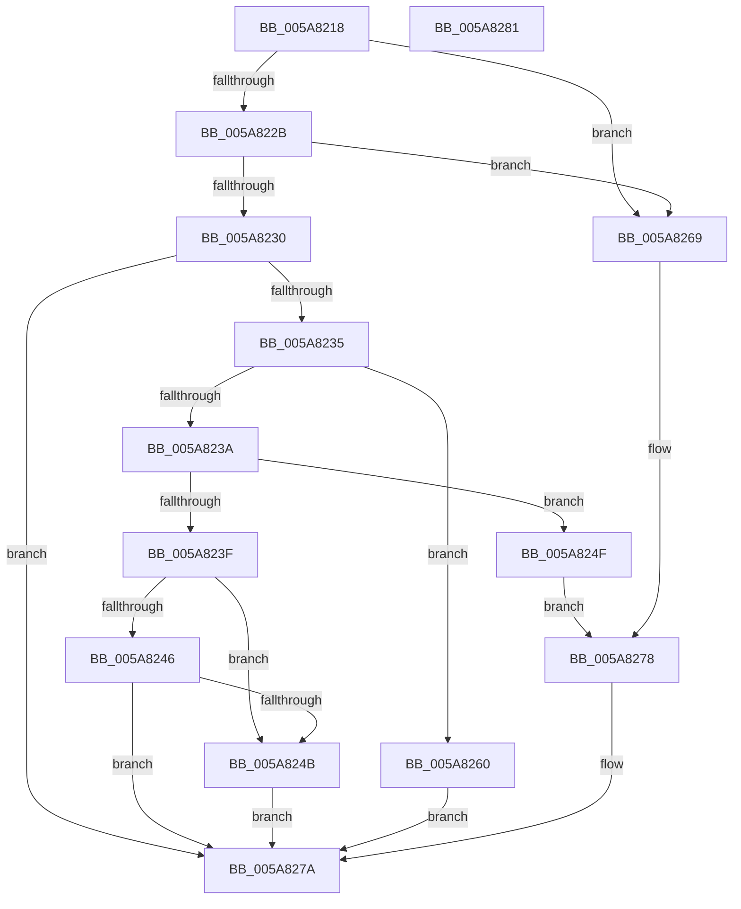

# PnpValidateRegistryValue

- RVA: `0x005A8218`–`0x005A8282` (길이 `106` bytes)
- VA: `0x00000001405A8218`
- 실행 섹션: `.text`
- PDB 이름 있음: `예`; PDB Function 태그: `아니요`
- unwind 정보 RVA: `0x0005C788`
- 디코드: `37`개 명령, `106/106` bytes 표시
- 미해석 바이트: `0` (있으면 어셈블리에 `.byte`로 보존)

> 이 문서는 커널 이미지의 기계어와 PDB 기호를 분석해 생성했습니다. 4번과 5번은 함수 원형과 자료형을 바이너리 사용 방식에서 추정한 C 해석이며 원본 소스 복구 결과는 아닙니다.

## 1. Dependencies

- 직접 호출 지점: **2**; 고유 호출 대상: **2**
- 직접 호출자로 확인된 함수: **3**
- RIP 상대 이미지 참조: **0**

### Outgoing calls
- `0x005A8259` → [PnpValidateMultiSzData](../4B/PnpValidateMultiSzData_function_004BD294.md) (function, `0x004BD294`)
- `0x005A8273` → [PnpValidateStringData](../4B/PnpValidateStringData_function_004B7678.md) (function, `0x004B7678`)

### Direct callers
- [PiDevCfgResolveVariableConstant](../../page/73/PiDevCfgResolveVariableConstant_function_007359E0.md) at `0x00735A23`
- [PiDevCfgResolveVariableKeyCopy](../../page/73/PiDevCfgResolveVariableKeyCopy_function_007360D0.md) at `0x00736135`
- [PiDevCfgResolveVariableKeyValue](../../page/73/PiDevCfgResolveVariableKeyValue_function_007361B0.md) at `0x007362DA`

### Static image references
- 디코드된 RIP-relative 메모리 참조가 없습니다.

## 2. Other-region calls and transfers

- 다른 실행 섹션으로 향하는 call: **0**
- 별도 외부 분기/꼬리 이동을 확인하지 못했습니다.

## 3. Assembly (complete function range)

```asm
005A8218  48 83 EC 28                     sub rsp, 0x28
005A821C  8B 41 04                        mov eax, dword ptr [rcx + 4]
005A821F  BA 01 00 00 00                  mov edx, 1
005A8224  4C 8B C1                        mov r8, rcx
005A8227  3B C2                           cmp eax, edx
005A8229  74 3E                           je 0x1405a8269
005A822B  83 F8 02                        cmp eax, 2
005A822E  74 39                           je 0x1405a8269
005A8230  83 F8 03                        cmp eax, 3
005A8233  74 45                           je 0x1405a827a
005A8235  83 F8 04                        cmp eax, 4
005A8238  74 26                           je 0x1405a8260
005A823A  83 F8 07                        cmp eax, 7
005A823D  74 10                           je 0x1405a824f
005A823F  3D 00 80 00 00                  cmp eax, 0x8000
005A8244  74 05                           je 0x1405a824b
005A8246  83 F8 FF                        cmp eax, -1
005A8249  75 2F                           jne 0x1405a827a
005A824B  32 D2                           xor dl, dl
005A824D  EB 2B                           jmp 0x1405a827a
005A824F  8B 49 08                        mov ecx, dword ptr [rcx + 8]
005A8252  41 8B 50 0C                     mov edx, dword ptr [r8 + 0xc]
005A8256  49 03 C8                        add rcx, r8
005A8259  E8 36 50 F1 FF                  call 0x1404bd294
005A825E  EB 18                           jmp 0x1405a8278
005A8260  83 79 0C 04                     cmp dword ptr [rcx + 0xc], 4
005A8264  0F 94 C2                        sete dl
005A8267  EB 11                           jmp 0x1405a827a
005A8269  8B 49 08                        mov ecx, dword ptr [rcx + 8]
005A826C  41 8B 50 0C                     mov edx, dword ptr [r8 + 0xc]
005A8270  49 03 C8                        add rcx, r8
005A8273  E8 00 F4 F0 FF                  call 0x1404b7678
005A8278  8A D0                           mov dl, al
005A827A  8A C2                           mov al, dl
005A827C  48 83 C4 28                     add rsp, 0x28
005A8280  C3                              ret
005A8281  CC                              int3
```

## 4. C-style interpretation (structured pseudocode)

```c
__int64 __fastcall PnpValidateRegistryValue(__int64 a1)
{
    __int64 result;
    __int64 v_rsp;

    v_rsp = (v_rsp) - (40);
    if (((unsigned int)((unsigned int)(*(unsigned int *)(a1 + 4)))) == 1) goto loc_005A8269;
    if (((unsigned int)((unsigned int)(*(unsigned int *)(a1 + 4)))) == 2) goto loc_005A8269;
    if (((unsigned int)((unsigned int)(*(unsigned int *)(a1 + 4)))) == 3) goto loc_005A827A;
    if (((unsigned int)((unsigned int)(*(unsigned int *)(a1 + 4)))) == 4) goto loc_005A8260;
    if (((unsigned int)((unsigned int)(*(unsigned int *)(a1 + 4)))) == 7) goto loc_005A824F;
    if (((unsigned int)((unsigned int)(*(unsigned int *)(a1 + 4)))) == 0x8000ULL) goto loc_005A824B;
    if (((unsigned int)((unsigned int)(*(unsigned int *)(a1 + 4)))) != -1) goto loc_005A827A;
loc_005A824B:
    a2 = 0;
    goto loc_005A827A;
loc_005A824F:
    a1 = ((unsigned int)(*(unsigned int *)(a1 + 8))) + (a1);
    result = PnpValidateMultiSzData(a1, (unsigned int)(*(unsigned int *)(a1 + 12)), a1, a4);
    goto loc_005A8278;
loc_005A8260:
    a2 = ((*(unsigned int *)(a1 + 12)) == 4) ? 1 : 0;
    goto loc_005A827A;
loc_005A8269:
    a1 = ((unsigned int)(*(unsigned int *)(a1 + 8))) + (a1);
    result = PnpValidateStringData(a1, (unsigned int)(*(unsigned int *)(a1 + 12)), a1, a4);
loc_005A8278:
loc_005A827A:
    v_rsp = (v_rsp) + (40);
    return (unsigned __int8)((unsigned __int8)(result));
}
```

## 5. (Beta) C Style

```c
int64_t PnpValidateRegistryValue(void *Arg1)
{
    uint8_t *arg1 = (uint8_t *)Arg1;

    int64_t result;
    int64_t local_rsp;

    local_rsp = (local_rsp) - (40);
    if (((uint32_t)((uint32_t)(*(uint32_t *)(arg1 + 0x4)))) == 1) goto loc_005A8269;
    if (((uint32_t)((uint32_t)(*(uint32_t *)(arg1 + 0x4)))) == 2) goto loc_005A8269;
    if (((uint32_t)((uint32_t)(*(uint32_t *)(arg1 + 0x4)))) == 3) goto loc_005A827A;
    if (((uint32_t)((uint32_t)(*(uint32_t *)(arg1 + 0x4)))) == 4) goto loc_005A8260;
    if (((uint32_t)((uint32_t)(*(uint32_t *)(arg1 + 0x4)))) == 7) goto loc_005A824F;
    if (((uint32_t)((uint32_t)(*(uint32_t *)(arg1 + 0x4)))) == 0x8000ULL) goto loc_005A824B;
    if (((uint32_t)((uint32_t)(*(uint32_t *)(arg1 + 0x4)))) != -1) goto loc_005A827A;
loc_005A824B:
    a2 = 0;
    goto loc_005A827A;
loc_005A824F:
    Arg1 = ((uint32_t)(*(uint32_t *)(arg1 + 0x8))) + (Arg1);
    result = PnpValidateMultiSzData(Arg1, (uint32_t)(*(uint32_t *)(arg1 + 0xC)), Arg1, a4);
    goto loc_005A8278;
loc_005A8260:
    a2 = ((*(uint32_t *)(arg1 + 0xC)) == 4) ? 1 : 0;
    goto loc_005A827A;
loc_005A8269:
    Arg1 = ((uint32_t)(*(uint32_t *)(arg1 + 0x8))) + (Arg1);
    result = PnpValidateStringData(Arg1, (uint32_t)(*(uint32_t *)(arg1 + 0xC)), Arg1, a4);
loc_005A8278:
loc_005A827A:
    local_rsp = (local_rsp) + (40);
    return (uint8_t)((uint8_t)(result));
}
```

### 관측된 메모리 오프셋

구조체 형식이 확인되지 않은 접근은 인자 기준의 오프셋으로만 기록했습니다.

| 기준 인자 | 오프셋 표현 | 폭 (bit) | 접근 |
|---|---:|---:|---|
| `Arg1` | `+ 0x4` | `32` | `R` |
| `Arg1` | `+ 0x8` | `32` | `R` |
| `Arg1` | `+ 0xC` | `32` | `R` |

## 6. Execution-region graph

[열기: 2D/3D 그래프와 함수 탐색 컨트롤 패널](../../../control-panel.html?section=text&rva=0x005A8218&view=graph)

- 2D 그래프는 위에서 아래로 흐르고, 3D 그래프는 빈 공간을 드래그해 회전합니다. Shift+드래그는 이동, 휠은 확대·축소, 함수 노드 선택은 대상 보고서 이동입니다.

### Static fallback


