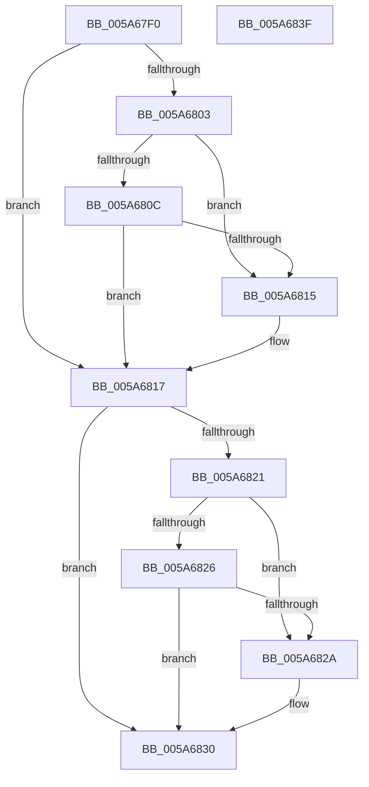

# PnpWatchdogSecondChanceCallback

- RVA: `0x005A67F0`–`0x005A6840` (길이 `80` bytes)
- VA: `0x00000001405A67F0`
- 실행 섹션: `.text`
- PDB 이름 있음: `예`; PDB Function 태그: `아니요`
- unwind 정보 RVA: `0x0005C788`
- 디코드: `24`개 명령, `80/80` bytes 표시
- 미해석 바이트: `0` (있으면 어셈블리에 `.byte`로 보존)

> 이 문서는 커널 이미지의 기계어와 PDB 기호를 분석해 생성했습니다. 4번과 5번은 함수 원형과 자료형을 바이너리 사용 방식에서 추정한 C 해석이며 원본 소스 복구 결과는 아닙니다.

## 1. Dependencies

- 직접 호출 지점: **2**; 고유 호출 대상: **2**
- 직접 호출자로 확인된 함수: **0**
- RIP 상대 이미지 참조: **4**

### Outgoing calls
- `0x005A682A` → [PnpWatchdogBugcheck](PnpWatchdogBugcheck_function_005A6494.md) (function, `0x005A6494`)
- `0x005A6835` → [PnpWatchdogEtwWrite](../4D/PnpWatchdogEtwWrite_function_004D2FB0.md) (function, `0x004D2FB0`)

### Direct callers
- 이 함수 시작 RVA로 연결되는 직접 call은 확인되지 않았습니다. 간접 호출은 완전히 역산할 수 없습니다.

### Static image references
- `0x005A67F7` → RVA `0x00FC521C` (`ALMOSTRO`; read)
- `0x005A6803` → RVA `0x00E66279` (`.data`; read)
- `0x005A680C` → RVA `0x00E66245` (`.data`; read)
- `0x005A6817` → RVA `0x00F8CCD8` (`.data`; read)

## 2. Other-region calls and transfers

- 다른 실행 섹션으로 향하는 call: **0**
- 별도 외부 분기/꼬리 이동을 확인하지 못했습니다.

## 3. Assembly (complete function range)

```asm
005A67F0  48 83 EC 28                     sub rsp, 0x28
005A67F4  45 33 C0                        xor r8d, r8d
005A67F7  44 38 05 1E EA A1 00            cmp byte ptr [rip + 0xa1ea1e], r8b
005A67FE  41 8A D0                        mov dl, r8b
005A6801  75 14                           jne 0x1405a6817
005A6803  44 38 05 6F FA 8B 00            cmp byte ptr [rip + 0x8bfa6f], r8b
005A680A  75 09                           jne 0x1405a6815
005A680C  44 38 05 32 FA 8B 00            cmp byte ptr [rip + 0x8bfa32], r8b
005A6813  74 02                           je 0x1405a6817
005A6815  B2 01                           mov dl, 1
005A6817  8B 05 BB 64 9E 00               mov eax, dword ptr [rip + 0x9e64bb]
005A681D  85 C0                           test eax, eax
005A681F  74 0F                           je 0x1405a6830
005A6821  83 F8 01                        cmp eax, 1
005A6824  74 04                           je 0x1405a682a
005A6826  84 D2                           test dl, dl
005A6828  74 06                           je 0x1405a6830
005A682A  E8 65 FC FF FF                  call 0x1405a6494
005A682F  CC                              int3
005A6830  BA 02 00 00 00                  mov edx, 2
005A6835  E8 76 C7 F2 FF                  call 0x1404d2fb0
005A683A  48 83 C4 28                     add rsp, 0x28
005A683E  C3                              ret
005A683F  CC                              int3
```

## 4. C-style interpretation (structured pseudocode)

```c
__int64 __fastcall PnpWatchdogSecondChanceCallback(__int64 a1, __int64 a2, int a3)
{
    __int64 result;
    __int64 v_rsp;

    v_rsp = (v_rsp) - (40);
    a3 = 0;
    if ((*(unsigned __int8 *)(v_rip + 10611230)) != 0) goto loc_005A6817;
    if ((*(unsigned __int8 *)(v_rip + 9173615)) != 0) goto loc_005A6815;
    if ((*(unsigned __int8 *)(v_rip + 9173554)) != 0) {
        a2 = 1;
    }
    if ((unsigned int)((unsigned int)(*(unsigned int *)(v_rip + 10380475))) == 0) goto loc_005A6830;
    if (((unsigned int)((unsigned int)(*(unsigned int *)(v_rip + 10380475)))) == 1) goto loc_005A682A;
    result = (unsigned int)(*(unsigned int *)(v_rip + 10380475));
    if ((unsigned __int8)(a2) != 0) {
        result = PnpWatchdogBugcheck(a1, a2, a3, a4);
    }
    result = PnpWatchdogEtwWrite(a1, 2, a3, a4);
    v_rsp = (v_rsp) + (40);
    return result;
}
```

## 5. (Beta) C Style

```c
int64_t PnpWatchdogSecondChanceCallback(int64_t Arg1, int64_t Arg2, int32_t Arg3)
{
    int64_t result;
    int64_t local_rsp;

    local_rsp = (local_rsp) - (40);
    Arg3 = 0;
    if ((*(uint8_t *)(v_rip + 0xA1EA1E)) != 0) goto loc_005A6817;
    if ((*(uint8_t *)(v_rip + 0x8BFA6F)) != 0) goto loc_005A6815;
    if ((*(uint8_t *)(v_rip + 0x8BFA32)) != 0) {
        Arg2 = 1;
    }
    if ((uint32_t)((uint32_t)(*(uint32_t *)(v_rip + 0x9E64BB))) == 0) goto loc_005A6830;
    if (((uint32_t)((uint32_t)(*(uint32_t *)(v_rip + 0x9E64BB)))) == 1) goto loc_005A682A;
    result = (uint32_t)(*(uint32_t *)(v_rip + 0x9E64BB));
    if ((uint8_t)(Arg2) != 0) {
        result = PnpWatchdogBugcheck(Arg1, Arg2, Arg3, a4);
    }
    result = PnpWatchdogEtwWrite(Arg1, 2, Arg3, a4);
    local_rsp = (local_rsp) + (40);
    return result;
}
```

## 6. Execution-region graph

[열기: 2D/3D 그래프와 함수 탐색 컨트롤 패널](../../../control-panel.html?section=text&rva=0x005A67F0&view=graph)

- 2D 그래프는 위에서 아래로 흐르고, 3D 그래프는 빈 공간을 드래그해 회전합니다. Shift+드래그는 이동, 휠은 확대·축소, 함수 노드 선택은 대상 보고서 이동입니다.

### Static fallback


