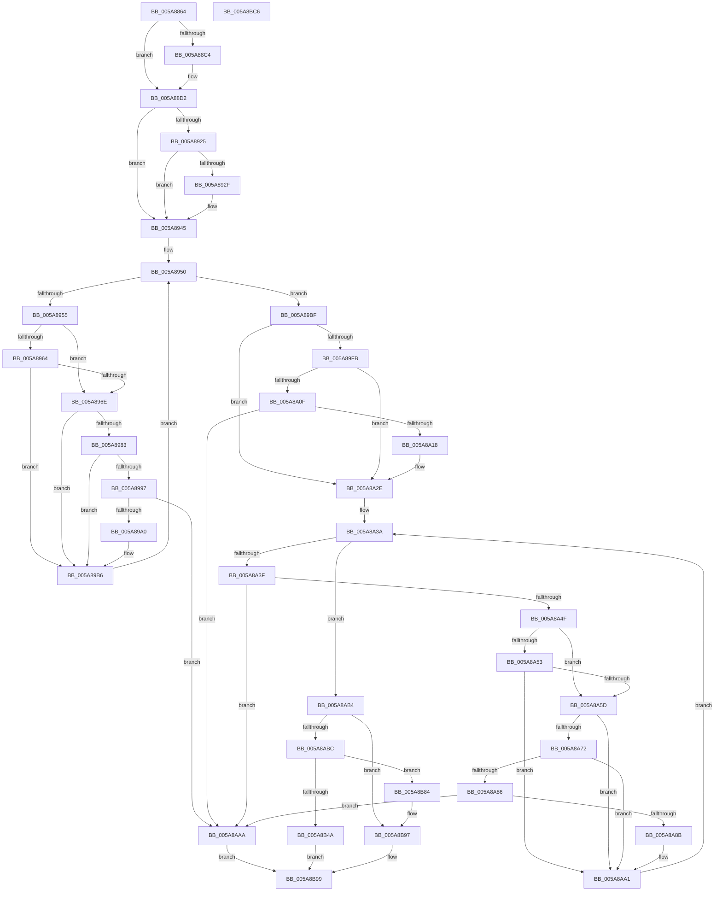

# PnprCopyReservedMapping

- RVA: `0x005A8864`–`0x005A8BC7` (길이 `867` bytes)
- VA: `0x00000001405A8864`
- 실행 섹션: `.text`
- PDB 이름 있음: `예`; PDB Function 태그: `아니요`
- unwind 정보 RVA: `0x000C8D9C`
- 디코드: `219`개 명령, `867/867` bytes 표시
- 미해석 바이트: `0` (있으면 어셈블리에 `.byte`로 보존)

> 이 문서는 커널 이미지의 기계어와 PDB 기호를 분석해 생성했습니다. 4번과 5번은 함수 원형과 자료형을 바이너리 사용 방식에서 추정한 C 해석이며 원본 소스 복구 결과는 아닙니다.

## 1. Dependencies

- 직접 호출 지점: **16**; 고유 호출 대상: **8**
- 직접 호출자로 확인된 함수: **1**
- RIP 상대 이미지 참조: **2**

### Outgoing calls
- `0x005A88CD` → [MmUnmapReservedMapping](../3E/MmUnmapReservedMapping_function_003E7BE0.md) (function, `0x003E7BE0`)
- `0x005A88E1` → [memset](../6C/memset_function_006C6C40.md) (function, `0x006C6C40`)
- `0x005A88EF` → [memset](../6C/memset_function_006C6C40.md) (function, `0x006C6C40`)
- `0x005A8902` → [MmGetPhysicalAddress](../23/MmGetPhysicalAddress_function_0023A500.md) (function, `0x0023A500`)
- `0x005A8912` → [PnprGetPageDestination](PnprGetPageDestination_function_005A8BD0.md) (function, `0x005A8BD0`)
- `0x005A8958` → [MmContainingPageForReservedMapping](../67/MmContainingPageForReservedMapping_function_00674B74.md) (function, `0x00674B74`)
- `0x005A897A` → [PnprGetPageDestination](PnprGetPageDestination_function_005A8BD0.md) (function, `0x005A8BD0`)
- `0x005A89E2` → [MmGetPhysicalAddress](../23/MmGetPhysicalAddress_function_0023A500.md) (function, `0x0023A500`)
- `0x005A89F2` → [PnprGetPageDestination](PnprGetPageDestination_function_005A8BD0.md) (function, `0x005A8BD0`)
- `0x005A8A42` → [MmContainingPageForReservedMapping](../67/MmContainingPageForReservedMapping_function_00674B74.md) (function, `0x00674B74`)
- `0x005A8A69` → [PnprGetPageDestination](PnprGetPageDestination_function_005A8BD0.md) (function, `0x005A8BD0`)
- `0x005A8B09` → [memcpy](../6C/memcpy_function_006C6840.md) (function, `0x006C6840`)
- `0x005A8B19` → [memcpy](../6C/memcpy_function_006C6840.md) (function, `0x006C6840`)
- `0x005A8B40` → [MmMapLockedPagesWithReservedMapping](../3E/MmMapLockedPagesWithReservedMapping_function_003E8910.md) (function, `0x003E8910`)
- `0x005A8B92` → [memcpy](../6C/memcpy_function_006C6840.md) (function, `0x006C6840`)
- `0x005A8BA0` → [_security_check_cookie](../6A/_security_check_cookie_function_006AC640.md) (function, `0x006AC640`)

### Direct callers
- [PnprRecopyMirrorPages](PnprRecopyMirrorPages_function_005A8F9C.md) at `0x005A90DF`

### Static image references
- `0x005A8887` → RVA `0x00E0A740` (`.data`; read)
- `0x005A8895` → RVA `0x00F8AC38` (`.data`; read)

## 2. Other-region calls and transfers

- 다른 실행 섹션으로 향하는 call: **0**
- 별도 외부 분기/꼬리 이동을 확인하지 못했습니다.

## 3. Assembly (complete function range)

```asm
005A8864  48 8B C4                        mov rax, rsp
005A8867  48 89 58 08                     mov qword ptr [rax + 8], rbx
005A886B  48 89 70 10                     mov qword ptr [rax + 0x10], rsi
005A886F  48 89 78 18                     mov qword ptr [rax + 0x18], rdi
005A8873  55                              push rbp
005A8874  41 54                           push r12
005A8876  41 55                           push r13
005A8878  41 56                           push r14
005A887A  41 57                           push r15
005A887C  48 8D 68 98                     lea rbp, [rax - 0x68]
005A8880  48 81 EC 40 01 00 00            sub rsp, 0x140
005A8887  48 8B 05 B2 1E 86 00            mov rax, qword ptr [rip + 0x861eb2]
005A888E  48 33 C4                        xor rax, rsp
005A8891  48 89 45 30                     mov qword ptr [rbp + 0x30], rax
005A8895  48 8B 0D 9C 23 9E 00            mov rcx, qword ptr [rip + 0x9e239c]
005A889C  45 33 ED                        xor r13d, r13d
005A889F  4C 89 6C 24 20                  mov qword ptr [rsp + 0x20], r13
005A88A4  4C 8B B9 90 00 00 00            mov r15, qword ptr [rcx + 0x90]
005A88AB  8B 81 B4 00 00 00               mov eax, dword ptr [rcx + 0xb4]
005A88B1  4C 8D 34 40                     lea r14, [rax + rax*2]
005A88B5  4F 8B 04 F7                     mov r8, qword ptr [r15 + r14*8]
005A88B9  4B 8D 34 F7                     lea rsi, [r15 + r14*8]
005A88BD  41 F6 40 0A 01                  test byte ptr [r8 + 0xa], 1
005A88C2  74 0E                           je 0x1405a88d2
005A88C4  48 8B 4E 08                     mov rcx, qword ptr [rsi + 8]
005A88C8  BA 50 6E 70 51                  mov edx, 0x51706e50
005A88CD  E8 0E F3 E3 FF                  call 0x1403e7be0
005A88D2  BB 80 00 00 00                  mov ebx, 0x80
005A88D7  48 8D 4C 24 30                  lea rcx, [rsp + 0x30]
005A88DC  44 8B C3                        mov r8d, ebx
005A88DF  33 D2                           xor edx, edx
005A88E1  E8 5A E3 11 00                  call 0x1406c6c40
005A88E6  44 8B C3                        mov r8d, ebx
005A88E9  48 8D 4D B0                     lea rcx, [rbp - 0x50]
005A88ED  33 D2                           xor edx, edx
005A88EF  E8 4C E3 11 00                  call 0x1406c6c40
005A88F4  4B 8B 0C F7                     mov rcx, qword ptr [r15 + r14*8]
005A88F8  41 8B FD                        mov edi, r13d
005A88FB  48 81 E1 00 F0 FF FF            and rcx, 0xfffffffffffff000
005A8902  E8 F9 1B C9 FF                  call 0x14023a500
005A8907  48 8D 54 24 20                  lea rdx, [rsp + 0x20]
005A890C  48 8B C8                        mov rcx, rax
005A890F  48 8B D8                        mov rbx, rax
005A8912  E8 B9 02 00 00                  call 0x1405a8bd0
005A8917  48 BA FF FF FF FF FF FF FF 7F   movabs rdx, 0x7fffffffffffffff
005A8921  85 C0                           test eax, eax
005A8923  78 20                           js 0x1405a8945
005A8925  48 8B 4C 24 20                  mov rcx, qword ptr [rsp + 0x20]
005A892A  48 3B CA                        cmp rcx, rdx
005A892D  74 16                           je 0x1405a8945
005A892F  48 C1 EB 0C                     shr rbx, 0xc
005A8933  BF 01 00 00 00                  mov edi, 1
005A8938  48 C1 E9 0C                     shr rcx, 0xc
005A893C  48 89 4D B0                     mov qword ptr [rbp - 0x50], rcx
005A8940  48 89 5C 24 30                  mov qword ptr [rsp + 0x30], rbx
005A8945  48 8B 76 08                     mov rsi, qword ptr [rsi + 8]
005A8949  4C 8D A6 00 00 01 00            lea r12, [rsi + 0x10000]
005A8950  49 3B F4                        cmp rsi, r12
005A8953  73 6A                           jae 0x1405a89bf
005A8955  48 8B CE                        mov rcx, rsi
005A8958  E8 17 C2 0C 00                  call 0x140674b74
005A895D  48 8B D8                        mov rbx, rax
005A8960  85 FF                           test edi, edi
005A8962  74 0A                           je 0x1405a896e
005A8964  8D 47 FF                        lea eax, [rdi - 1]
005A8967  48 3B 5C C4 30                  cmp rbx, qword ptr [rsp + rax*8 + 0x30]
005A896C  74 48                           je 0x1405a89b6
005A896E  48 C1 E3 0C                     shl rbx, 0xc
005A8972  48 8D 54 24 20                  lea rdx, [rsp + 0x20]
005A8977  48 8B CB                        mov rcx, rbx
005A897A  E8 51 02 00 00                  call 0x1405a8bd0
005A897F  85 C0                           test eax, eax
005A8981  78 33                           js 0x1405a89b6
005A8983  48 8B 44 24 20                  mov rax, qword ptr [rsp + 0x20]
005A8988  48 B9 FF FF FF FF FF FF FF 7F   movabs rcx, 0x7fffffffffffffff
005A8992  48 3B C1                        cmp rax, rcx
005A8995  74 1F                           je 0x1405a89b6
005A8997  83 FF 10                        cmp edi, 0x10
005A899A  0F 83 0A 01 00 00               jae 0x1405a8aaa
005A89A0  8B CF                           mov ecx, edi
005A89A2  48 C1 EB 0C                     shr rbx, 0xc
005A89A6  48 C1 E8 0C                     shr rax, 0xc
005A89AA  FF C7                           inc edi
005A89AC  48 89 5C CC 30                  mov qword ptr [rsp + rcx*8 + 0x30], rbx
005A89B1  48 89 44 CD B0                  mov qword ptr [rbp + rcx*8 - 0x50], rax
005A89B6  48 81 C6 00 10 00 00            add rsi, 0x1000
005A89BD  EB 91                           jmp 0x1405a8950
005A89BF  48 8B 0D 72 22 9E 00            mov rcx, qword ptr [rip + 0x9e2272]
005A89C6  8B 81 B4 00 00 00               mov eax, dword ptr [rcx + 0xb4]
005A89CC  4C 8B A1 88 00 00 00            mov r12, qword ptr [rcx + 0x88]
005A89D3  48 8D 34 40                     lea rsi, [rax + rax*2]
005A89D7  49 8B 0C F4                     mov rcx, qword ptr [r12 + rsi*8]
005A89DB  48 81 E1 00 F0 FF FF            and rcx, 0xfffffffffffff000
005A89E2  E8 19 1B C9 FF                  call 0x14023a500
005A89E7  48 8D 54 24 20                  lea rdx, [rsp + 0x20]
005A89EC  48 8B C8                        mov rcx, rax
005A89EF  48 8B D8                        mov rbx, rax
005A89F2  E8 D9 01 00 00                  call 0x1405a8bd0
005A89F7  85 C0                           test eax, eax
005A89F9  78 33                           js 0x1405a8a2e
005A89FB  48 8B 4C 24 20                  mov rcx, qword ptr [rsp + 0x20]
005A8A00  48 B8 FF FF FF FF FF FF FF 7F   movabs rax, 0x7fffffffffffffff
005A8A0A  48 3B C8                        cmp rcx, rax
005A8A0D  74 1F                           je 0x1405a8a2e
005A8A0F  83 FF 10                        cmp edi, 0x10
005A8A12  0F 83 92 00 00 00               jae 0x1405a8aaa
005A8A18  8B C7                           mov eax, edi
005A8A1A  48 C1 EB 0C                     shr rbx, 0xc
005A8A1E  48 C1 E9 0C                     shr rcx, 0xc
005A8A22  FF C7                           inc edi
005A8A24  48 89 5C C4 30                  mov qword ptr [rsp + rax*8 + 0x30], rbx
005A8A29  48 89 4C C5 B0                  mov qword ptr [rbp + rax*8 - 0x50], rcx
005A8A2E  49 8B 74 F4 08                  mov rsi, qword ptr [r12 + rsi*8 + 8]
005A8A33  4C 8D A6 00 00 01 00            lea r12, [rsi + 0x10000]
005A8A3A  49 3B F4                        cmp rsi, r12
005A8A3D  73 75                           jae 0x1405a8ab4
005A8A3F  48 8B CE                        mov rcx, rsi
005A8A42  E8 2D C1 0C 00                  call 0x140674b74
005A8A47  48 8B D8                        mov rbx, rax
005A8A4A  83 FF 10                        cmp edi, 0x10
005A8A4D  77 5B                           ja 0x1405a8aaa
005A8A4F  85 FF                           test edi, edi
005A8A51  74 0A                           je 0x1405a8a5d
005A8A53  8D 47 FF                        lea eax, [rdi - 1]
005A8A56  48 3B 5C C4 30                  cmp rbx, qword ptr [rsp + rax*8 + 0x30]
005A8A5B  74 44                           je 0x1405a8aa1
005A8A5D  48 C1 E3 0C                     shl rbx, 0xc
005A8A61  48 8D 54 24 20                  lea rdx, [rsp + 0x20]
005A8A66  48 8B CB                        mov rcx, rbx
005A8A69  E8 62 01 00 00                  call 0x1405a8bd0
005A8A6E  85 C0                           test eax, eax
005A8A70  78 2F                           js 0x1405a8aa1
005A8A72  48 8B 44 24 20                  mov rax, qword ptr [rsp + 0x20]
005A8A77  48 B9 FF FF FF FF FF FF FF 7F   movabs rcx, 0x7fffffffffffffff
005A8A81  48 3B C1                        cmp rax, rcx
005A8A84  74 1B                           je 0x1405a8aa1
005A8A86  83 FF 10                        cmp edi, 0x10
005A8A89  73 1F                           jae 0x1405a8aaa
005A8A8B  8B CF                           mov ecx, edi
005A8A8D  48 C1 EB 0C                     shr rbx, 0xc
005A8A91  48 C1 E8 0C                     shr rax, 0xc
005A8A95  FF C7                           inc edi
005A8A97  48 89 5C CC 30                  mov qword ptr [rsp + rcx*8 + 0x30], rbx
005A8A9C  48 89 44 CD B0                  mov qword ptr [rbp + rcx*8 - 0x50], rax
005A8AA1  48 81 C6 00 10 00 00            add rsi, 0x1000
005A8AA8  EB 90                           jmp 0x1405a8a3a
005A8AAA  B8 0D 00 00 C0                  mov eax, 0xc000000d
005A8AAF  E9 E5 00 00 00                  jmp 0x1405a8b99
005A8AB4  85 FF                           test edi, edi
005A8AB6  0F 84 DB 00 00 00               je 0x1405a8b97
005A8ABC  4B 8B 0C F7                     mov rcx, qword ptr [r15 + r14*8]
005A8AC0  8B D7                           mov edx, edi
005A8AC2  48 C1 E2 0D                     shl rdx, 0xd
005A8AC6  48 8B C2                        mov rax, rdx
005A8AC9  8B F7                           mov esi, edi
005A8ACB  89 51 28                        mov dword ptr [rcx + 0x28], edx
005A8ACE  48 8D 54 24 30                  lea rdx, [rsp + 0x30]
005A8AD3  48 C1 E8 0C                     shr rax, 0xc
005A8AD7  4C 89 29                        mov qword ptr [rcx], r13
005A8ADA  66 83 C0 06                     add ax, 6
005A8ADE  66 44 89 69 0A                  mov word ptr [rcx + 0xa], r13w
005A8AE3  48 8D 1C F5 00 00 00 00         lea rbx, [rsi*8]
005A8AEB  4C 89 69 20                     mov qword ptr [rcx + 0x20], r13
005A8AEF  4C 8B C3                        mov r8, rbx
005A8AF2  44 89 69 2C                     mov dword ptr [rcx + 0x2c], r13d
005A8AF6  66 C1 E0 03                     shl ax, 3
005A8AFA  66 89 41 08                     mov word ptr [rcx + 8], ax
005A8AFE  4B 8B 3C F7                     mov rdi, qword ptr [r15 + r14*8]
005A8B02  48 83 C7 30                     add rdi, 0x30
005A8B06  48 8B CF                        mov rcx, rdi
005A8B09  E8 32 DD 11 00                  call 0x1406c6840
005A8B0E  48 8D 0C 3B                     lea rcx, [rbx + rdi]
005A8B12  4C 8B C3                        mov r8, rbx
005A8B15  48 8D 55 B0                     lea rdx, [rbp - 0x50]
005A8B19  E8 22 DD 11 00                  call 0x1406c6840
005A8B1E  4B 8B 0C F7                     mov rcx, qword ptr [r15 + r14*8]
005A8B22  41 B9 01 00 00 00               mov r9d, 1
005A8B28  43 0F B7 44 F7 10               movzx eax, word ptr [r15 + r14*8 + 0x10]
005A8B2E  BA 50 6E 70 51                  mov edx, 0x51706e50
005A8B33  66 09 41 0A                     or word ptr [rcx + 0xa], ax
005A8B37  4F 8B 04 F7                     mov r8, qword ptr [r15 + r14*8]
005A8B3B  4B 8B 4C F7 08                  mov rcx, qword ptr [r15 + r14*8 + 8]
005A8B40  E8 CB FD E3 FF                  call 0x1403e8910
005A8B45  48 85 C0                        test rax, rax
005A8B48  75 3A                           jne 0x1405a8b84
005A8B4A  48 8B 0D E7 20 9E 00            mov rcx, qword ptr [rip + 0x9e20e7]
005A8B51  BA 60 17 00 00                  mov edx, 0x1760
005A8B56  8B 81 08 82 00 00               mov eax, dword ptr [rcx + 0x8208]
005A8B5C  85 C0                           test eax, eax
005A8B5E  0F 44 C2                        cmove eax, edx
005A8B61  BA 0A 00 00 00                  mov edx, 0xa
005A8B66  89 81 08 82 00 00               mov dword ptr [rcx + 0x8208], eax
005A8B6C  8B 81 0C 82 00 00               mov eax, dword ptr [rcx + 0x820c]
005A8B72  85 C0                           test eax, eax
005A8B74  0F 44 C2                        cmove eax, edx
005A8B77  89 81 0C 82 00 00               mov dword ptr [rcx + 0x820c], eax
005A8B7D  B8 9A 00 00 C0                  mov eax, 0xc000009a
005A8B82  EB 15                           jmp 0x1405a8b99
005A8B84  48 C1 E6 0C                     shl rsi, 0xc
005A8B88  48 8B D0                        mov rdx, rax
005A8B8B  4C 8B C6                        mov r8, rsi
005A8B8E  48 8D 0C 06                     lea rcx, [rsi + rax]
005A8B92  E8 A9 DC 11 00                  call 0x1406c6840
005A8B97  33 C0                           xor eax, eax
005A8B99  48 8B 4D 30                     mov rcx, qword ptr [rbp + 0x30]
005A8B9D  48 33 CC                        xor rcx, rsp
005A8BA0  E8 9B 3A 10 00                  call 0x1406ac640
005A8BA5  4C 8D 9C 24 40 01 00 00         lea r11, [rsp + 0x140]
005A8BAD  49 8B 5B 30                     mov rbx, qword ptr [r11 + 0x30]
005A8BB1  49 8B 73 38                     mov rsi, qword ptr [r11 + 0x38]
005A8BB5  49 8B 7B 40                     mov rdi, qword ptr [r11 + 0x40]
005A8BB9  49 8B E3                        mov rsp, r11
005A8BBC  41 5F                           pop r15
005A8BBE  41 5E                           pop r14
005A8BC0  41 5D                           pop r13
005A8BC2  41 5C                           pop r12
005A8BC4  5D                              pop rbp
005A8BC5  C3                              ret
005A8BC6  CC                              int3
```

## 4. C-style interpretation (structured pseudocode)

```c
__int64 __fastcall PnprCopyReservedMapping(void)
{
    __int64 result;
    __int64 v_r13;
    __int64 v_rbx;
    __int64 v_rdi;
    __int64 v_rsi;
    __int64 v_rsp;
    unsigned __int64 v_stack_m138;
    unsigned __int64 v_stack_m148;
    unsigned __int64 v_stack_m28;

    *(unsigned __int64 *)(v_rsp + 8) = v_rbx;
    *(unsigned __int64 *)(v_rsp + 16) = v_rsi;
    *(unsigned __int64 *)(v_rsp + 24) = v_rdi;
    v_rsp = (v_rsp) - (320);
    result = (*(unsigned __int64 *)(v_rip + 8789682)) ^ (v_rsp);
    *(unsigned __int64 *)(v_rsp - 104 + 48) = result;
    v_r13 = 0;
    v_stack_m148 = 0;
    result = (unsigned int)(*(unsigned int *)(*(unsigned __int64 *)(v_rip + 10363804) + 180));
    if (((*(unsigned __int8 *)(*(unsigned __int64 *)(*(unsigned __int64 *)(*(unsigned __int64 *)(v_rip + 10363804) + 144) + (unsigned int)(*(unsigned int *)(*(unsigned __int64 *)(v_rip + 10363804) + 180)) + (unsigned int)(*(unsigned int *)(*(unsigned __int64 *)(v_rip + 10363804) + 180)) * 2 * 8) + 10)) & (1)) != 0) {
        a1 = *(unsigned __int64 *)(*(unsigned __int64 *)(*(unsigned __int64 *)(v_rip + 10363804) + 144) + (unsigned int)(*(unsigned int *)(*(unsigned __int64 *)(v_rip + 10363804) + 180)) + (unsigned int)(*(unsigned int *)(*(unsigned __int64 *)(v_rip + 10363804) + 180)) * 2 * 8 + 8);
        a2 = 0x51706E50ULL;
        result = MmUnmapReservedMapping(a1, a2, *(unsigned __int64 *)(*(unsigned __int64 *)(*(unsigned __int64 *)(v_rip + 10363804) + 144) + (unsigned int)(*(unsigned int *)(*(unsigned __int64 *)(v_rip + 10363804) + 180)) + (unsigned int)(*(unsigned int *)(*(unsigned __int64 *)(v_rip + 10363804) + 180)) * 2 * 8), a4);
    }
    a2 = 0;
    result = memset(v_stack_m138, a2, 128, a4);
    a2 = 0;
    result = memset(v_rsp - 104 - 80, a2, 128, a4);
    a1 = (*(unsigned __int64 *)(*(unsigned __int64 *)(*(unsigned __int64 *)(v_rip + 10363804) + 144) + (unsigned int)(*(unsigned int *)(*(unsigned __int64 *)(v_rip + 10363804) + 180)) + (unsigned int)(*(unsigned int *)(*(unsigned __int64 *)(v_rip + 10363804) + 180)) * 2 * 8)) & (0xFFFFFFFFFFFFF000ULL);
    result = MmGetPhysicalAddress(a1, a2, 128, a4);
    result = PnprGetPageDestination(result, v_stack_m148, 128, a4);
    if (sign_flag) goto loc_005A8945;
    v_rbx = result;
    v_rdi = 0;
    if (v_stack_m148 != v_stack_m148) {
        v_rbx = (result) >> (12);
        v_rdi = 1;
        a1 = (v_stack_m148) >> (12);
        *(unsigned __int64 *)(v_rsp - 104 - 80) = a1;
        v_stack_m138 = v_rbx;
    }
loc_005A8950:
    if ((*(unsigned __int64 *)(*(unsigned __int64 *)(*(unsigned __int64 *)(v_rip + 10363804) + 144) + (unsigned int)(*(unsigned int *)(*(unsigned __int64 *)(v_rip + 10363804) + 180)) + (unsigned int)(*(unsigned int *)(*(unsigned __int64 *)(v_rip + 10363804) + 180)) * 2 * 8 + 8)) >= (*(unsigned __int64 *)(*(unsigned __int64 *)(*(unsigned __int64 *)(v_rip + 10363804) + 144) + (unsigned int)(*(unsigned int *)(*(unsigned __int64 *)(v_rip + 10363804) + 180)) + (unsigned int)(*(unsigned int *)(*(unsigned __int64 *)(v_rip + 10363804) + 180)) * 2 * 8 + 8) + 65536)) goto loc_005A89BF;
    result = MmContainingPageForReservedMapping(*(unsigned __int64 *)(*(unsigned __int64 *)(*(unsigned __int64 *)(v_rip + 10363804) + 144) + (unsigned int)(*(unsigned int *)(*(unsigned __int64 *)(v_rip + 10363804) + 180)) + (unsigned int)(*(unsigned int *)(*(unsigned __int64 *)(v_rip + 10363804) + 180)) * 2 * 8 + 8), v_stack_m148, 128, a4);
    if ((unsigned int)(v_rdi) == 0) goto loc_005A896E;
    if (result == (*(unsigned __int64 *)(v_rsp + v_rdi - 1 * 8 + 48))) goto loc_005A89B6;
loc_005A896E:
    v_rbx = (result) << (12);
    result = PnprGetPageDestination(v_rbx, v_stack_m148, 128, a4);
    if (sign_flag) goto loc_005A89B6;
    if (v_stack_m148 == v_rbx) goto loc_005A89B6;
    if (((unsigned int)(v_rdi)) >= 16) goto loc_005A8AAA;
    v_rbx = (v_rbx) >> (12);
    result = (v_stack_m148) >> (12);
    v_rdi = (unsigned int)((v_rdi) + 1);
    *(unsigned __int64 *)(v_rsp + (unsigned int)((unsigned int)(v_rdi)) * 8 + 48) = v_rbx;
    *(unsigned __int64 *)(v_rsp - 104 + (unsigned int)((unsigned int)(v_rdi)) * 8 - 80) = result;
loc_005A89B6:
    v_rsi = (*(unsigned __int64 *)(*(unsigned __int64 *)(*(unsigned __int64 *)(v_rip + 10363804) + 144) + (unsigned int)(*(unsigned int *)(*(unsigned __int64 *)(v_rip + 10363804) + 180)) + (unsigned int)(*(unsigned int *)(*(unsigned __int64 *)(v_rip + 10363804) + 180)) * 2 * 8 + 8)) + (0x1000ULL);
    goto loc_005A8950;
loc_005A89BF:
    a1 = (*(unsigned __int64 *)(*(unsigned __int64 *)(*(unsigned __int64 *)(v_rip + 10363506) + 136) + (unsigned int)(*(unsigned int *)(*(unsigned __int64 *)(v_rip + 10363506) + 180)) + (unsigned int)(*(unsigned int *)(*(unsigned __int64 *)(v_rip + 10363506) + 180)) * 2 * 8)) & (0xFFFFFFFFFFFFF000ULL);
    result = MmGetPhysicalAddress(a1, v_stack_m148, 128, a4);
    result = PnprGetPageDestination(result, v_stack_m148, 128, a4);
    if (sign_flag) goto loc_005A8A2E;
    if (v_stack_m148 == result) goto loc_005A8A2E;
    if (((unsigned int)(v_rdi)) >= 16) goto loc_005A8AAA;
    v_rbx = (result) >> (12);
    a1 = (v_stack_m148) >> (12);
    v_rdi = (unsigned int)((v_rdi) + 1);
    *(unsigned __int64 *)(v_rsp + (unsigned int)((unsigned int)(v_rdi)) * 8 + 48) = v_rbx;
    *(unsigned __int64 *)(v_rsp - 104 + (unsigned int)((unsigned int)(v_rdi)) * 8 - 80) = a1;
loc_005A8A2E:
loc_005A8A3A:
    if ((*(unsigned __int64 *)(*(unsigned __int64 *)(*(unsigned __int64 *)(v_rip + 10363506) + 136) + (unsigned int)(*(unsigned int *)(*(unsigned __int64 *)(v_rip + 10363506) + 180)) + (unsigned int)(*(unsigned int *)(*(unsigned __int64 *)(v_rip + 10363506) + 180)) * 2 * 8 + 8)) >= (*(unsigned __int64 *)(*(unsigned __int64 *)(*(unsigned __int64 *)(v_rip + 10363506) + 136) + (unsigned int)(*(unsigned int *)(*(unsigned __int64 *)(v_rip + 10363506) + 180)) + (unsigned int)(*(unsigned int *)(*(unsigned __int64 *)(v_rip + 10363506) + 180)) * 2 * 8 + 8) + 65536)) goto loc_005A8AB4;
    result = MmContainingPageForReservedMapping(*(unsigned __int64 *)(*(unsigned __int64 *)(*(unsigned __int64 *)(v_rip + 10363506) + 136) + (unsigned int)(*(unsigned int *)(*(unsigned __int64 *)(v_rip + 10363506) + 180)) + (unsigned int)(*(unsigned int *)(*(unsigned __int64 *)(v_rip + 10363506) + 180)) * 2 * 8 + 8), v_stack_m148, 128, a4);
    if (((unsigned int)(v_rdi)) > 16) goto loc_005A8AAA;
    if ((unsigned int)(v_rdi) == 0) goto loc_005A8A5D;
    if (result == (*(unsigned __int64 *)(v_rsp + v_rdi - 1 * 8 + 48))) goto loc_005A8AA1;
loc_005A8A5D:
    v_rbx = (result) << (12);
    result = PnprGetPageDestination(v_rbx, v_stack_m148, 128, a4);
    if (sign_flag) goto loc_005A8AA1;
    if (v_stack_m148 == v_rbx) goto loc_005A8AA1;
    if (((unsigned int)(v_rdi)) >= 16) goto loc_005A8AAA;
    v_rbx = (v_rbx) >> (12);
    result = (v_stack_m148) >> (12);
    v_rdi = (unsigned int)((v_rdi) + 1);
    *(unsigned __int64 *)(v_rsp + (unsigned int)((unsigned int)(v_rdi)) * 8 + 48) = v_rbx;
    *(unsigned __int64 *)(v_rsp - 104 + (unsigned int)((unsigned int)(v_rdi)) * 8 - 80) = result;
loc_005A8AA1:
    v_rsi = (*(unsigned __int64 *)(*(unsigned __int64 *)(*(unsigned __int64 *)(v_rip + 10363506) + 136) + (unsigned int)(*(unsigned int *)(*(unsigned __int64 *)(v_rip + 10363506) + 180)) + (unsigned int)(*(unsigned int *)(*(unsigned __int64 *)(v_rip + 10363506) + 180)) * 2 * 8 + 8)) + (0x1000ULL);
    goto loc_005A8A3A;
loc_005A8AAA:
    goto loc_005A8B99;
loc_005A8AB4:
    if ((unsigned int)(v_rdi) == 0) goto loc_005A8B97;
    a2 = ((unsigned int)((unsigned int)(v_rdi))) << (13);
    *(unsigned int *)(*(unsigned __int64 *)(*(unsigned __int64 *)(*(unsigned __int64 *)(v_rip + 10363804) + 144) + (unsigned int)(*(unsigned int *)(*(unsigned __int64 *)(v_rip + 10363804) + 180)) + (unsigned int)(*(unsigned int *)(*(unsigned __int64 *)(v_rip + 10363804) + 180)) * 2 * 8) + 40) = (unsigned int)(a2);
    result = (a2) >> (12);
    *(unsigned __int64 *)(*(unsigned __int64 *)(*(unsigned __int64 *)(*(unsigned __int64 *)(v_rip + 10363804) + 144) + (unsigned int)(*(unsigned int *)(*(unsigned __int64 *)(v_rip + 10363804) + 180)) + (unsigned int)(*(unsigned int *)(*(unsigned __int64 *)(v_rip + 10363804) + 180)) * 2 * 8)) = 0;
    result = (unsigned __int16)((result) + (6));
    *(unsigned __int16 *)(*(unsigned __int64 *)(*(unsigned __int64 *)(*(unsigned __int64 *)(v_rip + 10363804) + 144) + (unsigned int)(*(unsigned int *)(*(unsigned __int64 *)(v_rip + 10363804) + 180)) + (unsigned int)(*(unsigned int *)(*(unsigned __int64 *)(v_rip + 10363804) + 180)) * 2 * 8) + 10) = 0;
    *(unsigned __int64 *)(*(unsigned __int64 *)(*(unsigned __int64 *)(*(unsigned __int64 *)(v_rip + 10363804) + 144) + (unsigned int)(*(unsigned int *)(*(unsigned __int64 *)(v_rip + 10363804) + 180)) + (unsigned int)(*(unsigned int *)(*(unsigned __int64 *)(v_rip + 10363804) + 180)) * 2 * 8) + 32) = 0;
    *(unsigned int *)(*(unsigned __int64 *)(*(unsigned __int64 *)(*(unsigned __int64 *)(v_rip + 10363804) + 144) + (unsigned int)(*(unsigned int *)(*(unsigned __int64 *)(v_rip + 10363804) + 180)) + (unsigned int)(*(unsigned int *)(*(unsigned __int64 *)(v_rip + 10363804) + 180)) * 2 * 8) + 44) = 0;
    result = (unsigned __int16)((result) << (3));
    *(unsigned __int16 *)(*(unsigned __int64 *)(*(unsigned __int64 *)(*(unsigned __int64 *)(v_rip + 10363804) + 144) + (unsigned int)(*(unsigned int *)(*(unsigned __int64 *)(v_rip + 10363804) + 180)) + (unsigned int)(*(unsigned int *)(*(unsigned __int64 *)(v_rip + 10363804) + 180)) * 2 * 8) + 8) = (unsigned __int16)(result);
    v_rdi = (*(unsigned __int64 *)(*(unsigned __int64 *)(*(unsigned __int64 *)(v_rip + 10363804) + 144) + (unsigned int)(*(unsigned int *)(*(unsigned __int64 *)(v_rip + 10363804) + 180)) + (unsigned int)(*(unsigned int *)(*(unsigned __int64 *)(v_rip + 10363804) + 180)) * 2 * 8)) + (48);
    result = memcpy(v_rdi, v_stack_m138, (unsigned int)((unsigned int)(v_rdi)) * 8, a4);
    result = memcpy((unsigned int)((unsigned int)(v_rdi)) * 8 + v_rdi * 1, v_rsp - 104 - 80, (unsigned int)((unsigned int)(v_rdi)) * 8, a4);
    result = MmMapLockedPagesWithReservedMapping(*(unsigned __int64 *)(*(unsigned __int64 *)(*(unsigned __int64 *)(v_rip + 10363804) + 144) + (unsigned int)(*(unsigned int *)(*(unsigned __int64 *)(v_rip + 10363804) + 180)) + (unsigned int)(*(unsigned int *)(*(unsigned __int64 *)(v_rip + 10363804) + 180)) * 2 * 8 + 8), (unsigned int)(0x51706E50ULL), *(unsigned __int64 *)(*(unsigned __int64 *)(*(unsigned __int64 *)(v_rip + 10363804) + 144) + (unsigned int)(*(unsigned int *)(*(unsigned __int64 *)(v_rip + 10363804) + 180)) + (unsigned int)(*(unsigned int *)(*(unsigned __int64 *)(v_rip + 10363804) + 180)) * 2 * 8), 1);
    if (result != 0) goto loc_005A8B84;
    result = (unsigned int)(*(unsigned int *)(*(unsigned __int64 *)(v_rip + 10363111) + 33288));
    if ((unsigned int)((unsigned int)(*(unsigned int *)(*(unsigned __int64 *)(v_rip + 10363111) + 33288))) == 0) { result = (unsigned int)((unsigned int)(0x1760ULL)); }
    *(unsigned int *)(*(unsigned __int64 *)(v_rip + 10363111) + 33288) = (unsigned int)(result);
    result = (unsigned int)(*(unsigned int *)(*(unsigned __int64 *)(v_rip + 10363111) + 33292));
    if ((unsigned int)((unsigned int)(*(unsigned int *)(*(unsigned __int64 *)(v_rip + 10363111) + 33292))) == 0) { result = 10; }
    *(unsigned int *)(*(unsigned __int64 *)(v_rip + 10363111) + 33292) = (unsigned int)(result);
    goto loc_005A8B99;
loc_005A8B84:
    v_rsi = ((unsigned int)((unsigned int)(v_rdi))) << (12);
    result = memcpy(v_rsi + (unsigned int)(0xC000009AULL) * 1, (unsigned int)(0xC000009AULL), v_rsi, 1);
loc_005A8B97:
    result = 0;
loc_005A8B99:
    a1 = (*(unsigned __int64 *)(v_rsp - 104 + 48)) ^ (v_rsp);
    result = _security_check_cookie(a1, (unsigned int)(0xC000009AULL), v_rsi, 1);
    return result;
}
```

## 5. (Beta) C Style

```c
void PnprCopyReservedMapping(void)
{
    int64_t result;
    int64_t local_r13;
    int64_t local_rbx;
    int64_t local_rdi;
    int64_t local_rsi;
    int64_t local_rsp;
    uint64_t v_stack_m138;
    uint64_t v_stack_m148;
    uint64_t v_stack_m28;

    *(uint64_t *)(local_rsp + 0x8) = local_rbx;
    *(uint64_t *)(local_rsp + 0x10) = local_rsi;
    *(uint64_t *)(local_rsp + 0x18) = local_rdi;
    local_rsp = (local_rsp) - (320);
    result = (*(uint64_t *)(v_rip + 0x861EB2)) ^ (local_rsp);
    *(uint64_t *)(local_rsp - 0x68 + 0x30) = result;
    local_r13 = 0;
    v_stack_m148 = 0;
    result = (uint32_t)(*(uint32_t *)(*(uint64_t *)(v_rip + 0x9E239C) + 0xB4));
    if (((*(uint8_t *)(*(uint64_t *)(*(uint64_t *)(*(uint64_t *)(v_rip + 0x9E239C) + 0x90) + (uint32_t)(*(uint32_t *)(*(uint64_t *)(v_rip + 0x9E239C) + 0xB4)) + (uint32_t)(*(uint32_t *)(*(uint64_t *)(v_rip + 0x9E239C) + 0xB4)) * 2 * 8) + 0xA)) & (1)) != 0) {
        a1 = *(uint64_t *)(*(uint64_t *)(*(uint64_t *)(v_rip + 0x9E239C) + 0x90) + (uint32_t)(*(uint32_t *)(*(uint64_t *)(v_rip + 0x9E239C) + 0xB4)) + (uint32_t)(*(uint32_t *)(*(uint64_t *)(v_rip + 0x9E239C) + 0xB4)) * 2 * 8 + 0x8);
        a2 = 0x51706E50ULL;
        result = MmUnmapReservedMapping(a1, a2, *(uint64_t *)(*(uint64_t *)(*(uint64_t *)(v_rip + 0x9E239C) + 0x90) + (uint32_t)(*(uint32_t *)(*(uint64_t *)(v_rip + 0x9E239C) + 0xB4)) + (uint32_t)(*(uint32_t *)(*(uint64_t *)(v_rip + 0x9E239C) + 0xB4)) * 2 * 8), a4);
    }
    a2 = 0;
    result = memset(v_stack_m138, a2, 128, a4);
    a2 = 0;
    result = memset(local_rsp - 104 - 80, a2, 128, a4);
    a1 = (*(uint64_t *)(*(uint64_t *)(*(uint64_t *)(v_rip + 0x9E239C) + 0x90) + (uint32_t)(*(uint32_t *)(*(uint64_t *)(v_rip + 0x9E239C) + 0xB4)) + (uint32_t)(*(uint32_t *)(*(uint64_t *)(v_rip + 0x9E239C) + 0xB4)) * 2 * 8)) & (0xFFFFFFFFFFFFF000ULL);
    result = MmGetPhysicalAddress(a1, a2, 128, a4);
    result = PnprGetPageDestination(result, v_stack_m148, 128, a4);
    if (sign_flag) goto loc_005A8945;
    local_rbx = result;
    local_rdi = 0;
    if (v_stack_m148 != v_stack_m148) {
        local_rbx = (result) >> (12);
        local_rdi = 1;
        a1 = (v_stack_m148) >> (12);
        *(uint64_t *)(local_rsp - 0x68 - 0x50) = a1;
        v_stack_m138 = local_rbx;
    }
loc_005A8950:
    if ((*(uint64_t *)(*(uint64_t *)(*(uint64_t *)(v_rip + 0x9E239C) + 0x90) + (uint32_t)(*(uint32_t *)(*(uint64_t *)(v_rip + 0x9E239C) + 0xB4)) + (uint32_t)(*(uint32_t *)(*(uint64_t *)(v_rip + 0x9E239C) + 0xB4)) * 2 * 8 + 0x8)) >= (*(uint64_t *)(*(uint64_t *)(*(uint64_t *)(v_rip + 0x9E239C) + 0x90) + (uint32_t)(*(uint32_t *)(*(uint64_t *)(v_rip + 0x9E239C) + 0xB4)) + (uint32_t)(*(uint32_t *)(*(uint64_t *)(v_rip + 0x9E239C) + 0xB4)) * 2 * 8 + 0x8) + 65536)) goto loc_005A89BF;
    result = MmContainingPageForReservedMapping(*(uint64_t *)(*(uint64_t *)(*(uint64_t *)(v_rip + 0x9E239C) + 0x90) + (uint32_t)(*(uint32_t *)(*(uint64_t *)(v_rip + 0x9E239C) + 0xB4)) + (uint32_t)(*(uint32_t *)(*(uint64_t *)(v_rip + 0x9E239C) + 0xB4)) * 2 * 8 + 0x8), v_stack_m148, 128, a4);
    if ((uint32_t)(local_rdi) == 0) goto loc_005A896E;
    if (result == (*(uint64_t *)(local_rsp + local_rdi - 0x1 * 8 + 0x30))) goto loc_005A89B6;
loc_005A896E:
    local_rbx = (result) << (12);
    result = PnprGetPageDestination(local_rbx, v_stack_m148, 128, a4);
    if (sign_flag) goto loc_005A89B6;
    if (v_stack_m148 == local_rbx) goto loc_005A89B6;
    if (((uint32_t)(local_rdi)) >= 16) goto loc_005A8AAA;
    local_rbx = (local_rbx) >> (12);
    result = (v_stack_m148) >> (12);
    local_rdi = (uint32_t)((local_rdi) + 1);
    *(uint64_t *)(local_rsp + (uint32_t)((uint32_t)(local_rdi)) * 8 + 0x30) = local_rbx;
    *(uint64_t *)(local_rsp - 0x68 + (uint32_t)((uint32_t)(local_rdi)) * 8 - 0x50) = result;
loc_005A89B6:
    local_rsi = (*(uint64_t *)(*(uint64_t *)(*(uint64_t *)(v_rip + 0x9E239C) + 0x90) + (uint32_t)(*(uint32_t *)(*(uint64_t *)(v_rip + 0x9E239C) + 0xB4)) + (uint32_t)(*(uint32_t *)(*(uint64_t *)(v_rip + 0x9E239C) + 0xB4)) * 2 * 8 + 0x8)) + (0x1000ULL);
    goto loc_005A8950;
loc_005A89BF:
    a1 = (*(uint64_t *)(*(uint64_t *)(*(uint64_t *)(v_rip + 0x9E2272) + 0x88) + (uint32_t)(*(uint32_t *)(*(uint64_t *)(v_rip + 0x9E2272) + 0xB4)) + (uint32_t)(*(uint32_t *)(*(uint64_t *)(v_rip + 0x9E2272) + 0xB4)) * 2 * 8)) & (0xFFFFFFFFFFFFF000ULL);
    result = MmGetPhysicalAddress(a1, v_stack_m148, 128, a4);
    result = PnprGetPageDestination(result, v_stack_m148, 128, a4);
    if (sign_flag) goto loc_005A8A2E;
    if (v_stack_m148 == result) goto loc_005A8A2E;
    if (((uint32_t)(local_rdi)) >= 16) goto loc_005A8AAA;
    local_rbx = (result) >> (12);
    a1 = (v_stack_m148) >> (12);
    local_rdi = (uint32_t)((local_rdi) + 1);
    *(uint64_t *)(local_rsp + (uint32_t)((uint32_t)(local_rdi)) * 8 + 0x30) = local_rbx;
    *(uint64_t *)(local_rsp - 0x68 + (uint32_t)((uint32_t)(local_rdi)) * 8 - 0x50) = a1;
loc_005A8A2E:
loc_005A8A3A:
    if ((*(uint64_t *)(*(uint64_t *)(*(uint64_t *)(v_rip + 0x9E2272) + 0x88) + (uint32_t)(*(uint32_t *)(*(uint64_t *)(v_rip + 0x9E2272) + 0xB4)) + (uint32_t)(*(uint32_t *)(*(uint64_t *)(v_rip + 0x9E2272) + 0xB4)) * 2 * 8 + 0x8)) >= (*(uint64_t *)(*(uint64_t *)(*(uint64_t *)(v_rip + 0x9E2272) + 0x88) + (uint32_t)(*(uint32_t *)(*(uint64_t *)(v_rip + 0x9E2272) + 0xB4)) + (uint32_t)(*(uint32_t *)(*(uint64_t *)(v_rip + 0x9E2272) + 0xB4)) * 2 * 8 + 0x8) + 65536)) goto loc_005A8AB4;
    result = MmContainingPageForReservedMapping(*(uint64_t *)(*(uint64_t *)(*(uint64_t *)(v_rip + 0x9E2272) + 0x88) + (uint32_t)(*(uint32_t *)(*(uint64_t *)(v_rip + 0x9E2272) + 0xB4)) + (uint32_t)(*(uint32_t *)(*(uint64_t *)(v_rip + 0x9E2272) + 0xB4)) * 2 * 8 + 0x8), v_stack_m148, 128, a4);
    if (((uint32_t)(local_rdi)) > 16) goto loc_005A8AAA;
    if ((uint32_t)(local_rdi) == 0) goto loc_005A8A5D;
    if (result == (*(uint64_t *)(local_rsp + local_rdi - 0x1 * 8 + 0x30))) goto loc_005A8AA1;
loc_005A8A5D:
    local_rbx = (result) << (12);
    result = PnprGetPageDestination(local_rbx, v_stack_m148, 128, a4);
    if (sign_flag) goto loc_005A8AA1;
    if (v_stack_m148 == local_rbx) goto loc_005A8AA1;
    if (((uint32_t)(local_rdi)) >= 16) goto loc_005A8AAA;
    local_rbx = (local_rbx) >> (12);
    result = (v_stack_m148) >> (12);
    local_rdi = (uint32_t)((local_rdi) + 1);
    *(uint64_t *)(local_rsp + (uint32_t)((uint32_t)(local_rdi)) * 8 + 0x30) = local_rbx;
    *(uint64_t *)(local_rsp - 0x68 + (uint32_t)((uint32_t)(local_rdi)) * 8 - 0x50) = result;
loc_005A8AA1:
    local_rsi = (*(uint64_t *)(*(uint64_t *)(*(uint64_t *)(v_rip + 0x9E2272) + 0x88) + (uint32_t)(*(uint32_t *)(*(uint64_t *)(v_rip + 0x9E2272) + 0xB4)) + (uint32_t)(*(uint32_t *)(*(uint64_t *)(v_rip + 0x9E2272) + 0xB4)) * 2 * 8 + 0x8)) + (0x1000ULL);
    goto loc_005A8A3A;
loc_005A8AAA:
    goto loc_005A8B99;
loc_005A8AB4:
    if ((uint32_t)(local_rdi) == 0) goto loc_005A8B97;
    a2 = ((uint32_t)((uint32_t)(local_rdi))) << (13);
    *(uint32_t *)(*(uint64_t *)(*(uint64_t *)(*(uint64_t *)(v_rip + 0x9E239C) + 0x90) + (uint32_t)(*(uint32_t *)(*(uint64_t *)(v_rip + 0x9E239C) + 0xB4)) + (uint32_t)(*(uint32_t *)(*(uint64_t *)(v_rip + 0x9E239C) + 0xB4)) * 2 * 8) + 0x28) = (uint32_t)(a2);
    result = (a2) >> (12);
    *(uint64_t *)(*(uint64_t *)(*(uint64_t *)(*(uint64_t *)(v_rip + 0x9E239C) + 0x90) + (uint32_t)(*(uint32_t *)(*(uint64_t *)(v_rip + 0x9E239C) + 0xB4)) + (uint32_t)(*(uint32_t *)(*(uint64_t *)(v_rip + 0x9E239C) + 0xB4)) * 2 * 8)) = 0;
    result = (uint16_t)((result) + (6));
    *(uint16_t *)(*(uint64_t *)(*(uint64_t *)(*(uint64_t *)(v_rip + 0x9E239C) + 0x90) + (uint32_t)(*(uint32_t *)(*(uint64_t *)(v_rip + 0x9E239C) + 0xB4)) + (uint32_t)(*(uint32_t *)(*(uint64_t *)(v_rip + 0x9E239C) + 0xB4)) * 2 * 8) + 0xA) = 0;
    *(uint64_t *)(*(uint64_t *)(*(uint64_t *)(*(uint64_t *)(v_rip + 0x9E239C) + 0x90) + (uint32_t)(*(uint32_t *)(*(uint64_t *)(v_rip + 0x9E239C) + 0xB4)) + (uint32_t)(*(uint32_t *)(*(uint64_t *)(v_rip + 0x9E239C) + 0xB4)) * 2 * 8) + 0x20) = 0;
    *(uint32_t *)(*(uint64_t *)(*(uint64_t *)(*(uint64_t *)(v_rip + 0x9E239C) + 0x90) + (uint32_t)(*(uint32_t *)(*(uint64_t *)(v_rip + 0x9E239C) + 0xB4)) + (uint32_t)(*(uint32_t *)(*(uint64_t *)(v_rip + 0x9E239C) + 0xB4)) * 2 * 8) + 0x2C) = 0;
    result = (uint16_t)((result) << (3));
    *(uint16_t *)(*(uint64_t *)(*(uint64_t *)(*(uint64_t *)(v_rip + 0x9E239C) + 0x90) + (uint32_t)(*(uint32_t *)(*(uint64_t *)(v_rip + 0x9E239C) + 0xB4)) + (uint32_t)(*(uint32_t *)(*(uint64_t *)(v_rip + 0x9E239C) + 0xB4)) * 2 * 8) + 0x8) = (uint16_t)(result);
    local_rdi = (*(uint64_t *)(*(uint64_t *)(*(uint64_t *)(v_rip + 0x9E239C) + 0x90) + (uint32_t)(*(uint32_t *)(*(uint64_t *)(v_rip + 0x9E239C) + 0xB4)) + (uint32_t)(*(uint32_t *)(*(uint64_t *)(v_rip + 0x9E239C) + 0xB4)) * 2 * 8)) + (48);
    result = memcpy(local_rdi, v_stack_m138, (uint32_t)((uint32_t)(local_rdi)) * 8, a4);
    result = memcpy((uint32_t)((uint32_t)(local_rdi)) * 8 + local_rdi * 1, local_rsp - 104 - 80, (uint32_t)((uint32_t)(local_rdi)) * 8, a4);
    result = MmMapLockedPagesWithReservedMapping(*(uint64_t *)(*(uint64_t *)(*(uint64_t *)(v_rip + 0x9E239C) + 0x90) + (uint32_t)(*(uint32_t *)(*(uint64_t *)(v_rip + 0x9E239C) + 0xB4)) + (uint32_t)(*(uint32_t *)(*(uint64_t *)(v_rip + 0x9E239C) + 0xB4)) * 2 * 8 + 0x8), (uint32_t)(0x51706E50ULL), *(uint64_t *)(*(uint64_t *)(*(uint64_t *)(v_rip + 0x9E239C) + 0x90) + (uint32_t)(*(uint32_t *)(*(uint64_t *)(v_rip + 0x9E239C) + 0xB4)) + (uint32_t)(*(uint32_t *)(*(uint64_t *)(v_rip + 0x9E239C) + 0xB4)) * 2 * 8), 1);
    if (result != 0) goto loc_005A8B84;
    result = (uint32_t)(*(uint32_t *)(*(uint64_t *)(v_rip + 0x9E20E7) + 0x8208));
    if ((uint32_t)((uint32_t)(*(uint32_t *)(*(uint64_t *)(v_rip + 0x9E20E7) + 0x8208))) == 0) { result = (uint32_t)((uint32_t)(0x1760ULL)); }
    *(uint32_t *)(*(uint64_t *)(v_rip + 0x9E20E7) + 0x8208) = (uint32_t)(result);
    result = (uint32_t)(*(uint32_t *)(*(uint64_t *)(v_rip + 0x9E20E7) + 0x820C));
    if ((uint32_t)((uint32_t)(*(uint32_t *)(*(uint64_t *)(v_rip + 0x9E20E7) + 0x820C))) == 0) { result = 10; }
    *(uint32_t *)(*(uint64_t *)(v_rip + 0x9E20E7) + 0x820C) = (uint32_t)(result);
    goto loc_005A8B99;
loc_005A8B84:
    local_rsi = ((uint32_t)((uint32_t)(local_rdi))) << (12);
    result = memcpy(local_rsi + (uint32_t)(0xC000009AULL) * 1, (uint32_t)(0xC000009AULL), local_rsi, 1);
loc_005A8B97:
    result = 0;
loc_005A8B99:
    a1 = (*(uint64_t *)(local_rsp - 0x68 + 0x30)) ^ (local_rsp);
    result = _security_check_cookie(a1, (uint32_t)(0xC000009AULL), local_rsi, 1);
    return result;
}
```

## 6. Execution-region graph

[열기: 2D/3D 그래프와 함수 탐색 컨트롤 패널](../../../control-panel.html?section=text&rva=0x005A8864&view=graph)

- 2D 그래프는 위에서 아래로 흐르고, 3D 그래프는 빈 공간을 드래그해 회전합니다. Shift+드래그는 이동, 휠은 확대·축소, 함수 노드 선택은 대상 보고서 이동입니다.

### Static fallback


