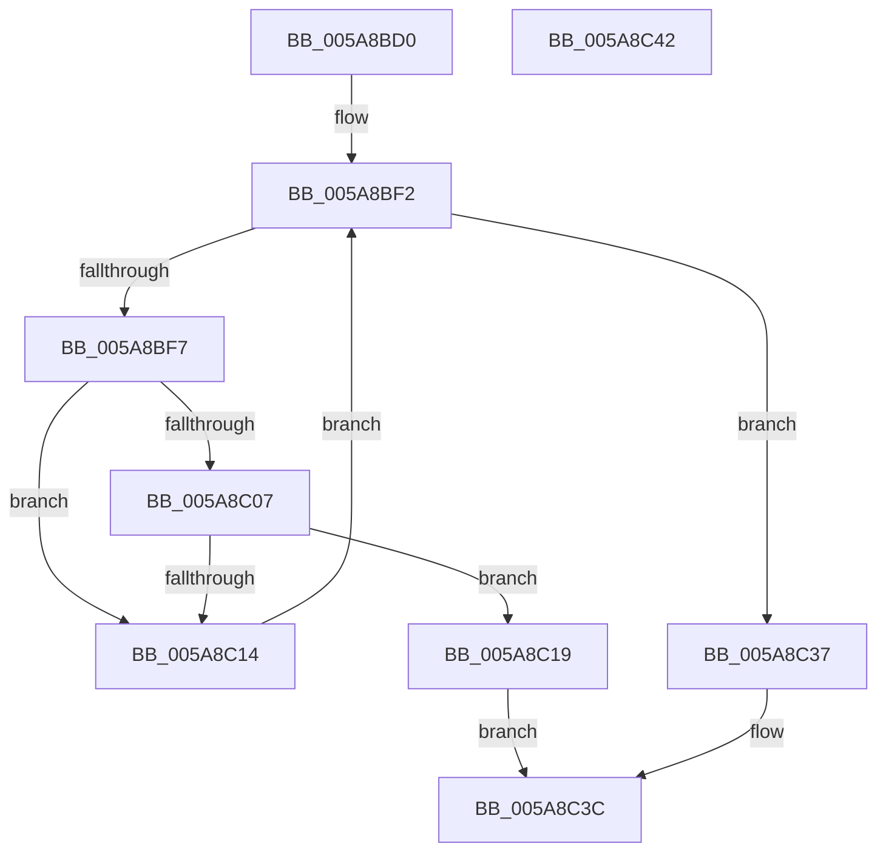

# PnprGetPageDestination

- RVA: `0x005A8BD0`–`0x005A8C43` (길이 `115` bytes)
- VA: `0x00000001405A8BD0`
- 실행 섹션: `.text`
- PDB 이름 있음: `예`; PDB Function 태그: `아니요`
- unwind 정보 RVA: `0x0005CF00`
- 디코드: `33`개 명령, `115/115` bytes 표시
- 미해석 바이트: `0` (있으면 어셈블리에 `.byte`로 보존)

> 이 문서는 커널 이미지의 기계어와 PDB 기호를 분석해 생성했습니다. 4번과 5번은 함수 원형과 자료형을 바이너리 사용 방식에서 추정한 C 해석이며 원본 소스 복구 결과는 아닙니다.

## 1. Dependencies

- 직접 호출 지점: **1**; 고유 호출 대상: **1**
- 직접 호출자로 확인된 함수: **1**
- RIP 상대 이미지 참조: **1**

### Outgoing calls
- `0x005A8C30` → [guard_dispatch_icall](../6B/guard_dispatch_icall_function_006BAAD0.md) (function, `0x006BAAD0`)

### Direct callers
- [PnprCopyReservedMapping](PnprCopyReservedMapping_function_005A8864.md) at `0x005A8912`
- [PnprCopyReservedMapping](PnprCopyReservedMapping_function_005A8864.md) at `0x005A897A`
- [PnprCopyReservedMapping](PnprCopyReservedMapping_function_005A8864.md) at `0x005A89F2`
- [PnprCopyReservedMapping](PnprCopyReservedMapping_function_005A8864.md) at `0x005A8A69`

### Static image references
- `0x005A8BD6` → RVA `0x00F8AC38` (`.data`; read)

## 2. Other-region calls and transfers

- 다른 실행 섹션으로 향하는 call: **0**
- 별도 외부 분기/꼬리 이동을 확인하지 못했습니다.

## 3. Assembly (complete function range)

```asm
005A8BD0  40 53                           push rbx
005A8BD2  48 83 EC 20                     sub rsp, 0x20
005A8BD6  48 8B 05 5B 20 9E 00            mov rax, qword ptr [rip + 0x9e205b]
005A8BDD  4C 8B DA                        mov r11, rdx
005A8BE0  45 33 C0                        xor r8d, r8d
005A8BE3  4C 8B 48 18                     mov r9, qword ptr [rax + 0x18]
005A8BE7  48 8B 98 F8 81 00 00            mov rbx, qword ptr [rax + 0x81f8]
005A8BEE  45 8B 51 04                     mov r10d, dword ptr [r9 + 4]
005A8BF2  45 3B C2                        cmp r8d, r10d
005A8BF5  73 40                           jae 0x1405a8c37
005A8BF7  41 8B C0                        mov eax, r8d
005A8BFA  48 03 C0                        add rax, rax
005A8BFD  49 8B 54 C1 10                  mov rdx, qword ptr [r9 + rax*8 + 0x10]
005A8C02  48 3B CA                        cmp rcx, rdx
005A8C05  72 0D                           jb 0x1405a8c14
005A8C07  48 FF CA                        dec rdx
005A8C0A  49 03 54 C1 18                  add rdx, qword ptr [r9 + rax*8 + 0x18]
005A8C0F  48 3B CA                        cmp rcx, rdx
005A8C12  76 05                           jbe 0x1405a8c19
005A8C14  41 FF C0                        inc r8d
005A8C17  EB D9                           jmp 0x1405a8bf2
005A8C19  48 8B D1                        mov rdx, rcx
005A8C1C  4D 8B C3                        mov r8, r11
005A8C1F  48 8B 0D 12 20 9E 00            mov rcx, qword ptr [rip + 0x9e2012]
005A8C26  48 8B C3                        mov rax, rbx
005A8C29  48 8B 89 A0 81 00 00            mov rcx, qword ptr [rcx + 0x81a0]
005A8C30  E8 9B 1E 11 00                  call 0x1406baad0
005A8C35  EB 05                           jmp 0x1405a8c3c
005A8C37  B8 25 02 00 C0                  mov eax, 0xc0000225
005A8C3C  48 83 C4 20                     add rsp, 0x20
005A8C40  5B                              pop rbx
005A8C41  C3                              ret
005A8C42  CC                              int3
```

## 4. C-style interpretation (structured pseudocode)

```c
__int64 __fastcall PnprGetPageDestination(__int64 a1, __int64 a2, int a3)
{
    __int64 result;
    __int64 v_rsp;

    v_rsp = (v_rsp) - (32);
    a3 = 0;
loc_005A8BF2:
    if (0 >= ((unsigned int)((unsigned int)(*(unsigned int *)(*(unsigned __int64 *)(*(unsigned __int64 *)(v_rip + 10362971) + 24) + 4))))) goto loc_005A8C37;
    result = (0) + (0);
    if (a1 < (*(unsigned __int64 *)(*(unsigned __int64 *)(*(unsigned __int64 *)(v_rip + 10362971) + 24) + result * 8 + 16))) goto loc_005A8C14;
    a2 = (*(unsigned __int64 *)(*(unsigned __int64 *)(*(unsigned __int64 *)(v_rip + 10362971) + 24) + result * 8 + 16)) - 1;
    a2 = (a2) + (*(unsigned __int64 *)(*(unsigned __int64 *)(*(unsigned __int64 *)(v_rip + 10362971) + 24) + result * 8 + 24));
    if (a1 <= a2) goto loc_005A8C19;
loc_005A8C14:
    a3 = (unsigned int)((a3) + 1);
    goto loc_005A8BF2;
loc_005A8C19:
    result = guard_dispatch_icall(*(unsigned __int64 *)(*(unsigned __int64 *)(v_rip + 10362898) + 33184), a1, a2, *(unsigned __int64 *)(*(unsigned __int64 *)(v_rip + 10362971) + 24));
    goto loc_005A8C3C;
loc_005A8C37:
loc_005A8C3C:
    v_rsp = (v_rsp) + (32);
    return (unsigned int)(0xC0000225ULL);
}
```

## 5. (Beta) C Style

```c
int64_t PnprGetPageDestination(int64_t Arg1, int64_t Arg2, int32_t Arg3)
{
    int64_t result;
    int64_t local_rsp;

    local_rsp = (local_rsp) - (32);
    Arg3 = 0;
loc_005A8BF2:
    if (0 >= ((uint32_t)((uint32_t)(*(uint32_t *)(*(uint64_t *)(*(uint64_t *)(v_rip + 0x9E205B) + 0x18) + 0x4))))) goto loc_005A8C37;
    result = (0) + (0);
    if (Arg1 < (*(uint64_t *)(*(uint64_t *)(*(uint64_t *)(v_rip + 0x9E205B) + 0x18) + result * 8 + 0x10))) goto loc_005A8C14;
    Arg2 = (*(uint64_t *)(*(uint64_t *)(*(uint64_t *)(v_rip + 0x9E205B) + 0x18) + result * 8 + 0x10)) - 1;
    Arg2 = (Arg2) + (*(uint64_t *)(*(uint64_t *)(*(uint64_t *)(v_rip + 0x9E205B) + 0x18) + result * 8 + 0x18));
    if (Arg1 <= Arg2) goto loc_005A8C19;
loc_005A8C14:
    Arg3 = (uint32_t)((Arg3) + 1);
    goto loc_005A8BF2;
loc_005A8C19:
    result = guard_dispatch_icall(*(uint64_t *)(*(uint64_t *)(v_rip + 0x9E2012) + 0x81A0), Arg1, Arg2, *(uint64_t *)(*(uint64_t *)(v_rip + 0x9E205B) + 0x18));
    goto loc_005A8C3C;
loc_005A8C37:
loc_005A8C3C:
    local_rsp = (local_rsp) + (32);
    return (uint32_t)(0xC0000225ULL);
}
```

## 6. Execution-region graph

[열기: 2D/3D 그래프와 함수 탐색 컨트롤 패널](../../../control-panel.html?section=text&rva=0x005A8BD0&view=graph)

- 2D 그래프는 위에서 아래로 흐르고, 3D 그래프는 빈 공간을 드래그해 회전합니다. Shift+드래그는 이동, 휠은 확대·축소, 함수 노드 선택은 대상 보고서 이동입니다.

### Static fallback


