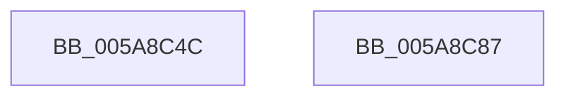

# PnprGetStackLimits

- RVA: `0x005A8C4C`–`0x005A8C88` (길이 `60` bytes)
- VA: `0x00000001405A8C4C`
- 실행 섹션: `.text`
- PDB 이름 있음: `예`; PDB Function 태그: `아니요`
- unwind 정보 RVA: `0x00068D5C`
- 디코드: `17`개 명령, `60/60` bytes 표시
- 미해석 바이트: `0` (있으면 어셈블리에 `.byte`로 보존)

> 이 문서는 커널 이미지의 기계어와 PDB 기호를 분석해 생성했습니다. 4번과 5번은 함수 원형과 자료형을 바이너리 사용 방식에서 추정한 C 해석이며 원본 소스 복구 결과는 아닙니다.

## 1. Dependencies

- 직접 호출 지점: **2**; 고유 호출 대상: **2**
- 직접 호출자로 확인된 함수: **2**
- RIP 상대 이미지 참조: **0**

### Outgoing calls
- `0x005A8C62` → [KeGetCurrentStackPointer](../6B/KeGetCurrentStackPointer_function_006B1070.md) (function, `0x006B1070`)
- `0x005A8C77` → [KeQueryCurrentStackInformation](../2F/KeQueryCurrentStackInformation_function_002F7C80.md) (function, `0x002F7C80`)

### Direct callers
- [PnprRecopyMirrorPages](PnprRecopyMirrorPages_function_005A8F9C.md) at `0x005A8FD1`
- [PnprQuiesceProcessorDpc](../../pagelk/B6/PnprQuiesceProcessorDpc_function_00B64B50.md) at `0x00B64E90`

### Static image references
- 디코드된 RIP-relative 메모리 참조가 없습니다.

## 2. Other-region calls and transfers

- 다른 실행 섹션으로 향하는 call: **0**
- 별도 외부 분기/꼬리 이동을 확인하지 못했습니다.

## 3. Assembly (complete function range)

```asm
005A8C4C  48 89 5C 24 10                  mov qword ptr [rsp + 0x10], rbx
005A8C51  57                              push rdi
005A8C52  48 83 EC 20                     sub rsp, 0x20
005A8C56  48 83 64 24 40 00               and qword ptr [rsp + 0x40], 0
005A8C5C  48 8B FA                        mov rdi, rdx
005A8C5F  48 8B D9                        mov rbx, rcx
005A8C62  E8 09 84 10 00                  call 0x1406b1070
005A8C67  4C 8B C7                        mov r8, rdi
005A8C6A  48 89 03                        mov qword ptr [rbx], rax
005A8C6D  48 8D 54 24 40                  lea rdx, [rsp + 0x40]
005A8C72  48 8D 4C 24 30                  lea rcx, [rsp + 0x30]
005A8C77  E8 04 F0 D4 FF                  call 0x1402f7c80
005A8C7C  48 8B 5C 24 38                  mov rbx, qword ptr [rsp + 0x38]
005A8C81  48 83 C4 20                     add rsp, 0x20
005A8C85  5F                              pop rdi
005A8C86  C3                              ret
005A8C87  CC                              int3
```

## 4. C-style interpretation (structured pseudocode)

```c
__int64 __fastcall PnprGetStackLimits(__int64 a1, __int64 a2)
{
    __int64 result;
    __int64 v_rsp;
    unsigned __int64 v_stack_p10;
    unsigned __int64 v_stack_p18;
    unsigned __int64 v_stack_p8;

    v_stack_p10 = v_rbx;
    v_rsp = (v_rsp) - (32);
    result = KeGetCurrentStackPointer(a1, a2, a3, a4);
    *(unsigned __int64 *)(a1) = result;
    result = KeQueryCurrentStackInformation(v_stack_p8, v_stack_p18, a2, a4);
    v_rsp = (v_rsp) + (32);
    return result;
}
```

## 5. (Beta) C Style

```c
int64_t PnprGetStackLimits(void *Arg1, int64_t Arg2)
{
    uint8_t *arg1 = (uint8_t *)Arg1;

    int64_t result;
    int64_t local_rsp;
    uint64_t v_stack_p10;
    uint64_t v_stack_p18;
    uint64_t v_stack_p8;

    v_stack_p10 = local_rbx;
    local_rsp = (local_rsp) - (32);
    result = KeGetCurrentStackPointer(Arg1, Arg2, a3, a4);
    *(uint64_t *)(arg1) = result;
    result = KeQueryCurrentStackInformation(v_stack_p8, v_stack_p18, Arg2, a4);
    local_rsp = (local_rsp) + (32);
    return result;
}
```

### 관측된 메모리 오프셋

구조체 형식이 확인되지 않은 접근은 인자 기준의 오프셋으로만 기록했습니다.

| 기준 인자 | 오프셋 표현 | 폭 (bit) | 접근 |
|---|---:|---:|---|
| `Arg1` | `+ 0x0` | `64` | `W` |

## 6. Execution-region graph

[열기: 2D/3D 그래프와 함수 탐색 컨트롤 패널](../../../control-panel.html?section=text&rva=0x005A8C4C&view=graph)

- 2D 그래프는 위에서 아래로 흐르고, 3D 그래프는 빈 공간을 드래그해 회전합니다. Shift+드래그는 이동, 휠은 확대·축소, 함수 노드 선택은 대상 보고서 이동입니다.

### Static fallback


