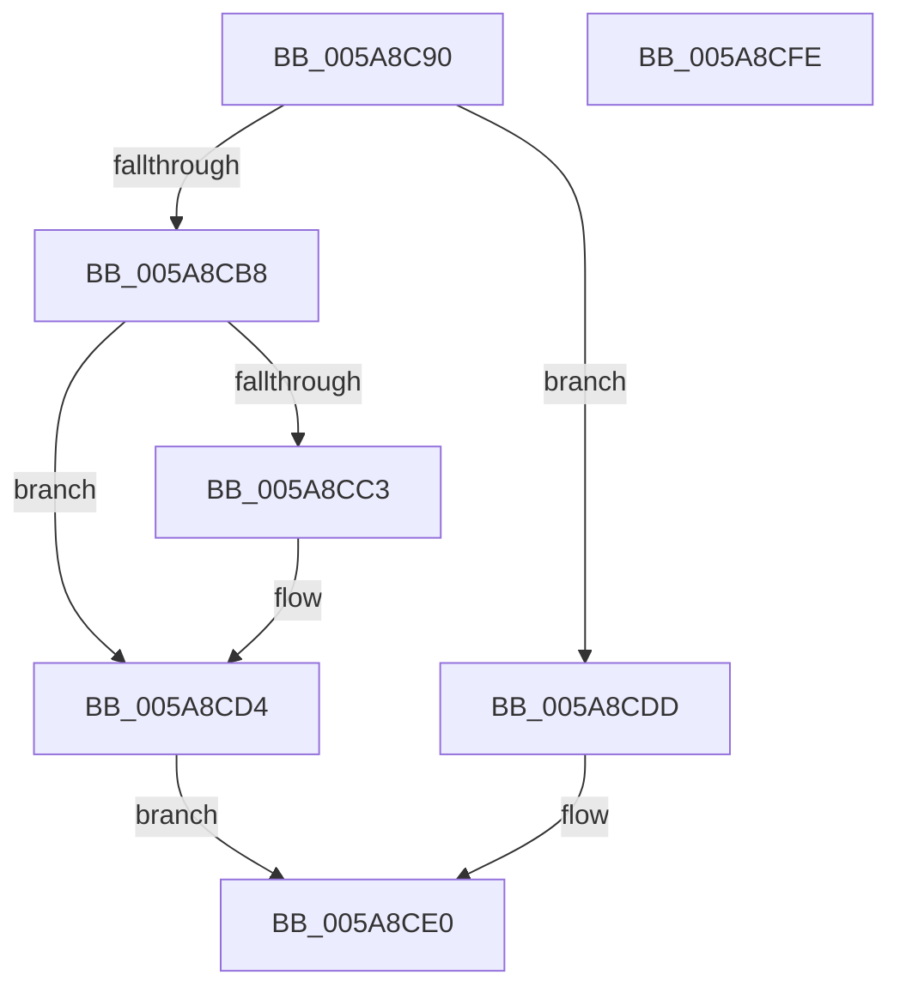

# PnprMirrorPhysicalMemory

- RVA: `0x005A8C90`–`0x005A8CFF` (길이 `111` bytes)
- VA: `0x00000001405A8C90`
- 실행 섹션: `.text`
- PDB 이름 있음: `예`; PDB Function 태그: `아니요`
- unwind 정보 RVA: `0x00060BC4`
- 디코드: `29`개 명령, `111/111` bytes 표시
- 미해석 바이트: `0` (있으면 어셈블리에 `.byte`로 보존)

> 이 문서는 커널 이미지의 기계어와 PDB 기호를 분석해 생성했습니다. 4번과 5번은 함수 원형과 자료형을 바이너리 사용 방식에서 추정한 C 해석이며 원본 소스 복구 결과는 아닙니다.

## 1. Dependencies

- 직접 호출 지점: **2**; 고유 호출 대상: **2**
- 직접 호출자로 확인된 함수: **0**
- RIP 상대 이미지 참조: **1**

### Outgoing calls
- `0x005A8CD6` → [PnprGetMillisecondCounter](../../pagelk/B6/PnprGetMillisecondCounter_function_00B63FD4.md) (function, `0x00B63FD4`)
- `0x005A8CE9` → [PnprMarkOrMirrorPages](../../pagelk/B6/PnprMarkOrMirrorPages_function_00B646A8.md) (function, `0x00B646A8`)

### Direct callers
- 이 함수 시작 RVA로 연결되는 직접 call은 확인되지 않았습니다. 간접 호출은 완전히 역산할 수 없습니다.

### Static image references
- `0x005A8C9F` → RVA `0x00F8AC38` (`.data`; read)

## 2. Other-region calls and transfers

- 다른 실행 섹션으로 향하는 call: **2**
  - `0x005A8CD6` → [PnprGetMillisecondCounter](../../pagelk/B6/PnprGetMillisecondCounter_function_00B63FD4.md) (`.text` → `PAGELK`)
  - `0x005A8CE9` → [PnprMarkOrMirrorPages](../../pagelk/B6/PnprMarkOrMirrorPages_function_00B646A8.md) (`.text` → `PAGELK`)
- 별도 외부 분기/꼬리 이동을 확인하지 못했습니다.

## 3. Assembly (complete function range)

```asm
005A8C90  48 89 5C 24 08                  mov qword ptr [rsp + 8], rbx
005A8C95  48 89 74 24 10                  mov qword ptr [rsp + 0x10], rsi
005A8C9A  57                              push rdi
005A8C9B  48 83 EC 20                     sub rsp, 0x20
005A8C9F  48 8B 05 92 1F 9E 00            mov rax, qword ptr [rip + 0x9e1f92]
005A8CA6  40 32 F6                        xor sil, sil
005A8CA9  48 8B DA                        mov rbx, rdx
005A8CAC  48 8B F9                        mov rdi, rcx
005A8CAF  40 38 B0 D0 00 00 00            cmp byte ptr [rax + 0xd0], sil
005A8CB6  76 25                           jbe 0x1405a8cdd
005A8CB8  8B 80 C8 00 00 00               mov eax, dword ptr [rax + 0xc8]
005A8CBE  83 F8 02                        cmp eax, 2
005A8CC1  7D 11                           jge 0x1405a8cd4
005A8CC3  48 8B 05 6E 1F 9E 00            mov rax, qword ptr [rip + 0x9e1f6e]
005A8CCA  C7 80 C8 00 00 00 02 00 00 00   mov dword ptr [rax + 0xc8], 2
005A8CD4  33 C9                           xor ecx, ecx
005A8CD6  E8 F9 B2 5B 00                  call 0x140b63fd4
005A8CDB  EB 03                           jmp 0x1405a8ce0
005A8CDD  40 B6 01                        mov sil, 1
005A8CE0  44 8A C6                        mov r8b, sil
005A8CE3  48 8B D3                        mov rdx, rbx
005A8CE6  48 8B CF                        mov rcx, rdi
005A8CE9  E8 BA B9 5B 00                  call 0x140b646a8
005A8CEE  48 8B 5C 24 30                  mov rbx, qword ptr [rsp + 0x30]
005A8CF3  48 8B 74 24 38                  mov rsi, qword ptr [rsp + 0x38]
005A8CF8  48 83 C4 20                     add rsp, 0x20
005A8CFC  5F                              pop rdi
005A8CFD  C3                              ret
005A8CFE  CC                              int3
```

## 4. C-style interpretation (structured pseudocode)

```c
__int64 __fastcall PnprMirrorPhysicalMemory(__int64 a1, __int64 a2)
{
    __int64 result;
    __int64 v_rsi;
    __int64 v_rsp;
    unsigned __int64 v_stack_p10;
    unsigned __int64 v_stack_p8;

    v_stack_p8 = v_rbx;
    v_stack_p10 = v_rsi;
    v_rsp = (v_rsp) - (32);
    v_rsi = 0;
    if ((*(unsigned __int8 *)(*(unsigned __int64 *)(v_rip + 10362770) + 208)) <= 0) goto loc_005A8CDD;
    result = (unsigned int)(*(unsigned int *)(*(unsigned __int64 *)(v_rip + 10362770) + 200));
    if (((unsigned int)((unsigned int)(*(unsigned int *)(*(unsigned __int64 *)(v_rip + 10362770) + 200)))) < 2) {
        result = *(unsigned __int64 *)(v_rip + 10362734);
        *(unsigned int *)(result + 200) = 2;
    }
    a1 = 0;
    result = PnprGetMillisecondCounter(a1, a2, a3, a4);
    goto loc_005A8CE0;
loc_005A8CDD:
loc_005A8CE0:
    result = PnprMarkOrMirrorPages(0, a2, 1, a4);
    v_rsp = (v_rsp) + (32);
    return result;
}
```

## 5. (Beta) C Style

```c
int64_t PnprMirrorPhysicalMemory(int64_t Arg1, int64_t Arg2)
{
    int64_t result;
    int64_t local_rsi;
    int64_t local_rsp;
    uint64_t v_stack_p10;
    uint64_t v_stack_p8;

    v_stack_p8 = local_rbx;
    v_stack_p10 = local_rsi;
    local_rsp = (local_rsp) - (32);
    local_rsi = 0;
    if ((*(uint8_t *)(*(uint64_t *)(v_rip + 0x9E1F92) + 0xD0)) <= 0) goto loc_005A8CDD;
    result = (uint32_t)(*(uint32_t *)(*(uint64_t *)(v_rip + 0x9E1F92) + 0xC8));
    if (((uint32_t)((uint32_t)(*(uint32_t *)(*(uint64_t *)(v_rip + 0x9E1F92) + 0xC8)))) < 2) {
        result = *(uint64_t *)(v_rip + 0x9E1F6E);
        *(uint32_t *)(result + 0xC8) = 2;
    }
    Arg1 = 0;
    result = PnprGetMillisecondCounter(Arg1, Arg2, a3, a4);
    goto loc_005A8CE0;
loc_005A8CDD:
loc_005A8CE0:
    result = PnprMarkOrMirrorPages(0, Arg2, 1, a4);
    local_rsp = (local_rsp) + (32);
    return result;
}
```

## 6. Execution-region graph

[열기: 2D/3D 그래프와 함수 탐색 컨트롤 패널](../../../control-panel.html?section=text&rva=0x005A8C90&view=graph)

- 2D 그래프는 위에서 아래로 흐르고, 3D 그래프는 빈 공간을 드래그해 회전합니다. Shift+드래그는 이동, 휠은 확대·축소, 함수 노드 선택은 대상 보고서 이동입니다.

### Static fallback


