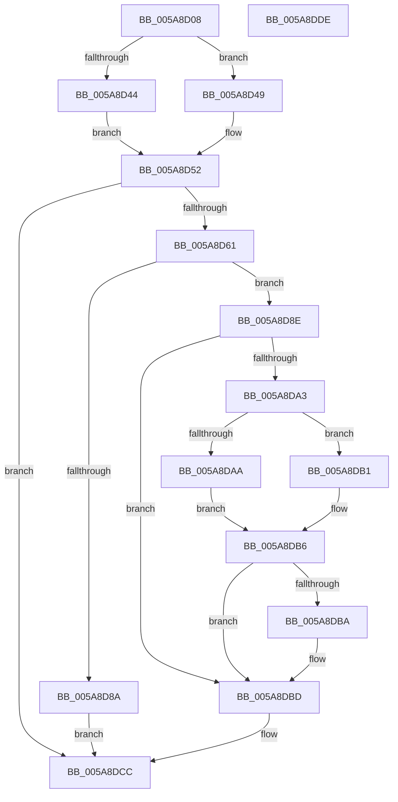

# PnprQueryReplaceFeatures

- RVA: `0x005A8D08`–`0x005A8DDF` (길이 `215` bytes)
- VA: `0x00000001405A8D08`
- 실행 섹션: `.text`
- PDB 이름 있음: `예`; PDB Function 태그: `아니요`
- unwind 정보 RVA: `0x000C62DC`
- 디코드: `68`개 명령, `215/215` bytes 표시
- 미해석 바이트: `0` (있으면 어셈블리에 `.byte`로 보존)

> 이 문서는 커널 이미지의 기계어와 PDB 기호를 분석해 생성했습니다. 4번과 5번은 함수 원형과 자료형을 바이너리 사용 방식에서 추정한 C 해석이며 원본 소스 복구 결과는 아닙니다.

## 1. Dependencies

- 직접 호출 지점: **3**; 고유 호출 대상: **2**
- 직접 호출자로 확인된 함수: **1**
- RIP 상대 이미지 참조: **1**

### Outgoing calls
- `0x005A8D81` → [PnpQueryInterface](../../page/A2/PnpQueryInterface_function_00A28D38.md) (function, `0x00A28D38`)
- `0x005A8D9A` → [guard_dispatch_icall](../6B/guard_dispatch_icall_function_006BAAD0.md) (function, `0x006BAAD0`)
- `0x005A8DC5` → [guard_dispatch_icall](../6B/guard_dispatch_icall_function_006BAAD0.md) (function, `0x006BAAD0`)

### Direct callers
- [PnpReplacePartitionUnit](../../page/73/PnpReplacePartitionUnit_function_00738550.md) at `0x00738BD5`

### Static image references
- `0x005A8D75` → RVA `0x000240E8` (`.rdata`; read)

## 2. Other-region calls and transfers

- 다른 실행 섹션으로 향하는 call: **1**
  - `0x005A8D81` → [PnpQueryInterface](../../page/A2/PnpQueryInterface_function_00A28D38.md) (`.text` → `PAGE`)
- 별도 외부 분기/꼬리 이동을 확인하지 못했습니다.

## 3. Assembly (complete function range)

```asm
005A8D08  48 89 5C 24 10                  mov qword ptr [rsp + 0x10], rbx
005A8D0D  48 89 7C 24 18                  mov qword ptr [rsp + 0x18], rdi
005A8D12  55                              push rbp
005A8D13  48 8B EC                        mov rbp, rsp
005A8D16  48 83 EC 70                     sub rsp, 0x70
005A8D1A  44 8B 41 08                     mov r8d, dword ptr [rcx + 8]
005A8D1E  33 DB                           xor ebx, ebx
005A8D20  0F 57 C0                        xorps xmm0, xmm0
005A8D23  89 5D 10                        mov dword ptr [rbp + 0x10], ebx
005A8D26  33 C0                           xor eax, eax
005A8D28  4C 8B D2                        mov r10, rdx
005A8D2B  48 89 45 F0                     mov qword ptr [rbp - 0x10], rax
005A8D2F  8D 7B 10                        lea edi, [rbx + 0x10]
005A8D32  0F 11 45 C0                     movups xmmword ptr [rbp - 0x40], xmm0
005A8D36  0F 11 45 D0                     movups xmmword ptr [rbp - 0x30], xmm0
005A8D3A  0F 11 45 E0                     movups xmmword ptr [rbp - 0x20], xmm0
005A8D3E  41 F6 C0 04                     test r8b, 4
005A8D42  74 05                           je 0x1405a8d49
005A8D44  8D 4B 08                        lea ecx, [rbx + 8]
005A8D47  EB 09                           jmp 0x1405a8d52
005A8D49  41 F6 C0 08                     test r8b, 8
005A8D4D  8B CB                           mov ecx, ebx
005A8D4F  0F 45 CF                        cmovne ecx, edi
005A8D52  8B C1                           mov eax, ecx
005A8D54  83 C8 20                        or eax, 0x20
005A8D57  44 84 C7                        test dil, r8b
005A8D5A  0F 44 C1                        cmove eax, ecx
005A8D5D  85 C0                           test eax, eax
005A8D5F  75 6B                           jne 0x1405a8dcc
005A8D61  49 8B 0A                        mov rcx, qword ptr [r10]
005A8D64  44 8D 48 38                     lea r9d, [rax + 0x38]
005A8D68  44 8D 40 01                     lea r8d, [rax + 1]
005A8D6C  48 8D 45 C0                     lea rax, [rbp - 0x40]
005A8D70  48 89 44 24 28                  mov qword ptr [rsp + 0x28], rax
005A8D75  48 8D 15 6C B3 A7 FF            lea rdx, [rip - 0x584c94]
005A8D7C  48 89 5C 24 20                  mov qword ptr [rsp + 0x20], rbx
005A8D81  E8 B2 FF 47 00                  call 0x140a28d38
005A8D86  85 C0                           test eax, eax
005A8D88  79 04                           jns 0x1405a8d8e
005A8D8A  33 C0                           xor eax, eax
005A8D8C  EB 3E                           jmp 0x1405a8dcc
005A8D8E  48 8B 4D C8                     mov rcx, qword ptr [rbp - 0x38]
005A8D92  48 8D 55 10                     lea rdx, [rbp + 0x10]
005A8D96  48 8B 45 E8                     mov rax, qword ptr [rbp - 0x18]
005A8D9A  E8 31 1D 11 00                  call 0x1406baad0
005A8D9F  85 C0                           test eax, eax
005A8DA1  78 1A                           js 0x1405a8dbd
005A8DA3  8B 45 10                        mov eax, dword ptr [rbp + 0x10]
005A8DA6  A8 01                           test al, 1
005A8DA8  74 07                           je 0x1405a8db1
005A8DAA  BB 08 00 00 00                  mov ebx, 8
005A8DAF  EB 05                           jmp 0x1405a8db6
005A8DB1  A8 02                           test al, 2
005A8DB3  0F 45 DF                        cmovne ebx, edi
005A8DB6  A8 04                           test al, 4
005A8DB8  74 03                           je 0x1405a8dbd
005A8DBA  83 CB 20                        or ebx, 0x20
005A8DBD  48 8B 4D C8                     mov rcx, qword ptr [rbp - 0x38]
005A8DC1  48 8B 45 D8                     mov rax, qword ptr [rbp - 0x28]
005A8DC5  E8 06 1D 11 00                  call 0x1406baad0
005A8DCA  8B C3                           mov eax, ebx
005A8DCC  4C 8D 5C 24 70                  lea r11, [rsp + 0x70]
005A8DD1  49 8B 5B 18                     mov rbx, qword ptr [r11 + 0x18]
005A8DD5  49 8B 7B 20                     mov rdi, qword ptr [r11 + 0x20]
005A8DD9  49 8B E3                        mov rsp, r11
005A8DDC  5D                              pop rbp
005A8DDD  C3                              ret
005A8DDE  CC                              int3
```

## 4. C-style interpretation (structured pseudocode)

```c
__int64 __fastcall PnprQueryReplaceFeatures(__int64 a1, __int64 a2)
{
    __int64 result;
    __int64 v_rbx;
    __int64 v_rsp;
    unsigned __int64 v_stack_m18;
    unsigned __int64 v_stack_m20;
    unsigned __int64 v_stack_m28;
    unsigned __int64 v_stack_m30;
    unsigned __int64 v_stack_m38;
    unsigned __int64 v_stack_m40;
    unsigned __int64 v_stack_m48;
    unsigned __int64 v_stack_m50;
    unsigned __int64 v_stack_m58;
    unsigned __int64 v_stack_m8;
    unsigned __int64 v_stack_p10;
    unsigned __int64 v_stack_p18;
    unsigned int v_stack_p8;

    v_stack_p10 = v_rbx;
    v_stack_p18 = v_rdi;
    v_rsp = (v_rsp) - (112);
    v_rbx = 0;
    v_stack_p8 = 0;
    result = 0;
    v_stack_m18 = 0;
    v_stack_m48 = v_xmm0;
    v_stack_m38 = v_xmm0;
    v_stack_m28 = v_xmm0;
    if ((((unsigned __int8)((unsigned int)(*(unsigned int *)(a1 + 8)))) & (4)) == 0) goto loc_005A8D49;
    goto loc_005A8D52;
loc_005A8D49:
    a1 = 0;
    if ((((unsigned __int8)((unsigned int)(*(unsigned int *)(a1 + 8)))) & (8)) != 0) { a1 = (unsigned int)(v_rbx + 16); }
loc_005A8D52:
    result = (unsigned int)(((unsigned int)((unsigned int)(a1))) | (32));
    if ((((unsigned __int8)(v_rbx + 16)) & ((unsigned __int8)((unsigned int)(*(unsigned int *)(a1 + 8))))) == 0) { result = (unsigned int)(a1); }
    if ((unsigned int)(result) != 0) goto loc_005A8DCC;
    v_stack_m50 = v_stack_m48;
    v_stack_m58 = 0;
    result = PnpQueryInterface(*(unsigned __int64 *)(a2), v_rip - 5786772, result + 1, result + 56);
    if (!sign_flag) goto loc_005A8D8E;
    result = 0;
    goto loc_005A8DCC;
loc_005A8D8E:
    result = guard_dispatch_icall(v_stack_m40, v_stack_p8, result + 1, result + 56);
    if (sign_flag) goto loc_005A8DBD;
    if ((((unsigned __int8)((unsigned int)(v_stack_p8))) & (1)) == 0) goto loc_005A8DB1;
    goto loc_005A8DB6;
loc_005A8DB1:
    v_rbx = 8;
    if ((((unsigned __int8)((unsigned int)(v_stack_p8))) & (2)) != 0) { v_rbx = (unsigned int)(v_rbx + 16); }
loc_005A8DB6:
    if ((((unsigned __int8)((unsigned int)(v_stack_p8))) & (4)) != 0) {
        v_rbx = (unsigned int)((v_rbx) | (32));
    }
    result = guard_dispatch_icall(v_stack_m40, v_stack_p8, result + 1, result + 56);
loc_005A8DCC:
    return (unsigned int)((unsigned int)(v_rbx));
}
```

## 5. (Beta) C Style

```c
int64_t PnprQueryReplaceFeatures(void *Arg1, void *Arg2)
{
    uint8_t *arg1 = (uint8_t *)Arg1;
    uint8_t *arg2 = (uint8_t *)Arg2;

    int64_t result;
    int64_t local_rbx;
    int64_t local_rsp;
    uint64_t v_stack_m18;
    uint64_t v_stack_m20;
    uint64_t v_stack_m28;
    uint64_t v_stack_m30;
    uint64_t v_stack_m38;
    uint64_t v_stack_m40;
    uint64_t v_stack_m48;
    uint64_t v_stack_m50;
    uint64_t v_stack_m58;
    uint64_t v_stack_m8;
    uint64_t v_stack_p10;
    uint64_t v_stack_p18;
    uint32_t v_stack_p8;

    v_stack_p10 = local_rbx;
    v_stack_p18 = local_rdi;
    local_rsp = (local_rsp) - (112);
    local_rbx = 0;
    v_stack_p8 = 0;
    result = 0;
    v_stack_m18 = 0;
    v_stack_m48 = v_xmm0;
    v_stack_m38 = v_xmm0;
    v_stack_m28 = v_xmm0;
    if ((((uint8_t)((uint32_t)(*(uint32_t *)(arg1 + 0x8)))) & (4)) == 0) goto loc_005A8D49;
    goto loc_005A8D52;
loc_005A8D49:
    Arg1 = 0;
    if ((((uint8_t)((uint32_t)(*(uint32_t *)(arg1 + 0x8)))) & (8)) != 0) { Arg1 = (uint32_t)(local_rbx + 16); }
loc_005A8D52:
    result = (uint32_t)(((uint32_t)((uint32_t)(Arg1))) | (32));
    if ((((uint8_t)(local_rbx + 16)) & ((uint8_t)((uint32_t)(*(uint32_t *)(arg1 + 0x8))))) == 0) { result = (uint32_t)(Arg1); }
    if ((uint32_t)(result) != 0) goto loc_005A8DCC;
    v_stack_m50 = v_stack_m48;
    v_stack_m58 = 0;
    result = PnpQueryInterface(*(uint64_t *)(arg2), v_rip - 5786772, result + 1, result + 56);
    if (!sign_flag) goto loc_005A8D8E;
    result = 0;
    goto loc_005A8DCC;
loc_005A8D8E:
    result = guard_dispatch_icall(v_stack_m40, v_stack_p8, result + 1, result + 56);
    if (sign_flag) goto loc_005A8DBD;
    if ((((uint8_t)((uint32_t)(v_stack_p8))) & (1)) == 0) goto loc_005A8DB1;
    goto loc_005A8DB6;
loc_005A8DB1:
    local_rbx = 8;
    if ((((uint8_t)((uint32_t)(v_stack_p8))) & (2)) != 0) { local_rbx = (uint32_t)(local_rbx + 16); }
loc_005A8DB6:
    if ((((uint8_t)((uint32_t)(v_stack_p8))) & (4)) != 0) {
        local_rbx = (uint32_t)((local_rbx) | (32));
    }
    result = guard_dispatch_icall(v_stack_m40, v_stack_p8, result + 1, result + 56);
loc_005A8DCC:
    return (uint32_t)((uint32_t)(local_rbx));
}
```

### 관측된 메모리 오프셋

구조체 형식이 확인되지 않은 접근은 인자 기준의 오프셋으로만 기록했습니다.

| 기준 인자 | 오프셋 표현 | 폭 (bit) | 접근 |
|---|---:|---:|---|
| `Arg1` | `+ 0x8` | `32` | `R` |
| `Arg2` | `+ 0x0` | `64` | `R` |

## 6. Execution-region graph

[열기: 2D/3D 그래프와 함수 탐색 컨트롤 패널](../../../control-panel.html?section=text&rva=0x005A8D08&view=graph)

- 2D 그래프는 위에서 아래로 흐르고, 3D 그래프는 빈 공간을 드래그해 회전합니다. Shift+드래그는 이동, 휠은 확대·축소, 함수 노드 선택은 대상 보고서 이동입니다.

### Static fallback


