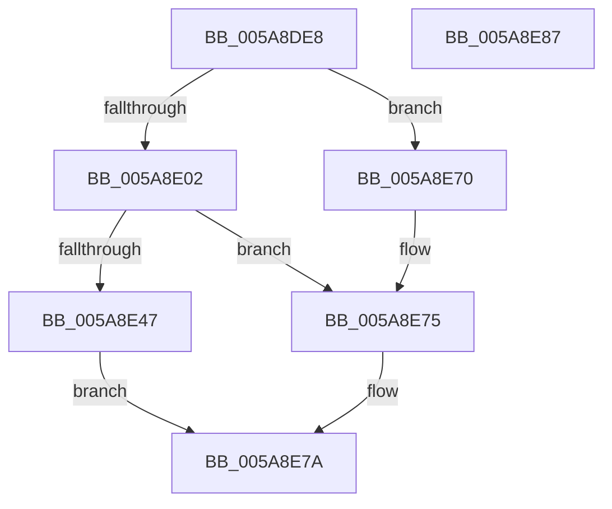

# PnprQuiesce

- RVA: `0x005A8DE8`–`0x005A8E88` (길이 `160` bytes)
- VA: `0x00000001405A8DE8`
- 실행 섹션: `.text`
- PDB 이름 있음: `예`; PDB Function 태그: `아니요`
- unwind 정보 RVA: `0x0006E5F8`
- 디코드: `42`개 명령, `160/160` bytes 표시
- 미해석 바이트: `0` (있으면 어셈블리에 `.byte`로 보존)

> 이 문서는 커널 이미지의 기계어와 PDB 기호를 분석해 생성했습니다. 4번과 5번은 함수 원형과 자료형을 바이너리 사용 방식에서 추정한 C 해석이며 원본 소스 복구 결과는 아닙니다.

## 1. Dependencies

- 직접 호출 지점: **4**; 고유 호출 대상: **4**
- 직접 호출자로 확인된 함수: **2**
- RIP 상대 이미지 참조: **1**

### Outgoing calls
- `0x005A8E11` → [KeSetEvent](../33/KeSetEvent_function_0033F310.md) (function, `0x0033F310`)
- `0x005A8E31` → [KeWaitForSingleObject](../20/KeWaitForSingleObject_function_0020E6B0.md) (function, `0x0020E6B0`)
- `0x005A8E70` → [PnprLockPagesForReplace](../../page/73/PnprLockPagesForReplace_function_0073A150.md) (function, `0x0073A150`)
- `0x005A8E75` → [PnprQuiesceProcessors](../../pagelk/B6/PnprQuiesceProcessors_function_00B64FB4.md) (function, `0x00B64FB4`)

### Direct callers
- [PnprEndMirroring](../../pagelk/B6/PnprEndMirroring_function_00B63F60.md) at `0x00B63F7A`
- [PnprInitiateReplaceOperation](../../pagelk/B6/PnprInitiateReplaceOperation_function_00B64034.md) at `0x00B64242`

### Static image references
- `0x005A8DF2` → RVA `0x00F8AC38` (`.data`; read)

## 2. Other-region calls and transfers

- 다른 실행 섹션으로 향하는 call: **2**
  - `0x005A8E70` → [PnprLockPagesForReplace](../../page/73/PnprLockPagesForReplace_function_0073A150.md) (`.text` → `PAGE`)
  - `0x005A8E75` → [PnprQuiesceProcessors](../../pagelk/B6/PnprQuiesceProcessors_function_00B64FB4.md) (`.text` → `PAGELK`)
- 별도 외부 분기/꼬리 이동을 확인하지 못했습니다.

## 3. Assembly (complete function range)

```asm
005A8DE8  48 89 5C 24 08                  mov qword ptr [rsp + 8], rbx
005A8DED  57                              push rdi
005A8DEE  48 83 EC 30                     sub rsp, 0x30
005A8DF2  48 8B 0D 3F 1E 9E 00            mov rcx, qword ptr [rip + 0x9e1e3f]
005A8DF9  33 DB                           xor ebx, ebx
005A8DFB  8B 41 40                        mov eax, dword ptr [rcx + 0x40]
005A8DFE  A8 20                           test al, 0x20
005A8E00  75 6E                           jne 0x1405a8e70
005A8E02  8D 7B 01                        lea edi, [rbx + 1]
005A8E05  48 81 C1 28 81 00 00            add rcx, 0x8128
005A8E0C  44 8A C7                        mov r8b, dil
005A8E0F  33 D2                           xor edx, edx
005A8E11  E8 FA 64 D9 FF                  call 0x14033f310
005A8E16  48 8B 0D 1B 1E 9E 00            mov rcx, qword ptr [rip + 0x9e1e1b]
005A8E1D  45 33 C9                        xor r9d, r9d
005A8E20  48 21 5C 24 20                  and qword ptr [rsp + 0x20], rbx
005A8E25  48 81 C1 40 81 00 00            add rcx, 0x8140
005A8E2C  45 33 C0                        xor r8d, r8d
005A8E2F  33 D2                           xor edx, edx
005A8E31  E8 7A 58 C6 FF                  call 0x14020e6b0
005A8E36  48 8B 05 FB 1D 9E 00            mov rax, qword ptr [rip + 0x9e1dfb]
005A8E3D  8B 98 88 81 00 00               mov ebx, dword ptr [rax + 0x8188]
005A8E43  85 DB                           test ebx, ebx
005A8E45  79 2E                           jns 0x1405a8e75
005A8E47  8B 88 08 82 00 00               mov ecx, dword ptr [rax + 0x8208]
005A8E4D  BA 64 07 00 00                  mov edx, 0x764
005A8E52  85 C9                           test ecx, ecx
005A8E54  0F 44 CA                        cmove ecx, edx
005A8E57  89 88 08 82 00 00               mov dword ptr [rax + 0x8208], ecx
005A8E5D  8B 88 0C 82 00 00               mov ecx, dword ptr [rax + 0x820c]
005A8E63  85 C9                           test ecx, ecx
005A8E65  0F 44 CF                        cmove ecx, edi
005A8E68  89 88 0C 82 00 00               mov dword ptr [rax + 0x820c], ecx
005A8E6E  EB 0A                           jmp 0x1405a8e7a
005A8E70  E8 DB 12 19 00                  call 0x14073a150
005A8E75  E8 3A C1 5B 00                  call 0x140b64fb4
005A8E7A  8B C3                           mov eax, ebx
005A8E7C  48 8B 5C 24 40                  mov rbx, qword ptr [rsp + 0x40]
005A8E81  48 83 C4 30                     add rsp, 0x30
005A8E85  5F                              pop rdi
005A8E86  C3                              ret
005A8E87  CC                              int3
```

## 4. C-style interpretation (structured pseudocode)

```c
__int64 __fastcall PnprQuiesce(__int64 a1, int a2, __int64 a3, int a4)
{
    __int64 result;
    __int64 v_rbx;
    __int64 v_rsp;
    unsigned __int64 v_stack_m18;
    unsigned __int64 v_stack_p8;

    v_stack_p8 = v_rbx;
    v_rsp = (v_rsp) - (48);
    v_rbx = 0;
    if ((((unsigned __int8)((unsigned int)(*(unsigned int *)(*(unsigned __int64 *)(v_rip + 10362431) + 64)))) & (32)) != 0) goto loc_005A8E70;
    a1 = (*(unsigned __int64 *)(v_rip + 10362431)) + (0x8128ULL);
    a2 = 0;
    result = KeSetEvent(a1, a2, (unsigned __int8)(v_rbx + 1), a4);
    a4 = 0;
    a1 = (*(unsigned __int64 *)(v_rip + 10362395)) + (0x8140ULL);
    a3 = 0;
    a2 = 0;
    result = KeWaitForSingleObject(a1, a2, a3, a4);
    if (!sign_flag) goto loc_005A8E75;
    a1 = (unsigned int)(*(unsigned int *)(*(unsigned __int64 *)(v_rip + 10362363) + 33288));
    if ((unsigned int)((unsigned int)(*(unsigned int *)(*(unsigned __int64 *)(v_rip + 10362363) + 33288))) == 0) { a1 = (unsigned int)((unsigned int)(0x764ULL)); }
    *(unsigned int *)(*(unsigned __int64 *)(v_rip + 10362363) + 33288) = (unsigned int)(a1);
    a1 = (unsigned int)(*(unsigned int *)(*(unsigned __int64 *)(v_rip + 10362363) + 33292));
    if ((unsigned int)((unsigned int)(*(unsigned int *)(*(unsigned __int64 *)(v_rip + 10362363) + 33292))) == 0) { a1 = (unsigned int)(v_rbx + 1); }
    *(unsigned int *)(*(unsigned __int64 *)(v_rip + 10362363) + 33292) = (unsigned int)(a1);
    goto loc_005A8E7A;
loc_005A8E70:
    result = PnprLockPagesForReplace(a1, (unsigned int)(0x764ULL), a3, a4);
loc_005A8E75:
    result = PnprQuiesceProcessors(a1, (unsigned int)(0x764ULL), a3, a4);
loc_005A8E7A:
    v_rsp = (v_rsp) + (48);
    return (unsigned int)((unsigned int)((unsigned int)(*(unsigned int *)(*(unsigned __int64 *)(v_rip + 10362363) + 33160))));
}
```

## 5. (Beta) C Style

```c
int64_t PnprQuiesce(int64_t Arg1, int32_t Arg2, int64_t Arg3, int32_t Arg4)
{
    int64_t result;
    int64_t local_rbx;
    int64_t local_rsp;
    uint64_t v_stack_m18;
    uint64_t v_stack_p8;

    v_stack_p8 = local_rbx;
    local_rsp = (local_rsp) - (48);
    local_rbx = 0;
    if ((((uint8_t)((uint32_t)(*(uint32_t *)(*(uint64_t *)(v_rip + 0x9E1E3F) + 0x40)))) & (32)) != 0) goto loc_005A8E70;
    Arg1 = (*(uint64_t *)(v_rip + 0x9E1E3F)) + (0x8128ULL);
    Arg2 = 0;
    result = KeSetEvent(Arg1, Arg2, (uint8_t)(local_rbx + 1), Arg4);
    Arg4 = 0;
    Arg1 = (*(uint64_t *)(v_rip + 0x9E1E1B)) + (0x8140ULL);
    Arg3 = 0;
    Arg2 = 0;
    result = KeWaitForSingleObject(Arg1, Arg2, Arg3, Arg4);
    if (!sign_flag) goto loc_005A8E75;
    Arg1 = (uint32_t)(*(uint32_t *)(*(uint64_t *)(v_rip + 0x9E1DFB) + 0x8208));
    if ((uint32_t)((uint32_t)(*(uint32_t *)(*(uint64_t *)(v_rip + 0x9E1DFB) + 0x8208))) == 0) { Arg1 = (uint32_t)((uint32_t)(0x764ULL)); }
    *(uint32_t *)(*(uint64_t *)(v_rip + 0x9E1DFB) + 0x8208) = (uint32_t)(Arg1);
    Arg1 = (uint32_t)(*(uint32_t *)(*(uint64_t *)(v_rip + 0x9E1DFB) + 0x820C));
    if ((uint32_t)((uint32_t)(*(uint32_t *)(*(uint64_t *)(v_rip + 0x9E1DFB) + 0x820C))) == 0) { Arg1 = (uint32_t)(local_rbx + 1); }
    *(uint32_t *)(*(uint64_t *)(v_rip + 0x9E1DFB) + 0x820C) = (uint32_t)(Arg1);
    goto loc_005A8E7A;
loc_005A8E70:
    result = PnprLockPagesForReplace(Arg1, (uint32_t)(0x764ULL), Arg3, Arg4);
loc_005A8E75:
    result = PnprQuiesceProcessors(Arg1, (uint32_t)(0x764ULL), Arg3, Arg4);
loc_005A8E7A:
    local_rsp = (local_rsp) + (48);
    return (uint32_t)((uint32_t)((uint32_t)(*(uint32_t *)(*(uint64_t *)(v_rip + 0x9E1DFB) + 0x8188))));
}
```

## 6. Execution-region graph

[열기: 2D/3D 그래프와 함수 탐색 컨트롤 패널](../../../control-panel.html?section=text&rva=0x005A8DE8&view=graph)

- 2D 그래프는 위에서 아래로 흐르고, 3D 그래프는 빈 공간을 드래그해 회전합니다. Shift+드래그는 이동, 휠은 확대·축소, 함수 노드 선택은 대상 보고서 이동입니다.

### Static fallback


