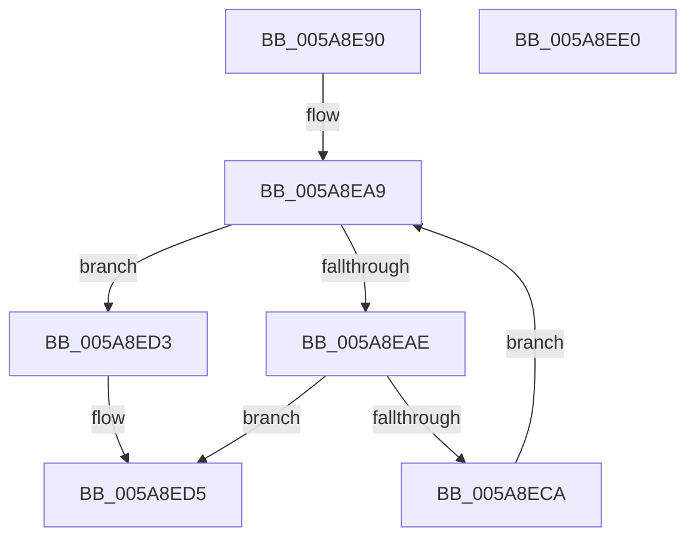

# PnprRecopyAddress

- RVA: `0x005A8E90`–`0x005A8EE1` (길이 `81` bytes)
- VA: `0x00000001405A8E90`
- 실행 섹션: `.text`
- PDB 이름 있음: `예`; PDB Function 태그: `아니요`
- unwind 정보 RVA: `0x000C8D8C`
- 디코드: `25`개 명령, `81/81` bytes 표시
- 미해석 바이트: `0` (있으면 어셈블리에 `.byte`로 보존)

> 이 문서는 커널 이미지의 기계어와 PDB 기호를 분석해 생성했습니다. 4번과 5번은 함수 원형과 자료형을 바이너리 사용 방식에서 추정한 C 해석이며 원본 소스 복구 결과는 아닙니다.

## 1. Dependencies

- 직접 호출 지점: **2**; 고유 호출 대상: **2**
- 직접 호출자로 확인된 함수: **2**
- RIP 상대 이미지 참조: **0**

### Outgoing calls
- `0x005A8EB1` → [MmGetPhysicalAddress](../23/MmGetPhysicalAddress_function_0023A500.md) (function, `0x0023A500`)
- `0x005A8EC1` → [PnprMarkOrMirrorPages](../../pagelk/B6/PnprMarkOrMirrorPages_function_00B646A8.md) (function, `0x00B646A8`)

### Direct callers
- [PnprRecopyMappingReserve](PnprRecopyMappingReserve_function_005A8EE8.md) at `0x005A8F45`
- [PnprRecopyMirrorPages](PnprRecopyMirrorPages_function_005A8F9C.md) at `0x005A8FFF`
- [PnprRecopyMirrorPages](PnprRecopyMirrorPages_function_005A8F9C.md) at `0x005A90A0`

### Static image references
- 디코드된 RIP-relative 메모리 참조가 없습니다.

## 2. Other-region calls and transfers

- 다른 실행 섹션으로 향하는 call: **1**
  - `0x005A8EC1` → [PnprMarkOrMirrorPages](../../pagelk/B6/PnprMarkOrMirrorPages_function_00B646A8.md) (`.text` → `PAGELK`)
- 별도 외부 분기/꼬리 이동을 확인하지 못했습니다.

## 3. Assembly (complete function range)

```asm
005A8E90  48 89 74 24 08                  mov qword ptr [rsp + 8], rsi
005A8E95  57                              push rdi
005A8E96  48 83 EC 20                     sub rsp, 0x20
005A8E9A  48 8B F9                        mov rdi, rcx
005A8E9D  8B F2                           mov esi, edx
005A8E9F  48 81 E7 00 F0 FF FF            and rdi, 0xfffffffffffff000
005A8EA6  48 03 F1                        add rsi, rcx
005A8EA9  48 3B FE                        cmp rdi, rsi
005A8EAC  73 25                           jae 0x1405a8ed3
005A8EAE  48 8B CF                        mov rcx, rdi
005A8EB1  E8 4A 16 C9 FF                  call 0x14023a500
005A8EB6  41 B0 01                        mov r8b, 1
005A8EB9  BA 00 10 00 00                  mov edx, 0x1000
005A8EBE  48 8B C8                        mov rcx, rax
005A8EC1  E8 E2 B7 5B 00                  call 0x140b646a8
005A8EC6  85 C0                           test eax, eax
005A8EC8  78 0B                           js 0x1405a8ed5
005A8ECA  48 81 C7 00 10 00 00            add rdi, 0x1000
005A8ED1  EB D6                           jmp 0x1405a8ea9
005A8ED3  33 C0                           xor eax, eax
005A8ED5  48 8B 74 24 30                  mov rsi, qword ptr [rsp + 0x30]
005A8EDA  48 83 C4 20                     add rsp, 0x20
005A8EDE  5F                              pop rdi
005A8EDF  C3                              ret
005A8EE0  CC                              int3
```

## 4. C-style interpretation (structured pseudocode)

```c
__int64 __fastcall PnprRecopyAddress(__int64 a1, int a2)
{
    __int64 result;
    __int64 v_rdi;
    __int64 v_rsi;
    __int64 v_rsp;
    unsigned __int64 v_stack_p8;

    v_stack_p8 = v_rsi;
    v_rsp = (v_rsp) - (32);
    v_rdi = (a1) & (0xFFFFFFFFFFFFF000ULL);
    v_rsi = ((unsigned int)(a2)) + (a1);
loc_005A8EA9:
    if (v_rdi >= v_rsi) goto loc_005A8ED3;
    result = MmGetPhysicalAddress(v_rdi, a2, a3, a4);
    result = PnprMarkOrMirrorPages(result, (unsigned int)(0x1000ULL), 1, a4);
    if (sign_flag) goto loc_005A8ED5;
    v_rdi = (v_rdi) + (0x1000ULL);
    goto loc_005A8EA9;
loc_005A8ED3:
    result = 0;
loc_005A8ED5:
    v_rsp = (v_rsp) + (32);
    return result;
}
```

## 5. (Beta) C Style

```c
int64_t PnprRecopyAddress(int64_t Arg1, int32_t Arg2)
{
    int64_t result;
    int64_t local_rdi;
    int64_t local_rsi;
    int64_t local_rsp;
    uint64_t v_stack_p8;

    v_stack_p8 = local_rsi;
    local_rsp = (local_rsp) - (32);
    local_rdi = (Arg1) & (0xFFFFFFFFFFFFF000ULL);
    local_rsi = ((uint32_t)(Arg2)) + (Arg1);
loc_005A8EA9:
    if (local_rdi >= local_rsi) goto loc_005A8ED3;
    result = MmGetPhysicalAddress(local_rdi, Arg2, a3, a4);
    result = PnprMarkOrMirrorPages(result, (uint32_t)(0x1000ULL), 1, a4);
    if (sign_flag) goto loc_005A8ED5;
    local_rdi = (local_rdi) + (0x1000ULL);
    goto loc_005A8EA9;
loc_005A8ED3:
    result = 0;
loc_005A8ED5:
    local_rsp = (local_rsp) + (32);
    return result;
}
```

## 6. Execution-region graph

[열기: 2D/3D 그래프와 함수 탐색 컨트롤 패널](../../../control-panel.html?section=text&rva=0x005A8E90&view=graph)

- 2D 그래프는 위에서 아래로 흐르고, 3D 그래프는 빈 공간을 드래그해 회전합니다. Shift+드래그는 이동, 휠은 확대·축소, 함수 노드 선택은 대상 보고서 이동입니다.

### Static fallback


