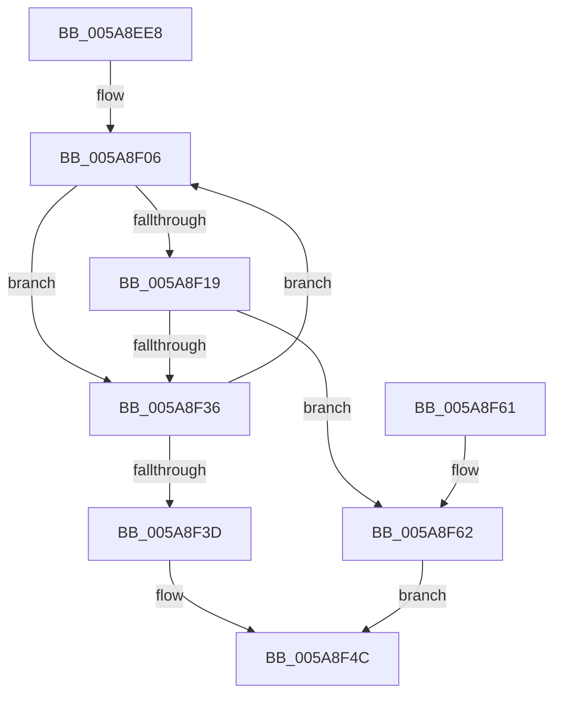

# PnprRecopyMappingReserve

- RVA: `0x005A8EE8`–`0x005A8F96` (길이 `174` bytes)
- VA: `0x00000001405A8EE8`
- 실행 섹션: `.text`
- PDB 이름 있음: `예`; PDB Function 태그: `아니요`
- unwind 정보 RVA: `0x0008DFE8`
- 디코드: `50`개 명령, `174/174` bytes 표시
- 미해석 바이트: `0` (있으면 어셈블리에 `.byte`로 보존)

> 이 문서는 커널 이미지의 기계어와 PDB 기호를 분석해 생성했습니다. 4번과 5번은 함수 원형과 자료형을 바이너리 사용 방식에서 추정한 C 해석이며 원본 소스 복구 결과는 아닙니다.

## 1. Dependencies

- 직접 호출 지점: **3**; 고유 호출 대상: **3**
- 직접 호출자로 확인된 함수: **1**
- RIP 상대 이미지 참조: **1**

### Outgoing calls
- `0x005A8F0F` → [MmContainingPageForReservedMapping](../67/MmContainingPageForReservedMapping_function_00674B74.md) (function, `0x00674B74`)
- `0x005A8F2B` → [PnprMarkOrMirrorPages](../../pagelk/B6/PnprMarkOrMirrorPages_function_00B646A8.md) (function, `0x00B646A8`)
- `0x005A8F45` → [PnprRecopyAddress](PnprRecopyAddress_function_005A8E90.md) (function, `0x005A8E90`)

### Direct callers
- [PnprRecopyMirrorPages](PnprRecopyMirrorPages_function_005A8F9C.md) at `0x005A9028`
- [PnprRecopyMirrorPages](PnprRecopyMirrorPages_function_005A8F9C.md) at `0x005A9045`

### Static image references
- `0x005A8F62` → RVA `0x00F8AC38` (`.data`; read)

## 2. Other-region calls and transfers

- 다른 실행 섹션으로 향하는 call: **1**
  - `0x005A8F2B` → [PnprMarkOrMirrorPages](../../pagelk/B6/PnprMarkOrMirrorPages_function_00B646A8.md) (`.text` → `PAGELK`)
- 별도 외부 분기/꼬리 이동을 확인하지 못했습니다.

## 3. Assembly (complete function range)

```asm
005A8EE8  48 89 5C 24 08                  mov qword ptr [rsp + 8], rbx
005A8EED  48 89 6C 24 10                  mov qword ptr [rsp + 0x10], rbp
005A8EF2  48 89 74 24 18                  mov qword ptr [rsp + 0x18], rsi
005A8EF7  57                              push rdi
005A8EF8  48 83 EC 20                     sub rsp, 0x20
005A8EFC  33 F6                           xor esi, esi
005A8EFE  48 8B F9                        mov rdi, rcx
005A8F01  33 DB                           xor ebx, ebx
005A8F03  8D 6E 01                        lea ebp, [rsi + 1]
005A8F06  8B CB                           mov ecx, ebx
005A8F08  C1 E1 0C                        shl ecx, 0xc
005A8F0B  48 03 4F 08                     add rcx, qword ptr [rdi + 8]
005A8F0F  E8 60 BC 0C 00                  call 0x140674b74
005A8F14  48 3B C6                        cmp rax, rsi
005A8F17  74 1D                           je 0x1405a8f36
005A8F19  48 8B F0                        mov rsi, rax
005A8F1C  44 8A C5                        mov r8b, bpl
005A8F1F  48 C1 E0 0C                     shl rax, 0xc
005A8F23  BA 00 10 00 00                  mov edx, 0x1000
005A8F28  48 8B C8                        mov rcx, rax
005A8F2B  E8 78 B7 5B 00                  call 0x140b646a8
005A8F30  8B D0                           mov edx, eax
005A8F32  85 C0                           test eax, eax
005A8F34  78 2C                           js 0x1405a8f62
005A8F36  03 DD                           add ebx, ebp
005A8F38  83 FB 10                        cmp ebx, 0x10
005A8F3B  72 C9                           jb 0x1405a8f06
005A8F3D  48 8B 0F                        mov rcx, qword ptr [rdi]
005A8F40  BA 30 00 00 00                  mov edx, 0x30
005A8F45  E8 46 FF FF FF                  call 0x1405a8e90
005A8F4A  33 C0                           xor eax, eax
005A8F4C  48 8B 5C 24 30                  mov rbx, qword ptr [rsp + 0x30]
005A8F51  48 8B 6C 24 38                  mov rbp, qword ptr [rsp + 0x38]
005A8F56  48 8B 74 24 40                  mov rsi, qword ptr [rsp + 0x40]
005A8F5B  48 83 C4 20                     add rsp, 0x20
005A8F5F  5F                              pop rdi
005A8F60  C3                              ret
005A8F61  CC                              int3
005A8F62  48 8B 0D CF 1C 9E 00            mov rcx, qword ptr [rip + 0x9e1ccf]
005A8F69  41 B8 63 16 00 00               mov r8d, 0x1663
005A8F6F  8B 81 08 82 00 00               mov eax, dword ptr [rcx + 0x8208]
005A8F75  85 C0                           test eax, eax
005A8F77  41 0F 44 C0                     cmove eax, r8d
005A8F7B  89 81 08 82 00 00               mov dword ptr [rcx + 0x8208], eax
005A8F81  8B 81 0C 82 00 00               mov eax, dword ptr [rcx + 0x820c]
005A8F87  85 C0                           test eax, eax
005A8F89  0F 44 C5                        cmove eax, ebp
005A8F8C  89 81 0C 82 00 00               mov dword ptr [rcx + 0x820c], eax
005A8F92  8B C2                           mov eax, edx
005A8F94  EB B6                           jmp 0x1405a8f4c
```

## 4. C-style interpretation (structured pseudocode)

```c
__int64 __fastcall PnprRecopyMappingReserve(__int64 a1)
{
    __int64 result;
    __int64 v_rbx;
    __int64 v_rsi;
    __int64 v_rsp;
    unsigned __int64 v_stack_p10;
    unsigned __int64 v_stack_p18;
    unsigned __int64 v_stack_p8;

    v_stack_p8 = v_rbx;
    v_stack_p10 = v_rbp;
    v_stack_p18 = v_rsi;
    v_rsp = (v_rsp) - (32);
    v_rsi = 0;
    v_rbx = 0;
loc_005A8F06:
    a1 = (unsigned int)((0) << (12));
    a1 = (a1) + (*(unsigned __int64 *)(a1 + 8));
    result = MmContainingPageForReservedMapping(a1, a2, a3, a4);
    if (result == 0) goto loc_005A8F36;
    result = (result) << (12);
    result = PnprMarkOrMirrorPages(result, (unsigned int)(0x1000ULL), (unsigned __int8)(v_rsi + 1), a4);
    if (sign_flag) goto loc_005A8F62;
loc_005A8F36:
    v_rbx = (unsigned int)((v_rbx) + ((unsigned int)(v_rsi + 1)));
    if (((unsigned int)(v_rbx)) < 16) goto loc_005A8F06;
    result = PnprRecopyAddress(*(unsigned __int64 *)(a1), 48, (unsigned __int8)(v_rsi + 1), a4);
    result = 0;
loc_005A8F4C:
    v_rsp = (v_rsp) + (32);
    return result;
loc_005A8F62:
    result = (unsigned int)(*(unsigned int *)(*(unsigned __int64 *)(v_rip + 10362063) + 33288));
    if ((unsigned int)((unsigned int)(*(unsigned int *)(*(unsigned __int64 *)(v_rip + 10362063) + 33288))) == 0) { result = (unsigned int)((unsigned int)(0x1663ULL)); }
    *(unsigned int *)(*(unsigned __int64 *)(v_rip + 10362063) + 33288) = (unsigned int)(result);
    result = (unsigned int)(*(unsigned int *)(*(unsigned __int64 *)(v_rip + 10362063) + 33292));
    if ((unsigned int)((unsigned int)(*(unsigned int *)(*(unsigned __int64 *)(v_rip + 10362063) + 33292))) == 0) { result = (unsigned int)(v_stack_p10); }
    *(unsigned int *)(*(unsigned __int64 *)(v_rip + 10362063) + 33292) = (unsigned int)(result);
    goto loc_005A8F4C;
}
```

## 5. (Beta) C Style

```c
int64_t PnprRecopyMappingReserve(void *Arg1)
{
    uint8_t *arg1 = (uint8_t *)Arg1;

    int64_t result;
    int64_t local_rbx;
    int64_t local_rsi;
    int64_t local_rsp;
    uint64_t v_stack_p10;
    uint64_t v_stack_p18;
    uint64_t v_stack_p8;

    v_stack_p8 = local_rbx;
    v_stack_p10 = local_rbp;
    v_stack_p18 = local_rsi;
    local_rsp = (local_rsp) - (32);
    local_rsi = 0;
    local_rbx = 0;
loc_005A8F06:
    Arg1 = (uint32_t)((0) << (12));
    Arg1 = (Arg1) + (*(uint64_t *)(arg1 + 0x8));
    result = MmContainingPageForReservedMapping(Arg1, a2, a3, a4);
    if (result == 0) goto loc_005A8F36;
    result = (result) << (12);
    result = PnprMarkOrMirrorPages(result, (uint32_t)(0x1000ULL), (uint8_t)(local_rsi + 1), a4);
    if (sign_flag) goto loc_005A8F62;
loc_005A8F36:
    local_rbx = (uint32_t)((local_rbx) + ((uint32_t)(local_rsi + 1)));
    if (((uint32_t)(local_rbx)) < 16) goto loc_005A8F06;
    result = PnprRecopyAddress(*(uint64_t *)(arg1), 48, (uint8_t)(local_rsi + 1), a4);
    result = 0;
loc_005A8F4C:
    local_rsp = (local_rsp) + (32);
    return result;
loc_005A8F62:
    result = (uint32_t)(*(uint32_t *)(*(uint64_t *)(v_rip + 0x9E1CCF) + 0x8208));
    if ((uint32_t)((uint32_t)(*(uint32_t *)(*(uint64_t *)(v_rip + 0x9E1CCF) + 0x8208))) == 0) { result = (uint32_t)((uint32_t)(0x1663ULL)); }
    *(uint32_t *)(*(uint64_t *)(v_rip + 0x9E1CCF) + 0x8208) = (uint32_t)(result);
    result = (uint32_t)(*(uint32_t *)(*(uint64_t *)(v_rip + 0x9E1CCF) + 0x820C));
    if ((uint32_t)((uint32_t)(*(uint32_t *)(*(uint64_t *)(v_rip + 0x9E1CCF) + 0x820C))) == 0) { result = (uint32_t)(v_stack_p10); }
    *(uint32_t *)(*(uint64_t *)(v_rip + 0x9E1CCF) + 0x820C) = (uint32_t)(result);
    goto loc_005A8F4C;
}
```

### 관측된 메모리 오프셋

구조체 형식이 확인되지 않은 접근은 인자 기준의 오프셋으로만 기록했습니다.

| 기준 인자 | 오프셋 표현 | 폭 (bit) | 접근 |
|---|---:|---:|---|
| `Arg1` | `+ 0x0` | `64` | `R` |
| `Arg1` | `+ 0x8` | `64` | `R` |

## 6. Execution-region graph

[열기: 2D/3D 그래프와 함수 탐색 컨트롤 패널](../../../control-panel.html?section=text&rva=0x005A8EE8&view=graph)

- 2D 그래프는 위에서 아래로 흐르고, 3D 그래프는 빈 공간을 드래그해 회전합니다. Shift+드래그는 이동, 휠은 확대·축소, 함수 노드 선택은 대상 보고서 이동입니다.

### Static fallback


