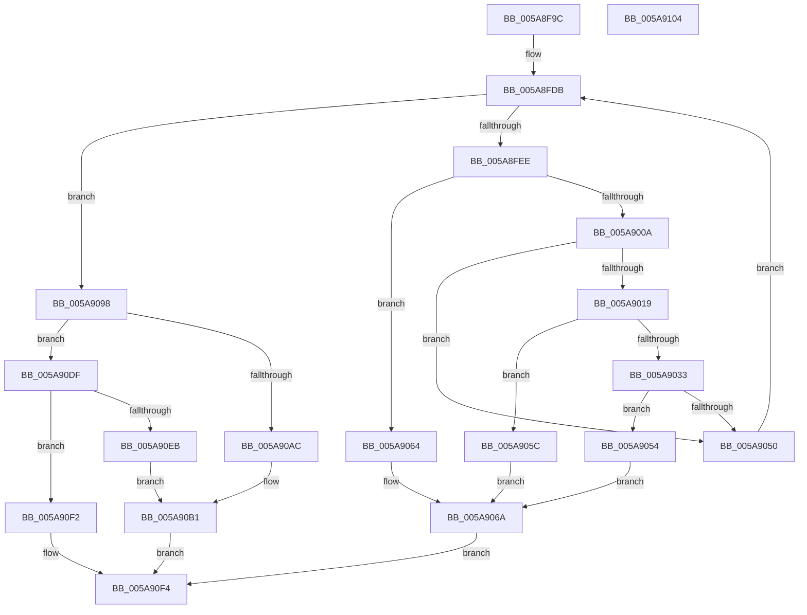

# PnprRecopyMirrorPages

- RVA: `0x005A8F9C`–`0x005A9105` (길이 `361` bytes)
- VA: `0x00000001405A8F9C`
- 실행 섹션: `.text`
- PDB 이름 있음: `예`; PDB Function 태그: `아니요`
- unwind 정보 RVA: `0x00060BC4`
- 디코드: `90`개 명령, `361/361` bytes 표시
- 미해석 바이트: `0` (있으면 어셈블리에 `.byte`로 보존)

> 이 문서는 커널 이미지의 기계어와 PDB 기호를 분석해 생성했습니다. 4번과 5번은 함수 원형과 자료형을 바이너리 사용 방식에서 추정한 C 해석이며 원본 소스 복구 결과는 아닙니다.

## 1. Dependencies

- 직접 호출 지점: **6**; 고유 호출 대상: **4**
- 직접 호출자로 확인된 함수: **1**
- RIP 상대 이미지 참조: **1**

### Outgoing calls
- `0x005A8FD1` → [PnprGetStackLimits](PnprGetStackLimits_function_005A8C4C.md) (function, `0x005A8C4C`)
- `0x005A8FFF` → [PnprRecopyAddress](PnprRecopyAddress_function_005A8E90.md) (function, `0x005A8E90`)
- `0x005A9028` → [PnprRecopyMappingReserve](PnprRecopyMappingReserve_function_005A8EE8.md) (function, `0x005A8EE8`)
- `0x005A9045` → [PnprRecopyMappingReserve](PnprRecopyMappingReserve_function_005A8EE8.md) (function, `0x005A8EE8`)
- `0x005A90A0` → [PnprRecopyAddress](PnprRecopyAddress_function_005A8E90.md) (function, `0x005A8E90`)
- `0x005A90DF` → [PnprCopyReservedMapping](PnprCopyReservedMapping_function_005A8864.md) (function, `0x005A8864`)

### Direct callers
- [PnprSwapFinalize](PnprSwapFinalize_function_005A9334.md) at `0x005A935B`

### Static image references
- `0x005A8FB5` → RVA `0x00F8AC38` (`.data`; read)

## 2. Other-region calls and transfers

- 다른 실행 섹션으로 향하는 call: **0**
- 별도 외부 분기/꼬리 이동을 확인하지 못했습니다.

## 3. Assembly (complete function range)

```asm
005A8F9C  48 89 5C 24 08                  mov qword ptr [rsp + 8], rbx
005A8FA1  48 89 74 24 10                  mov qword ptr [rsp + 0x10], rsi
005A8FA6  57                              push rdi
005A8FA7  48 83 EC 20                     sub rsp, 0x20
005A8FAB  65 8B 04 25 A4 01 00 00         mov eax, dword ptr gs:[0x1a4]
005A8FB3  8B C8                           mov ecx, eax
005A8FB5  48 8B 05 7C 1C 9E 00            mov rax, qword ptr [rip + 0x9e1c7c]
005A8FBC  48 8D 90 D8 40 00 00            lea rdx, [rax + 0x40d8]
005A8FC3  48 05 D8 00 00 00               add rax, 0xd8
005A8FC9  48 8D 14 CA                     lea rdx, [rdx + rcx*8]
005A8FCD  48 8D 0C C8                     lea rcx, [rax + rcx*8]
005A8FD1  E8 76 FC FF FF                  call 0x1405a8c4c
005A8FD6  33 DB                           xor ebx, ebx
005A8FD8  8D 73 01                        lea esi, [rbx + 1]
005A8FDB  48 8B 05 56 1C 9E 00            mov rax, qword ptr [rip + 0x9e1c56]
005A8FE2  3B 98 B0 00 00 00               cmp ebx, dword ptr [rax + 0xb0]
005A8FE8  0F 83 AA 00 00 00               jae 0x1405a9098
005A8FEE  48 8B 8C D8 D8 00 00 00         mov rcx, qword ptr [rax + rbx*8 + 0xd8]
005A8FF6  8B 94 D8 D8 40 00 00            mov edx, dword ptr [rax + rbx*8 + 0x40d8]
005A8FFD  2B D1                           sub edx, ecx
005A8FFF  E8 8C FE FF FF                  call 0x1405a8e90
005A9004  8B D0                           mov edx, eax
005A9006  85 C0                           test eax, eax
005A9008  78 5A                           js 0x1405a9064
005A900A  48 8B 05 27 1C 9E 00            mov rax, qword ptr [rip + 0x9e1c27]
005A9011  3B 98 B4 00 00 00               cmp ebx, dword ptr [rax + 0xb4]
005A9017  74 37                           je 0x1405a9050
005A9019  48 8B 80 90 00 00 00            mov rax, qword ptr [rax + 0x90]
005A9020  48 8D 3C 5B                     lea rdi, [rbx + rbx*2]
005A9024  48 8D 0C F8                     lea rcx, [rax + rdi*8]
005A9028  E8 BB FE FF FF                  call 0x1405a8ee8
005A902D  8B D0                           mov edx, eax
005A902F  85 C0                           test eax, eax
005A9031  78 29                           js 0x1405a905c
005A9033  48 8B 05 FE 1B 9E 00            mov rax, qword ptr [rip + 0x9e1bfe]
005A903A  48 8B 88 88 00 00 00            mov rcx, qword ptr [rax + 0x88]
005A9041  48 8D 0C F9                     lea rcx, [rcx + rdi*8]
005A9045  E8 9E FE FF FF                  call 0x1405a8ee8
005A904A  8B D0                           mov edx, eax
005A904C  85 C0                           test eax, eax
005A904E  78 04                           js 0x1405a9054
005A9050  03 DE                           add ebx, esi
005A9052  EB 87                           jmp 0x1405a8fdb
005A9054  41 B8 FF 15 00 00               mov r8d, 0x15ff
005A905A  EB 0E                           jmp 0x1405a906a
005A905C  41 B8 F7 15 00 00               mov r8d, 0x15f7
005A9062  EB 06                           jmp 0x1405a906a
005A9064  41 B8 E7 15 00 00               mov r8d, 0x15e7
005A906A  48 8B 0D C7 1B 9E 00            mov rcx, qword ptr [rip + 0x9e1bc7]
005A9071  8B 81 08 82 00 00               mov eax, dword ptr [rcx + 0x8208]
005A9077  85 C0                           test eax, eax
005A9079  41 0F 44 C0                     cmove eax, r8d
005A907D  89 81 08 82 00 00               mov dword ptr [rcx + 0x8208], eax
005A9083  8B 81 0C 82 00 00               mov eax, dword ptr [rcx + 0x820c]
005A9089  85 C0                           test eax, eax
005A908B  0F 44 C6                        cmove eax, esi
005A908E  89 81 0C 82 00 00               mov dword ptr [rcx + 0x820c], eax
005A9094  8B C2                           mov eax, edx
005A9096  EB 5C                           jmp 0x1405a90f4
005A9098  BA 48 82 00 00                  mov edx, 0x8248
005A909D  48 8B C8                        mov rcx, rax
005A90A0  E8 EB FD FF FF                  call 0x1405a8e90
005A90A5  44 8B C0                        mov r8d, eax
005A90A8  85 C0                           test eax, eax
005A90AA  79 33                           jns 0x1405a90df
005A90AC  B8 0B 16 00 00                  mov eax, 0x160b
005A90B1  48 8B 15 80 1B 9E 00            mov rdx, qword ptr [rip + 0x9e1b80]
005A90B8  8B 8A 08 82 00 00               mov ecx, dword ptr [rdx + 0x8208]
005A90BE  85 C9                           test ecx, ecx
005A90C0  0F 44 C8                        cmove ecx, eax
005A90C3  89 8A 08 82 00 00               mov dword ptr [rdx + 0x8208], ecx
005A90C9  8B 82 0C 82 00 00               mov eax, dword ptr [rdx + 0x820c]
005A90CF  85 C0                           test eax, eax
005A90D1  0F 44 C6                        cmove eax, esi
005A90D4  89 82 0C 82 00 00               mov dword ptr [rdx + 0x820c], eax
005A90DA  41 8B C0                        mov eax, r8d
005A90DD  EB 15                           jmp 0x1405a90f4
005A90DF  E8 80 F7 FF FF                  call 0x1405a8864
005A90E4  44 8B C0                        mov r8d, eax
005A90E7  85 C0                           test eax, eax
005A90E9  79 07                           jns 0x1405a90f2
005A90EB  B8 17 16 00 00                  mov eax, 0x1617
005A90F0  EB BF                           jmp 0x1405a90b1
005A90F2  33 C0                           xor eax, eax
005A90F4  48 8B 5C 24 30                  mov rbx, qword ptr [rsp + 0x30]
005A90F9  48 8B 74 24 38                  mov rsi, qword ptr [rsp + 0x38]
005A90FE  48 83 C4 20                     add rsp, 0x20
005A9102  5F                              pop rdi
005A9103  C3                              ret
005A9104  CC                              int3
```

## 4. C-style interpretation (structured pseudocode)

```c
__int64 __fastcall PnprRecopyMirrorPages(void)
{
    __int64 result;
    __int64 v_rbx;
    __int64 v_rsp;
    unsigned __int64 v_stack_p10;
    unsigned __int64 v_stack_p8;

    v_stack_p8 = v_rbx;
    v_stack_p10 = v_rsi;
    v_rsp = (v_rsp) - (32);
    result = (*(unsigned __int64 *)(v_rip + 10361980)) + (216);
    result = PnprGetStackLimits(result + (unsigned int)((unsigned int)((unsigned int)(*(unsigned int *)(gs_base + (0 + 420))))) * 8, *(unsigned __int64 *)(v_rip + 10361980) + 16600 + (unsigned int)((unsigned int)((unsigned int)(*(unsigned int *)(gs_base + (0 + 420))))) * 8, a3, a4);
    v_rbx = 0;
loc_005A8FDB:
    if (0 >= (*(unsigned int *)(*(unsigned __int64 *)(v_rip + 10361942) + 176))) goto loc_005A9098;
    a2 = (unsigned int)(((unsigned int)(*(unsigned int *)(*(unsigned __int64 *)(v_rip + 10361942) + v_rbx * 8 + 16600))) - ((unsigned int)(*(unsigned __int64 *)(*(unsigned __int64 *)(v_rip + 10361942) + v_rbx * 8 + 216))));
    result = PnprRecopyAddress(*(unsigned __int64 *)(*(unsigned __int64 *)(v_rip + 10361942) + v_rbx * 8 + 216), a2, a3, a4);
    if (sign_flag) goto loc_005A9064;
    if (0 == (*(unsigned int *)(*(unsigned __int64 *)(v_rip + 10361895) + 180))) goto loc_005A9050;
    result = PnprRecopyMappingReserve(*(unsigned __int64 *)(*(unsigned __int64 *)(v_rip + 10361895) + 144) + v_rbx + v_rbx * 2 * 8, (unsigned int)((unsigned int)(result)), a3, a4);
    if (sign_flag) goto loc_005A905C;
    result = PnprRecopyMappingReserve(*(unsigned __int64 *)(*(unsigned __int64 *)(v_rip + 10361854) + 136) + v_rbx + v_rbx * 2 * 8, (unsigned int)((unsigned int)(result)), a3, a4);
    if (sign_flag) goto loc_005A9054;
loc_005A9050:
    v_rbx = (unsigned int)((v_rbx) + ((unsigned int)(v_rbx + 1)));
    goto loc_005A8FDB;
loc_005A9054:
    goto loc_005A906A;
loc_005A905C:
    goto loc_005A906A;
loc_005A9064:
loc_005A906A:
    result = (unsigned int)(*(unsigned int *)(*(unsigned __int64 *)(v_rip + 10361799) + 33288));
    if ((unsigned int)((unsigned int)(*(unsigned int *)(*(unsigned __int64 *)(v_rip + 10361799) + 33288))) == 0) { result = (unsigned int)((unsigned int)(0x15E7ULL)); }
    *(unsigned int *)(*(unsigned __int64 *)(v_rip + 10361799) + 33288) = (unsigned int)(result);
    result = (unsigned int)(*(unsigned int *)(*(unsigned __int64 *)(v_rip + 10361799) + 33292));
    if ((unsigned int)((unsigned int)(*(unsigned int *)(*(unsigned __int64 *)(v_rip + 10361799) + 33292))) == 0) { result = (unsigned int)(v_rbx + 1); }
    *(unsigned int *)(*(unsigned __int64 *)(v_rip + 10361799) + 33292) = (unsigned int)(result);
    goto loc_005A90F4;
loc_005A9098:
    result = PnprRecopyAddress((unsigned int)((unsigned int)((unsigned int)((unsigned int)(result)))), (unsigned int)(0x8248ULL), (unsigned int)(0x15E7ULL), a4);
    if (!sign_flag) goto loc_005A90DF;
loc_005A90B1:
    a1 = (unsigned int)(*(unsigned int *)(*(unsigned __int64 *)(v_rip + 10361728) + 33288));
    if ((unsigned int)((unsigned int)(*(unsigned int *)(*(unsigned __int64 *)(v_rip + 10361728) + 33288))) == 0) { a1 = (unsigned int)((unsigned int)(0x160BULL)); }
    *(unsigned int *)(*(unsigned __int64 *)(v_rip + 10361728) + 33288) = (unsigned int)(a1);
    result = (unsigned int)(*(unsigned int *)(*(unsigned __int64 *)(v_rip + 10361728) + 33292));
    if ((unsigned int)((unsigned int)(*(unsigned int *)(*(unsigned __int64 *)(v_rip + 10361728) + 33292))) == 0) { result = (unsigned int)(v_rbx + 1); }
    *(unsigned int *)(*(unsigned __int64 *)(v_rip + 10361728) + 33292) = (unsigned int)(result);
    goto loc_005A90F4;
loc_005A90DF:
    result = PnprCopyReservedMapping(a1, *(unsigned __int64 *)(v_rip + 10361728), (unsigned int)((unsigned int)(result)), a4);
    if (!sign_flag) goto loc_005A90F2;
    goto loc_005A90B1;
loc_005A90F2:
    result = 0;
loc_005A90F4:
    v_rsp = (v_rsp) + (32);
    return result;
}
```

## 5. (Beta) C Style

```c
void PnprRecopyMirrorPages(void)
{
    int64_t result;
    int64_t local_rbx;
    int64_t local_rsp;
    uint64_t v_stack_p10;
    uint64_t v_stack_p8;

    v_stack_p8 = local_rbx;
    v_stack_p10 = local_rsi;
    local_rsp = (local_rsp) - (32);
    result = (*(uint64_t *)(v_rip + 0x9E1C7C)) + (216);
    result = PnprGetStackLimits(result + (uint32_t)((uint32_t)((uint32_t)(*(uint32_t *)(gs_base + (0 + 0x1A4))))) * 8, *(uint64_t *)(v_rip + 0x9E1C7C) + 16600 + (uint32_t)((uint32_t)((uint32_t)(*(uint32_t *)(gs_base + (0 + 0x1A4))))) * 8, a3, a4);
    local_rbx = 0;
loc_005A8FDB:
    if (0 >= (*(uint32_t *)(*(uint64_t *)(v_rip + 0x9E1C56) + 0xB0))) goto loc_005A9098;
    a2 = (uint32_t)(((uint32_t)(*(uint32_t *)(*(uint64_t *)(v_rip + 0x9E1C56) + local_rbx * 8 + 0x40D8))) - ((uint32_t)(*(uint64_t *)(*(uint64_t *)(v_rip + 0x9E1C56) + local_rbx * 8 + 0xD8))));
    result = PnprRecopyAddress(*(uint64_t *)(*(uint64_t *)(v_rip + 0x9E1C56) + local_rbx * 8 + 0xD8), a2, a3, a4);
    if (sign_flag) goto loc_005A9064;
    if (0 == (*(uint32_t *)(*(uint64_t *)(v_rip + 0x9E1C27) + 0xB4))) goto loc_005A9050;
    result = PnprRecopyMappingReserve(*(uint64_t *)(*(uint64_t *)(v_rip + 0x9E1C27) + 0x90) + local_rbx + local_rbx * 2 * 8, (uint32_t)((uint32_t)(result)), a3, a4);
    if (sign_flag) goto loc_005A905C;
    result = PnprRecopyMappingReserve(*(uint64_t *)(*(uint64_t *)(v_rip + 0x9E1BFE) + 0x88) + local_rbx + local_rbx * 2 * 8, (uint32_t)((uint32_t)(result)), a3, a4);
    if (sign_flag) goto loc_005A9054;
loc_005A9050:
    local_rbx = (uint32_t)((local_rbx) + ((uint32_t)(local_rbx + 1)));
    goto loc_005A8FDB;
loc_005A9054:
    goto loc_005A906A;
loc_005A905C:
    goto loc_005A906A;
loc_005A9064:
loc_005A906A:
    result = (uint32_t)(*(uint32_t *)(*(uint64_t *)(v_rip + 0x9E1BC7) + 0x8208));
    if ((uint32_t)((uint32_t)(*(uint32_t *)(*(uint64_t *)(v_rip + 0x9E1BC7) + 0x8208))) == 0) { result = (uint32_t)((uint32_t)(0x15E7ULL)); }
    *(uint32_t *)(*(uint64_t *)(v_rip + 0x9E1BC7) + 0x8208) = (uint32_t)(result);
    result = (uint32_t)(*(uint32_t *)(*(uint64_t *)(v_rip + 0x9E1BC7) + 0x820C));
    if ((uint32_t)((uint32_t)(*(uint32_t *)(*(uint64_t *)(v_rip + 0x9E1BC7) + 0x820C))) == 0) { result = (uint32_t)(local_rbx + 1); }
    *(uint32_t *)(*(uint64_t *)(v_rip + 0x9E1BC7) + 0x820C) = (uint32_t)(result);
    goto loc_005A90F4;
loc_005A9098:
    result = PnprRecopyAddress((uint32_t)((uint32_t)((uint32_t)((uint32_t)(result)))), (uint32_t)(0x8248ULL), (uint32_t)(0x15E7ULL), a4);
    if (!sign_flag) goto loc_005A90DF;
loc_005A90B1:
    a1 = (uint32_t)(*(uint32_t *)(*(uint64_t *)(v_rip + 0x9E1B80) + 0x8208));
    if ((uint32_t)((uint32_t)(*(uint32_t *)(*(uint64_t *)(v_rip + 0x9E1B80) + 0x8208))) == 0) { a1 = (uint32_t)((uint32_t)(0x160BULL)); }
    *(uint32_t *)(*(uint64_t *)(v_rip + 0x9E1B80) + 0x8208) = (uint32_t)(a1);
    result = (uint32_t)(*(uint32_t *)(*(uint64_t *)(v_rip + 0x9E1B80) + 0x820C));
    if ((uint32_t)((uint32_t)(*(uint32_t *)(*(uint64_t *)(v_rip + 0x9E1B80) + 0x820C))) == 0) { result = (uint32_t)(local_rbx + 1); }
    *(uint32_t *)(*(uint64_t *)(v_rip + 0x9E1B80) + 0x820C) = (uint32_t)(result);
    goto loc_005A90F4;
loc_005A90DF:
    result = PnprCopyReservedMapping(a1, *(uint64_t *)(v_rip + 0x9E1B80), (uint32_t)((uint32_t)(result)), a4);
    if (!sign_flag) goto loc_005A90F2;
    goto loc_005A90B1;
loc_005A90F2:
    result = 0;
loc_005A90F4:
    local_rsp = (local_rsp) + (32);
    return result;
}
```

## 6. Execution-region graph

[열기: 2D/3D 그래프와 함수 탐색 컨트롤 패널](../../../control-panel.html?section=text&rva=0x005A8F9C&view=graph)

- 2D 그래프는 위에서 아래로 흐르고, 3D 그래프는 빈 공간을 드래그해 회전합니다. Shift+드래그는 이동, 휠은 확대·축소, 함수 노드 선택은 대상 보고서 이동입니다.

### Static fallback


