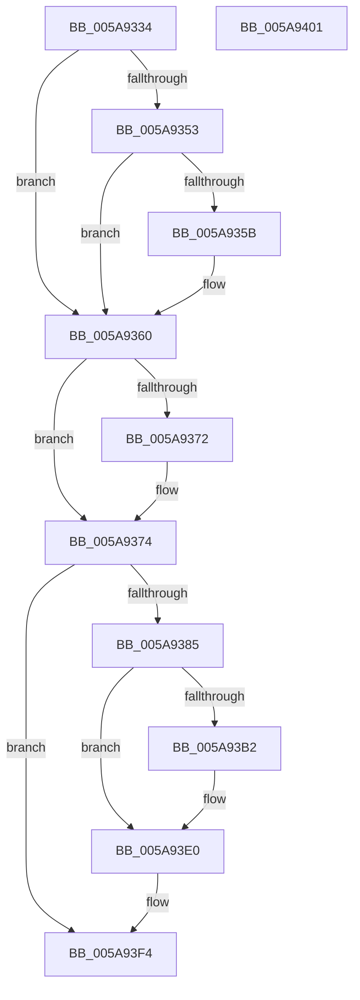

# PnprSwapFinalize

- RVA: `0x005A9334`–`0x005A9402` (길이 `206` bytes)
- VA: `0x00000001405A9334`
- 실행 섹션: `.text`
- PDB 이름 있음: `예`; PDB Function 태그: `아니요`
- unwind 정보 RVA: `0x0005CAAC`
- 디코드: `53`개 명령, `206/206` bytes 표시
- 미해석 바이트: `0` (있으면 어셈블리에 `.byte`로 보존)

> 이 문서는 커널 이미지의 기계어와 PDB 기호를 분석해 생성했습니다. 4번과 5번은 함수 원형과 자료형을 바이너리 사용 방식에서 추정한 C 해석이며 원본 소스 복구 결과는 아닙니다.

## 1. Dependencies

- 직접 호출 지점: **4**; 고유 호출 대상: **3**
- 직접 호출자로 확인된 함수: **1**
- RIP 상대 이미지 참조: **1**

### Outgoing calls
- `0x005A935B` → [PnprRecopyMirrorPages](PnprRecopyMirrorPages_function_005A8F9C.md) (function, `0x005A8F9C`)
- `0x005A9387` → [PnprGetMillisecondCounter](../../pagelk/B6/PnprGetMillisecondCounter_function_00B63FD4.md) (function, `0x00B63FD4`)
- `0x005A93A7` → [guard_dispatch_icall](../6B/guard_dispatch_icall_function_006BAAD0.md) (function, `0x006BAAD0`)
- `0x005A93E2` → [PnprGetMillisecondCounter](../../pagelk/B6/PnprGetMillisecondCounter_function_00B63FD4.md) (function, `0x00B63FD4`)

### Direct callers
- [PnprSwap](PnprSwap_function_005A910C.md) at `0x005A9275`

### Static image references
- `0x005A933E` → RVA `0x00F8AC38` (`.data`; read)

## 2. Other-region calls and transfers

- 다른 실행 섹션으로 향하는 call: **2**
  - `0x005A9387` → [PnprGetMillisecondCounter](../../pagelk/B6/PnprGetMillisecondCounter_function_00B63FD4.md) (`.text` → `PAGELK`)
  - `0x005A93E2` → [PnprGetMillisecondCounter](../../pagelk/B6/PnprGetMillisecondCounter_function_00B63FD4.md) (`.text` → `PAGELK`)
- 별도 외부 분기/꼬리 이동을 확인하지 못했습니다.

## 3. Assembly (complete function range)

```asm
005A9334  48 89 5C 24 08                  mov qword ptr [rsp + 8], rbx
005A9339  57                              push rdi
005A933A  48 83 EC 20                     sub rsp, 0x20
005A933E  48 8B 0D F3 18 9E 00            mov rcx, qword ptr [rip + 0x9e18f3]
005A9345  33 DB                           xor ebx, ebx
005A9347  48 8B 41 18                     mov rax, qword ptr [rcx + 0x18]
005A934B  8D 7B 08                        lea edi, [rbx + 8]
005A934E  39 58 04                        cmp dword ptr [rax + 4], ebx
005A9351  74 0D                           je 0x1405a9360
005A9353  8B 41 40                        mov eax, dword ptr [rcx + 0x40]
005A9356  40 84 C7                        test dil, al
005A9359  75 05                           jne 0x1405a9360
005A935B  E8 3C FC FF FF                  call 0x1405a8f9c
005A9360  48 8B 05 D1 18 9E 00            mov rax, qword ptr [rip + 0x9e18d1]
005A9367  83 60 40 FB                     and dword ptr [rax + 0x40], 0xfffffffb
005A936B  8B 40 40                        mov eax, dword ptr [rax + 0x40]
005A936E  A8 20                           test al, 0x20
005A9370  75 02                           jne 0x1405a9374
005A9372  0F 09                           wbinvd
005A9374  90                              nop
005A9375  48 8B 05 BC 18 9E 00            mov rax, qword ptr [rip + 0x9e18bc]
005A937C  48 39 98 E0 81 00 00            cmp qword ptr [rax + 0x81e0], rbx
005A9383  74 6F                           je 0x1405a93f4
005A9385  33 C9                           xor ecx, ecx
005A9387  E8 48 AC 5B 00                  call 0x140b63fd4
005A938C  48 8B 0D A5 18 9E 00            mov rcx, qword ptr [rip + 0x9e18a5]
005A9393  89 81 24 82 00 00               mov dword ptr [rcx + 0x8224], eax
005A9399  48 8B 81 E0 81 00 00            mov rax, qword ptr [rcx + 0x81e0]
005A93A0  48 8B 89 A0 81 00 00            mov rcx, qword ptr [rcx + 0x81a0]
005A93A7  E8 24 17 11 00                  call 0x1406baad0
005A93AC  8B D8                           mov ebx, eax
005A93AE  85 C0                           test eax, eax
005A93B0  79 2E                           jns 0x1405a93e0
005A93B2  48 8B 15 7F 18 9E 00            mov rdx, qword ptr [rip + 0x9e187f]
005A93B9  B8 AC 0B 00 00                  mov eax, 0xbac
005A93BE  8B 8A 08 82 00 00               mov ecx, dword ptr [rdx + 0x8208]
005A93C4  85 C9                           test ecx, ecx
005A93C6  0F 44 C8                        cmove ecx, eax
005A93C9  8B 82 0C 82 00 00               mov eax, dword ptr [rdx + 0x820c]
005A93CF  85 C0                           test eax, eax
005A93D1  89 8A 08 82 00 00               mov dword ptr [rdx + 0x8208], ecx
005A93D7  0F 44 C7                        cmove eax, edi
005A93DA  89 82 0C 82 00 00               mov dword ptr [rdx + 0x820c], eax
005A93E0  33 C9                           xor ecx, ecx
005A93E2  E8 ED AB 5B 00                  call 0x140b63fd4
005A93E7  48 8B 0D 4A 18 9E 00            mov rcx, qword ptr [rip + 0x9e184a]
005A93EE  89 81 28 82 00 00               mov dword ptr [rcx + 0x8228], eax
005A93F4  8B C3                           mov eax, ebx
005A93F6  48 8B 5C 24 30                  mov rbx, qword ptr [rsp + 0x30]
005A93FB  48 83 C4 20                     add rsp, 0x20
005A93FF  5F                              pop rdi
005A9400  C3                              ret
005A9401  CC                              int3
```

## 4. C-style interpretation (structured pseudocode)

```c
__int64 __fastcall PnprSwapFinalize(void)
{
    __int64 result;
    __int64 v_rbx;
    __int64 v_rsp;
    unsigned __int64 v_stack_p8;

    v_stack_p8 = v_rbx;
    v_rsp = (v_rsp) - (32);
    v_rbx = 0;
    if ((*(unsigned int *)(*(unsigned __int64 *)(*(unsigned __int64 *)(v_rip + 10361075) + 24) + 4)) == 0) goto loc_005A9360;
    result = (unsigned int)(*(unsigned int *)(*(unsigned __int64 *)(v_rip + 10361075) + 64));
    if ((((unsigned __int8)(v_rbx + 8)) & ((unsigned __int8)((unsigned int)(*(unsigned int *)(*(unsigned __int64 *)(v_rip + 10361075) + 64))))) == 0) {
        result = PnprRecopyMirrorPages(*(unsigned __int64 *)(v_rip + 10361075), a2, a3, a4);
    }
    if ((((unsigned __int8)((unsigned int)(*(unsigned int *)(*(unsigned __int64 *)(v_rip + 10361041) + 64)))) & (32)) == 0) {
    }
    if ((*(unsigned __int64 *)(*(unsigned __int64 *)(v_rip + 10361020) + 33248)) == 0) goto loc_005A93F4;
    a1 = 0;
    result = PnprGetMillisecondCounter(a1, a2, a3, a4);
    *(unsigned int *)(*(unsigned __int64 *)(v_rip + 10360997) + 33316) = (unsigned int)(result);
    result = guard_dispatch_icall(*(unsigned __int64 *)(*(unsigned __int64 *)(v_rip + 10360997) + 33184), a2, a3, a4);
    if (sign_flag) {
        a2 = *(unsigned __int64 *)(v_rip + 10360959);
        result = 0xBACULL;
        a1 = *(unsigned int *)(a2 + 33288);
        if ((unsigned int)(a1) == 0) { a1 = (unsigned int)(result); }
        result = *(unsigned int *)(a2 + 33292);
        *(unsigned int *)(a2 + 33288) = (unsigned int)(a1);
        if ((unsigned int)(result) == 0) { result = (unsigned int)(v_rbx + 8); }
        *(unsigned int *)(a2 + 33292) = (unsigned int)(result);
    }
    a1 = 0;
    result = PnprGetMillisecondCounter(a1, a2, a3, a4);
    *(unsigned int *)(*(unsigned __int64 *)(v_rip + 10360906) + 33320) = (unsigned int)(result);
loc_005A93F4:
    v_rsp = (v_rsp) + (32);
    return (unsigned int)((unsigned int)((unsigned int)((unsigned int)(result))));
}
```

## 5. (Beta) C Style

```c
void PnprSwapFinalize(void)
{
    int64_t result;
    int64_t local_rbx;
    int64_t local_rsp;
    uint64_t v_stack_p8;

    v_stack_p8 = local_rbx;
    local_rsp = (local_rsp) - (32);
    local_rbx = 0;
    if ((*(uint32_t *)(*(uint64_t *)(*(uint64_t *)(v_rip + 0x9E18F3) + 0x18) + 0x4)) == 0) goto loc_005A9360;
    result = (uint32_t)(*(uint32_t *)(*(uint64_t *)(v_rip + 0x9E18F3) + 0x40));
    if ((((uint8_t)(local_rbx + 8)) & ((uint8_t)((uint32_t)(*(uint32_t *)(*(uint64_t *)(v_rip + 0x9E18F3) + 0x40))))) == 0) {
        result = PnprRecopyMirrorPages(*(uint64_t *)(v_rip + 0x9E18F3), a2, a3, a4);
    }
    if ((((uint8_t)((uint32_t)(*(uint32_t *)(*(uint64_t *)(v_rip + 0x9E18D1) + 0x40)))) & (32)) == 0) {
    }
    if ((*(uint64_t *)(*(uint64_t *)(v_rip + 0x9E18BC) + 0x81E0)) == 0) goto loc_005A93F4;
    a1 = 0;
    result = PnprGetMillisecondCounter(a1, a2, a3, a4);
    *(uint32_t *)(*(uint64_t *)(v_rip + 0x9E18A5) + 0x8224) = (uint32_t)(result);
    result = guard_dispatch_icall(*(uint64_t *)(*(uint64_t *)(v_rip + 0x9E18A5) + 0x81A0), a2, a3, a4);
    if (sign_flag) {
        a2 = *(uint64_t *)(v_rip + 0x9E187F);
        result = 0xBACULL;
        a1 = *(uint32_t *)(a2 + 0x8208);
        if ((uint32_t)(a1) == 0) { a1 = (uint32_t)(result); }
        result = *(uint32_t *)(a2 + 0x820C);
        *(uint32_t *)(a2 + 0x8208) = (uint32_t)(a1);
        if ((uint32_t)(result) == 0) { result = (uint32_t)(local_rbx + 8); }
        *(uint32_t *)(a2 + 0x820C) = (uint32_t)(result);
    }
    a1 = 0;
    result = PnprGetMillisecondCounter(a1, a2, a3, a4);
    *(uint32_t *)(*(uint64_t *)(v_rip + 0x9E184A) + 0x8228) = (uint32_t)(result);
loc_005A93F4:
    local_rsp = (local_rsp) + (32);
    return (uint32_t)((uint32_t)((uint32_t)((uint32_t)(result))));
}
```

## 6. Execution-region graph

[열기: 2D/3D 그래프와 함수 탐색 컨트롤 패널](../../../control-panel.html?section=text&rva=0x005A9334&view=graph)

- 2D 그래프는 위에서 아래로 흐르고, 3D 그래프는 빈 공간을 드래그해 회전합니다. Shift+드래그는 이동, 휠은 확대·축소, 함수 노드 선택은 대상 보고서 이동입니다.

### Static fallback


