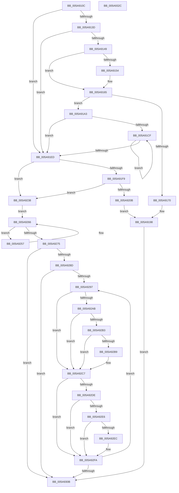

# PnprSwap

- RVA: `0x005A910C`–`0x005A932D` (길이 `545` bytes)
- VA: `0x00000001405A910C`
- 실행 섹션: `.text`
- PDB 이름 있음: `예`; PDB Function 태그: `아니요`
- unwind 정보 RVA: `0x0005C954`
- 디코드: `124`개 명령, `545/545` bytes 표시
- 미해석 바이트: `0` (있으면 어셈블리에 `.byte`로 보존)

> 이 문서는 커널 이미지의 기계어와 PDB 기호를 분석해 생성했습니다. 4번과 5번은 함수 원형과 자료형을 바이너리 사용 방식에서 추정한 C 해석이며 원본 소스 복구 결과는 아닙니다.

## 1. Dependencies

- 직접 호출 지점: **5**; 고유 호출 대상: **4**
- 직접 호출자로 확인된 함수: **2**
- RIP 상대 이미지 참조: **1**

### Outgoing calls
- `0x005A9165` → [PnprMirrorMarkedPages](../../pagelk/B6/PnprMirrorMarkedPages_function_00B6480C.md) (function, `0x00B6480C`)
- `0x005A9200` → [guard_dispatch_icall](../6B/guard_dispatch_icall_function_006BAAD0.md) (function, `0x006BAAD0`)
- `0x005A9275` → [PnprSwapFinalize](PnprSwapFinalize_function_005A9334.md) (function, `0x005A9334`)
- `0x005A92C2` → [MmUnmapReservedMapping](../3E/MmUnmapReservedMapping_function_003E7BE0.md) (function, `0x003E7BE0`)
- `0x005A92F5` → [MmUnmapReservedMapping](../3E/MmUnmapReservedMapping_function_003E7BE0.md) (function, `0x003E7BE0`)

### Direct callers
- [PnprEndMirroring](../../pagelk/B6/PnprEndMirroring_function_00B63F60.md) at `0x00B63F88`
- [PnprInitiateReplaceOperation](../../pagelk/B6/PnprInitiateReplaceOperation_function_00B64034.md) at `0x00B64250`

### Static image references
- `0x005A9120` → RVA `0x00F8AC38` (`.data`; read)

## 2. Other-region calls and transfers

- 다른 실행 섹션으로 향하는 call: **1**
  - `0x005A9165` → [PnprMirrorMarkedPages](../../pagelk/B6/PnprMirrorMarkedPages_function_00B6480C.md) (`.text` → `PAGELK`)
- 별도 외부 분기/꼬리 이동을 확인하지 못했습니다.

## 3. Assembly (complete function range)

```asm
005A910C  48 89 5C 24 08                  mov qword ptr [rsp + 8], rbx
005A9111  48 89 6C 24 10                  mov qword ptr [rsp + 0x10], rbp
005A9116  48 89 74 24 18                  mov qword ptr [rsp + 0x18], rsi
005A911B  57                              push rdi
005A911C  48 83 EC 20                     sub rsp, 0x20
005A9120  48 8B 0D 11 1B 9E 00            mov rcx, qword ptr [rip + 0x9e1b11]
005A9127  BE 08 00 00 00                  mov esi, 8
005A912C  48 8B 41 18                     mov rax, qword ptr [rcx + 0x18]
005A9130  8D 5E F9                        lea ebx, [rsi - 7]
005A9133  83 78 04 00                     cmp dword ptr [rax + 4], 0
005A9137  0F 84 B0 00 00 00               je 0x1405a91ed
005A913D  8B 41 40                        mov eax, dword ptr [rcx + 0x40]
005A9140  40 84 C6                        test sil, al
005A9143  0F 85 A4 00 00 00               jne 0x1405a91ed
005A9149  8B 81 C8 00 00 00               mov eax, dword ptr [rcx + 0xc8]
005A914F  83 F8 02                        cmp eax, 2
005A9152  7D 11                           jge 0x1405a9165
005A9154  48 8B 05 DD 1A 9E 00            mov rax, qword ptr [rip + 0x9e1add]
005A915B  C7 80 C8 00 00 00 02 00 00 00   mov dword ptr [rax + 0xc8], 2
005A9165  E8 A2 B6 5B 00                  call 0x140b6480c
005A916A  8B F8                           mov edi, eax
005A916C  85 C0                           test eax, eax
005A916E  79 33                           jns 0x1405a91a3
005A9170  48 8B 15 C1 1A 9E 00            mov rdx, qword ptr [rip + 0x9e1ac1]
005A9177  B8 0A 0B 00 00                  mov eax, 0xb0a
005A917C  8B 8A 08 82 00 00               mov ecx, dword ptr [rdx + 0x8208]
005A9182  85 C9                           test ecx, ecx
005A9184  0F 44 C8                        cmove ecx, eax
005A9187  8B 82 0C 82 00 00               mov eax, dword ptr [rdx + 0x820c]
005A918D  85 C0                           test eax, eax
005A918F  89 8A 08 82 00 00               mov dword ptr [rdx + 0x8208], ecx
005A9195  0F 44 C3                        cmove eax, ebx
005A9198  89 82 0C 82 00 00               mov dword ptr [rdx + 0x820c], eax
005A919E  E9 68 01 00 00                  jmp 0x1405a930b
005A91A3  48 8B 05 8E 1A 9E 00            mov rax, qword ptr [rip + 0x9e1a8e]
005A91AA  89 98 CC 00 00 00               mov dword ptr [rax + 0xcc], ebx
005A91B0  C7 80 C8 00 00 00 03 00 00 00   mov dword ptr [rax + 0xc8], 3
005A91BA  8B 80 CC 00 00 00               mov eax, dword ptr [rax + 0xcc]
005A91C0  48 8B 0D 71 1A 9E 00            mov rcx, qword ptr [rip + 0x9e1a71]
005A91C7  3B 81 B0 00 00 00               cmp eax, dword ptr [rcx + 0xb0]
005A91CD  7D 1E                           jge 0x1405a91ed
005A91CF  F3 90                           pause
005A91D1  48 8B 05 60 1A 9E 00            mov rax, qword ptr [rip + 0x9e1a60]
005A91D8  8B 90 CC 00 00 00               mov edx, dword ptr [rax + 0xcc]
005A91DE  48 8B 0D 53 1A 9E 00            mov rcx, qword ptr [rip + 0x9e1a53]
005A91E5  3B 91 B0 00 00 00               cmp edx, dword ptr [rcx + 0xb0]
005A91EB  7C E2                           jl 0x1405a91cf
005A91ED  48 8B 81 F0 81 00 00            mov rax, qword ptr [rcx + 0x81f0]
005A91F4  48 85 C0                        test rax, rax
005A91F7  74 3F                           je 0x1405a9238
005A91F9  48 8B 89 A0 81 00 00            mov rcx, qword ptr [rcx + 0x81a0]
005A9200  E8 CB 18 11 00                  call 0x1406baad0
005A9205  8B F8                           mov edi, eax
005A9207  85 C0                           test eax, eax
005A9209  79 2D                           jns 0x1405a9238
005A920B  48 8B 15 26 1A 9E 00            mov rdx, qword ptr [rip + 0x9e1a26]
005A9212  B9 1E 0B 00 00                  mov ecx, 0xb1e
005A9217  8B 82 08 82 00 00               mov eax, dword ptr [rdx + 0x8208]
005A921D  85 C0                           test eax, eax
005A921F  0F 44 C1                        cmove eax, ecx
005A9222  89 82 08 82 00 00               mov dword ptr [rdx + 0x8208], eax
005A9228  8B 82 0C 82 00 00               mov eax, dword ptr [rdx + 0x820c]
005A922E  85 C0                           test eax, eax
005A9230  0F 44 C6                        cmove eax, esi
005A9233  E9 60 FF FF FF                  jmp 0x1405a9198
005A9238  48 8B 0D F9 19 9E 00            mov rcx, qword ptr [rip + 0x9e19f9]
005A923F  89 99 CC 00 00 00               mov dword ptr [rcx + 0xcc], ebx
005A9245  C7 81 C8 00 00 00 04 00 00 00   mov dword ptr [rcx + 0xc8], 4
005A924F  8B 89 CC 00 00 00               mov ecx, dword ptr [rcx + 0xcc]
005A9255  EB 0F                           jmp 0x1405a9266
005A9257  F3 90                           pause
005A9259  48 8B 05 D8 19 9E 00            mov rax, qword ptr [rip + 0x9e19d8]
005A9260  8B 88 CC 00 00 00               mov ecx, dword ptr [rax + 0xcc]
005A9266  48 8B 05 CB 19 9E 00            mov rax, qword ptr [rip + 0x9e19cb]
005A926D  3B 88 B0 00 00 00               cmp ecx, dword ptr [rax + 0xb0]
005A9273  7C E2                           jl 0x1405a9257
005A9275  E8 BA 00 00 00                  call 0x1405a9334
005A927A  48 8B 15 B7 19 9E 00            mov rdx, qword ptr [rip + 0x9e19b7]
005A9281  8B F8                           mov edi, eax
005A9283  48 8B 42 18                     mov rax, qword ptr [rdx + 0x18]
005A9287  83 78 04 00                     cmp dword ptr [rax + 4], 0
005A928B  74 7E                           je 0x1405a930b
005A928D  33 F6                           xor esi, esi
005A928F  39 B2 B0 00 00 00               cmp dword ptr [rdx + 0xb0], esi
005A9295  76 74                           jbe 0x1405a930b
005A9297  48 8B 82 88 00 00 00            mov rax, qword ptr [rdx + 0x88]
005A929E  48 8D 2C 76                     lea rbp, [rsi + rsi*2]
005A92A2  48 8D 0C E8                     lea rcx, [rax + rbp*8]
005A92A6  48 85 C9                        test rcx, rcx
005A92A9  74 1C                           je 0x1405a92c7
005A92AB  4C 8B 01                        mov r8, qword ptr [rcx]
005A92AE  4D 85 C0                        test r8, r8
005A92B1  74 14                           je 0x1405a92c7
005A92B3  41 84 58 0A                     test byte ptr [r8 + 0xa], bl
005A92B7  74 0E                           je 0x1405a92c7
005A92B9  48 8B 49 08                     mov rcx, qword ptr [rcx + 8]
005A92BD  BA 50 6E 70 51                  mov edx, 0x51706e50
005A92C2  E8 19 E9 E3 FF                  call 0x1403e7be0
005A92C7  48 8B 05 6A 19 9E 00            mov rax, qword ptr [rip + 0x9e196a]
005A92CE  48 8B 88 90 00 00 00            mov rcx, qword ptr [rax + 0x90]
005A92D5  48 8D 0C E9                     lea rcx, [rcx + rbp*8]
005A92D9  48 85 C9                        test rcx, rcx
005A92DC  74 1C                           je 0x1405a92fa
005A92DE  4C 8B 01                        mov r8, qword ptr [rcx]
005A92E1  4D 85 C0                        test r8, r8
005A92E4  74 14                           je 0x1405a92fa
005A92E6  41 84 58 0A                     test byte ptr [r8 + 0xa], bl
005A92EA  74 0E                           je 0x1405a92fa
005A92EC  48 8B 49 08                     mov rcx, qword ptr [rcx + 8]
005A92F0  BA 50 6E 70 51                  mov edx, 0x51706e50
005A92F5  E8 E6 E8 E3 FF                  call 0x1403e7be0
005A92FA  48 8B 15 37 19 9E 00            mov rdx, qword ptr [rip + 0x9e1937]
005A9301  03 F3                           add esi, ebx
005A9303  3B B2 B0 00 00 00               cmp esi, dword ptr [rdx + 0xb0]
005A9309  72 8C                           jb 0x1405a9297
005A930B  48 8B 5C 24 30                  mov rbx, qword ptr [rsp + 0x30]
005A9310  8B C7                           mov eax, edi
005A9312  48 8B 6C 24 38                  mov rbp, qword ptr [rsp + 0x38]
005A9317  48 8B 74 24 40                  mov rsi, qword ptr [rsp + 0x40]
005A931C  C7 82 C8 00 00 00 05 00 00 00   mov dword ptr [rdx + 0xc8], 5
005A9326  48 83 C4 20                     add rsp, 0x20
005A932A  5F                              pop rdi
005A932B  C3                              ret
005A932C  CC                              int3
```

## 4. C-style interpretation (structured pseudocode)

```c
__int64 __fastcall PnprSwap(void)
{
    __int64 result;
    __int64 v_rsi;
    __int64 v_rsp;
    unsigned __int64 v_stack_p10;
    unsigned __int64 v_stack_p18;
    unsigned __int64 v_stack_p8;

    v_stack_p8 = v_rbx;
    v_stack_p10 = v_rbp;
    v_stack_p18 = v_rsi;
    v_rsp = (v_rsp) - (32);
    if ((*(unsigned int *)(*(unsigned __int64 *)(*(unsigned __int64 *)(v_rip + 10361617) + 24) + 4)) == 0) goto loc_005A91ED;
    if (((8) & ((unsigned __int8)((unsigned int)(*(unsigned int *)(*(unsigned __int64 *)(v_rip + 10361617) + 64))))) != 0) goto loc_005A91ED;
    result = (unsigned int)(*(unsigned int *)(*(unsigned __int64 *)(v_rip + 10361617) + 200));
    if (((unsigned int)((unsigned int)(*(unsigned int *)(*(unsigned __int64 *)(v_rip + 10361617) + 200)))) < 2) {
        result = *(unsigned __int64 *)(v_rip + 10361565);
        *(unsigned int *)(result + 200) = 2;
    }
    result = PnprMirrorMarkedPages(*(unsigned __int64 *)(v_rip + 10361617), a2, a3, a4);
    if (!sign_flag) goto loc_005A91A3;
    a1 = (unsigned int)(*(unsigned int *)(*(unsigned __int64 *)(v_rip + 10361537) + 33288));
    if ((unsigned int)((unsigned int)(*(unsigned int *)(*(unsigned __int64 *)(v_rip + 10361537) + 33288))) == 0) { a1 = (unsigned int)((unsigned int)(0xB0AULL)); }
    *(unsigned int *)(*(unsigned __int64 *)(v_rip + 10361537) + 33288) = (unsigned int)(a1);
    result = (unsigned int)(*(unsigned int *)(*(unsigned __int64 *)(v_rip + 10361537) + 33292));
    if ((unsigned int)((unsigned int)(*(unsigned int *)(*(unsigned __int64 *)(v_rip + 10361537) + 33292))) == 0) { result = (unsigned int)(8 - 7); }
loc_005A9198:
    *(unsigned int *)(*(unsigned __int64 *)(v_rip + 10361537) + 33292) = (unsigned int)(result);
    goto loc_005A930B;
loc_005A91A3:
    *(unsigned int *)(*(unsigned __int64 *)(v_rip + 10361486) + 204) = (unsigned int)(8 - 7);
    *(unsigned int *)(*(unsigned __int64 *)(v_rip + 10361486) + 200) = 3;
    if (((unsigned int)((unsigned int)(*(unsigned int *)(*(unsigned __int64 *)(v_rip + 10361486) + 204)))) >= (*(unsigned int *)(*(unsigned __int64 *)(v_rip + 10361457) + 176))) goto loc_005A91ED;
loc_005A91CF:
    if (((unsigned int)((unsigned int)(*(unsigned int *)(*(unsigned __int64 *)(v_rip + 10361440) + 204)))) < (*(unsigned int *)(*(unsigned __int64 *)(v_rip + 10361427) + 176))) goto loc_005A91CF;
loc_005A91ED:
    if (*(unsigned __int64 *)(*(unsigned __int64 *)(v_rip + 10361427) + 33264) == 0) goto loc_005A9238;
    result = guard_dispatch_icall(*(unsigned __int64 *)(*(unsigned __int64 *)(v_rip + 10361427) + 33184), (unsigned int)(*(unsigned int *)(*(unsigned __int64 *)(v_rip + 10361440) + 204)), a3, a4);
    if (!sign_flag) goto loc_005A9238;
    result = (unsigned int)(*(unsigned int *)(*(unsigned __int64 *)(v_rip + 10361382) + 33288));
    if ((unsigned int)((unsigned int)(*(unsigned int *)(*(unsigned __int64 *)(v_rip + 10361382) + 33288))) == 0) { result = (unsigned int)((unsigned int)(0xB1EULL)); }
    *(unsigned int *)(*(unsigned __int64 *)(v_rip + 10361382) + 33288) = (unsigned int)(result);
    result = (unsigned int)(*(unsigned int *)(*(unsigned __int64 *)(v_rip + 10361382) + 33292));
    if ((unsigned int)((unsigned int)(*(unsigned int *)(*(unsigned __int64 *)(v_rip + 10361382) + 33292))) == 0) { result = 8; }
    goto loc_005A9198;
loc_005A9238:
    *(unsigned int *)(*(unsigned __int64 *)(v_rip + 10361337) + 204) = (unsigned int)(8 - 7);
    *(unsigned int *)(*(unsigned __int64 *)(v_rip + 10361337) + 200) = 4;
    goto loc_005A9266;
loc_005A9257:
loc_005A9266:
    if (((unsigned int)((unsigned int)(*(unsigned int *)(*(unsigned __int64 *)(v_rip + 10361304) + 204)))) < (*(unsigned int *)(*(unsigned __int64 *)(v_rip + 10361291) + 176))) goto loc_005A9257;
    result = PnprSwapFinalize((unsigned int)(*(unsigned int *)(*(unsigned __int64 *)(v_rip + 10361304) + 204)), *(unsigned __int64 *)(v_rip + 10361382), a3, a4);
    if ((*(unsigned int *)(*(unsigned __int64 *)(*(unsigned __int64 *)(v_rip + 10361271) + 24) + 4)) == 0) goto loc_005A930B;
    v_rsi = 0;
    if ((*(unsigned int *)(*(unsigned __int64 *)(v_rip + 10361271) + 176)) <= 0) goto loc_005A930B;
loc_005A9297:
    if (*(unsigned __int64 *)(*(unsigned __int64 *)(v_rip + 10361271) + 136) + v_rsi + v_rsi * 2 * 8 == 0) goto loc_005A92C7;
    if (*(unsigned __int64 *)(*(unsigned __int64 *)(*(unsigned __int64 *)(v_rip + 10361271) + 136) + v_rsi + v_rsi * 2 * 8) == 0) goto loc_005A92C7;
    result = *(unsigned __int64 *)(*(unsigned __int64 *)(v_rip + 10361271) + 136);
    if (((*(unsigned __int8 *)(*(unsigned __int64 *)(*(unsigned __int64 *)(*(unsigned __int64 *)(v_rip + 10361271) + 136) + v_rsi + v_rsi * 2 * 8) + 10)) & ((unsigned __int8)(8 - 7))) != 0) {
        a1 = *(unsigned __int64 *)(*(unsigned __int64 *)(*(unsigned __int64 *)(v_rip + 10361271) + 136) + v_rsi + v_rsi * 2 * 8 + 8);
        a2 = 0x51706E50ULL;
        result = MmUnmapReservedMapping(a1, a2, *(unsigned __int64 *)(*(unsigned __int64 *)(*(unsigned __int64 *)(v_rip + 10361271) + 136) + v_rsi + v_rsi * 2 * 8), a4);
    }
    if (*(unsigned __int64 *)(*(unsigned __int64 *)(v_rip + 10361194) + 144) + v_rsi + v_rsi * 2 * 8 == 0) goto loc_005A92FA;
    if (*(unsigned __int64 *)(*(unsigned __int64 *)(*(unsigned __int64 *)(v_rip + 10361194) + 144) + v_rsi + v_rsi * 2 * 8) == 0) goto loc_005A92FA;
    result = *(unsigned __int64 *)(v_rip + 10361194);
    if (((*(unsigned __int8 *)(*(unsigned __int64 *)(*(unsigned __int64 *)(*(unsigned __int64 *)(v_rip + 10361194) + 144) + v_rsi + v_rsi * 2 * 8) + 10)) & ((unsigned __int8)(8 - 7))) != 0) {
        a1 = *(unsigned __int64 *)(*(unsigned __int64 *)(*(unsigned __int64 *)(v_rip + 10361194) + 144) + v_rsi + v_rsi * 2 * 8 + 8);
        a2 = 0x51706E50ULL;
        result = MmUnmapReservedMapping(a1, a2, *(unsigned __int64 *)(*(unsigned __int64 *)(*(unsigned __int64 *)(v_rip + 10361194) + 144) + v_rsi + v_rsi * 2 * 8), a4);
    }
    v_rsi = (unsigned int)((v_rsi) + ((unsigned int)(8 - 7)));
    if (((unsigned int)(v_rsi)) < (*(unsigned int *)(*(unsigned __int64 *)(v_rip + 10361143) + 176))) goto loc_005A9297;
loc_005A930B:
    *(unsigned int *)(*(unsigned __int64 *)(v_rip + 10361143) + 200) = 5;
    v_rsp = (v_rsp) + (32);
    return (unsigned int)((unsigned int)((unsigned int)((unsigned int)(result))));
}
```

## 5. (Beta) C Style

```c
void PnprSwap(void)
{
    int64_t result;
    int64_t local_rsi;
    int64_t local_rsp;
    uint64_t v_stack_p10;
    uint64_t v_stack_p18;
    uint64_t v_stack_p8;

    v_stack_p8 = local_rbx;
    v_stack_p10 = local_rbp;
    v_stack_p18 = local_rsi;
    local_rsp = (local_rsp) - (32);
    if ((*(uint32_t *)(*(uint64_t *)(*(uint64_t *)(v_rip + 0x9E1B11) + 0x18) + 0x4)) == 0) goto loc_005A91ED;
    if (((8) & ((uint8_t)((uint32_t)(*(uint32_t *)(*(uint64_t *)(v_rip + 0x9E1B11) + 0x40))))) != 0) goto loc_005A91ED;
    result = (uint32_t)(*(uint32_t *)(*(uint64_t *)(v_rip + 0x9E1B11) + 0xC8));
    if (((uint32_t)((uint32_t)(*(uint32_t *)(*(uint64_t *)(v_rip + 0x9E1B11) + 0xC8)))) < 2) {
        result = *(uint64_t *)(v_rip + 0x9E1ADD);
        *(uint32_t *)(result + 0xC8) = 2;
    }
    result = PnprMirrorMarkedPages(*(uint64_t *)(v_rip + 0x9E1B11), a2, a3, a4);
    if (!sign_flag) goto loc_005A91A3;
    a1 = (uint32_t)(*(uint32_t *)(*(uint64_t *)(v_rip + 0x9E1AC1) + 0x8208));
    if ((uint32_t)((uint32_t)(*(uint32_t *)(*(uint64_t *)(v_rip + 0x9E1AC1) + 0x8208))) == 0) { a1 = (uint32_t)((uint32_t)(0xB0AULL)); }
    *(uint32_t *)(*(uint64_t *)(v_rip + 0x9E1AC1) + 0x8208) = (uint32_t)(a1);
    result = (uint32_t)(*(uint32_t *)(*(uint64_t *)(v_rip + 0x9E1AC1) + 0x820C));
    if ((uint32_t)((uint32_t)(*(uint32_t *)(*(uint64_t *)(v_rip + 0x9E1AC1) + 0x820C))) == 0) { result = (uint32_t)(8 - 7); }
loc_005A9198:
    *(uint32_t *)(*(uint64_t *)(v_rip + 0x9E1AC1) + 0x820C) = (uint32_t)(result);
    goto loc_005A930B;
loc_005A91A3:
    *(uint32_t *)(*(uint64_t *)(v_rip + 0x9E1A8E) + 0xCC) = (uint32_t)(8 - 7);
    *(uint32_t *)(*(uint64_t *)(v_rip + 0x9E1A8E) + 0xC8) = 3;
    if (((uint32_t)((uint32_t)(*(uint32_t *)(*(uint64_t *)(v_rip + 0x9E1A8E) + 0xCC)))) >= (*(uint32_t *)(*(uint64_t *)(v_rip + 0x9E1A71) + 0xB0))) goto loc_005A91ED;
loc_005A91CF:
    if (((uint32_t)((uint32_t)(*(uint32_t *)(*(uint64_t *)(v_rip + 0x9E1A60) + 0xCC)))) < (*(uint32_t *)(*(uint64_t *)(v_rip + 0x9E1A53) + 0xB0))) goto loc_005A91CF;
loc_005A91ED:
    if (*(uint64_t *)(*(uint64_t *)(v_rip + 0x9E1A53) + 0x81F0) == 0) goto loc_005A9238;
    result = guard_dispatch_icall(*(uint64_t *)(*(uint64_t *)(v_rip + 0x9E1A53) + 0x81A0), (uint32_t)(*(uint32_t *)(*(uint64_t *)(v_rip + 0x9E1A60) + 0xCC)), a3, a4);
    if (!sign_flag) goto loc_005A9238;
    result = (uint32_t)(*(uint32_t *)(*(uint64_t *)(v_rip + 0x9E1A26) + 0x8208));
    if ((uint32_t)((uint32_t)(*(uint32_t *)(*(uint64_t *)(v_rip + 0x9E1A26) + 0x8208))) == 0) { result = (uint32_t)((uint32_t)(0xB1EULL)); }
    *(uint32_t *)(*(uint64_t *)(v_rip + 0x9E1A26) + 0x8208) = (uint32_t)(result);
    result = (uint32_t)(*(uint32_t *)(*(uint64_t *)(v_rip + 0x9E1A26) + 0x820C));
    if ((uint32_t)((uint32_t)(*(uint32_t *)(*(uint64_t *)(v_rip + 0x9E1A26) + 0x820C))) == 0) { result = 8; }
    goto loc_005A9198;
loc_005A9238:
    *(uint32_t *)(*(uint64_t *)(v_rip + 0x9E19F9) + 0xCC) = (uint32_t)(8 - 7);
    *(uint32_t *)(*(uint64_t *)(v_rip + 0x9E19F9) + 0xC8) = 4;
    goto loc_005A9266;
loc_005A9257:
loc_005A9266:
    if (((uint32_t)((uint32_t)(*(uint32_t *)(*(uint64_t *)(v_rip + 0x9E19D8) + 0xCC)))) < (*(uint32_t *)(*(uint64_t *)(v_rip + 0x9E19CB) + 0xB0))) goto loc_005A9257;
    result = PnprSwapFinalize((uint32_t)(*(uint32_t *)(*(uint64_t *)(v_rip + 0x9E19D8) + 0xCC)), *(uint64_t *)(v_rip + 0x9E1A26), a3, a4);
    if ((*(uint32_t *)(*(uint64_t *)(*(uint64_t *)(v_rip + 0x9E19B7) + 0x18) + 0x4)) == 0) goto loc_005A930B;
    local_rsi = 0;
    if ((*(uint32_t *)(*(uint64_t *)(v_rip + 0x9E19B7) + 0xB0)) <= 0) goto loc_005A930B;
loc_005A9297:
    if (*(uint64_t *)(*(uint64_t *)(v_rip + 0x9E19B7) + 0x88) + local_rsi + local_rsi * 2 * 8 == 0) goto loc_005A92C7;
    if (*(uint64_t *)(*(uint64_t *)(*(uint64_t *)(v_rip + 0x9E19B7) + 0x88) + local_rsi + local_rsi * 2 * 8) == 0) goto loc_005A92C7;
    result = *(uint64_t *)(*(uint64_t *)(v_rip + 0x9E19B7) + 0x88);
    if (((*(uint8_t *)(*(uint64_t *)(*(uint64_t *)(*(uint64_t *)(v_rip + 0x9E19B7) + 0x88) + local_rsi + local_rsi * 2 * 8) + 0xA)) & ((uint8_t)(8 - 7))) != 0) {
        a1 = *(uint64_t *)(*(uint64_t *)(*(uint64_t *)(v_rip + 0x9E19B7) + 0x88) + local_rsi + local_rsi * 2 * 8 + 0x8);
        a2 = 0x51706E50ULL;
        result = MmUnmapReservedMapping(a1, a2, *(uint64_t *)(*(uint64_t *)(*(uint64_t *)(v_rip + 0x9E19B7) + 0x88) + local_rsi + local_rsi * 2 * 8), a4);
    }
    if (*(uint64_t *)(*(uint64_t *)(v_rip + 0x9E196A) + 0x90) + local_rsi + local_rsi * 2 * 8 == 0) goto loc_005A92FA;
    if (*(uint64_t *)(*(uint64_t *)(*(uint64_t *)(v_rip + 0x9E196A) + 0x90) + local_rsi + local_rsi * 2 * 8) == 0) goto loc_005A92FA;
    result = *(uint64_t *)(v_rip + 0x9E196A);
    if (((*(uint8_t *)(*(uint64_t *)(*(uint64_t *)(*(uint64_t *)(v_rip + 0x9E196A) + 0x90) + local_rsi + local_rsi * 2 * 8) + 0xA)) & ((uint8_t)(8 - 7))) != 0) {
        a1 = *(uint64_t *)(*(uint64_t *)(*(uint64_t *)(v_rip + 0x9E196A) + 0x90) + local_rsi + local_rsi * 2 * 8 + 0x8);
        a2 = 0x51706E50ULL;
        result = MmUnmapReservedMapping(a1, a2, *(uint64_t *)(*(uint64_t *)(*(uint64_t *)(v_rip + 0x9E196A) + 0x90) + local_rsi + local_rsi * 2 * 8), a4);
    }
    local_rsi = (uint32_t)((local_rsi) + ((uint32_t)(8 - 7)));
    if (((uint32_t)(local_rsi)) < (*(uint32_t *)(*(uint64_t *)(v_rip + 0x9E1937) + 0xB0))) goto loc_005A9297;
loc_005A930B:
    *(uint32_t *)(*(uint64_t *)(v_rip + 0x9E1937) + 0xC8) = 5;
    local_rsp = (local_rsp) + (32);
    return (uint32_t)((uint32_t)((uint32_t)((uint32_t)(result))));
}
```

## 6. Execution-region graph

[열기: 2D/3D 그래프와 함수 탐색 컨트롤 패널](../../../control-panel.html?section=text&rva=0x005A910C&view=graph)

- 2D 그래프는 위에서 아래로 흐르고, 3D 그래프는 빈 공간을 드래그해 회전합니다. Shift+드래그는 이동, 휠은 확대·축소, 함수 노드 선택은 대상 보고서 이동입니다.

### Static fallback


