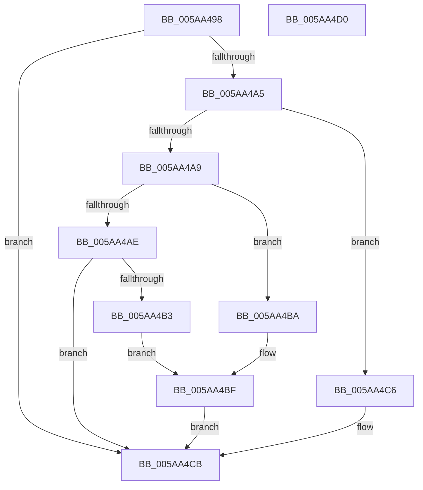

# PpvUtilFailDriver

- RVA: `0x005AA498`–`0x005AA4D1` (길이 `57` bytes)
- VA: `0x00000001405AA498`
- 실행 섹션: `.text`
- PDB 이름 있음: `예`; PDB Function 태그: `아니요`
- unwind 정보 RVA: `0x0005C788`
- 디코드: `18`개 명령, `57/57` bytes 표시
- 미해석 바이트: `0` (있으면 어셈블리에 `.byte`로 보존)

> 이 문서는 커널 이미지의 기계어와 PDB 기호를 분석해 생성했습니다. 4번과 5번은 함수 원형과 자료형을 바이너리 사용 방식에서 추정한 C 해석이며 원본 소스 복구 결과는 아닙니다.

## 1. Dependencies

- 직접 호출 지점: **2**; 고유 호출 대상: **2**
- 직접 호출자로 확인된 함수: **2**
- RIP 상대 이미지 참조: **1**

### Outgoing calls
- `0x005AA4BF` → [VfErrorReport8](../../pagevrfy/BA/VfErrorReport8_function_00BA3548.md) (function, `0x00BA3548`)
- `0x005AA4C6` → [VfErrorReport7](../../pagevrfy/BA/VfErrorReport7_function_00BA34B0.md) (function, `0x00BA34B0`)

### Direct callers
- [PiProcessNewDeviceNode](../../page/A2/PiProcessNewDeviceNode_function_00A28F20.md) at `0x00A2943C`
- [PiProcessNewDeviceNode](../../page/A2/PiProcessNewDeviceNode_function_00A28F20.md) at `0x00A29497`
- [sub_00B1F43A](../../page/B1/Unknown_function_00B1F43A.md) at `0x00B1F527`

### Static image references
- `0x005AA49C` → RVA `0x00E663C8` (`.data`; read)

## 2. Other-region calls and transfers

- 다른 실행 섹션으로 향하는 call: **2**
  - `0x005AA4BF` → [VfErrorReport8](../../pagevrfy/BA/VfErrorReport8_function_00BA3548.md) (`.text` → `PAGEVRFY`)
  - `0x005AA4C6` → [VfErrorReport7](../../pagevrfy/BA/VfErrorReport7_function_00BA34B0.md) (`.text` → `PAGEVRFY`)
- 별도 외부 분기/꼬리 이동을 확인하지 못했습니다.

## 3. Assembly (complete function range)

```asm
005AA498  48 83 EC 28                     sub rsp, 0x28
005AA49C  80 3D 25 BF 8B 00 00            cmp byte ptr [rip + 0x8bbf25], 0
005AA4A3  74 26                           je 0x1405aa4cb
005AA4A5  85 C9                           test ecx, ecx
005AA4A7  74 1D                           je 0x1405aa4c6
005AA4A9  83 E9 01                        sub ecx, 1
005AA4AC  74 0C                           je 0x1405aa4ba
005AA4AE  83 F9 01                        cmp ecx, 1
005AA4B1  75 18                           jne 0x1405aa4cb
005AA4B3  B9 4D 02 00 00                  mov ecx, 0x24d
005AA4B8  EB 05                           jmp 0x1405aa4bf
005AA4BA  B9 4B 02 00 00                  mov ecx, 0x24b
005AA4BF  E8 84 90 5F 00                  call 0x140ba3548
005AA4C4  EB 05                           jmp 0x1405aa4cb
005AA4C6  E8 E5 8F 5F 00                  call 0x140ba34b0
005AA4CB  48 83 C4 28                     add rsp, 0x28
005AA4CF  C3                              ret
005AA4D0  CC                              int3
```

## 4. C-style interpretation (structured pseudocode)

```c
__int64 __fastcall PpvUtilFailDriver(int a1)
{
    __int64 result;
    __int64 v_rsp;

    v_rsp = (v_rsp) - (40);
    if ((*(unsigned __int8 *)(v_rip + 9158437)) == 0) goto loc_005AA4CB;
    if (a1 == 0) goto loc_005AA4C6;
    a1 = (unsigned int)((a1) - (1));
    if (condition_is_equal) goto loc_005AA4BA;
    if (a1 != 1) goto loc_005AA4CB;
    goto loc_005AA4BF;
loc_005AA4BA:
loc_005AA4BF:
    result = VfErrorReport8(587, a2, a3, a4);
    goto loc_005AA4CB;
loc_005AA4C6:
    result = VfErrorReport7(587, a2, a3, a4);
loc_005AA4CB:
    v_rsp = (v_rsp) + (40);
    return result;
}
```

## 5. (Beta) C Style

```c
int64_t PpvUtilFailDriver(int32_t Arg1)
{
    int64_t result;
    int64_t local_rsp;

    local_rsp = (local_rsp) - (40);
    if ((*(uint8_t *)(v_rip + 0x8BBF25)) == 0) goto loc_005AA4CB;
    if (Arg1 == 0) goto loc_005AA4C6;
    Arg1 = (uint32_t)((Arg1) - (1));
    if (condition_is_equal) goto loc_005AA4BA;
    if (Arg1 != 1) goto loc_005AA4CB;
    goto loc_005AA4BF;
loc_005AA4BA:
loc_005AA4BF:
    result = VfErrorReport8(587, a2, a3, a4);
    goto loc_005AA4CB;
loc_005AA4C6:
    result = VfErrorReport7(587, a2, a3, a4);
loc_005AA4CB:
    local_rsp = (local_rsp) + (40);
    return result;
}
```

## 6. Execution-region graph

[열기: 2D/3D 그래프와 함수 탐색 컨트롤 패널](../../../control-panel.html?section=text&rva=0x005AA498&view=graph)

- 2D 그래프는 위에서 아래로 흐르고, 3D 그래프는 빈 공간을 드래그해 회전합니다. Shift+드래그는 이동, 휠은 확대·축소, 함수 노드 선택은 대상 보고서 이동입니다.

### Static fallback


