# RtlUnicodeStringCopyStringEx

- RVA: `0x005A4FC0`–`0x005A5221` (길이 `609` bytes)
- VA: `0x00000001405A4FC0`
- 실행 섹션: `.text`
- PDB 이름 있음: `예`; PDB Function 태그: `아니요`
- unwind 정보 RVA: `0x000BCDB8`
- 디코드: `177`개 명령, `609/609` bytes 표시
- 미해석 바이트: `0` (있으면 어셈블리에 `.byte`로 보존)

> 이 문서는 커널 이미지의 기계어와 PDB 기호를 분석해 생성했습니다. 4번과 5번은 함수 원형과 자료형을 바이너리 사용 방식에서 추정한 C 해석이며 원본 소스 복구 결과는 아닙니다.

## 1. Dependencies

- 직접 호출 지점: **2**; 고유 호출 대상: **1**
- 직접 호출자로 확인된 함수: **3**
- RIP 상대 이미지 참조: **1**

### Outgoing calls
- `0x005A5108` → [memset](../6C/memset_function_006C6C40.md) (function, `0x006C6C40`)
- `0x005A51F2` → [memset](../6C/memset_function_006C6C40.md) (function, `0x006C6C40`)

### Direct callers
- [PiDevCfgBuildDriverConfigurationId](../../page/AB/PiDevCfgBuildDriverConfigurationId_function_00ABC0D0.md) at `0x00ABC24C`
- [PiDevCfgLogDeviceConfigured](../../page/AD/PiDevCfgLogDeviceConfigured_function_00ADCDD4.md) at `0x00ADD205`
- [PiDevCfgLogDeviceConfigured](../../page/AD/PiDevCfgLogDeviceConfigured_function_00ADCDD4.md) at `0x00ADD392`
- [PipInitComputerIds](../../init/C7/PipInitComputerIds_function_00C74734.md) at `0x00C75635`
- [PipInitComputerIds](../../init/C7/PipInitComputerIds_function_00C74734.md) at `0x00C75795`

### Static image references
- `0x005A5077` → RVA `0x006C8EC0` (` ?? ::FNODOBFM::`string'`; read)

## 2. Other-region calls and transfers

- 다른 실행 섹션으로 향하는 call: **0**
- 별도 외부 분기/꼬리 이동을 확인하지 못했습니다.

## 3. Assembly (complete function range)

```asm
005A4FC0  48 8B C4                        mov rax, rsp
005A4FC3  48 89 58 08                     mov qword ptr [rax + 8], rbx
005A4FC7  48 89 68 10                     mov qword ptr [rax + 0x10], rbp
005A4FCB  48 89 70 20                     mov qword ptr [rax + 0x20], rsi
005A4FCF  4C 89 40 18                     mov qword ptr [rax + 0x18], r8
005A4FD3  57                              push rdi
005A4FD4  41 54                           push r12
005A4FD6  41 55                           push r13
005A4FD8  41 56                           push r14
005A4FDA  41 57                           push r15
005A4FDC  48 83 EC 20                     sub rsp, 0x20
005A4FE0  45 8B E9                        mov r13d, r9d
005A4FE3  4C 8B F9                        mov r15, rcx
005A4FE6  45 33 C9                        xor r9d, r9d
005A4FE9  48 85 C9                        test rcx, rcx
005A4FEC  75 07                           jne 0x1405a4ff5
005A4FEE  41 0F BA E5 08                  bt r13d, 8
005A4FF3  72 63                           jb 0x1405a5058
005A4FF5  0F B7 09                        movzx ecx, word ptr [rcx]
005A4FF8  F6 C1 01                        test cl, 1
005A4FFB  0F 85 FB 01 00 00               jne 0x1405a51fc
005A5001  41 0F B7 47 02                  movzx eax, word ptr [r15 + 2]
005A5006  A8 01                           test al, 1
005A5008  0F 85 EE 01 00 00               jne 0x1405a51fc
005A500E  66 3B C8                        cmp cx, ax
005A5011  0F 87 E5 01 00 00               ja 0x1405a51fc
005A5017  41 B8 FE FF 00 00               mov r8d, 0xfffe
005A501D  66 41 3B C0                     cmp ax, r8w
005A5021  0F 87 D5 01 00 00               ja 0x1405a51fc
005A5027  4D 39 4F 08                     cmp qword ptr [r15 + 8], r9
005A502B  75 12                           jne 0x1405a503f
005A502D  66 85 C9                        test cx, cx
005A5030  0F 85 C6 01 00 00               jne 0x1405a51fc
005A5036  66 85 C0                        test ax, ax
005A5039  0F 85 BD 01 00 00               jne 0x1405a51fc
005A503F  4D 85 FF                        test r15, r15
005A5042  74 14                           je 0x1405a5058
005A5044  45 0F B7 77 02                  movzx r14d, word ptr [r15 + 2]
005A5049  4D 8B 67 08                     mov r12, qword ptr [r15 + 8]
005A504D  49 D1 EE                        shr r14, 1
005A5050  4D 8B DC                        mov r11, r12
005A5053  4D 8B D6                        mov r10, r14
005A5056  EB 0C                           jmp 0x1405a5064
005A5058  4D 8B D1                        mov r10, r9
005A505B  4D 8B D9                        mov r11, r9
005A505E  4D 8B E1                        mov r12, r9
005A5061  4D 8B F1                        mov r14, r9
005A5064  41 0F BA E5 08                  bt r13d, 8
005A5069  49 8B EC                        mov rbp, r12
005A506C  49 8B FE                        mov rdi, r14
005A506F  49 8B F1                        mov rsi, r9
005A5072  73 11                           jae 0x1405a5085
005A5074  48 85 D2                        test rdx, rdx
005A5077  48 8D 05 42 3E 12 00            lea rax, [rip + 0x123e42]
005A507E  48 0F 45 C2                     cmovne rax, rdx
005A5082  48 8B D0                        mov rdx, rax
005A5085  41 8B D9                        mov ebx, r9d
005A5088  B8 05 00 00 80                  mov eax, 0x80000005
005A508D  41 F7 C5 00 E0 FF FF            test r13d, 0xffffe000
005A5094  74 10                           je 0x1405a50a6
005A5096  BB 0D 00 00 C0                  mov ebx, 0xc000000d
005A509B  4D 8B C1                        mov r8, r9
005A509E  48 8B D7                        mov rdx, rdi
005A50A1  49 8B CC                        mov rcx, r12
005A50A4  EB 23                           jmp 0x1405a50c9
005A50A6  4D 85 F6                        test r14, r14
005A50A9  0F 85 C2 00 00 00               jne 0x1405a5171
005A50AF  66 44 39 0A                     cmp word ptr [rdx], r9w
005A50B3  74 07                           je 0x1405a50bc
005A50B5  4D 85 E4                        test r12, r12
005A50B8  74 DC                           je 0x1405a5096
005A50BA  8B D8                           mov ebx, eax
005A50BC  4C 8B C6                        mov r8, rsi
005A50BF  48 8B D7                        mov rdx, rdi
005A50C2  48 8B CD                        mov rcx, rbp
005A50C5  85 DB                           test ebx, ebx
005A50C7  79 60                           jns 0x1405a5129
005A50C9  41 F7 C5 00 1C 00 00            test r13d, 0x1c00
005A50D0  74 57                           je 0x1405a5129
005A50D2  4D 85 F6                        test r14, r14
005A50D5  74 52                           je 0x1405a5129
005A50D7  41 8B C5                        mov eax, r13d
005A50DA  49 8B EB                        mov rbp, r11
005A50DD  25 00 10 00 00                  and eax, 0x1000
005A50E2  49 8B FA                        mov rdi, r10
005A50E5  49 8B F1                        mov rsi, r9
005A50E8  48 0F 44 E9                     cmove rbp, rcx
005A50EC  85 C0                           test eax, eax
005A50EE  48 0F 44 FA                     cmove rdi, rdx
005A50F2  49 0F 44 F0                     cmove rsi, r8
005A50F6  41 0F BA E5 0A                  bt r13d, 0xa
005A50FB  73 1C                           jae 0x1405a5119
005A50FD  4F 8D 04 36                     lea r8, [r14 + r14]
005A5101  41 0F B6 D5                     movzx edx, r13b
005A5105  49 8B CC                        mov rcx, r12
005A5108  E8 33 1B 12 00                  call 0x1406c6c40
005A510D  45 33 C9                        xor r9d, r9d
005A5110  49 8B EC                        mov rbp, r12
005A5113  41 8B F1                        mov esi, r9d
005A5116  49 8B FE                        mov rdi, r14
005A5119  41 0F BA E5 0B                  bt r13d, 0xb
005A511E  73 09                           jae 0x1405a5129
005A5120  49 8B EC                        mov rbp, r12
005A5123  49 8B FE                        mov rdi, r14
005A5126  49 8B F1                        mov rsi, r9
005A5129  33 D2                           xor edx, edx
005A512B  4D 85 FF                        test r15, r15
005A512E  74 07                           je 0x1405a5137
005A5130  66 03 F6                        add si, si
005A5133  66 41 89 37                     mov word ptr [r15], si
005A5137  B9 00 00 00 80                  mov ecx, 0x80000000
005A513C  8D 04 0B                        lea eax, [rbx + rcx]
005A513F  85 C1                           test ecx, eax
005A5141  75 0D                           jne 0x1405a5150
005A5143  B8 05 00 00 80                  mov eax, 0x80000005
005A5148  3B D8                           cmp ebx, eax
005A514A  0F 85 B1 00 00 00               jne 0x1405a5201
005A5150  48 8B 44 24 60                  mov rax, qword ptr [rsp + 0x60]
005A5155  48 85 C0                        test rax, rax
005A5158  0F 84 A3 00 00 00               je 0x1405a5201
005A515E  66 03 FF                        add di, di
005A5161  66 89 10                        mov word ptr [rax], dx
005A5164  66 89 78 02                     mov word ptr [rax + 2], di
005A5168  48 89 68 08                     mov qword ptr [rax + 8], rbp
005A516C  E9 90 00 00 00                  jmp 0x1405a5201
005A5171  4D 8B C4                        mov r8, r12
005A5174  B8 FF 7F 00 00                  mov eax, 0x7fff
005A5179  4C 2B C2                        sub r8, rdx
005A517C  49 8B CE                        mov rcx, r14
005A517F  48 85 C0                        test rax, rax
005A5182  74 3D                           je 0x1405a51c1
005A5184  44 0F B7 0A                     movzx r9d, word ptr [rdx]
005A5188  66 45 85 C9                     test r9w, r9w
005A518C  74 1A                           je 0x1405a51a8
005A518E  66 45 89 0C 10                  mov word ptr [r8 + rdx], r9w
005A5193  48 FF C8                        dec rax
005A5196  48 83 C2 02                     add rdx, 2
005A519A  45 33 C9                        xor r9d, r9d
005A519D  48 FF C6                        inc rsi
005A51A0  48 83 E9 01                     sub rcx, 1
005A51A4  75 D9                           jne 0x1405a517f
005A51A6  EB 03                           jmp 0x1405a51ab
005A51A8  45 33 C9                        xor r9d, r9d
005A51AB  48 85 C9                        test rcx, rcx
005A51AE  75 11                           jne 0x1405a51c1
005A51B0  48 85 C0                        test rax, rax
005A51B3  74 0C                           je 0x1405a51c1
005A51B5  66 44 39 0A                     cmp word ptr [rdx], r9w
005A51B9  B8 05 00 00 80                  mov eax, 0x80000005
005A51BE  0F 45 D8                        cmovne ebx, eax
005A51C1  49 8B FE                        mov rdi, r14
005A51C4  49 8D 2C 74                     lea rbp, [r12 + rsi*2]
005A51C8  48 2B FE                        sub rdi, rsi
005A51CB  85 DB                           test ebx, ebx
005A51CD  0F 88 E9 FE FF FF               js 0x1405a50bc
005A51D3  41 0F BA E5 09                  bt r13d, 9
005A51D8  0F 83 DE FE FF FF               jae 0x1405a50bc
005A51DE  48 85 FF                        test rdi, rdi
005A51E1  0F 84 D5 FE FF FF               je 0x1405a50bc
005A51E7  4C 8D 04 3F                     lea r8, [rdi + rdi]
005A51EB  41 0F B6 D5                     movzx edx, r13b
005A51EF  48 8B CD                        mov rcx, rbp
005A51F2  E8 49 1A 12 00                  call 0x1406c6c40
005A51F7  E9 2D FF FF FF                  jmp 0x1405a5129
005A51FC  BB 0D 00 00 C0                  mov ebx, 0xc000000d
005A5201  48 8B 6C 24 58                  mov rbp, qword ptr [rsp + 0x58]
005A5206  8B C3                           mov eax, ebx
005A5208  48 8B 5C 24 50                  mov rbx, qword ptr [rsp + 0x50]
005A520D  48 8B 74 24 68                  mov rsi, qword ptr [rsp + 0x68]
005A5212  48 83 C4 20                     add rsp, 0x20
005A5216  41 5F                           pop r15
005A5218  41 5E                           pop r14
005A521A  41 5D                           pop r13
005A521C  41 5C                           pop r12
005A521E  5F                              pop rdi
005A521F  C3                              ret
005A5220  CC                              int3
```

## 4. C-style interpretation (structured pseudocode)

```c
__int64 __fastcall RtlUnicodeStringCopyStringEx(__int64 a1, __int64 a2, __int64 a3, int a4)
{
    __int64 result;
    __int64 v_r14;
    __int64 v_rbp;
    __int64 v_rbx;
    __int64 v_rdi;
    __int64 v_rsi;
    __int64 v_rsp;
    unsigned __int64 v_stack_p10;
    unsigned __int64 v_stack_p18;
    unsigned __int64 v_stack_p20;
    unsigned __int64 v_stack_p8;

    *(unsigned __int64 *)(v_rsp + 8) = v_rbx;
    *(unsigned __int64 *)(v_rsp + 16) = v_rbp;
    *(unsigned __int64 *)(v_rsp + 32) = v_rsi;
    *(unsigned __int64 *)(v_rsp + 24) = a3;
    v_rsp = (v_rsp) - (32);
    a4 = 0;
    if (a1 != 0) goto loc_005A4FF5;
    if (condition_is_below) goto loc_005A5058;
loc_005A4FF5:
    if ((((unsigned __int8)(*(unsigned __int16 *)(a1))) & (1)) != 0) goto loc_005A51FC;
    if ((((unsigned __int8)(*(unsigned __int16 *)(a1 + 2))) & (1)) != 0) goto loc_005A51FC;
    if (((unsigned __int16)(*(unsigned __int16 *)(a1))) > ((unsigned __int16)(*(unsigned __int16 *)(a1 + 2)))) goto loc_005A51FC;
    if (((unsigned __int16)(*(unsigned __int16 *)(a1 + 2))) > ((unsigned __int16)((unsigned int)(0xFFFEULL)))) goto loc_005A51FC;
    if ((*(unsigned __int64 *)(a1 + 8)) != 0) goto loc_005A503F;
    if ((unsigned __int16)(*(unsigned __int16 *)(a1)) != 0) goto loc_005A51FC;
    if ((unsigned __int16)(*(unsigned __int16 *)(a1 + 2)) != 0) goto loc_005A51FC;
loc_005A503F:
    if (a1 == 0) goto loc_005A5058;
    v_r14 = (*(unsigned __int16 *)(a1 + 2)) >> (1);
    goto loc_005A5064;
loc_005A5058:
loc_005A5064:
    result = *(unsigned __int16 *)(a1 + 2);
    if (!(condition_is_above_or_equal)) {
        result = v_rip + 1195586;
        if (a2 != 0) { result = a2; }
        a2 = result;
    }
    if ((((unsigned int)((unsigned int)(a4))) & (0xFFFFE000ULL)) == 0) goto loc_005A50A6;
loc_005A5096:
    goto loc_005A50C9;
loc_005A50A6:
    if (0 != 0) goto loc_005A5171;
    if ((*(unsigned __int16 *)(0)) == 0) goto loc_005A50BC;
    if (0 == 0) goto loc_005A5096;
loc_005A50BC:
    if (!sign_flag) goto loc_005A5129;
loc_005A50C9:
    if ((((unsigned int)((unsigned int)(a4))) & (0x1C00ULL)) == 0) goto loc_005A5129;
    if (0 == 0) goto loc_005A5129;
    result = (unsigned int)(((unsigned int)((unsigned int)((unsigned int)(a4)))) & (0x1000ULL));
    v_rbp = 0;
    if (condition_is_equal) { v_rbp = 0; }
    v_rdi = 0;
    if ((unsigned int)(result) == 0) { v_rdi = 0; }
    v_rsi = 0;
    if ((unsigned int)(result) == 0) { v_rsi = 0; }
    if (!(condition_is_above_or_equal)) {
        a3 = 0 + 0 * 1;
        a2 = (unsigned __int8)((unsigned int)(a4));
        a1 = 0;
        result = memset(a1, a2, a3, a4);
        a4 = 0;
        v_rbp = 0;
        v_rsi = 0;
        v_rdi = 0;
    }
    if (!(condition_is_above_or_equal)) {
        v_rbp = 0;
        v_rdi = 0;
        v_rsi = 0;
    }
    a2 = 0;
    if (a1 != 0) {
        v_rsi = (unsigned __int16)((v_rsi) + ((unsigned __int16)(v_rsi)));
        *(unsigned __int16 *)(a1) = (unsigned __int16)(v_rsi);
    }
    if ((((unsigned int)((unsigned int)(0x80000000ULL))) & ((unsigned int)((unsigned int)((unsigned int)((unsigned int)(0x80000005ULL))) + (unsigned int)(0x80000000ULL) * 1))) != 0) goto loc_005A5150;
    if (((unsigned int)((unsigned int)((unsigned int)((unsigned int)(0x80000005ULL))))) != ((unsigned int)((unsigned int)(0x80000005ULL)))) goto loc_005A5201;
loc_005A5150:
    if (v_stack_p18 == 0) goto loc_005A5201;
    v_rdi = (unsigned __int16)((v_rdi) + ((unsigned __int16)(v_rdi)));
    *(unsigned __int16 *)(v_stack_p18) = 0;
    *(unsigned __int16 *)(v_stack_p18 + 2) = (unsigned __int16)(v_rdi);
    *(unsigned __int64 *)(v_stack_p18 + 8) = v_rbp;
    goto loc_005A5201;
loc_005A5171:
    a3 = (0) - (0);
loc_005A517F:
    if ((unsigned int)(0x7FFFULL) == 0) goto loc_005A51C1;
    if ((unsigned __int16)(*(unsigned __int16 *)(a2)) == 0) goto loc_005A51A8;
    *(unsigned __int16 *)(a3 + a2 * 1) = (unsigned __int16)(*(unsigned __int16 *)(a2));
    result = ((unsigned int)(0x7FFFULL)) - 1;
    a2 = (a2) + (2);
    a4 = 0;
    v_rsi = (v_rsi) + 1;
    a1 = (0) - (1);
    if (condition_is_not_equal) goto loc_005A517F;
    goto loc_005A51AB;
loc_005A51A8:
    a4 = 0;
loc_005A51AB:
    if (a1 != 0) goto loc_005A51C1;
    v_rbx = (unsigned int)((unsigned int)((unsigned int)(0x80000005ULL)));
    if (result != 0) {
        result = 0x80000005ULL;
        v_rbx = (unsigned int)((unsigned int)((unsigned int)(0x80000005ULL)));
        if ((*(unsigned __int16 *)(a2)) != 0) { v_rbx = (unsigned int)(result); }
    }
    v_rdi = (0) - (v_rsi);
    if (sign_flag) goto loc_005A50BC;
    if (condition_is_above_or_equal) goto loc_005A50BC;
    if (v_rdi == 0) goto loc_005A50BC;
    result = memset(0 + v_rsi * 2, (unsigned __int8)((unsigned int)(a4)), v_rdi + v_rdi * 1, a4);
    goto loc_005A5129;
loc_005A51FC:
loc_005A5201:
    v_rsp = (v_rsp) + (32);
    return (unsigned int)((unsigned int)((unsigned int)(0xC000000DULL)));
}
```

## 5. (Beta) C Style

```c
int64_t RtlUnicodeStringCopyStringEx(void *Arg1, int64_t Arg2, int64_t Arg3, int32_t Arg4)
{
    uint8_t *arg1 = (uint8_t *)Arg1;

    int64_t result;
    int64_t local_r14;
    int64_t local_rbp;
    int64_t local_rbx;
    int64_t local_rdi;
    int64_t local_rsi;
    int64_t local_rsp;
    uint64_t v_stack_p10;
    uint64_t v_stack_p18;
    uint64_t v_stack_p20;
    uint64_t v_stack_p8;

    *(uint64_t *)(local_rsp + 0x8) = local_rbx;
    *(uint64_t *)(local_rsp + 0x10) = local_rbp;
    *(uint64_t *)(local_rsp + 0x20) = local_rsi;
    *(uint64_t *)(local_rsp + 0x18) = Arg3;
    local_rsp = (local_rsp) - (32);
    Arg4 = 0;
    if (Arg1 != NULL) goto loc_005A4FF5;
    if (condition_is_below) goto loc_005A5058;
loc_005A4FF5:
    if ((((uint8_t)(*(uint16_t *)(arg1))) & (1)) != 0) goto loc_005A51FC;
    if ((((uint8_t)(*(uint16_t *)(arg1 + 0x2))) & (1)) != 0) goto loc_005A51FC;
    if (((uint16_t)(*(uint16_t *)(arg1))) > ((uint16_t)(*(uint16_t *)(arg1 + 0x2)))) goto loc_005A51FC;
    if (((uint16_t)(*(uint16_t *)(arg1 + 0x2))) > ((uint16_t)((uint32_t)(0xFFFEULL)))) goto loc_005A51FC;
    if ((*(uint64_t *)(arg1 + 0x8)) != 0) goto loc_005A503F;
    if ((uint16_t)(*(uint16_t *)(arg1)) != 0) goto loc_005A51FC;
    if ((uint16_t)(*(uint16_t *)(arg1 + 0x2)) != 0) goto loc_005A51FC;
loc_005A503F:
    if (Arg1 == NULL) goto loc_005A5058;
    local_r14 = (*(uint16_t *)(arg1 + 0x2)) >> (1);
    goto loc_005A5064;
loc_005A5058:
loc_005A5064:
    result = *(uint16_t *)(arg1 + 0x2);
    if (!(condition_is_above_or_equal)) {
        result = v_rip + 1195586;
        if (Arg2 != 0) { result = Arg2; }
        Arg2 = result;
    }
    if ((((uint32_t)((uint32_t)(Arg4))) & (0xFFFFE000ULL)) == 0) goto loc_005A50A6;
loc_005A5096:
    goto loc_005A50C9;
loc_005A50A6:
    if (0 != 0) goto loc_005A5171;
    if ((*(uint16_t *)(0)) == 0) goto loc_005A50BC;
    if (0 == 0) goto loc_005A5096;
loc_005A50BC:
    if (!sign_flag) goto loc_005A5129;
loc_005A50C9:
    if ((((uint32_t)((uint32_t)(Arg4))) & (0x1C00ULL)) == 0) goto loc_005A5129;
    if (0 == 0) goto loc_005A5129;
    result = (uint32_t)(((uint32_t)((uint32_t)((uint32_t)(Arg4)))) & (0x1000ULL));
    local_rbp = 0;
    if (condition_is_equal) { local_rbp = 0; }
    local_rdi = 0;
    if ((uint32_t)(result) == 0) { local_rdi = 0; }
    local_rsi = 0;
    if ((uint32_t)(result) == 0) { local_rsi = 0; }
    if (!(condition_is_above_or_equal)) {
        Arg3 = 0 + 0 * 1;
        Arg2 = (uint8_t)((uint32_t)(Arg4));
        Arg1 = 0;
        result = memset(Arg1, Arg2, Arg3, Arg4);
        Arg4 = 0;
        local_rbp = 0;
        local_rsi = 0;
        local_rdi = 0;
    }
    if (!(condition_is_above_or_equal)) {
        local_rbp = 0;
        local_rdi = 0;
        local_rsi = 0;
    }
    Arg2 = 0;
    if (Arg1 != NULL) {
        local_rsi = (uint16_t)((local_rsi) + ((uint16_t)(local_rsi)));
        *(uint16_t *)(arg1) = (uint16_t)(local_rsi);
    }
    if ((((uint32_t)((uint32_t)(0x80000000ULL))) & ((uint32_t)((uint32_t)((uint32_t)((uint32_t)(0x80000005ULL))) + (uint32_t)(0x80000000ULL) * 1))) != 0) goto loc_005A5150;
    if (((uint32_t)((uint32_t)((uint32_t)((uint32_t)(0x80000005ULL))))) != ((uint32_t)((uint32_t)(0x80000005ULL)))) goto loc_005A5201;
loc_005A5150:
    if (v_stack_p18 == 0) goto loc_005A5201;
    local_rdi = (uint16_t)((local_rdi) + ((uint16_t)(local_rdi)));
    *(uint16_t *)(v_stack_p18) = 0;
    *(uint16_t *)(v_stack_p18 + 0x2) = (uint16_t)(local_rdi);
    *(uint64_t *)(v_stack_p18 + 0x8) = local_rbp;
    goto loc_005A5201;
loc_005A5171:
    Arg3 = (0) - (0);
loc_005A517F:
    if ((uint32_t)(0x7FFFULL) == 0) goto loc_005A51C1;
    if ((uint16_t)(*(uint16_t *)(Arg2)) == 0) goto loc_005A51A8;
    *(uint16_t *)(Arg3 + Arg2 * 1) = (uint16_t)(*(uint16_t *)(Arg2));
    result = ((uint32_t)(0x7FFFULL)) - 1;
    Arg2 = (Arg2) + (2);
    Arg4 = 0;
    local_rsi = (local_rsi) + 1;
    Arg1 = (0) - (1);
    if (condition_is_not_equal) goto loc_005A517F;
    goto loc_005A51AB;
loc_005A51A8:
    Arg4 = 0;
loc_005A51AB:
    if (Arg1 != NULL) goto loc_005A51C1;
    local_rbx = (uint32_t)((uint32_t)((uint32_t)(0x80000005ULL)));
    if (result != 0) {
        result = 0x80000005ULL;
        local_rbx = (uint32_t)((uint32_t)((uint32_t)(0x80000005ULL)));
        if ((*(uint16_t *)(Arg2)) != 0) { local_rbx = (uint32_t)(result); }
    }
    local_rdi = (0) - (local_rsi);
    if (sign_flag) goto loc_005A50BC;
    if (condition_is_above_or_equal) goto loc_005A50BC;
    if (local_rdi == 0) goto loc_005A50BC;
    result = memset(0 + local_rsi * 2, (uint8_t)((uint32_t)(Arg4)), local_rdi + local_rdi * 1, Arg4);
    goto loc_005A5129;
loc_005A51FC:
loc_005A5201:
    local_rsp = (local_rsp) + (32);
    return (uint32_t)((uint32_t)((uint32_t)(0xC000000DULL)));
}
```

### 관측된 메모리 오프셋

구조체 형식이 확인되지 않은 접근은 인자 기준의 오프셋으로만 기록했습니다.

| 기준 인자 | 오프셋 표현 | 폭 (bit) | 접근 |
|---|---:|---:|---|
| `Arg1` | `+ 0x2` | `16` | `R` |
| `Arg1` | `+ 0x8` | `64` | `R` |

## 6. Execution-region graph

[열기: 2D/3D 그래프와 함수 탐색 컨트롤 패널](../../../control-panel.html?section=text&rva=0x005A4FC0&view=graph)

- 2D 그래프는 위에서 아래로 흐르고, 3D 그래프는 빈 공간을 드래그해 회전합니다. Shift+드래그는 이동, 휠은 확대·축소, 함수 노드 선택은 대상 보고서 이동입니다.

### Static fallback

```mermaid
flowchart TD
  bb_005A4FC0[BB_005A4FC0]
  bb_005A4FEE[BB_005A4FEE]
  bb_005A4FF5[BB_005A4FF5]
  bb_005A5001[BB_005A5001]
  bb_005A500E[BB_005A500E]
  bb_005A5017[BB_005A5017]
  bb_005A5027[BB_005A5027]
  bb_005A502D[BB_005A502D]
  bb_005A5036[BB_005A5036]
  bb_005A503F[BB_005A503F]
  bb_005A5044[BB_005A5044]
  bb_005A5058[BB_005A5058]
  bb_005A5064[BB_005A5064]
  bb_005A5074[BB_005A5074]
  bb_005A5085[BB_005A5085]
  bb_005A5096[BB_005A5096]
  bb_005A50A6[BB_005A50A6]
  bb_005A50AF[BB_005A50AF]
  bb_005A50B5[BB_005A50B5]
  bb_005A50BA[BB_005A50BA]
  bb_005A50BC[BB_005A50BC]
  bb_005A50C9[BB_005A50C9]
  bb_005A50D2[BB_005A50D2]
  bb_005A50D7[BB_005A50D7]
  bb_005A50FD[BB_005A50FD]
  bb_005A5119[BB_005A5119]
  bb_005A5120[BB_005A5120]
  bb_005A5129[BB_005A5129]
  bb_005A5130[BB_005A5130]
  bb_005A5137[BB_005A5137]
  bb_005A5143[BB_005A5143]
  bb_005A5150[BB_005A5150]
  bb_005A515E[BB_005A515E]
  bb_005A5171[BB_005A5171]
  bb_005A517F[BB_005A517F]
  bb_005A5184[BB_005A5184]
  bb_005A518E[BB_005A518E]
  bb_005A51A6[BB_005A51A6]
  bb_005A51A8[BB_005A51A8]
  bb_005A51AB[BB_005A51AB]
  bb_005A51B0[BB_005A51B0]
  bb_005A51B5[BB_005A51B5]
  bb_005A51C1[BB_005A51C1]
  bb_005A51D3[BB_005A51D3]
  bb_005A51DE[BB_005A51DE]
  bb_005A51E7[BB_005A51E7]
  bb_005A51FC[BB_005A51FC]
  bb_005A5201[BB_005A5201]
  bb_005A5220[BB_005A5220]
  bb_005A4FC0 -->|branch| bb_005A4FF5
  bb_005A4FC0 -->|fallthrough| bb_005A4FEE
  bb_005A4FEE -->|branch| bb_005A5058
  bb_005A4FEE -->|fallthrough| bb_005A4FF5
  bb_005A4FF5 -->|branch| bb_005A51FC
  bb_005A4FF5 -->|fallthrough| bb_005A5001
  bb_005A5001 -->|branch| bb_005A51FC
  bb_005A5001 -->|fallthrough| bb_005A500E
  bb_005A500E -->|branch| bb_005A51FC
  bb_005A500E -->|fallthrough| bb_005A5017
  bb_005A5017 -->|branch| bb_005A51FC
  bb_005A5017 -->|fallthrough| bb_005A5027
  bb_005A5027 -->|branch| bb_005A503F
  bb_005A5027 -->|fallthrough| bb_005A502D
  bb_005A502D -->|branch| bb_005A51FC
  bb_005A502D -->|fallthrough| bb_005A5036
  bb_005A5036 -->|branch| bb_005A51FC
  bb_005A5036 -->|fallthrough| bb_005A503F
  bb_005A503F -->|branch| bb_005A5058
  bb_005A503F -->|fallthrough| bb_005A5044
  bb_005A5044 -->|branch| bb_005A5064
  bb_005A5058 -->|flow| bb_005A5064
  bb_005A5064 -->|branch| bb_005A5085
  bb_005A5064 -->|fallthrough| bb_005A5074
  bb_005A5074 -->|flow| bb_005A5085
  bb_005A5085 -->|branch| bb_005A50A6
  bb_005A5085 -->|fallthrough| bb_005A5096
  bb_005A5096 -->|branch| bb_005A50C9
  bb_005A50A6 -->|branch| bb_005A5171
  bb_005A50A6 -->|fallthrough| bb_005A50AF
  bb_005A50AF -->|branch| bb_005A50BC
  bb_005A50AF -->|fallthrough| bb_005A50B5
  bb_005A50B5 -->|branch| bb_005A5096
  bb_005A50B5 -->|fallthrough| bb_005A50BA
  bb_005A50BA -->|flow| bb_005A50BC
  bb_005A50BC -->|branch| bb_005A5129
  bb_005A50BC -->|fallthrough| bb_005A50C9
  bb_005A50C9 -->|branch| bb_005A5129
  bb_005A50C9 -->|fallthrough| bb_005A50D2
  bb_005A50D2 -->|branch| bb_005A5129
  bb_005A50D2 -->|fallthrough| bb_005A50D7
  bb_005A50D7 -->|branch| bb_005A5119
  bb_005A50D7 -->|fallthrough| bb_005A50FD
  bb_005A50FD -->|flow| bb_005A5119
  bb_005A5119 -->|branch| bb_005A5129
  bb_005A5119 -->|fallthrough| bb_005A5120
  bb_005A5120 -->|flow| bb_005A5129
  bb_005A5129 -->|branch| bb_005A5137
  bb_005A5129 -->|fallthrough| bb_005A5130
  bb_005A5130 -->|flow| bb_005A5137
  bb_005A5137 -->|branch| bb_005A5150
  bb_005A5137 -->|fallthrough| bb_005A5143
  bb_005A5143 -->|branch| bb_005A5201
  bb_005A5143 -->|fallthrough| bb_005A5150
  bb_005A5150 -->|branch| bb_005A5201
  bb_005A5150 -->|fallthrough| bb_005A515E
  bb_005A515E -->|branch| bb_005A5201
  bb_005A5171 -->|flow| bb_005A517F
  bb_005A517F -->|branch| bb_005A51C1
  bb_005A517F -->|fallthrough| bb_005A5184
  bb_005A5184 -->|branch| bb_005A51A8
  bb_005A5184 -->|fallthrough| bb_005A518E
  bb_005A518E -->|branch| bb_005A517F
  bb_005A518E -->|fallthrough| bb_005A51A6
  bb_005A51A6 -->|branch| bb_005A51AB
  bb_005A51A8 -->|flow| bb_005A51AB
  bb_005A51AB -->|branch| bb_005A51C1
  bb_005A51AB -->|fallthrough| bb_005A51B0
  bb_005A51B0 -->|branch| bb_005A51C1
  bb_005A51B0 -->|fallthrough| bb_005A51B5
  bb_005A51B5 -->|flow| bb_005A51C1
  bb_005A51C1 -->|branch| bb_005A50BC
  bb_005A51C1 -->|fallthrough| bb_005A51D3
  bb_005A51D3 -->|branch| bb_005A50BC
  bb_005A51D3 -->|fallthrough| bb_005A51DE
  bb_005A51DE -->|branch| bb_005A50BC
  bb_005A51DE -->|fallthrough| bb_005A51E7
  bb_005A51E7 -->|branch| bb_005A5129
  bb_005A51FC -->|flow| bb_005A5201
```


