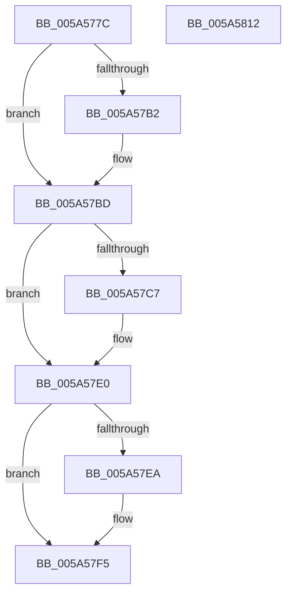

# RtlUnicodeStringExHandleOtherFlags

- RVA: `0x005A577C`–`0x005A5813` (길이 `151` bytes)
- VA: `0x00000001405A577C`
- 실행 섹션: `.text`
- PDB 이름 있음: `예`; PDB Function 태그: `예`
- unwind 정보 RVA: `0x000C4FC0`
- 디코드: `39`개 명령, `151/151` bytes 표시
- 미해석 바이트: `0` (있으면 어셈블리에 `.byte`로 보존)

> 이 문서는 커널 이미지의 기계어와 PDB 기호를 분석해 생성했습니다. 4번과 5번은 함수 원형과 자료형을 바이너리 사용 방식에서 추정한 C 해석이며 원본 소스 복구 결과는 아닙니다.

## 1. Dependencies

- 직접 호출 지점: **1**; 고유 호출 대상: **1**
- 직접 호출자로 확인된 함수: **1**
- RIP 상대 이미지 참조: **0**

### Outgoing calls
- `0x005A57D0` → [memset](../6C/memset_function_006C6C40.md) (function, `0x006C6C40`)

### Direct callers
- [RtlUnicodeStringPrintfEx](../4A/RtlUnicodeStringPrintfEx_function_004A8FD0.md) at `0x004A91C6`

### Static image references
- 디코드된 RIP-relative 메모리 참조가 없습니다.

## 2. Other-region calls and transfers

- 다른 실행 섹션으로 향하는 call: **0**
- 별도 외부 분기/꼬리 이동을 확인하지 못했습니다.

## 3. Assembly (complete function range)

```asm
005A577C  48 8B C4                        mov rax, rsp
005A577F  48 89 58 08                     mov qword ptr [rax + 8], rbx
005A5783  48 89 68 10                     mov qword ptr [rax + 0x10], rbp
005A5787  48 89 78 18                     mov qword ptr [rax + 0x18], rdi
005A578B  4C 89 70 20                     mov qword ptr [rax + 0x20], r14
005A578F  41 57                           push r15
005A5791  48 83 EC 20                     sub rsp, 0x20
005A5795  F7 44 24 60 00 10 00 00         test dword ptr [rsp + 0x60], 0x1000
005A579D  4D 8B F1                        mov r14, r9
005A57A0  4C 8B 7C 24 58                  mov r15, qword ptr [rsp + 0x58]
005A57A5  48 8B DA                        mov rbx, rdx
005A57A8  48 8B 6C 24 50                  mov rbp, qword ptr [rsp + 0x50]
005A57AD  48 8B F9                        mov rdi, rcx
005A57B0  74 0B                           je 0x1405a57bd
005A57B2  49 83 21 00                     and qword ptr [r9], 0
005A57B6  48 89 4D 00                     mov qword ptr [rbp], rcx
005A57BA  49 89 17                        mov qword ptr [r15], rdx
005A57BD  F7 44 24 60 00 04 00 00         test dword ptr [rsp + 0x60], 0x400
005A57C5  74 19                           je 0x1405a57e0
005A57C7  4C 8D 04 12                     lea r8, [rdx + rdx]
005A57CB  0F B6 54 24 60                  movzx edx, byte ptr [rsp + 0x60]
005A57D0  E8 6B 14 12 00                  call 0x1406c6c40
005A57D5  49 83 26 00                     and qword ptr [r14], 0
005A57D9  48 89 7D 00                     mov qword ptr [rbp], rdi
005A57DD  49 89 1F                        mov qword ptr [r15], rbx
005A57E0  F7 44 24 60 00 08 00 00         test dword ptr [rsp + 0x60], 0x800
005A57E8  74 0B                           je 0x1405a57f5
005A57EA  49 83 26 00                     and qword ptr [r14], 0
005A57EE  48 89 7D 00                     mov qword ptr [rbp], rdi
005A57F2  49 89 1F                        mov qword ptr [r15], rbx
005A57F5  48 8B 5C 24 30                  mov rbx, qword ptr [rsp + 0x30]
005A57FA  33 C0                           xor eax, eax
005A57FC  48 8B 6C 24 38                  mov rbp, qword ptr [rsp + 0x38]
005A5801  48 8B 7C 24 40                  mov rdi, qword ptr [rsp + 0x40]
005A5806  4C 8B 74 24 48                  mov r14, qword ptr [rsp + 0x48]
005A580B  48 83 C4 20                     add rsp, 0x20
005A580F  41 5F                           pop r15
005A5811  C3                              ret
005A5812  CC                              int3
```

## 4. C-style interpretation (structured pseudocode)

```c
__int64 __fastcall RtlUnicodeStringExHandleOtherFlags(__int64 a1, __int64 a2, __int64 a3, __int64 a4, __int64 a5, __int64 a6, unsigned __int8 a7)
{
    __int64 result;
    __int64 v_rsp;
    unsigned __int64 v_stack_p10;
    unsigned __int64 v_stack_p18;
    unsigned __int64 v_stack_p20;
    unsigned __int64 v_stack_p8;

    *(unsigned __int64 *)(v_rsp + 8) = v_rbx;
    *(unsigned __int64 *)(v_rsp + 16) = v_rbp;
    *(unsigned __int64 *)(v_rsp + 24) = v_rdi;
    *(unsigned __int64 *)(v_rsp + 32) = v_r14;
    v_rsp = (v_rsp) - (32);
    if (((a7) & (0x1000ULL)) != 0) {
        *(unsigned __int64 *)(a5) = a1;
        *(unsigned __int64 *)(a6) = a2;
    }
    result = v_rsp;
    if (((a7) & (0x400ULL)) != 0) {
        a3 = a2 + a2 * 1;
        a2 = a7;
        result = memset(a1, a2, a3, a4);
        *(unsigned __int64 *)(a5) = a1;
        *(unsigned __int64 *)(a6) = a2;
    }
    if (((a7) & (0x800ULL)) != 0) {
        *(unsigned __int64 *)(a5) = a1;
        *(unsigned __int64 *)(a6) = a2;
    }
    result = 0;
    v_rsp = (v_rsp) + (32);
    return result;
}
```

## 5. (Beta) C Style

```c
int64_t RtlUnicodeStringExHandleOtherFlags(int64_t Arg1, void *Arg2, int64_t Arg3, void *Arg4, void *Arg5, void *Arg6, uint8_t Arg7)
{
    uint8_t *arg2 = (uint8_t *)Arg2;
    uint8_t *arg4 = (uint8_t *)Arg4;
    uint8_t *arg5 = (uint8_t *)Arg5;
    uint8_t *arg6 = (uint8_t *)Arg6;

    int64_t result;
    int64_t local_rsp;
    uint64_t v_stack_p10;
    uint64_t v_stack_p18;
    uint64_t v_stack_p20;
    uint64_t v_stack_p8;

    *(uint64_t *)(local_rsp + 0x8) = local_rbx;
    *(uint64_t *)(local_rsp + 0x10) = local_rbp;
    *(uint64_t *)(local_rsp + 0x18) = local_rdi;
    *(uint64_t *)(local_rsp + 0x20) = local_r14;
    local_rsp = (local_rsp) - (32);
    if (((Arg7) & (0x1000ULL)) != 0) {
        *(uint64_t *)(arg5) = Arg1;
        *(void **)(arg6) = Arg2;
    }
    result = local_rsp;
    if (((Arg7) & (0x400ULL)) != 0) {
        Arg3 = Arg2 + Arg2 * 1;
        Arg2 = Arg7;
        result = memset(Arg1, Arg2, Arg3, Arg4);
        *(uint64_t *)(arg5) = Arg1;
        *(void **)(arg6) = Arg2;
    }
    if (((Arg7) & (0x800ULL)) != 0) {
        *(uint64_t *)(arg5) = Arg1;
        *(void **)(arg6) = Arg2;
    }
    result = 0;
    local_rsp = (local_rsp) + (32);
    return result;
}
```

### 관측된 메모리 오프셋

구조체 형식이 확인되지 않은 접근은 인자 기준의 오프셋으로만 기록했습니다.

| 기준 인자 | 오프셋 표현 | 폭 (bit) | 접근 |
|---|---:|---:|---|
| `Arg2` | `+ 0x0 + rdx*1` | `64` | `R` |
| `Arg4` | `+ 0x0` | `64` | `R/W` |
| `Arg5` | `+ 0x0` | `64` | `W` |
| `Arg6` | `+ 0x0` | `64` | `W` |

## 6. Execution-region graph

[열기: 2D/3D 그래프와 함수 탐색 컨트롤 패널](../../../control-panel.html?section=text&rva=0x005A577C&view=graph)

- 2D 그래프는 위에서 아래로 흐르고, 3D 그래프는 빈 공간을 드래그해 회전합니다. Shift+드래그는 이동, 휠은 확대·축소, 함수 노드 선택은 대상 보고서 이동입니다.

### Static fallback


