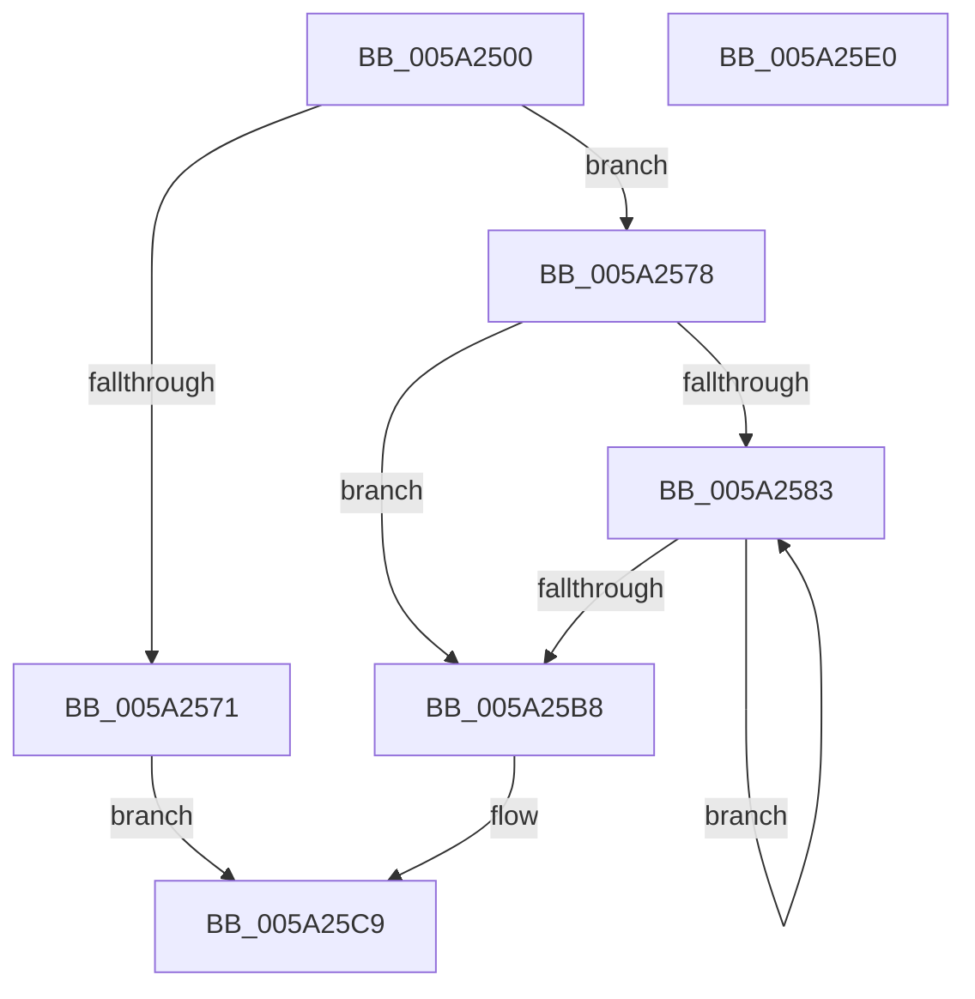

# SecureDump_ConvertBinaryToHexString

- RVA: `0x005A2500`–`0x005A25E1` (길이 `225` bytes)
- VA: `0x00000001405A2500`
- 실행 섹션: `.text`
- PDB 이름 있음: `예`; PDB Function 태그: `아니요`
- unwind 정보 RVA: `0x000C7DFC`
- 디코드: `63`개 명령, `225/225` bytes 표시
- 미해석 바이트: `0` (있으면 어셈블리에 `.byte`로 보존)

> 이 문서는 커널 이미지의 기계어와 PDB 기호를 분석해 생성했습니다. 4번과 5번은 함수 원형과 자료형을 바이너리 사용 방식에서 추정한 C 해석이며 원본 소스 복구 결과는 아닙니다.

## 1. Dependencies

- 직접 호출 지점: **1**; 고유 호출 대상: **1**
- 직접 호출자로 확인된 함수: **1**
- RIP 상대 이미지 참조: **1**

### Outgoing calls
- `0x005A25D0` → [_security_check_cookie](../6A/_security_check_cookie_function_006AC640.md) (function, `0x006AC640`)

### Direct callers
- [SecureDump_LoadCertAndProvisionKey](SecureDump_LoadCertAndProvisionKey_function_005A2E04.md) at `0x005A30AA`

### Static image references
- `0x005A250E` → RVA `0x00E0A740` (`.data`; read)

## 2. Other-region calls and transfers

- 다른 실행 섹션으로 향하는 call: **0**
- 별도 외부 분기/꼬리 이동을 확인하지 못했습니다.

## 3. Assembly (complete function range)

```asm
005A2500  40 55                           push rbp
005A2502  53                              push rbx
005A2503  56                              push rsi
005A2504  57                              push rdi
005A2505  41 56                           push r14
005A2507  48 8B EC                        mov rbp, rsp
005A250A  48 83 EC 30                     sub rsp, 0x30
005A250E  48 8B 05 2B 82 86 00            mov rax, qword ptr [rip + 0x86822b]
005A2515  48 33 C4                        xor rax, rsp
005A2518  48 89 45 F0                     mov qword ptr [rbp - 0x10], rax
005A251C  41 8B 01                        mov eax, dword ptr [r9]
005A251F  8D 34 12                        lea esi, [rdx + rdx]
005A2522  4C 8B D9                        mov r11, rcx
005A2525  C7 45 D0 30 00 31 00            mov dword ptr [rbp - 0x30], 0x310030
005A252C  8D 4E 01                        lea ecx, [rsi + 1]
005A252F  C7 45 D4 32 00 33 00            mov dword ptr [rbp - 0x2c], 0x330032
005A2536  48 03 C9                        add rcx, rcx
005A2539  C7 45 D8 34 00 35 00            mov dword ptr [rbp - 0x28], 0x350034
005A2540  C7 45 DC 36 00 37 00            mov dword ptr [rbp - 0x24], 0x370036
005A2547  49 8B F9                        mov rdi, r9
005A254A  C7 45 E0 38 00 39 00            mov dword ptr [rbp - 0x20], 0x390038
005A2551  49 8B D8                        mov rbx, r8
005A2554  C7 45 E4 41 00 42 00            mov dword ptr [rbp - 0x1c], 0x420041
005A255B  44 8B D2                        mov r10d, edx
005A255E  C7 45 E8 43 00 44 00            mov dword ptr [rbp - 0x18], 0x440043
005A2565  C7 45 EC 45 00 46 00            mov dword ptr [rbp - 0x14], 0x460045
005A256C  48 3B C1                        cmp rax, rcx
005A256F  73 07                           jae 0x1405a2578
005A2571  B8 23 00 00 C0                  mov eax, 0xc0000023
005A2576  EB 51                           jmp 0x1405a25c9
005A2578  45 33 F6                        xor r14d, r14d
005A257B  45 8B CE                        mov r9d, r14d
005A257E  45 85 D2                        test r10d, r10d
005A2581  74 35                           je 0x1405a25b8
005A2583  41 0F B6 03                     movzx eax, byte ptr [r11]
005A2587  47 8D 04 09                     lea r8d, [r9 + r9]
005A258B  48 C1 E8 04                     shr rax, 4
005A258F  41 8D 48 01                     lea ecx, [r8 + 1]
005A2593  41 FF C1                        inc r9d
005A2596  0F B7 44 45 D0                  movzx eax, word ptr [rbp + rax*2 - 0x30]
005A259B  66 42 89 04 43                  mov word ptr [rbx + r8*2], ax
005A25A0  41 0F B6 13                     movzx edx, byte ptr [r11]
005A25A4  49 FF C3                        inc r11
005A25A7  83 E2 0F                        and edx, 0xf
005A25AA  0F B7 44 55 D0                  movzx eax, word ptr [rbp + rdx*2 - 0x30]
005A25AF  66 89 04 4B                     mov word ptr [rbx + rcx*2], ax
005A25B3  45 3B CA                        cmp r9d, r10d
005A25B6  72 CB                           jb 0x1405a2583
005A25B8  42 8D 04 95 02 00 00 00         lea eax, [r10*4 + 2]
005A25C0  66 44 89 34 73                  mov word ptr [rbx + rsi*2], r14w
005A25C5  89 07                           mov dword ptr [rdi], eax
005A25C7  33 C0                           xor eax, eax
005A25C9  48 8B 4D F0                     mov rcx, qword ptr [rbp - 0x10]
005A25CD  48 33 CC                        xor rcx, rsp
005A25D0  E8 6B A0 10 00                  call 0x1406ac640
005A25D5  48 83 C4 30                     add rsp, 0x30
005A25D9  41 5E                           pop r14
005A25DB  5F                              pop rdi
005A25DC  5E                              pop rsi
005A25DD  5B                              pop rbx
005A25DE  5D                              pop rbp
005A25DF  C3                              ret
005A25E0  CC                              int3
```

## 4. C-style interpretation (structured pseudocode)

```c
__int64 __fastcall SecureDump_ConvertBinaryToHexString(__int64 a1, __int64 a2, __int64 a3, __int64 a4)
{
    __int64 result;
    __int64 v_r11;
    __int64 v_r14;
    __int64 v_rsp;
    unsigned __int64 v_stack_m38;
    unsigned int v_stack_m3C;
    unsigned int v_stack_m40;
    unsigned int v_stack_m44;
    unsigned int v_stack_m48;
    unsigned int v_stack_m4C;
    unsigned int v_stack_m50;
    unsigned int v_stack_m54;
    unsigned int v_stack_m58;

    v_rsp = (v_rsp) - (48);
    result = (*(unsigned __int64 *)(v_rip + 8815147)) ^ (v_rsp);
    v_stack_m38 = result;
    v_stack_m58 = 0x310030ULL;
    v_stack_m54 = 0x330032ULL;
    a1 = (a2 + a2 * 1 + 1) + (a2 + a2 * 1 + 1);
    v_stack_m50 = 0x350034ULL;
    v_stack_m4C = 0x370036ULL;
    v_stack_m48 = 0x390038ULL;
    v_stack_m44 = 0x420041ULL;
    v_stack_m40 = 0x440043ULL;
    v_stack_m3C = 0x460045ULL;
    if (((unsigned int)(*(unsigned int *)(a4))) >= a1) goto loc_005A2578;
    goto loc_005A25C9;
loc_005A2578:
    v_r14 = 0;
    if ((unsigned int)((unsigned int)((unsigned int)(a2))) == 0) goto loc_005A25B8;
loc_005A2583:
    result = (*(unsigned __int8 *)(a1)) >> (4);
    a4 = (unsigned int)((0) + 1);
    *(unsigned __int16 *)(a3 + 0 + 0 * 1 * 2) = (unsigned __int16)(*(unsigned __int16 *)(v_rsp + result * 2 - 48));
    v_r11 = (a1) + 1;
    a2 = (unsigned int)((*(unsigned __int8 *)(a1)) & (15));
    *(unsigned __int16 *)(a3 + 0 + 0 * 1 + 1 * 2) = (unsigned __int16)(*(unsigned __int16 *)(v_rsp + a2 * 2 - 48));
    if (((unsigned int)(a4)) < ((unsigned int)((unsigned int)((unsigned int)(a2))))) goto loc_005A2583;
loc_005A25B8:
    *(unsigned __int16 *)(a3 + a2 + a2 * 1 * 2) = 0;
    *(unsigned int *)(a4) = (unsigned int)((unsigned int)((unsigned int)(a2)) * 4 + 2);
    result = 0;
loc_005A25C9:
    a1 = (v_stack_m38) ^ (v_rsp);
    result = _security_check_cookie(a1, a2, 0 + 0 * 1, a4);
    v_rsp = (v_rsp) + (48);
    return result;
}
```

## 5. (Beta) C Style

```c
int64_t SecureDump_ConvertBinaryToHexString(int64_t Arg1, void *Arg2, void *Arg3, void *Arg4)
{
    uint8_t *arg2 = (uint8_t *)Arg2;
    uint8_t *arg3 = (uint8_t *)Arg3;
    uint8_t *arg4 = (uint8_t *)Arg4;

    int64_t result;
    int64_t local_r11;
    int64_t local_r14;
    int64_t local_rsp;
    uint64_t v_stack_m38;
    uint32_t v_stack_m3C;
    uint32_t v_stack_m40;
    uint32_t v_stack_m44;
    uint32_t v_stack_m48;
    uint32_t v_stack_m4C;
    uint32_t v_stack_m50;
    uint32_t v_stack_m54;
    uint32_t v_stack_m58;

    local_rsp = (local_rsp) - (48);
    result = (*(uint64_t *)(v_rip + 0x86822B)) ^ (local_rsp);
    v_stack_m38 = result;
    v_stack_m58 = 0x310030ULL;
    v_stack_m54 = 0x330032ULL;
    Arg1 = (Arg2 + Arg2 * 1 + 1) + (Arg2 + Arg2 * 1 + 1);
    v_stack_m50 = 0x350034ULL;
    v_stack_m4C = 0x370036ULL;
    v_stack_m48 = 0x390038ULL;
    v_stack_m44 = 0x420041ULL;
    v_stack_m40 = 0x440043ULL;
    v_stack_m3C = 0x460045ULL;
    if (((uint32_t)(*(uint32_t *)(arg4))) >= Arg1) goto loc_005A2578;
    goto loc_005A25C9;
loc_005A2578:
    local_r14 = 0;
    if ((uint32_t)((uint32_t)((uint32_t)(Arg2))) == 0) goto loc_005A25B8;
loc_005A2583:
    result = (*(uint8_t *)(Arg1)) >> (4);
    Arg4 = (uint32_t)((0) + 1);
    *(uint16_t *)(arg3 + 0x0 + 0x0 * 1 * 2) = (uint16_t)(*(uint16_t *)(local_rsp + result * 2 - 0x30));
    local_r11 = (Arg1) + 1;
    Arg2 = (uint32_t)((*(uint8_t *)(Arg1)) & (15));
    *(uint16_t *)(arg3 + 0x0 + 0x0 * 1 + 0x1 * 2) = (uint16_t)(*(uint16_t *)(local_rsp + arg2 * 2 - 0x30));
    if (((uint32_t)(Arg4)) < ((uint32_t)((uint32_t)((uint32_t)(Arg2))))) goto loc_005A2583;
loc_005A25B8:
    *(uint16_t *)(arg3 + arg2 + arg2 * 1 * 2) = 0;
    *(uint32_t *)(arg4) = (uint32_t)((uint32_t)((uint32_t)(Arg2)) * 4 + 2);
    result = 0;
loc_005A25C9:
    Arg1 = (v_stack_m38) ^ (local_rsp);
    result = _security_check_cookie(Arg1, Arg2, 0 + 0 * 1, Arg4);
    local_rsp = (local_rsp) + (48);
    return result;
}
```

### 관측된 메모리 오프셋

구조체 형식이 확인되지 않은 접근은 인자 기준의 오프셋으로만 기록했습니다.

| 기준 인자 | 오프셋 표현 | 폭 (bit) | 접근 |
|---|---:|---:|---|
| `Arg2` | `+ 0x0 + rdx*1` | `32` | `R` |
| `Arg2` | `+ 0x1` | `32` | `R` |
| `Arg3` | `+ 0x0 + r8*2` | `16` | `W` |
| `Arg3` | `+ 0x0 + rcx*2` | `16` | `W` |
| `Arg3` | `+ 0x0 + rsi*2` | `16` | `W` |
| `Arg4` | `+ 0x0` | `32` | `R` |
| `Arg4` | `+ 0x0` | `32` | `W` |

## 6. Execution-region graph

[열기: 2D/3D 그래프와 함수 탐색 컨트롤 패널](../../../control-panel.html?section=text&rva=0x005A2500&view=graph)

- 2D 그래프는 위에서 아래로 흐르고, 3D 그래프는 빈 공간을 드래그해 회전합니다. Shift+드래그는 이동, 휠은 확대·축소, 함수 노드 선택은 대상 보고서 이동입니다.

### Static fallback


