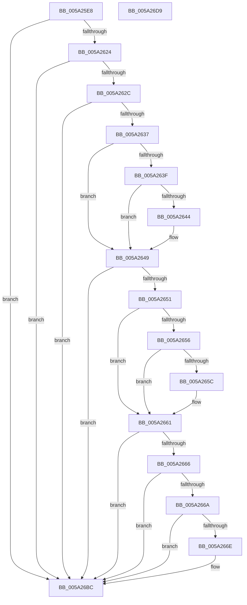

# SecureDump_ConvertParsedRSAPubKeyToBCryptPubKey

- RVA: `0x005A25E8`–`0x005A26DA` (길이 `242` bytes)
- VA: `0x00000001405A25E8`
- 실행 섹션: `.text`
- PDB 이름 있음: `예`; PDB Function 태그: `아니요`
- unwind 정보 RVA: `0x0005E6B4`
- 디코드: `70`개 명령, `242/242` bytes 표시
- 미해석 바이트: `0` (있으면 어셈블리에 `.byte`로 보존)

> 이 문서는 커널 이미지의 기계어와 PDB 기호를 분석해 생성했습니다. 4번과 5번은 함수 원형과 자료형을 바이너리 사용 방식에서 추정한 C 해석이며 원본 소스 복구 결과는 아닙니다.

## 1. Dependencies

- 직접 호출 지점: **3**; 고유 호출 대상: **2**
- 직접 호출자로 확인된 함수: **1**
- RIP 상대 이미지 참조: **0**

### Outgoing calls
- `0x005A267A` → [memset](../6C/memset_function_006C6C40.md) (function, `0x006C6C40`)
- `0x005A26A3` → [memcpy](../6C/memcpy_function_006C6840.md) (function, `0x006C6840`)
- `0x005A26B5` → [memcpy](../6C/memcpy_function_006C6840.md) (function, `0x006C6840`)

### Direct callers
- [SecureDump_ConvertToRsaBlob](SecureDump_ConvertToRsaBlob_function_005A26E0.md) at `0x005A2759`

### Static image references
- 디코드된 RIP-relative 메모리 참조가 없습니다.

## 2. Other-region calls and transfers

- 다른 실행 섹션으로 향하는 call: **0**
- 별도 외부 분기/꼬리 이동을 확인하지 못했습니다.

## 3. Assembly (complete function range)

```asm
005A25E8  48 8B C4                        mov rax, rsp
005A25EB  48 89 58 08                     mov qword ptr [rax + 8], rbx
005A25EF  48 89 68 10                     mov qword ptr [rax + 0x10], rbp
005A25F3  48 89 70 18                     mov qword ptr [rax + 0x18], rsi
005A25F7  48 89 78 20                     mov qword ptr [rax + 0x20], rdi
005A25FB  41 56                           push r14
005A25FD  48 83 EC 20                     sub rsp, 0x20
005A2601  8B 59 30                        mov ebx, dword ptr [rcx + 0x30]
005A2604  4C 8B F2                        mov r14, rdx
005A2607  8B 79 20                        mov edi, dword ptr [rcx + 0x20]
005A260A  BA 28 04 00 C0                  mov edx, 0xc0000428
005A260F  48 8B 71 28                     mov rsi, qword ptr [rcx + 0x28]
005A2613  48 8B 69 38                     mov rbp, qword ptr [rcx + 0x38]
005A2617  B9 04 02 00 00                  mov ecx, 0x204
005A261C  3B D9                           cmp ebx, ecx
005A261E  0F 87 98 00 00 00               ja 0x1405a26bc
005A2624  3B F9                           cmp edi, ecx
005A2626  0F 87 90 00 00 00               ja 0x1405a26bc
005A262C  8D 04 3B                        lea eax, [rbx + rdi]
005A262F  3B C1                           cmp eax, ecx
005A2631  0F 87 85 00 00 00               ja 0x1405a26bc
005A2637  83 C8 FF                        or eax, 0xffffffff
005A263A  83 FF 01                        cmp edi, 1
005A263D  76 0A                           jbe 0x1405a2649
005A263F  80 3E 00                        cmp byte ptr [rsi], 0
005A2642  75 05                           jne 0x1405a2649
005A2644  48 FF C6                        inc rsi
005A2647  03 F8                           add edi, eax
005A2649  81 FF 00 02 00 00               cmp edi, 0x200
005A264F  77 6B                           ja 0x1405a26bc
005A2651  83 FB 01                        cmp ebx, 1
005A2654  76 0B                           jbe 0x1405a2661
005A2656  80 7D 00 00                     cmp byte ptr [rbp], 0
005A265A  75 05                           jne 0x1405a2661
005A265C  48 FF C5                        inc rbp
005A265F  03 D8                           add ebx, eax
005A2661  83 FB 04                        cmp ebx, 4
005A2664  77 56                           ja 0x1405a26bc
005A2666  85 FF                           test edi, edi
005A2668  74 52                           je 0x1405a26bc
005A266A  85 DB                           test ebx, ebx
005A266C  74 4E                           je 0x1405a26bc
005A266E  49 8D 4E 10                     lea rcx, [r14 + 0x10]
005A2672  33 D2                           xor edx, edx
005A2674  41 B8 0C 02 00 00               mov r8d, 0x20c
005A267A  E8 C1 45 12 00                  call 0x1406c6c40
005A267F  8D 04 FD 00 00 00 00            lea eax, [rdi*8]
005A2686  41 C7 06 52 53 41 31            mov dword ptr [r14], 0x31415352
005A268D  49 8D 4E 18                     lea rcx, [r14 + 0x18]
005A2691  41 89 46 04                     mov dword ptr [r14 + 4], eax
005A2695  4C 8B C3                        mov r8, rbx
005A2698  41 89 5E 08                     mov dword ptr [r14 + 8], ebx
005A269C  48 8B D5                        mov rdx, rbp
005A269F  41 89 7E 0C                     mov dword ptr [r14 + 0xc], edi
005A26A3  E8 98 41 12 00                  call 0x1406c6840
005A26A8  49 8D 4E 18                     lea rcx, [r14 + 0x18]
005A26AC  44 8B C7                        mov r8d, edi
005A26AF  48 03 CB                        add rcx, rbx
005A26B2  48 8B D6                        mov rdx, rsi
005A26B5  E8 86 41 12 00                  call 0x1406c6840
005A26BA  33 D2                           xor edx, edx
005A26BC  48 8B 5C 24 30                  mov rbx, qword ptr [rsp + 0x30]
005A26C1  8B C2                           mov eax, edx
005A26C3  48 8B 6C 24 38                  mov rbp, qword ptr [rsp + 0x38]
005A26C8  48 8B 74 24 40                  mov rsi, qword ptr [rsp + 0x40]
005A26CD  48 8B 7C 24 48                  mov rdi, qword ptr [rsp + 0x48]
005A26D2  48 83 C4 20                     add rsp, 0x20
005A26D6  41 5E                           pop r14
005A26D8  C3                              ret
005A26D9  CC                              int3
```

## 4. C-style interpretation (structured pseudocode)

```c
__int64 __fastcall SecureDump_ConvertParsedRSAPubKeyToBCryptPubKey(__int64 a1, __int64 a2)
{
    __int64 result;
    __int64 v_rbp;
    __int64 v_rbx;
    __int64 v_rdi;
    __int64 v_rsi;
    __int64 v_rsp;
    unsigned __int64 v_stack_p10;
    unsigned __int64 v_stack_p18;
    unsigned __int64 v_stack_p20;
    unsigned __int64 v_stack_p8;

    *(unsigned __int64 *)(v_rsp + 8) = v_rbx;
    *(unsigned __int64 *)(v_rsp + 16) = v_rbp;
    *(unsigned __int64 *)(v_rsp + 24) = v_rsi;
    *(unsigned __int64 *)(v_rsp + 32) = v_rdi;
    v_rsp = (v_rsp) - (32);
    if (((unsigned int)((unsigned int)(*(unsigned int *)(a1 + 48)))) > 516) goto loc_005A26BC;
    if (((unsigned int)((unsigned int)(*(unsigned int *)(a1 + 32)))) > 516) goto loc_005A26BC;
    if (((unsigned int)((unsigned int)(*(unsigned int *)(a1 + 48)) + (unsigned int)(*(unsigned int *)(a1 + 32)) * 1)) > 516) goto loc_005A26BC;
    result = (unsigned int)(((unsigned int)(*(unsigned int *)(a1 + 48)) + (unsigned int)(*(unsigned int *)(a1 + 32)) * 1) | (0xFFFFFFFFULL));
    if (((unsigned int)((unsigned int)(*(unsigned int *)(a1 + 32)))) <= 1) goto loc_005A2649;
    v_rsi = *(unsigned __int64 *)(a1 + 40);
    v_rdi = (unsigned int)(*(unsigned int *)(a1 + 32));
    if ((*(unsigned __int8 *)(*(unsigned __int64 *)(a1 + 40))) == 0) {
        v_rsi = (*(unsigned __int64 *)(a1 + 40)) + 1;
        v_rdi = (unsigned int)(((unsigned int)(*(unsigned int *)(a1 + 32))) + ((unsigned int)(result)));
    }
    if (((unsigned int)(v_rdi)) > 512) goto loc_005A26BC;
    if (((unsigned int)((unsigned int)(*(unsigned int *)(a1 + 48)))) <= 1) goto loc_005A2661;
    v_rbx = (unsigned int)(*(unsigned int *)(a1 + 48));
    v_rbp = *(unsigned __int64 *)(a1 + 56);
    if ((*(unsigned __int8 *)(*(unsigned __int64 *)(a1 + 56))) == 0) {
        v_rbp = (*(unsigned __int64 *)(a1 + 56)) + 1;
        v_rbx = (unsigned int)(((unsigned int)(*(unsigned int *)(a1 + 48))) + ((unsigned int)(result)));
    }
    if (((unsigned int)(v_rbx)) > 4) goto loc_005A26BC;
    if ((unsigned int)(v_rdi) == 0) goto loc_005A26BC;
    if ((unsigned int)(v_rbx) != 0) {
        a1 = a2 + 16;
        a2 = 0;
        a3 = 524;
        result = memset(a1, a2, a3, a4);
        result = v_rdi * 8;
        *(unsigned int *)(a2) = 0x31415352ULL;
        a1 = a2 + 24;
        *(unsigned int *)(a2 + 4) = (unsigned int)(result);
        a3 = v_rbx;
        *(unsigned int *)(a2 + 8) = (unsigned int)(v_rbx);
        a2 = v_rbp;
        *(unsigned int *)(a2 + 12) = (unsigned int)(v_rdi);
        result = memcpy(a1, a2, a3, a4);
        a1 = a2 + 24;
        a3 = (unsigned int)(v_rdi);
        a1 = (a1) + (v_rbx);
        a2 = v_rsi;
        result = memcpy(a1, a2, a3, a4);
        a2 = 0;
    }
    v_rsp = (v_rsp) + (32);
    return 0;
}
```

## 5. (Beta) C Style

```c
int64_t SecureDump_ConvertParsedRSAPubKeyToBCryptPubKey(void *Arg1, void *Arg2)
{
    uint8_t *arg1 = (uint8_t *)Arg1;
    uint8_t *arg2 = (uint8_t *)Arg2;

    int64_t result;
    int64_t local_rbp;
    int64_t local_rbx;
    int64_t local_rdi;
    int64_t local_rsi;
    int64_t local_rsp;
    uint64_t v_stack_p10;
    uint64_t v_stack_p18;
    uint64_t v_stack_p20;
    uint64_t v_stack_p8;

    *(uint64_t *)(local_rsp + 0x8) = local_rbx;
    *(uint64_t *)(local_rsp + 0x10) = local_rbp;
    *(uint64_t *)(local_rsp + 0x18) = local_rsi;
    *(uint64_t *)(local_rsp + 0x20) = local_rdi;
    local_rsp = (local_rsp) - (32);
    if (((uint32_t)((uint32_t)(*(uint32_t *)(arg1 + 0x30)))) > 516) goto loc_005A26BC;
    if (((uint32_t)((uint32_t)(*(uint32_t *)(arg1 + 0x20)))) > 516) goto loc_005A26BC;
    if (((uint32_t)((uint32_t)(*(uint32_t *)(arg1 + 0x30)) + (uint32_t)(*(uint32_t *)(arg1 + 0x20)) * 1)) > 516) goto loc_005A26BC;
    result = (uint32_t)(((uint32_t)(*(uint32_t *)(arg1 + 0x30)) + (uint32_t)(*(uint32_t *)(arg1 + 0x20)) * 1) | (0xFFFFFFFFULL));
    if (((uint32_t)((uint32_t)(*(uint32_t *)(arg1 + 0x20)))) <= 1) goto loc_005A2649;
    local_rsi = *(uint64_t *)(arg1 + 0x28);
    local_rdi = (uint32_t)(*(uint32_t *)(arg1 + 0x20));
    if ((*(uint8_t *)(*(uint64_t *)(arg1 + 0x28))) == 0) {
        local_rsi = (*(uint64_t *)(arg1 + 0x28)) + 1;
        local_rdi = (uint32_t)(((uint32_t)(*(uint32_t *)(arg1 + 0x20))) + ((uint32_t)(result)));
    }
    if (((uint32_t)(local_rdi)) > 512) goto loc_005A26BC;
    if (((uint32_t)((uint32_t)(*(uint32_t *)(arg1 + 0x30)))) <= 1) goto loc_005A2661;
    local_rbx = (uint32_t)(*(uint32_t *)(arg1 + 0x30));
    local_rbp = *(uint64_t *)(arg1 + 0x38);
    if ((*(uint8_t *)(*(uint64_t *)(arg1 + 0x38))) == 0) {
        local_rbp = (*(uint64_t *)(arg1 + 0x38)) + 1;
        local_rbx = (uint32_t)(((uint32_t)(*(uint32_t *)(arg1 + 0x30))) + ((uint32_t)(result)));
    }
    if (((uint32_t)(local_rbx)) > 4) goto loc_005A26BC;
    if ((uint32_t)(local_rdi) == 0) goto loc_005A26BC;
    if ((uint32_t)(local_rbx) != 0) {
        Arg1 = Arg2 + 16;
        Arg2 = 0;
        a3 = 524;
        result = memset(Arg1, Arg2, a3, a4);
        result = local_rdi * 8;
        *(uint32_t *)(arg2) = 0x31415352ULL;
        Arg1 = Arg2 + 24;
        *(uint32_t *)(arg2 + 0x4) = (uint32_t)(result);
        a3 = local_rbx;
        *(uint32_t *)(arg2 + 0x8) = (uint32_t)(local_rbx);
        Arg2 = local_rbp;
        *(uint32_t *)(arg2 + 0xC) = (uint32_t)(local_rdi);
        result = memcpy(Arg1, Arg2, a3, a4);
        Arg1 = Arg2 + 24;
        a3 = (uint32_t)(local_rdi);
        Arg1 = (Arg1) + (local_rbx);
        Arg2 = local_rsi;
        result = memcpy(Arg1, Arg2, a3, a4);
        Arg2 = 0;
    }
    local_rsp = (local_rsp) + (32);
    return 0;
}
```

### 관측된 메모리 오프셋

구조체 형식이 확인되지 않은 접근은 인자 기준의 오프셋으로만 기록했습니다.

| 기준 인자 | 오프셋 표현 | 폭 (bit) | 접근 |
|---|---:|---:|---|
| `Arg1` | `+ 0x20` | `32` | `R` |
| `Arg1` | `+ 0x28` | `64` | `R` |
| `Arg1` | `+ 0x30` | `32` | `R` |
| `Arg1` | `+ 0x38` | `64` | `R` |
| `Arg2` | `+ 0x0` | `32` | `W` |
| `Arg2` | `+ 0x4` | `32` | `W` |
| `Arg2` | `+ 0x8` | `32` | `W` |
| `Arg2` | `+ 0xC` | `32` | `W` |
| `Arg2` | `+ 0x10` | `64` | `R` |
| `Arg2` | `+ 0x18` | `64` | `R` |

## 6. Execution-region graph

[열기: 2D/3D 그래프와 함수 탐색 컨트롤 패널](../../../control-panel.html?section=text&rva=0x005A25E8&view=graph)

- 2D 그래프는 위에서 아래로 흐르고, 3D 그래프는 빈 공간을 드래그해 회전합니다. Shift+드래그는 이동, 휠은 확대·축소, 함수 노드 선택은 대상 보고서 이동입니다.

### Static fallback


