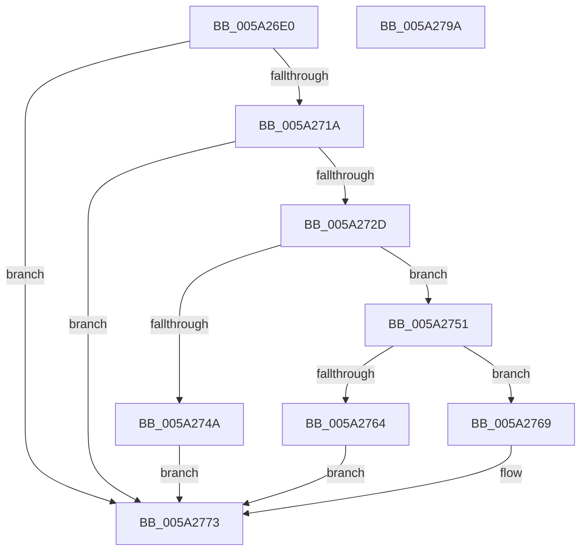

# SecureDump_ConvertToRsaBlob

- RVA: `0x005A26E0`–`0x005A279B` (길이 `187` bytes)
- VA: `0x00000001405A26E0`
- 실행 섹션: `.text`
- PDB 이름 있음: `예`; PDB Function 태그: `아니요`
- unwind 정보 RVA: `0x000C7DDC`
- 디코드: `49`개 명령, `187/187` bytes 표시
- 미해석 바이트: `0` (있으면 어셈블리에 `.byte`로 보존)

> 이 문서는 커널 이미지의 기계어와 PDB 기호를 분석해 생성했습니다. 4번과 5번은 함수 원형과 자료형을 바이너리 사용 방식에서 추정한 C 해석이며 원본 소스 복구 결과는 아닙니다.

## 1. Dependencies

- 직접 호출 지점: **6**; 고유 호출 대상: **6**
- 직접 호출자로 확인된 함수: **1**
- RIP 상대 이미지 참조: **1**

### Outgoing calls
- `0x005A2711` → [MinAsn1ParsePublicKeyInfo](../../page/83/MinAsn1ParsePublicKeyInfo_function_00838E94.md) (function, `0x00838E94`)
- `0x005A2724` → [MinAsn1ParseRSAPublicKey](../../page/83/MinAsn1ParseRSAPublicKey_function_00838EDC.md) (function, `0x00838EDC`)
- `0x005A273D` → [ExAllocatePool2](../../poolcode/B8/ExAllocatePool2_function_00B820F0.md) (function, `0x00B820F0`)
- `0x005A2759` → [SecureDump_ConvertParsedRSAPubKeyToBCryptPubKey](SecureDump_ConvertParsedRSAPubKeyToBCryptPubKey_function_005A25E8.md) (function, `0x005A25E8`)
- `0x005A276E` → [ExFreePoolWithTag](../../poolcode/B8/ExFreePoolWithTag_function_00B82870.md) (function, `0x00B82870`)
- `0x005A2780` → [_security_check_cookie](../6A/_security_check_cookie_function_006AC640.md) (function, `0x006AC640`)

### Direct callers
- [SecureDump_ValidateAmeCertChain](SecureDump_ValidateAmeCertChain_function_005A38B0.md) at `0x005A3A50`

### Static image references
- `0x005A26F2` → RVA `0x00E0A740` (`.data`; read)

## 2. Other-region calls and transfers

- 다른 실행 섹션으로 향하는 call: **4**
  - `0x005A2711` → [MinAsn1ParsePublicKeyInfo](../../page/83/MinAsn1ParsePublicKeyInfo_function_00838E94.md) (`.text` → `PAGE`)
  - `0x005A2724` → [MinAsn1ParseRSAPublicKey](../../page/83/MinAsn1ParseRSAPublicKey_function_00838EDC.md) (`.text` → `PAGE`)
  - `0x005A273D` → [ExAllocatePool2](../../poolcode/B8/ExAllocatePool2_function_00B820F0.md) (`.text` → `POOLCODE`)
  - `0x005A276E` → [ExFreePoolWithTag](../../poolcode/B8/ExFreePoolWithTag_function_00B82870.md) (`.text` → `POOLCODE`)
- 별도 외부 분기/꼬리 이동을 확인하지 못했습니다.

## 3. Assembly (complete function range)

```asm
005A26E0  48 89 5C 24 18                  mov qword ptr [rsp + 0x18], rbx
005A26E5  48 89 74 24 20                  mov qword ptr [rsp + 0x20], rsi
005A26EA  57                              push rdi
005A26EB  48 81 EC B0 00 00 00            sub rsp, 0xb0
005A26F2  48 8B 05 47 80 86 00            mov rax, qword ptr [rip + 0x868047]
005A26F9  48 33 C4                        xor rax, rsp
005A26FC  48 89 84 24 A0 00 00 00         mov qword ptr [rsp + 0xa0], rax
005A2704  48 8B F2                        mov rsi, rdx
005A2707  BF 0A 09 00 C0                  mov edi, 0xc000090a
005A270C  48 8D 54 24 20                  lea rdx, [rsp + 0x20]
005A2711  E8 7E 67 29 00                  call 0x140838e94
005A2716  85 C0                           test eax, eax
005A2718  78 59                           js 0x1405a2773
005A271A  48 8D 54 24 60                  lea rdx, [rsp + 0x60]
005A271F  48 8D 4C 24 50                  lea rcx, [rsp + 0x50]
005A2724  E8 B3 67 29 00                  call 0x140838edc
005A2729  85 C0                           test eax, eax
005A272B  78 46                           js 0x1405a2773
005A272D  BA 1C 02 00 00                  mov edx, 0x21c
005A2732  B9 40 00 00 00                  mov ecx, 0x40
005A2737  41 B8 53 64 6D 70               mov r8d, 0x706d6453
005A273D  E8 AE F9 5D 00                  call 0x140b820f0
005A2742  48 8B D8                        mov rbx, rax
005A2745  48 85 C0                        test rax, rax
005A2748  75 07                           jne 0x1405a2751
005A274A  BF 17 00 00 C0                  mov edi, 0xc0000017
005A274F  EB 22                           jmp 0x1405a2773
005A2751  48 8B D3                        mov rdx, rbx
005A2754  48 8D 4C 24 60                  lea rcx, [rsp + 0x60]
005A2759  E8 8A FE FF FF                  call 0x1405a25e8
005A275E  8B F8                           mov edi, eax
005A2760  85 C0                           test eax, eax
005A2762  78 05                           js 0x1405a2769
005A2764  48 89 1E                        mov qword ptr [rsi], rbx
005A2767  EB 0A                           jmp 0x1405a2773
005A2769  33 D2                           xor edx, edx
005A276B  48 8B CB                        mov rcx, rbx
005A276E  E8 FD 00 5E 00                  call 0x140b82870
005A2773  8B C7                           mov eax, edi
005A2775  48 8B 8C 24 A0 00 00 00         mov rcx, qword ptr [rsp + 0xa0]
005A277D  48 33 CC                        xor rcx, rsp
005A2780  E8 BB 9E 10 00                  call 0x1406ac640
005A2785  4C 8D 9C 24 B0 00 00 00         lea r11, [rsp + 0xb0]
005A278D  49 8B 5B 20                     mov rbx, qword ptr [r11 + 0x20]
005A2791  49 8B 73 28                     mov rsi, qword ptr [r11 + 0x28]
005A2795  49 8B E3                        mov rsp, r11
005A2798  5F                              pop rdi
005A2799  C3                              ret
005A279A  CC                              int3
```

## 4. C-style interpretation (structured pseudocode)

```c
__int64 __fastcall SecureDump_ConvertToRsaBlob(__int64 a1, __int64 a2)
{
    __int64 result;
    __int64 v_rsp;
    unsigned __int64 v_stack_m18;
    unsigned __int64 v_stack_m58;
    unsigned __int64 v_stack_m68;
    unsigned __int64 v_stack_m8;
    unsigned __int64 v_stack_m98;
    unsigned __int64 v_stack_p18;
    unsigned __int64 v_stack_p20;

    v_stack_p18 = v_rbx;
    v_stack_p20 = v_rsi;
    v_rsp = (v_rsp) - (176);
    result = (*(unsigned __int64 *)(v_rip + 8814663)) ^ (v_rsp);
    v_stack_m18 = result;
    result = MinAsn1ParsePublicKeyInfo(a1, v_stack_m98, a3, a4);
    if (sign_flag) goto loc_005A2773;
    result = MinAsn1ParseRSAPublicKey(v_stack_m68, v_stack_m58, a3, a4);
    if (sign_flag) goto loc_005A2773;
    result = ExAllocatePool2(64, 540, (unsigned int)(0x706D6453ULL), a4);
    if (result != 0) goto loc_005A2751;
    goto loc_005A2773;
loc_005A2751:
    result = SecureDump_ConvertParsedRSAPubKeyToBCryptPubKey(v_stack_m58, result, (unsigned int)(0x706D6453ULL), a4);
    if (sign_flag) goto loc_005A2769;
    *(unsigned __int64 *)(a2) = result;
    goto loc_005A2773;
loc_005A2769:
    a2 = 0;
    result = ExFreePoolWithTag(result, a2, (unsigned int)(0x706D6453ULL), a4);
loc_005A2773:
    a1 = (v_stack_m18) ^ (v_rsp);
    result = _security_check_cookie(a1, a2, (unsigned int)(0x706D6453ULL), a4);
    return result;
}
```

## 5. (Beta) C Style

```c
int64_t SecureDump_ConvertToRsaBlob(int64_t Arg1, void *Arg2)
{
    uint8_t *arg2 = (uint8_t *)Arg2;

    int64_t result;
    int64_t local_rsp;
    uint64_t v_stack_m18;
    uint64_t v_stack_m58;
    uint64_t v_stack_m68;
    uint64_t v_stack_m8;
    uint64_t v_stack_m98;
    uint64_t v_stack_p18;
    uint64_t v_stack_p20;

    v_stack_p18 = local_rbx;
    v_stack_p20 = local_rsi;
    local_rsp = (local_rsp) - (176);
    result = (*(uint64_t *)(v_rip + 0x868047)) ^ (local_rsp);
    v_stack_m18 = result;
    result = MinAsn1ParsePublicKeyInfo(Arg1, v_stack_m98, a3, a4);
    if (sign_flag) goto loc_005A2773;
    result = MinAsn1ParseRSAPublicKey(v_stack_m68, v_stack_m58, a3, a4);
    if (sign_flag) goto loc_005A2773;
    result = ExAllocatePool2(64, 540, (uint32_t)(0x706D6453ULL), a4);
    if (result != 0) goto loc_005A2751;
    goto loc_005A2773;
loc_005A2751:
    result = SecureDump_ConvertParsedRSAPubKeyToBCryptPubKey(v_stack_m58, result, (uint32_t)(0x706D6453ULL), a4);
    if (sign_flag) goto loc_005A2769;
    *(uint64_t *)(arg2) = result;
    goto loc_005A2773;
loc_005A2769:
    Arg2 = 0;
    result = ExFreePoolWithTag(result, Arg2, (uint32_t)(0x706D6453ULL), a4);
loc_005A2773:
    Arg1 = (v_stack_m18) ^ (local_rsp);
    result = _security_check_cookie(Arg1, Arg2, (uint32_t)(0x706D6453ULL), a4);
    return result;
}
```

### 관측된 메모리 오프셋

구조체 형식이 확인되지 않은 접근은 인자 기준의 오프셋으로만 기록했습니다.

| 기준 인자 | 오프셋 표현 | 폭 (bit) | 접근 |
|---|---:|---:|---|
| `Arg2` | `+ 0x0` | `64` | `W` |

## 6. Execution-region graph

[열기: 2D/3D 그래프와 함수 탐색 컨트롤 패널](../../../control-panel.html?section=text&rva=0x005A26E0&view=graph)

- 2D 그래프는 위에서 아래로 흐르고, 3D 그래프는 빈 공간을 드래그해 회전합니다. Shift+드래그는 이동, 휠은 확대·축소, 함수 노드 선택은 대상 보고서 이동입니다.

### Static fallback


