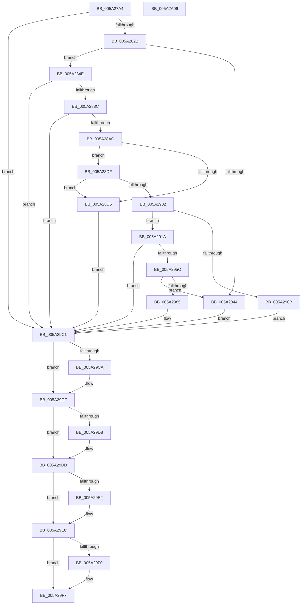

# SecureDump_EncryptSymmetricKeyWithPublicKey

- RVA: `0x005A27A4`–`0x005A2A07` (길이 `611` bytes)
- VA: `0x00000001405A27A4`
- 실행 섹션: `.text`
- PDB 이름 있음: `예`; PDB Function 태그: `아니요`
- unwind 정보 RVA: `0x000C7D74`
- 디코드: `154`개 명령, `611/611` bytes 표시
- 미해석 바이트: `0` (있으면 어셈블리에 `.byte`로 보존)

> 이 문서는 커널 이미지의 기계어와 PDB 기호를 분석해 생성했습니다. 4번과 5번은 함수 원형과 자료형을 바이너리 사용 방식에서 추정한 C 해석이며 원본 소스 복구 결과는 아닙니다.

## 1. Dependencies

- 직접 호출 지점: **13**; 고유 호출 대상: **10**
- 직접 호출자로 확인된 함수: **2**
- RIP 상대 이미지 참조: **11**

### Outgoing calls
- `0x005A2815` → `cng.sys!BCryptExportKey` (import, 간접 대상; import `cng.sys!BCryptExportKey`)
- `0x005A2837` → [ExAllocatePool2](../../poolcode/B8/ExAllocatePool2_function_00B820F0.md) (function, `0x00B820F0`)
- `0x005A2876` → `cng.sys!BCryptExportKey` (import, 간접 대상; import `cng.sys!BCryptExportKey`)
- `0x005A289D` → [BCryptOpenAlgorithmProvider](../../page/AB/BCryptOpenAlgorithmProvider_function_00ABF200.md) (function, `0x00ABF200`)
- `0x005A28CA` → [BCryptImportKeyPair](../../page/79/BCryptImportKeyPair_function_0079C8C8.md) (function, `0x0079C8C8`)
- `0x005A28F7` → [BCryptGetProperty](../../page/A5/BCryptGetProperty_function_00A56158.md) (function, `0x00A56158`)
- `0x005A2951` → [BCryptEncrypt](../4F/BCryptEncrypt_function_004F9D54.md) (function, `0x004F9D54`)
- `0x005A296D` → [ExAllocatePool2](../../poolcode/B8/ExAllocatePool2_function_00B820F0.md) (function, `0x00B820F0`)
- `0x005A29BA` → [BCryptEncrypt](../4F/BCryptEncrypt_function_004F9D54.md) (function, `0x004F9D54`)
- `0x005A29CA` → [BCryptCloseAlgorithmProvider](../60/BCryptCloseAlgorithmProvider_function_006064D8.md) (function, `0x006064D8`)
- `0x005A29D8` → [BCryptDestroyKey](../60/BCryptDestroyKey_function_00606530.md) (function, `0x00606530`)
- `0x005A29E7` → [ExFreePoolWithTag](../../poolcode/B8/ExFreePoolWithTag_function_00B82870.md) (function, `0x00B82870`)
- `0x005A29F2` → [SecureDump_LogErrorEvent](SecureDump_LogErrorEvent_function_005A314C.md) (function, `0x005A314C`)

### Direct callers
- [SecureDump_Init](SecureDump_Init_function_005A2CC4.md) at `0x005A2CEF`
- [SecureDump_ReInitialize](SecureDump_ReInitialize_function_005A348C.md) at `0x005A3577`

### Static image references
- `0x005A27B4` → RVA `0x00E661F0` (`.data`; read)
- `0x005A27BB` → RVA `0x006CA8D0` (` ?? ::FNODOBFM::`string'`; read)
- `0x005A27D7` → RVA `0x006CA8E0` (` ?? ::FNODOBFM::`string'`; read)
- `0x005A280B` → RVA `0x00E661FC` (`.data`; write)
- `0x005A2815` → RVA `0x00151170` (`cng.sys!BCryptExportKey (IAT)`; read)
- `0x005A288F` → RVA `0x006CA900` (` ?? ::FNODOBFM::`string'`; read)
- `0x005A28AC` → RVA `0x00E661C8` (`.data`; read)
- `0x005A28BE` → RVA `0x00E661C0` (`.data`; read)
- `0x005A28F0` → RVA `0x006CA980` (` ?? ::FNODOBFM::`string'`; read)
- `0x005A291E` → RVA `0x00E661E0` (`.data`; read)
- `0x005A2972` → RVA `0x00E661D8` (`.data`; write)

## 2. Other-region calls and transfers

- 다른 실행 섹션으로 향하는 call: **6**
  - `0x005A2837` → [ExAllocatePool2](../../poolcode/B8/ExAllocatePool2_function_00B820F0.md) (`.text` → `POOLCODE`)
  - `0x005A289D` → [BCryptOpenAlgorithmProvider](../../page/AB/BCryptOpenAlgorithmProvider_function_00ABF200.md) (`.text` → `PAGE`)
  - `0x005A28CA` → [BCryptImportKeyPair](../../page/79/BCryptImportKeyPair_function_0079C8C8.md) (`.text` → `PAGE`)
  - `0x005A28F7` → [BCryptGetProperty](../../page/A5/BCryptGetProperty_function_00A56158.md) (`.text` → `PAGE`)
  - `0x005A296D` → [ExAllocatePool2](../../poolcode/B8/ExAllocatePool2_function_00B820F0.md) (`.text` → `POOLCODE`)
  - `0x005A29E7` → [ExFreePoolWithTag](../../poolcode/B8/ExFreePoolWithTag_function_00B82870.md) (`.text` → `POOLCODE`)
- 별도 외부 분기/꼬리 이동을 확인하지 못했습니다.

## 3. Assembly (complete function range)

```asm
005A27A4  40 55                           push rbp
005A27A6  53                              push rbx
005A27A7  56                              push rsi
005A27A8  57                              push rdi
005A27A9  41 55                           push r13
005A27AB  41 56                           push r14
005A27AD  48 8B EC                        mov rbp, rsp
005A27B0  48 83 EC 78                     sub rsp, 0x78
005A27B4  48 8B 0D 35 3A 8C 00            mov rcx, qword ptr [rip + 0x8c3a35]
005A27BB  48 8D 05 0E 81 12 00            lea rax, [rip + 0x12810e]
005A27C2  45 33 F6                        xor r14d, r14d
005A27C5  48 89 45 E0                     mov qword ptr [rbp - 0x20], rax
005A27C9  48 8D 45 38                     lea rax, [rbp + 0x38]
005A27CD  44 89 74 24 30                  mov dword ptr [rsp + 0x30], r14d
005A27D2  48 89 44 24 28                  mov qword ptr [rsp + 0x28], rax
005A27D7  4C 8D 05 02 81 12 00            lea r8, [rip + 0x128102]
005A27DE  45 33 C9                        xor r9d, r9d
005A27E1  44 89 74 24 20                  mov dword ptr [rsp + 0x20], r14d
005A27E6  33 D2                           xor edx, edx
005A27E8  44 89 75 38                     mov dword ptr [rbp + 0x38], r14d
005A27EC  41 8B F6                        mov esi, r14d
005A27EF  4C 89 75 D8                     mov qword ptr [rbp - 0x28], r14
005A27F3  4C 89 75 50                     mov qword ptr [rbp + 0x50], r14
005A27F7  41 8D 7E 01                     lea edi, [r14 + 1]
005A27FB  4C 89 75 E8                     mov qword ptr [rbp - 0x18], r14
005A27FF  4C 89 75 F0                     mov qword ptr [rbp - 0x10], r14
005A2803  44 89 75 40                     mov dword ptr [rbp + 0x40], r14d
005A2807  44 89 75 48                     mov dword ptr [rbp + 0x48], r14d
005A280B  C7 05 E7 39 8C 00 02 00 00 00   mov dword ptr [rip + 0x8c39e7], 2
005A2815  48 FF 15 54 E9 BA FF            call qword ptr [rip - 0x4516ac]
005A281C  0F 1F 44 00 00                  nop dword ptr [rax + rax]
005A2821  8B D8                           mov ebx, eax
005A2823  85 C0                           test eax, eax
005A2825  0F 88 96 01 00 00               js 0x1405a29c1
005A282B  8B 55 38                        mov edx, dword ptr [rbp + 0x38]
005A282E  8D 4F 3F                        lea ecx, [rdi + 0x3f]
005A2831  41 B8 53 64 6D 70               mov r8d, 0x706d6453
005A2837  E8 B4 F8 5D 00                  call 0x140b820f0
005A283C  48 8B F0                        mov rsi, rax
005A283F  48 85 C0                        test rax, rax
005A2842  75 0A                           jne 0x1405a284e
005A2844  BB 9A 00 00 C0                  mov ebx, 0xc000009a
005A2849  E9 73 01 00 00                  jmp 0x1405a29c1
005A284E  48 8B 0D 9B 39 8C 00            mov rcx, qword ptr [rip + 0x8c399b]
005A2855  48 8D 45 38                     lea rax, [rbp + 0x38]
005A2859  44 89 74 24 30                  mov dword ptr [rsp + 0x30], r14d
005A285E  4C 8D 05 7B 80 12 00            lea r8, [rip + 0x12807b]
005A2865  48 89 44 24 28                  mov qword ptr [rsp + 0x28], rax
005A286A  4C 8B CE                        mov r9, rsi
005A286D  8B 45 38                        mov eax, dword ptr [rbp + 0x38]
005A2870  33 D2                           xor edx, edx
005A2872  89 44 24 20                     mov dword ptr [rsp + 0x20], eax
005A2876  48 FF 15 F3 E8 BA FF            call qword ptr [rip - 0x45170d]
005A287D  0F 1F 44 00 00                  nop dword ptr [rax + rax]
005A2882  8B D8                           mov ebx, eax
005A2884  85 C0                           test eax, eax
005A2886  0F 88 35 01 00 00               js 0x1405a29c1
005A288C  44 8B CF                        mov r9d, edi
005A288F  48 8D 15 6A 80 12 00            lea rdx, [rip + 0x12806a]
005A2896  45 33 C0                        xor r8d, r8d
005A2899  48 8D 4D D8                     lea rcx, [rbp - 0x28]
005A289D  E8 5E C9 51 00                  call 0x140abf200
005A28A2  8B D8                           mov ebx, eax
005A28A4  85 C0                           test eax, eax
005A28A6  0F 88 15 01 00 00               js 0x1405a29c1
005A28AC  8B 05 16 39 8C 00               mov eax, dword ptr [rip + 0x8c3916]
005A28B2  4C 8D 4D 50                     lea r9, [rbp + 0x50]
005A28B6  48 8B 4D D8                     mov rcx, qword ptr [rbp - 0x28]
005A28BA  89 44 24 28                     mov dword ptr [rsp + 0x28], eax
005A28BE  48 8B 05 FB 38 8C 00            mov rax, qword ptr [rip + 0x8c38fb]
005A28C5  48 89 44 24 20                  mov qword ptr [rsp + 0x20], rax
005A28CA  E8 F9 9F 1F 00                  call 0x14079c8c8
005A28CF  8B D8                           mov ebx, eax
005A28D1  85 C0                           test eax, eax
005A28D3  79 0A                           jns 0x1405a28df
005A28D5  BF 03 00 00 00                  mov edi, 3
005A28DA  E9 E2 00 00 00                  jmp 0x1405a29c1
005A28DF  48 8B 4D 50                     mov rcx, qword ptr [rbp + 0x50]
005A28E3  48 8D 45 48                     lea rax, [rbp + 0x48]
005A28E7  4C 8D 45 40                     lea r8, [rbp + 0x40]
005A28EB  48 89 44 24 20                  mov qword ptr [rsp + 0x20], rax
005A28F0  48 8D 15 89 80 12 00            lea rdx, [rip + 0x128089]
005A28F7  E8 5C 38 4B 00                  call 0x140a56158
005A28FC  8B D8                           mov ebx, eax
005A28FE  85 C0                           test eax, eax
005A2900  78 D3                           js 0x1405a28d5
005A2902  81 7D 40 00 08 00 00            cmp dword ptr [rbp + 0x40], 0x800
005A2909  74 0F                           je 0x1405a291a
005A290B  BF 04 00 00 00                  mov edi, 4
005A2910  BB 01 00 00 C0                  mov ebx, 0xc0000001
005A2915  E9 A7 00 00 00                  jmp 0x1405a29c1
005A291A  44 8B 45 38                     mov r8d, dword ptr [rbp + 0x38]
005A291E  4C 8D 2D BB 38 8C 00            lea r13, [rip + 0x8c38bb]
005A2925  48 8B 4D 50                     mov rcx, qword ptr [rbp + 0x50]
005A2929  4C 8D 4D E0                     lea r9, [rbp - 0x20]
005A292D  C7 44 24 48 04 00 00 00         mov dword ptr [rsp + 0x48], 4
005A2935  48 8B D6                        mov rdx, rsi
005A2938  4C 89 6C 24 40                  mov qword ptr [rsp + 0x40], r13
005A293D  44 89 74 24 38                  mov dword ptr [rsp + 0x38], r14d
005A2942  4C 89 74 24 30                  mov qword ptr [rsp + 0x30], r14
005A2947  44 89 74 24 28                  mov dword ptr [rsp + 0x28], r14d
005A294C  4C 89 74 24 20                  mov qword ptr [rsp + 0x20], r14
005A2951  E8 FE 73 F5 FF                  call 0x1404f9d54
005A2956  8B D8                           mov ebx, eax
005A2958  85 C0                           test eax, eax
005A295A  78 65                           js 0x1405a29c1
005A295C  8B 15 7E 38 8C 00               mov edx, dword ptr [rip + 0x8c387e]
005A2962  B9 40 00 00 00                  mov ecx, 0x40
005A2967  41 B8 53 64 6D 70               mov r8d, 0x706d6453
005A296D  E8 7E F7 5D 00                  call 0x140b820f0
005A2972  48 89 05 5F 38 8C 00            mov qword ptr [rip + 0x8c385f], rax
005A2979  48 8B C8                        mov rcx, rax
005A297C  48 85 C0                        test rax, rax
005A297F  0F 84 BF FE FF FF               je 0x1405a2844
005A2985  8B 05 55 38 8C 00               mov eax, dword ptr [rip + 0x8c3855]
005A298B  4C 8D 4D E0                     lea r9, [rbp - 0x20]
005A298F  44 8B 45 38                     mov r8d, dword ptr [rbp + 0x38]
005A2993  48 8B D6                        mov rdx, rsi
005A2996  C7 44 24 48 04 00 00 00         mov dword ptr [rsp + 0x48], 4
005A299E  4C 89 6C 24 40                  mov qword ptr [rsp + 0x40], r13
005A29A3  89 44 24 38                     mov dword ptr [rsp + 0x38], eax
005A29A7  48 89 4C 24 30                  mov qword ptr [rsp + 0x30], rcx
005A29AC  48 8B 4D 50                     mov rcx, qword ptr [rbp + 0x50]
005A29B0  44 89 74 24 28                  mov dword ptr [rsp + 0x28], r14d
005A29B5  4C 89 74 24 20                  mov qword ptr [rsp + 0x20], r14
005A29BA  E8 95 73 F5 FF                  call 0x1404f9d54
005A29BF  8B D8                           mov ebx, eax
005A29C1  48 8B 4D D8                     mov rcx, qword ptr [rbp - 0x28]
005A29C5  48 85 C9                        test rcx, rcx
005A29C8  74 05                           je 0x1405a29cf
005A29CA  E8 09 3B 06 00                  call 0x1406064d8
005A29CF  48 8B 4D 50                     mov rcx, qword ptr [rbp + 0x50]
005A29D3  48 85 C9                        test rcx, rcx
005A29D6  74 05                           je 0x1405a29dd
005A29D8  E8 53 3B 06 00                  call 0x140606530
005A29DD  48 85 F6                        test rsi, rsi
005A29E0  74 0A                           je 0x1405a29ec
005A29E2  33 D2                           xor edx, edx
005A29E4  48 8B CE                        mov rcx, rsi
005A29E7  E8 84 FE 5D 00                  call 0x140b82870
005A29EC  85 DB                           test ebx, ebx
005A29EE  79 07                           jns 0x1405a29f7
005A29F0  8B CF                           mov ecx, edi
005A29F2  E8 55 07 00 00                  call 0x1405a314c
005A29F7  8B C3                           mov eax, ebx
005A29F9  48 83 C4 78                     add rsp, 0x78
005A29FD  41 5E                           pop r14
005A29FF  41 5D                           pop r13
005A2A01  5F                              pop rdi
005A2A02  5E                              pop rsi
005A2A03  5B                              pop rbx
005A2A04  5D                              pop rbp
005A2A05  C3                              ret
005A2A06  CC                              int3
```

## 4. C-style interpretation (structured pseudocode)

```c
__int64 __fastcall SecureDump_EncryptSymmetricKeyWithPublicKey(__int64 a1, int a2, __int64 a3, int a4)
{
    __int64 result;
    __int64 v_r14;
    __int64 v_rsp;
    unsigned __int64 v_stack_m40;
    unsigned __int64 v_stack_m48;
    unsigned __int64 v_stack_m50;
    unsigned __int64 v_stack_m58;
    unsigned int v_stack_m60;
    unsigned __int64 v_stack_m68;
    unsigned int v_stack_m70;
    unsigned int v_stack_m78;
    unsigned __int64 v_stack_m80;
    unsigned int v_stack_m88;
    unsigned int v_stack_p10;
    unsigned int v_stack_p18;
    unsigned __int64 v_stack_p20;
    unsigned __int64 v_stack_p8;

    v_rsp = (v_rsp) - (120);
    v_r14 = 0;
    v_stack_m50 = v_rip + 1212686;
    v_stack_m78 = 0;
    v_stack_m80 = v_stack_p8;
    a4 = 0;
    v_stack_m88 = 0;
    a2 = 0;
    v_stack_p8 = 0;
    v_stack_m58 = 0;
    v_stack_p20 = 0;
    v_stack_m48 = 0;
    v_stack_m40 = 0;
    v_stack_p10 = 0;
    v_stack_p18 = 0;
    *(unsigned int *)(v_rip + 9189863) = 2;
    result = cng_sys_BCryptExportKey(*(unsigned __int64 *)(v_rip + 9189941), a2, v_rip + 1212674, a4);
    if (sign_flag) goto loc_005A29C1;
    result = ExAllocatePool2(v_r14 + 1 + 63, (unsigned int)(v_stack_p8), (unsigned int)(0x706D6453ULL), a4);
    if (result != 0) goto loc_005A284E;
loc_005A2844:
    goto loc_005A29C1;
loc_005A284E:
    v_stack_m78 = 0;
    v_stack_m80 = v_stack_p8;
    a2 = 0;
    v_stack_m88 = (unsigned int)((unsigned int)(v_stack_p8));
    result = cng_sys_BCryptExportKey(*(unsigned __int64 *)(v_rip + 9189787), a2, v_rip + 1212539, result);
    if (sign_flag) goto loc_005A29C1;
    a3 = 0;
    result = BCryptOpenAlgorithmProvider(v_stack_m58, v_rip + 1212522, a3, (unsigned int)((unsigned int)(v_r14 + 1)));
    if (sign_flag) goto loc_005A29C1;
    v_stack_m80 = (unsigned int)((unsigned int)(*(unsigned int *)(v_rip + 9189654)));
    v_stack_m88 = *(unsigned __int64 *)(v_rip + 9189627);
    result = BCryptImportKeyPair(v_stack_m58, v_rip + 1212522, a3, v_stack_p20);
    if (!sign_flag) goto loc_005A28DF;
loc_005A28D5:
    goto loc_005A29C1;
loc_005A28DF:
    v_stack_m88 = v_stack_p18;
    result = BCryptGetProperty(v_stack_p20, v_rip + 1212553, v_stack_p10, v_stack_p20);
    if (sign_flag) goto loc_005A28D5;
    if (v_stack_p10 == 0x800ULL) goto loc_005A291A;
    goto loc_005A29C1;
loc_005A291A:
    v_stack_m60 = 4;
    v_stack_m68 = v_rip + 9189563;
    v_stack_m70 = 0;
    v_stack_m78 = 0;
    v_stack_m80 = 0;
    v_stack_m88 = 0;
    result = BCryptEncrypt(v_stack_p20, result, (unsigned int)(v_stack_p8), v_stack_m50);
    if (sign_flag) goto loc_005A29C1;
    result = ExAllocatePool2(64, (unsigned int)(*(unsigned int *)(v_rip + 9189502)), (unsigned int)(0x706D6453ULL), v_stack_m50);
    *(unsigned __int64 *)(v_rip + 9189471) = result;
    if (result == 0) goto loc_005A2844;
    v_stack_m60 = 4;
    v_stack_m68 = v_rip + 9189563;
    v_stack_m70 = (unsigned int)((unsigned int)(*(unsigned int *)(v_rip + 9189461)));
    v_stack_m78 = result;
    v_stack_m80 = 0;
    v_stack_m88 = 0;
    result = BCryptEncrypt(v_stack_p20, result, (unsigned int)(v_stack_p8), v_stack_m50);
loc_005A29C1:
    if (v_stack_m58 != 0) {
        result = BCryptCloseAlgorithmProvider(v_stack_m58, result, (unsigned int)(v_stack_p8), v_stack_m50);
    }
    if (v_stack_p20 != 0) {
        result = BCryptDestroyKey(v_stack_p20, result, (unsigned int)(v_stack_p8), v_stack_m50);
    }
    if (result != 0) {
        a2 = 0;
        a1 = result;
        result = ExFreePoolWithTag(a1, a2, (unsigned int)(v_stack_p8), v_stack_m50);
    }
    if (sign_flag) {
        a1 = 4;
        result = SecureDump_LogErrorEvent(a1, a2, (unsigned int)(v_stack_p8), v_stack_m50);
    }
    v_rsp = (v_rsp) + (120);
    return (unsigned int)((unsigned int)((unsigned int)((unsigned int)(result))));
}
```

## 5. (Beta) C Style

```c
int64_t SecureDump_EncryptSymmetricKeyWithPublicKey(int64_t Arg1, int32_t Arg2, int64_t Arg3, int32_t Arg4)
{
    int64_t result;
    int64_t local_r14;
    int64_t local_rsp;
    uint64_t v_stack_m40;
    uint64_t v_stack_m48;
    uint64_t v_stack_m50;
    uint64_t v_stack_m58;
    uint32_t v_stack_m60;
    uint64_t v_stack_m68;
    uint32_t v_stack_m70;
    uint32_t v_stack_m78;
    uint64_t v_stack_m80;
    uint32_t v_stack_m88;
    uint32_t v_stack_p10;
    uint32_t v_stack_p18;
    uint64_t v_stack_p20;
    uint64_t v_stack_p8;

    local_rsp = (local_rsp) - (120);
    local_r14 = 0;
    v_stack_m50 = v_rip + 1212686;
    v_stack_m78 = 0;
    v_stack_m80 = v_stack_p8;
    Arg4 = 0;
    v_stack_m88 = 0;
    Arg2 = 0;
    v_stack_p8 = 0;
    v_stack_m58 = 0;
    v_stack_p20 = 0;
    v_stack_m48 = 0;
    v_stack_m40 = 0;
    v_stack_p10 = 0;
    v_stack_p18 = 0;
    *(uint32_t *)(v_rip + 0x8C39E7) = 2;
    result = kernel_indirect_call(*(uint64_t *)(v_rip + 0x8C3A35), Arg2, v_rip + 1212674, Arg4);
    if (sign_flag) goto loc_005A29C1;
    result = ExAllocatePool2(local_r14 + 1 + 63, (uint32_t)(v_stack_p8), (uint32_t)(0x706D6453ULL), Arg4);
    if (result != 0) goto loc_005A284E;
loc_005A2844:
    goto loc_005A29C1;
loc_005A284E:
    v_stack_m78 = 0;
    v_stack_m80 = v_stack_p8;
    Arg2 = 0;
    v_stack_m88 = (uint32_t)((uint32_t)(v_stack_p8));
    result = kernel_indirect_call(*(uint64_t *)(v_rip + 0x8C399B), Arg2, v_rip + 1212539, result);
    if (sign_flag) goto loc_005A29C1;
    Arg3 = 0;
    result = BCryptOpenAlgorithmProvider(v_stack_m58, v_rip + 1212522, Arg3, (uint32_t)((uint32_t)(local_r14 + 1)));
    if (sign_flag) goto loc_005A29C1;
    v_stack_m80 = (uint32_t)((uint32_t)(*(uint32_t *)(v_rip + 0x8C3916)));
    v_stack_m88 = *(uint64_t *)(v_rip + 0x8C38FB);
    result = BCryptImportKeyPair(v_stack_m58, v_rip + 1212522, Arg3, v_stack_p20);
    if (!sign_flag) goto loc_005A28DF;
loc_005A28D5:
    goto loc_005A29C1;
loc_005A28DF:
    v_stack_m88 = v_stack_p18;
    result = BCryptGetProperty(v_stack_p20, v_rip + 1212553, v_stack_p10, v_stack_p20);
    if (sign_flag) goto loc_005A28D5;
    if (v_stack_p10 == 0x800ULL) goto loc_005A291A;
    goto loc_005A29C1;
loc_005A291A:
    v_stack_m60 = 4;
    v_stack_m68 = v_rip + 9189563;
    v_stack_m70 = 0;
    v_stack_m78 = 0;
    v_stack_m80 = 0;
    v_stack_m88 = 0;
    result = BCryptEncrypt(v_stack_p20, result, (uint32_t)(v_stack_p8), v_stack_m50);
    if (sign_flag) goto loc_005A29C1;
    result = ExAllocatePool2(64, (uint32_t)(*(uint32_t *)(v_rip + 0x8C387E)), (uint32_t)(0x706D6453ULL), v_stack_m50);
    *(uint64_t *)(v_rip + 0x8C385F) = result;
    if (result == 0) goto loc_005A2844;
    v_stack_m60 = 4;
    v_stack_m68 = v_rip + 9189563;
    v_stack_m70 = (uint32_t)((uint32_t)(*(uint32_t *)(v_rip + 0x8C3855)));
    v_stack_m78 = result;
    v_stack_m80 = 0;
    v_stack_m88 = 0;
    result = BCryptEncrypt(v_stack_p20, result, (uint32_t)(v_stack_p8), v_stack_m50);
loc_005A29C1:
    if (v_stack_m58 != 0) {
        result = BCryptCloseAlgorithmProvider(v_stack_m58, result, (uint32_t)(v_stack_p8), v_stack_m50);
    }
    if (v_stack_p20 != 0) {
        result = BCryptDestroyKey(v_stack_p20, result, (uint32_t)(v_stack_p8), v_stack_m50);
    }
    if (result != 0) {
        Arg2 = 0;
        Arg1 = result;
        result = ExFreePoolWithTag(Arg1, Arg2, (uint32_t)(v_stack_p8), v_stack_m50);
    }
    if (sign_flag) {
        Arg1 = 4;
        result = SecureDump_LogErrorEvent(Arg1, Arg2, (uint32_t)(v_stack_p8), v_stack_m50);
    }
    local_rsp = (local_rsp) + (120);
    return (uint32_t)((uint32_t)((uint32_t)((uint32_t)(result))));
}
```

## 6. Execution-region graph

[열기: 2D/3D 그래프와 함수 탐색 컨트롤 패널](../../../control-panel.html?section=text&rva=0x005A27A4&view=graph)

- 2D 그래프는 위에서 아래로 흐르고, 3D 그래프는 빈 공간을 드래그해 회전합니다. Shift+드래그는 이동, 휠은 확대·축소, 함수 노드 선택은 대상 보고서 이동입니다.

### Static fallback


