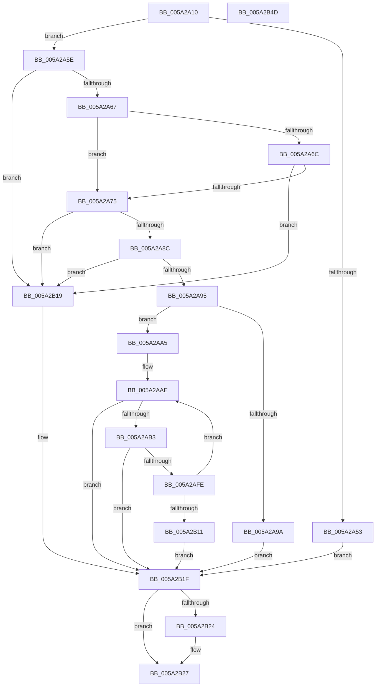

# SecureDump_Encrypt_DmpData

- RVA: `0x005A2A10`–`0x005A2B4E` (길이 `318` bytes)
- VA: `0x00000001405A2A10`
- 실행 섹션: `.text`
- PDB 이름 있음: `예`; PDB Function 태그: `아니요`
- unwind 정보 RVA: `0x000C7E18`
- 디코드: `83`개 명령, `318/318` bytes 표시
- 미해석 바이트: `0` (있으면 어셈블리에 `.byte`로 보존)

> 이 문서는 커널 이미지의 기계어와 PDB 기호를 분석해 생성했습니다. 4번과 5번은 함수 원형과 자료형을 바이너리 사용 방식에서 추정한 C 해석이며 원본 소스 복구 결과는 아닙니다.

## 1. Dependencies

- 직접 호출 지점: **2**; 고유 호출 대상: **2**
- 직접 호출자로 확인된 함수: **1**
- RIP 상대 이미지 참조: **4**

### Outgoing calls
- `0x005A2AF2` → [BCryptEncrypt](../4F/BCryptEncrypt_function_004F9D54.md) (function, `0x004F9D54`)
- `0x005A2B32` → [_security_check_cookie](../6A/_security_check_cookie_function_006AC640.md) (function, `0x006AC640`)

### Direct callers
- [IopLiveDumpWriteBuffer](../3F/IopLiveDumpWriteBuffer_function_003F6688.md) at `0x003F676B`

### Static image references
- `0x005A2A23` → RVA `0x00E0A740` (`.data`; read)
- `0x005A2A3C` → RVA `0x00E661B4` (`.data`; read)
- `0x005A2A75` → RVA `0x00E661E4` (`.data`; read)
- `0x005A2AD6` → RVA `0x00E661F0` (`.data`; read)

## 2. Other-region calls and transfers

- 다른 실행 섹션으로 향하는 call: **0**
- 별도 외부 분기/꼬리 이동을 확인하지 못했습니다.

## 3. Assembly (complete function range)

```asm
005A2A10  48 89 5C 24 10                  mov qword ptr [rsp + 0x10], rbx
005A2A15  48 89 74 24 20                  mov qword ptr [rsp + 0x20], rsi
005A2A1A  57                              push rdi
005A2A1B  41 56                           push r14
005A2A1D  41 57                           push r15
005A2A1F  48 83 EC 70                     sub rsp, 0x70
005A2A23  48 8B 05 16 7D 86 00            mov rax, qword ptr [rip + 0x867d16]
005A2A2A  48 33 C4                        xor rax, rsp
005A2A2D  48 89 44 24 60                  mov qword ptr [rsp + 0x60], rax
005A2A32  48 8B B4 24 B0 00 00 00         mov rsi, qword ptr [rsp + 0xb0]
005A2A3A  33 DB                           xor ebx, ebx
005A2A3C  38 1D 72 37 8C 00               cmp byte ptr [rip + 0x8c3772], bl
005A2A42  4D 8B F8                        mov r15, r8
005A2A45  48 8B FA                        mov rdi, rdx
005A2A48  4C 8B F1                        mov r14, rcx
005A2A4B  41 BA 01 00 00 C0               mov r10d, 0xc0000001
005A2A51  75 0B                           jne 0x1405a2a5e
005A2A53  41 BA 10 00 00 C0               mov r10d, 0xc0000010
005A2A59  E9 C1 00 00 00                  jmp 0x1405a2b1f
005A2A5E  4D 85 F6                        test r14, r14
005A2A61  0F 84 B2 00 00 00               je 0x1405a2b19
005A2A67  4D 85 FF                        test r15, r15
005A2A6A  75 09                           jne 0x1405a2a75
005A2A6C  4D 85 C9                        test r9, r9
005A2A6F  0F 85 A4 00 00 00               jne 0x1405a2b19
005A2A75  8B 0D 69 37 8C 00               mov ecx, dword ptr [rip + 0x8c3769]
005A2A7B  33 D2                           xor edx, edx
005A2A7D  48 8B C7                        mov rax, rdi
005A2A80  48 F7 F1                        div rcx
005A2A83  48 85 D2                        test rdx, rdx
005A2A86  0F 85 8D 00 00 00               jne 0x1405a2b19
005A2A8C  48 3B F9                        cmp rdi, rcx
005A2A8F  0F 82 84 00 00 00               jb 0x1405a2b19
005A2A95  4C 3B CF                        cmp r9, rdi
005A2A98  73 0B                           jae 0x1405a2aa5
005A2A9A  48 8B DF                        mov rbx, rdi
005A2A9D  41 BA 05 00 00 80               mov r10d, 0x80000005
005A2AA3  EB 7A                           jmp 0x1405a2b1f
005A2AA5  21 5C 24 50                     and dword ptr [rsp + 0x50], ebx
005A2AA9  48 21 5C 24 58                  and qword ptr [rsp + 0x58], rbx
005A2AAE  48 3B DF                        cmp rbx, rdi
005A2AB1  73 6C                           jae 0x1405a2b1f
005A2AB3  83 64 24 48 00                  and dword ptr [rsp + 0x48], 0
005A2AB8  4C 8D 44 24 50                  lea r8, [rsp + 0x50]
005A2ABD  4C 89 44 24 40                  mov qword ptr [rsp + 0x40], r8
005A2AC2  49 8D 04 1F                     lea rax, [r15 + rbx]
005A2AC6  89 4C 24 38                     mov dword ptr [rsp + 0x38], ecx
005A2ACA  49 8D 14 1E                     lea rdx, [r14 + rbx]
005A2ACE  48 89 44 24 30                  mov qword ptr [rsp + 0x30], rax
005A2AD3  44 8B C1                        mov r8d, ecx
005A2AD6  48 8B 0D 13 37 8C 00            mov rcx, qword ptr [rip + 0x8c3713]
005A2ADD  48 8D 44 24 58                  lea rax, [rsp + 0x58]
005A2AE2  C7 44 24 28 08 00 00 00         mov dword ptr [rsp + 0x28], 8
005A2AEA  45 33 C9                        xor r9d, r9d
005A2AED  48 89 44 24 20                  mov qword ptr [rsp + 0x20], rax
005A2AF2  E8 5D 72 F5 FF                  call 0x1404f9d54
005A2AF7  44 8B D0                        mov r10d, eax
005A2AFA  85 C0                           test eax, eax
005A2AFC  78 21                           js 0x1405a2b1f
005A2AFE  8B 4C 24 50                     mov ecx, dword ptr [rsp + 0x50]
005A2B02  48 03 D9                        add rbx, rcx
005A2B05  8B 0D D9 36 8C 00               mov ecx, dword ptr [rip + 0x8c36d9]
005A2B0B  39 4C 24 50                     cmp dword ptr [rsp + 0x50], ecx
005A2B0F  74 9D                           je 0x1405a2aae
005A2B11  41 BA 01 00 00 C0               mov r10d, 0xc0000001
005A2B17  EB 06                           jmp 0x1405a2b1f
005A2B19  41 BA 0D 00 00 C0               mov r10d, 0xc000000d
005A2B1F  48 85 F6                        test rsi, rsi
005A2B22  74 03                           je 0x1405a2b27
005A2B24  48 89 1E                        mov qword ptr [rsi], rbx
005A2B27  41 8B C2                        mov eax, r10d
005A2B2A  48 8B 4C 24 60                  mov rcx, qword ptr [rsp + 0x60]
005A2B2F  48 33 CC                        xor rcx, rsp
005A2B32  E8 09 9B 10 00                  call 0x1406ac640
005A2B37  4C 8D 5C 24 70                  lea r11, [rsp + 0x70]
005A2B3C  49 8B 5B 28                     mov rbx, qword ptr [r11 + 0x28]
005A2B40  49 8B 73 38                     mov rsi, qword ptr [r11 + 0x38]
005A2B44  49 8B E3                        mov rsp, r11
005A2B47  41 5F                           pop r15
005A2B49  41 5E                           pop r14
005A2B4B  5F                              pop rdi
005A2B4C  C3                              ret
005A2B4D  CC                              int3
```

## 4. C-style interpretation (structured pseudocode)

```c
__int64 __fastcall SecureDump_Encrypt_DmpData(__int64 a1, __int64 a2, __int64 a3, __int64 a4, __int64 a5)
{
    __int64 result;
    __int64 v_rbx;
    __int64 v_rsp;
    unsigned __int64 v_stack_m18;
    unsigned __int64 v_stack_m28;
    unsigned __int64 v_stack_m30;
    unsigned int v_stack_m38;
    unsigned int v_stack_m40;
    unsigned __int64 v_stack_m48;
    unsigned int v_stack_m50;
    unsigned __int64 v_stack_m58;
    unsigned int v_stack_m60;
    unsigned __int64 v_stack_m68;
    unsigned __int64 v_stack_p10;
    unsigned __int64 v_stack_p20;

    v_stack_p10 = v_rbx;
    v_stack_p20 = v_rsi;
    v_rsp = (v_rsp) - (112);
    result = (*(unsigned __int64 *)(v_rip + 8813846)) ^ (v_rsp);
    v_stack_m28 = result;
    v_rbx = 0;
    if ((*(unsigned __int8 *)(v_rip + 9189234)) != 0) goto loc_005A2A5E;
    goto loc_005A2B1F;
loc_005A2A5E:
    if (a1 == 0) goto loc_005A2B19;
    if (a3 != 0) goto loc_005A2A75;
    if (a4 != 0) goto loc_005A2B19;
loc_005A2A75:
    a2 = 0;
    if (0 != 0) goto loc_005A2B19;
    if (0 < ((unsigned int)(*(unsigned int *)(v_rip + 9189225)))) goto loc_005A2B19;
    if (a4 >= 0) goto loc_005A2AA5;
    goto loc_005A2B1F;
loc_005A2AA5:
loc_005A2AAE:
    if (0 >= 0) goto loc_005A2B1F;
    v_stack_m48 = v_stack_m38;
    v_stack_m50 = (unsigned int)((unsigned int)(*(unsigned int *)(v_rip + 9189225)));
    v_stack_m58 = a3 + 0 * 1;
    v_stack_m60 = 8;
    a4 = 0;
    v_stack_m68 = v_stack_m30;
    result = BCryptEncrypt(*(unsigned __int64 *)(v_rip + 9189139), a1 + 0 * 1, (unsigned int)((unsigned int)((unsigned int)(*(unsigned int *)(v_rip + 9189225)))), a4);
    if (sign_flag) goto loc_005A2B1F;
    v_rbx = (0) + ((unsigned int)(v_stack_m38));
    if (v_stack_m38 == ((unsigned int)((unsigned int)(*(unsigned int *)(v_rip + 9189081))))) goto loc_005A2AAE;
    goto loc_005A2B1F;
loc_005A2B19:
loc_005A2B1F:
    if (a5 != 0) {
        *(unsigned __int64 *)(a5) = v_rbx;
    }
    a1 = (v_stack_m28) ^ (v_rsp);
    result = _security_check_cookie(a1, a1 + 0 * 1, (unsigned int)((unsigned int)((unsigned int)(*(unsigned int *)(v_rip + 9189225)))), a4);
    return result;
}
```

## 5. (Beta) C Style

```c
int64_t SecureDump_Encrypt_DmpData(int64_t Arg1, int64_t Arg2, int64_t Arg3, int64_t Arg4, int64_t Arg5)
{
    int64_t result;
    int64_t local_rbx;
    int64_t local_rsp;
    uint64_t v_stack_m18;
    uint64_t v_stack_m28;
    uint64_t v_stack_m30;
    uint32_t v_stack_m38;
    uint32_t v_stack_m40;
    uint64_t v_stack_m48;
    uint32_t v_stack_m50;
    uint64_t v_stack_m58;
    uint32_t v_stack_m60;
    uint64_t v_stack_m68;
    uint64_t v_stack_p10;
    uint64_t v_stack_p20;

    v_stack_p10 = local_rbx;
    v_stack_p20 = local_rsi;
    local_rsp = (local_rsp) - (112);
    result = (*(uint64_t *)(v_rip + 0x867D16)) ^ (local_rsp);
    v_stack_m28 = result;
    local_rbx = 0;
    if ((*(uint8_t *)(v_rip + 0x8C3772)) != 0) goto loc_005A2A5E;
    goto loc_005A2B1F;
loc_005A2A5E:
    if (Arg1 == 0) goto loc_005A2B19;
    if (Arg3 != 0) goto loc_005A2A75;
    if (Arg4 != 0) goto loc_005A2B19;
loc_005A2A75:
    Arg2 = 0;
    if (0 != 0) goto loc_005A2B19;
    if (0 < ((uint32_t)(*(uint32_t *)(v_rip + 0x8C3769)))) goto loc_005A2B19;
    if (Arg4 >= 0) goto loc_005A2AA5;
    goto loc_005A2B1F;
loc_005A2AA5:
loc_005A2AAE:
    if (0 >= 0) goto loc_005A2B1F;
    v_stack_m48 = v_stack_m38;
    v_stack_m50 = (uint32_t)((uint32_t)(*(uint32_t *)(v_rip + 0x8C3769)));
    v_stack_m58 = Arg3 + 0 * 1;
    v_stack_m60 = 8;
    Arg4 = 0;
    v_stack_m68 = v_stack_m30;
    result = BCryptEncrypt(*(uint64_t *)(v_rip + 0x8C3713), Arg1 + 0 * 1, (uint32_t)((uint32_t)((uint32_t)(*(uint32_t *)(v_rip + 0x8C3769)))), Arg4);
    if (sign_flag) goto loc_005A2B1F;
    local_rbx = (0) + ((uint32_t)(v_stack_m38));
    if (v_stack_m38 == ((uint32_t)((uint32_t)(*(uint32_t *)(v_rip + 0x8C36D9))))) goto loc_005A2AAE;
    goto loc_005A2B1F;
loc_005A2B19:
loc_005A2B1F:
    if (Arg5 != 0) {
        *(uint64_t *)(Arg5) = local_rbx;
    }
    Arg1 = (v_stack_m28) ^ (local_rsp);
    result = _security_check_cookie(Arg1, Arg1 + 0 * 1, (uint32_t)((uint32_t)((uint32_t)(*(uint32_t *)(v_rip + 0x8C3769)))), Arg4);
    return result;
}
```

## 6. Execution-region graph

[열기: 2D/3D 그래프와 함수 탐색 컨트롤 패널](../../../control-panel.html?section=text&rva=0x005A2A10&view=graph)

- 2D 그래프는 위에서 아래로 흐르고, 3D 그래프는 빈 공간을 드래그해 회전합니다. Shift+드래그는 이동, 휠은 확대·축소, 함수 노드 선택은 대상 보고서 이동입니다.

### Static fallback


