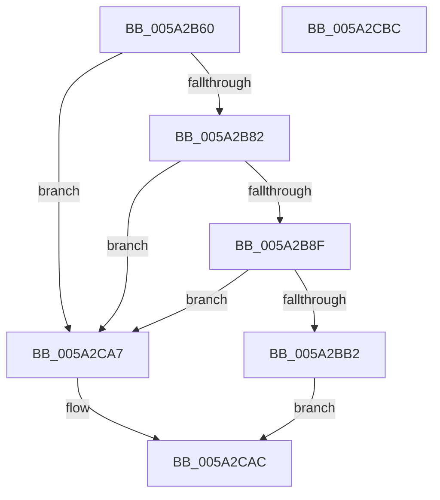

# SecureDump_Get_SecureDumpHeader

- RVA: `0x005A2B60`–`0x005A2CBD` (길이 `349` bytes)
- VA: `0x00000001405A2B60`
- 실행 섹션: `.text`
- PDB 이름 있음: `예`; PDB Function 태그: `아니요`
- unwind 정보 RVA: `0x00060BC4`
- 디코드: `78`개 명령, `349/349` bytes 표시
- 미해석 바이트: `0` (있으면 어셈블리에 `.byte`로 보존)

> 이 문서는 커널 이미지의 기계어와 PDB 기호를 분석해 생성했습니다. 4번과 5번은 함수 원형과 자료형을 바이너리 사용 방식에서 추정한 C 해석이며 원본 소스 복구 결과는 아닙니다.

## 1. Dependencies

- 직접 호출 지점: **3**; 고유 호출 대상: **2**
- 직접 호출자로 확인된 함수: **2**
- RIP 상대 이미지 참조: **9**

### Outgoing calls
- `0x005A2BBA` → [memset](../6C/memset_function_006C6C40.md) (function, `0x006C6C40`)
- `0x005A2C59` → [memcpy](../6C/memcpy_function_006C6840.md) (function, `0x006C6840`)
- `0x005A2C95` → [memcpy](../6C/memcpy_function_006C6840.md) (function, `0x006C6840`)

### Direct callers
- [IopLiveDumpWriteDumpFileWithExtraPages](../59/IopLiveDumpWriteDumpFileWithExtraPages_function_0059F910.md) at `0x005A0110`
- [sub_006EB65A](../6E/Unknown_function_006EB65A.md) at `0x006EB86A`

### Static image references
- `0x005A2B6F` → RVA `0x00E661B4` (`.data`; read)
- `0x005A2B82` → RVA `0x00E66200` (`.data`; read)
- `0x005A2B8F` → RVA `0x00E661E0` (`.data`; read)
- `0x005A2B98` → RVA `0x00E661CC` (`.data`; read)
- `0x005A2C52` → RVA `0x00E661D8` (`.data`; read)
- `0x005A2C5E` → RVA `0x00E661E4` (`.data`; read)
- `0x005A2C6D` → RVA `0x00E661F8` (`.data`; read)
- `0x005A2C8E` → RVA `0x00E661D0` (`.data`; read)
- `0x005A2C9A` → RVA `0x00E661FC` (`.data`; read)

## 2. Other-region calls and transfers

- 다른 실행 섹션으로 향하는 call: **0**
- 별도 외부 분기/꼬리 이동을 확인하지 못했습니다.

## 3. Assembly (complete function range)

```asm
005A2B60  48 89 5C 24 08                  mov qword ptr [rsp + 8], rbx
005A2B65  48 89 74 24 10                  mov qword ptr [rsp + 0x10], rsi
005A2B6A  57                              push rdi
005A2B6B  48 83 EC 20                     sub rsp, 0x20
005A2B6F  80 3D 3E 36 8C 00 00            cmp byte ptr [rip + 0x8c363e], 0
005A2B76  48 8B DA                        mov rbx, rdx
005A2B79  48 8B F1                        mov rsi, rcx
005A2B7C  0F 84 25 01 00 00               je 0x1405a2ca7
005A2B82  44 3B 05 77 36 8C 00            cmp r8d, dword ptr [rip + 0x8c3677]
005A2B89  0F 82 18 01 00 00               jb 0x1405a2ca7
005A2B8F  8B 05 4B 36 8C 00               mov eax, dword ptr [rip + 0x8c364b]
005A2B95  41 8B F8                        mov edi, r8d
005A2B98  44 8B 05 2D 36 8C 00            mov r8d, dword ptr [rip + 0x8c362d]
005A2B9F  49 81 C0 58 10 00 00            add r8, 0x1058
005A2BA6  4C 03 C0                        add r8, rax
005A2BA9  49 3B F8                        cmp rdi, r8
005A2BAC  0F 82 F5 00 00 00               jb 0x1405a2ca7
005A2BB2  44 8B C7                        mov r8d, edi
005A2BB5  33 D2                           xor edx, edx
005A2BB7  48 8B CB                        mov rcx, rbx
005A2BBA  E8 81 40 12 00                  call 0x1406c6c40
005A2BBF  C7 43 08 01 00 00 00            mov dword ptr [rbx + 8], 1
005A2BC6  8B 05 34 36 8C 00               mov eax, dword ptr [rip + 0x8c3634]
005A2BCC  89 43 0C                        mov dword ptr [rbx + 0xc], eax
005A2BCF  8B 06                           mov eax, dword ptr [rsi]
005A2BD1  89 03                           mov dword ptr [rbx], eax
005A2BD3  8B 46 04                        mov eax, dword ptr [rsi + 4]
005A2BD6  89 43 04                        mov dword ptr [rbx + 4], eax
005A2BD9  8B 46 30                        mov eax, dword ptr [rsi + 0x30]
005A2BDC  89 43 30                        mov dword ptr [rbx + 0x30], eax
005A2BDF  8B 86 98 0F 00 00               mov eax, dword ptr [rsi + 0xf98]
005A2BE5  89 83 98 0F 00 00               mov dword ptr [rbx + 0xf98], eax
005A2BEB  48 8B 8E A0 0F 00 00            mov rcx, qword ptr [rsi + 0xfa0]
005A2BF2  48 81 C1 FF 0F 00 00            add rcx, 0xfff
005A2BF9  48 03 CF                        add rcx, rdi
005A2BFC  48 81 E1 00 F0 FF FF            and rcx, 0xfffffffffffff000
005A2C03  48 89 8B A0 0F 00 00            mov qword ptr [rbx + 0xfa0], rcx
005A2C0A  48 8D 8B 58 10 00 00            lea rcx, [rbx + 0x1058]
005A2C11  8B 86 50 10 00 00               mov eax, dword ptr [rsi + 0x1050]
005A2C17  0F BA E8 08                     bts eax, 8
005A2C1B  89 83 50 10 00 00               mov dword ptr [rbx + 0x1050], eax
005A2C21  8B 46 38                        mov eax, dword ptr [rsi + 0x38]
005A2C24  48 83 63 40 00                  and qword ptr [rbx + 0x40], 0
005A2C29  48 83 63 48 00                  and qword ptr [rbx + 0x48], 0
005A2C2E  48 83 63 50 00                  and qword ptr [rbx + 0x50], 0
005A2C33  48 83 63 58 00                  and qword ptr [rbx + 0x58], 0
005A2C38  89 43 38                        mov dword ptr [rbx + 0x38], eax
005A2C3B  C7 43 14 58 10 00 00            mov dword ptr [rbx + 0x14], 0x1058
005A2C42  8B 05 98 35 8C 00               mov eax, dword ptr [rip + 0x8c3598]
005A2C48  89 43 10                        mov dword ptr [rbx + 0x10], eax
005A2C4B  44 8B 05 8E 35 8C 00            mov r8d, dword ptr [rip + 0x8c358e]
005A2C52  48 8B 15 7F 35 8C 00            mov rdx, qword ptr [rip + 0x8c357f]
005A2C59  E8 E2 3B 12 00                  call 0x1406c6840
005A2C5E  8B 05 80 35 8C 00               mov eax, dword ptr [rip + 0x8c3580]
005A2C64  8B 53 14                        mov edx, dword ptr [rbx + 0x14]
005A2C67  03 53 10                        add edx, dword ptr [rbx + 0x10]
005A2C6A  89 43 28                        mov dword ptr [rbx + 0x28], eax
005A2C6D  8B 05 85 35 8C 00               mov eax, dword ptr [rip + 0x8c3585]
005A2C73  89 53 1C                        mov dword ptr [rbx + 0x1c], edx
005A2C76  89 43 20                        mov dword ptr [rbx + 0x20], eax
005A2C79  8B 05 4D 35 8C 00               mov eax, dword ptr [rip + 0x8c354d]
005A2C7F  8B CA                           mov ecx, edx
005A2C81  89 43 18                        mov dword ptr [rbx + 0x18], eax
005A2C84  48 03 CB                        add rcx, rbx
005A2C87  44 8B 05 3E 35 8C 00            mov r8d, dword ptr [rip + 0x8c353e]
005A2C8E  48 8B 15 3B 35 8C 00            mov rdx, qword ptr [rip + 0x8c353b]
005A2C95  E8 A6 3B 12 00                  call 0x1406c6840
005A2C9A  8B 05 5C 35 8C 00               mov eax, dword ptr [rip + 0x8c355c]
005A2CA0  89 43 24                        mov dword ptr [rbx + 0x24], eax
005A2CA3  33 C0                           xor eax, eax
005A2CA5  EB 05                           jmp 0x1405a2cac
005A2CA7  B8 0D 00 00 C0                  mov eax, 0xc000000d
005A2CAC  48 8B 5C 24 30                  mov rbx, qword ptr [rsp + 0x30]
005A2CB1  48 8B 74 24 38                  mov rsi, qword ptr [rsp + 0x38]
005A2CB6  48 83 C4 20                     add rsp, 0x20
005A2CBA  5F                              pop rdi
005A2CBB  C3                              ret
005A2CBC  CC                              int3
```

## 4. C-style interpretation (structured pseudocode)

```c
__int64 __fastcall SecureDump_Get_SecureDumpHeader(__int64 a1, __int64 a2, int a3)
{
    __int64 result;
    __int64 v_rsp;
    unsigned __int64 v_stack_p10;
    unsigned __int64 v_stack_p8;

    v_stack_p8 = v_rbx;
    v_stack_p10 = v_rsi;
    v_rsp = (v_rsp) - (32);
    if ((*(unsigned __int8 *)(v_rip + 9188926)) == 0) goto loc_005A2CA7;
    if (a3 < (*(unsigned int *)(v_rip + 9188983))) goto loc_005A2CA7;
    a3 = ((unsigned int)(*(unsigned int *)(v_rip + 9188909))) + (0x1058ULL);
    a3 = (a3) + ((unsigned int)(*(unsigned int *)(v_rip + 9188939)));
    if (((unsigned int)(a3)) < a3) goto loc_005A2CA7;
    a2 = 0;
    result = memset(0, a2, (unsigned int)((unsigned int)((unsigned int)(a3))), a4);
    *(unsigned int *)(a2 + 8) = 1;
    *(unsigned int *)(a2 + 12) = (unsigned int)((unsigned int)(*(unsigned int *)(v_rip + 9188916)));
    *(unsigned int *)(a2) = (unsigned int)((unsigned int)(*(unsigned int *)(a1)));
    *(unsigned int *)(a2 + 4) = (unsigned int)((unsigned int)(*(unsigned int *)(a1 + 4)));
    *(unsigned int *)(a2 + 48) = (unsigned int)((unsigned int)(*(unsigned int *)(a1 + 48)));
    *(unsigned int *)(a2 + 3992) = (unsigned int)((unsigned int)(*(unsigned int *)(a1 + 3992)));
    a1 = (*(unsigned __int64 *)(a1 + 4000)) + (0xFFFULL);
    a1 = (a1) + ((unsigned int)(a3));
    a1 = (a1) & (0xFFFFFFFFFFFFF000ULL);
    *(unsigned __int64 *)(a2 + 4000) = a1;
    *(unsigned int *)(a2 + 4176) = (unsigned int)((unsigned int)(*(unsigned int *)(a1 + 4176)));
    *(unsigned int *)(a2 + 56) = (unsigned int)((unsigned int)(*(unsigned int *)(a1 + 56)));
    *(unsigned int *)(a2 + 20) = 0x1058ULL;
    *(unsigned int *)(a2 + 16) = (unsigned int)((unsigned int)(*(unsigned int *)(v_rip + 9188760)));
    result = memcpy(a2 + 4184, *(unsigned __int64 *)(v_rip + 9188735), (unsigned int)(*(unsigned int *)(v_rip + 9188750)), a4);
    a2 = (unsigned int)(((unsigned int)(*(unsigned int *)(a2 + 20))) + (*(unsigned int *)(a2 + 16)));
    *(unsigned int *)(a2 + 40) = (unsigned int)((unsigned int)(*(unsigned int *)(v_rip + 9188736)));
    *(unsigned int *)(a2 + 28) = (unsigned int)(a2);
    *(unsigned int *)(a2 + 32) = (unsigned int)((unsigned int)(*(unsigned int *)(v_rip + 9188741)));
    *(unsigned int *)(a2 + 24) = (unsigned int)((unsigned int)(*(unsigned int *)(v_rip + 9188685)));
    a1 = ((unsigned int)((unsigned int)(a2))) + (a2);
    result = memcpy(a1, *(unsigned __int64 *)(v_rip + 9188667), (unsigned int)(*(unsigned int *)(v_rip + 9188670)), a4);
    *(unsigned int *)(a2 + 36) = (unsigned int)((unsigned int)(*(unsigned int *)(v_rip + 9188700)));
    result = 0;
    goto loc_005A2CAC;
loc_005A2CA7:
loc_005A2CAC:
    v_rsp = (v_rsp) + (32);
    return (unsigned int)(0xC000000DULL);
}
```

## 5. (Beta) C Style

```c
int64_t SecureDump_Get_SecureDumpHeader(void *Arg1, void *Arg2, int32_t Arg3)
{
    uint8_t *arg1 = (uint8_t *)Arg1;
    uint8_t *arg2 = (uint8_t *)Arg2;

    int64_t result;
    int64_t local_rsp;
    uint64_t v_stack_p10;
    uint64_t v_stack_p8;

    v_stack_p8 = local_rbx;
    v_stack_p10 = local_rsi;
    local_rsp = (local_rsp) - (32);
    if ((*(uint8_t *)(v_rip + 0x8C363E)) == 0) goto loc_005A2CA7;
    if (Arg3 < (*(uint32_t *)(v_rip + 0x8C3677))) goto loc_005A2CA7;
    Arg3 = ((uint32_t)(*(uint32_t *)(v_rip + 0x8C362D))) + (0x1058ULL);
    Arg3 = (Arg3) + ((uint32_t)(*(uint32_t *)(v_rip + 0x8C364B)));
    if (((uint32_t)(Arg3)) < Arg3) goto loc_005A2CA7;
    Arg2 = 0;
    result = memset(0, Arg2, (uint32_t)((uint32_t)((uint32_t)(Arg3))), a4);
    *(uint32_t *)(arg2 + 0x8) = 1;
    *(uint32_t *)(arg2 + 0xC) = (uint32_t)((uint32_t)(*(uint32_t *)(v_rip + 0x8C3634)));
    *(uint32_t *)(arg2) = (uint32_t)((uint32_t)(*(uint32_t *)(arg1)));
    *(uint32_t *)(arg2 + 0x4) = (uint32_t)((uint32_t)(*(uint32_t *)(arg1 + 0x4)));
    *(uint32_t *)(arg2 + 0x30) = (uint32_t)((uint32_t)(*(uint32_t *)(arg1 + 0x30)));
    *(uint32_t *)(arg2 + 0xF98) = (uint32_t)((uint32_t)(*(uint32_t *)(arg1 + 0xF98)));
    Arg1 = (*(uint64_t *)(arg1 + 0xFA0)) + (0xFFFULL);
    Arg1 = (Arg1) + ((uint32_t)(Arg3));
    Arg1 = (Arg1) & (0xFFFFFFFFFFFFF000ULL);
    *(void **)(arg2 + 0xFA0) = Arg1;
    *(uint32_t *)(arg2 + 0x1050) = (uint32_t)((uint32_t)(*(uint32_t *)(arg1 + 0x1050)));
    *(uint32_t *)(arg2 + 0x38) = (uint32_t)((uint32_t)(*(uint32_t *)(arg1 + 0x38)));
    *(uint32_t *)(arg2 + 0x14) = 0x1058ULL;
    *(uint32_t *)(arg2 + 0x10) = (uint32_t)((uint32_t)(*(uint32_t *)(v_rip + 0x8C3598)));
    result = memcpy(Arg2 + 4184, *(uint64_t *)(v_rip + 0x8C357F), (uint32_t)(*(uint32_t *)(v_rip + 0x8C358E)), a4);
    Arg2 = (uint32_t)(((uint32_t)(*(uint32_t *)(arg2 + 0x14))) + (*(uint32_t *)(arg2 + 0x10)));
    *(uint32_t *)(arg2 + 0x28) = (uint32_t)((uint32_t)(*(uint32_t *)(v_rip + 0x8C3580)));
    *(uint32_t *)(arg2 + 0x1C) = (uint32_t)(Arg2);
    *(uint32_t *)(arg2 + 0x20) = (uint32_t)((uint32_t)(*(uint32_t *)(v_rip + 0x8C3585)));
    *(uint32_t *)(arg2 + 0x18) = (uint32_t)((uint32_t)(*(uint32_t *)(v_rip + 0x8C354D)));
    Arg1 = ((uint32_t)((uint32_t)(Arg2))) + (Arg2);
    result = memcpy(Arg1, *(uint64_t *)(v_rip + 0x8C353B), (uint32_t)(*(uint32_t *)(v_rip + 0x8C353E)), a4);
    *(uint32_t *)(arg2 + 0x24) = (uint32_t)((uint32_t)(*(uint32_t *)(v_rip + 0x8C355C)));
    result = 0;
    goto loc_005A2CAC;
loc_005A2CA7:
loc_005A2CAC:
    local_rsp = (local_rsp) + (32);
    return (uint32_t)(0xC000000DULL);
}
```

### 관측된 메모리 오프셋

구조체 형식이 확인되지 않은 접근은 인자 기준의 오프셋으로만 기록했습니다.

| 기준 인자 | 오프셋 표현 | 폭 (bit) | 접근 |
|---|---:|---:|---|
| `Arg1` | `+ 0x0` | `32` | `R` |
| `Arg1` | `+ 0x4` | `32` | `R` |
| `Arg1` | `+ 0x30` | `32` | `R` |
| `Arg1` | `+ 0x38` | `32` | `R` |
| `Arg1` | `+ 0xF98` | `32` | `R` |
| `Arg1` | `+ 0xFA0` | `64` | `R` |
| `Arg1` | `+ 0x1050` | `32` | `R` |
| `Arg2` | `+ 0x0` | `32` | `W` |
| `Arg2` | `+ 0x4` | `32` | `W` |
| `Arg2` | `+ 0x8` | `32` | `W` |
| `Arg2` | `+ 0xC` | `32` | `W` |
| `Arg2` | `+ 0x10` | `32` | `R` |
| `Arg2` | `+ 0x10` | `32` | `W` |
| `Arg2` | `+ 0x14` | `32` | `R` |
| `Arg2` | `+ 0x14` | `32` | `W` |
| `Arg2` | `+ 0x18` | `32` | `W` |
| `Arg2` | `+ 0x1C` | `32` | `W` |
| `Arg2` | `+ 0x20` | `32` | `W` |
| `Arg2` | `+ 0x24` | `32` | `W` |
| `Arg2` | `+ 0x28` | `32` | `W` |
| `Arg2` | `+ 0x30` | `32` | `W` |
| `Arg2` | `+ 0x38` | `32` | `W` |
| `Arg2` | `+ 0x40` | `64` | `R/W` |
| `Arg2` | `+ 0x48` | `64` | `R/W` |
| `Arg2` | `+ 0x50` | `64` | `R/W` |
| `Arg2` | `+ 0x58` | `64` | `R/W` |
| `Arg2` | `+ 0xF98` | `32` | `W` |
| `Arg2` | `+ 0xFA0` | `64` | `W` |
| `Arg2` | `+ 0x1050` | `32` | `W` |
| `Arg2` | `+ 0x1058` | `64` | `R` |

## 6. Execution-region graph

[열기: 2D/3D 그래프와 함수 탐색 컨트롤 패널](../../../control-panel.html?section=text&rva=0x005A2B60&view=graph)

- 2D 그래프는 위에서 아래로 흐르고, 3D 그래프는 빈 공간을 드래그해 회전합니다. Shift+드래그는 이동, 휠은 확대·축소, 함수 노드 선택은 대상 보고서 이동입니다.

### Static fallback


