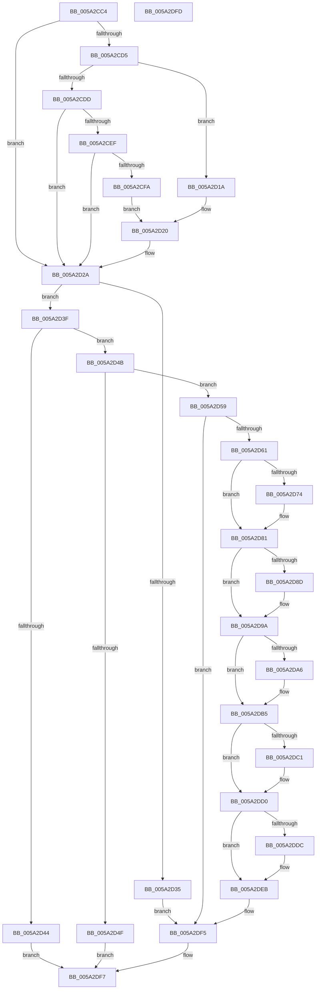

# SecureDump_Init

- RVA: `0x005A2CC4`–`0x005A2DFE` (길이 `314` bytes)
- VA: `0x00000001405A2CC4`
- 실행 섹션: `.text`
- PDB 이름 있음: `예`; PDB Function 태그: `아니요`
- unwind 정보 RVA: `0x0005CF00`
- 디코드: `74`개 명령, `314/314` bytes 표시
- 미해석 바이트: `0` (있으면 어셈블리에 `.byte`로 보존)

> 이 문서는 커널 이미지의 기계어와 PDB 기호를 분석해 생성했습니다. 4번과 5번은 함수 원형과 자료형을 바이너리 사용 방식에서 추정한 C 해석이며 원본 소스 복구 결과는 아닙니다.

## 1. Dependencies

- 직접 호출 지점: **7**; 고유 호출 대상: **5**
- 직접 호출자로 확인된 함수: **1**
- RIP 상대 이미지 참조: **17**

### Outgoing calls
- `0x005A2CE4` → [SecureDump_SymmetricEncryptionSetup](SecureDump_SymmetricEncryptionSetup_function_005A3774.md) (function, `0x005A3774`)
- `0x005A2CEF` → [SecureDump_EncryptSymmetricKeyWithPublicKey](SecureDump_EncryptSymmetricKeyWithPublicKey_function_005A27A4.md) (function, `0x005A27A4`)
- `0x005A2D74` → [BCryptCloseAlgorithmProvider](../60/BCryptCloseAlgorithmProvider_function_006064D8.md) (function, `0x006064D8`)
- `0x005A2D8D` → [BCryptDestroyKey](../60/BCryptDestroyKey_function_00606530.md) (function, `0x00606530`)
- `0x005A2DA8` → [ExFreePoolWithTag](../../poolcode/B8/ExFreePoolWithTag_function_00B82870.md) (function, `0x00B82870`)
- `0x005A2DC3` → [ExFreePoolWithTag](../../poolcode/B8/ExFreePoolWithTag_function_00B82870.md) (function, `0x00B82870`)
- `0x005A2DDE` → [ExFreePoolWithTag](../../poolcode/B8/ExFreePoolWithTag_function_00B82870.md) (function, `0x00B82870`)

### Direct callers
- [IopInitCrashDumpDuringSysInit](../../init/C2/IopInitCrashDumpDuringSysInit_function_00C2CAE4.md) at `0x00C2CB28`

### Static image references
- `0x005A2CCC` → RVA `0x00E661B0` (`.data`; read)
- `0x005A2CD5` → RVA `0x00E661BC` (`.data`; read)
- `0x005A2CDD` → RVA `0x00E661B4` (`.data`; write)
- `0x005A2CFA` → RVA `0x00E661E0` (`.data`; read)
- `0x005A2D06` → RVA `0x00E661CC` (`.data`; read)
- `0x005A2D12` → RVA `0x00E66200` (`.data`; write)
- `0x005A2D20` → RVA `0x00E661B0` (`.data`; write)
- `0x005A2D61` → RVA `0x00E661E8` (`.data`; read)
- `0x005A2D79` → RVA `0x00E661E8` (`.data`; read/write)
- `0x005A2D81` → RVA `0x00E661F0` (`.data`; read)
- `0x005A2D92` → RVA `0x00E661F0` (`.data`; read/write)
- `0x005A2D9A` → RVA `0x00E661D8` (`.data`; read)
- `0x005A2DAD` → RVA `0x00E661D8` (`.data`; read/write)
- `0x005A2DB5` → RVA `0x00E661D0` (`.data`; read)
- `0x005A2DC8` → RVA `0x00E661D0` (`.data`; read/write)
- `0x005A2DD0` → RVA `0x00E661C0` (`.data`; read)
- `0x005A2DE3` → RVA `0x00E661C0` (`.data`; read/write)

## 2. Other-region calls and transfers

- 다른 실행 섹션으로 향하는 call: **3**
  - `0x005A2DA8` → [ExFreePoolWithTag](../../poolcode/B8/ExFreePoolWithTag_function_00B82870.md) (`.text` → `POOLCODE`)
  - `0x005A2DC3` → [ExFreePoolWithTag](../../poolcode/B8/ExFreePoolWithTag_function_00B82870.md) (`.text` → `POOLCODE`)
  - `0x005A2DDE` → [ExFreePoolWithTag](../../poolcode/B8/ExFreePoolWithTag_function_00B82870.md) (`.text` → `POOLCODE`)
- 별도 외부 분기/꼬리 이동을 확인하지 못했습니다.

## 3. Assembly (complete function range)

```asm
005A2CC4  40 53                           push rbx
005A2CC6  48 83 EC 20                     sub rsp, 0x20
005A2CCA  33 DB                           xor ebx, ebx
005A2CCC  83 3D DD 34 8C 00 01            cmp dword ptr [rip + 0x8c34dd], 1
005A2CD3  75 55                           jne 0x1405a2d2a
005A2CD5  39 1D E1 34 8C 00               cmp dword ptr [rip + 0x8c34e1], ebx
005A2CDB  74 3D                           je 0x1405a2d1a
005A2CDD  C6 05 D0 34 8C 00 01            mov byte ptr [rip + 0x8c34d0], 1
005A2CE4  E8 8B 0A 00 00                  call 0x1405a3774
005A2CE9  8B D8                           mov ebx, eax
005A2CEB  85 C0                           test eax, eax
005A2CED  78 3B                           js 0x1405a2d2a
005A2CEF  E8 B0 FA FF FF                  call 0x1405a27a4
005A2CF4  8B D8                           mov ebx, eax
005A2CF6  85 C0                           test eax, eax
005A2CF8  78 30                           js 0x1405a2d2a
005A2CFA  8B 15 E0 34 8C 00               mov edx, dword ptr [rip + 0x8c34e0]
005A2D00  81 C2 57 20 00 00               add edx, 0x2057
005A2D06  03 15 C0 34 8C 00               add edx, dword ptr [rip + 0x8c34c0]
005A2D0C  81 E2 00 F0 FF FF               and edx, 0xfffff000
005A2D12  89 15 E8 34 8C 00               mov dword ptr [rip + 0x8c34e8], edx
005A2D18  EB 06                           jmp 0x1405a2d20
005A2D1A  88 1D 94 34 8C 00               mov byte ptr [rip + 0x8c3494], bl
005A2D20  C7 05 86 34 8C 00 02 00 00 00   mov dword ptr [rip + 0x8c3486], 2
005A2D2A  8B 05 80 34 8C 00               mov eax, dword ptr [rip + 0x8c3480]
005A2D30  83 F8 03                        cmp eax, 3
005A2D33  75 0A                           jne 0x1405a2d3f
005A2D35  BB 01 00 00 C0                  mov ebx, 0xc0000001
005A2D3A  E9 B6 00 00 00                  jmp 0x1405a2df5
005A2D3F  83 F8 02                        cmp eax, 2
005A2D42  75 07                           jne 0x1405a2d4b
005A2D44  33 C0                           xor eax, eax
005A2D46  E9 AC 00 00 00                  jmp 0x1405a2df7
005A2D4B  85 C0                           test eax, eax
005A2D4D  75 0A                           jne 0x1405a2d59
005A2D4F  B8 10 00 00 C0                  mov eax, 0xc0000010
005A2D54  E9 9E 00 00 00                  jmp 0x1405a2df7
005A2D59  85 DB                           test ebx, ebx
005A2D5B  0F 89 94 00 00 00               jns 0x1405a2df5
005A2D61  48 8B 0D 80 34 8C 00            mov rcx, qword ptr [rip + 0x8c3480]
005A2D68  C6 05 45 34 8C 00 00            mov byte ptr [rip + 0x8c3445], 0
005A2D6F  48 85 C9                        test rcx, rcx
005A2D72  74 0D                           je 0x1405a2d81
005A2D74  E8 5F 37 06 00                  call 0x1406064d8
005A2D79  48 83 25 67 34 8C 00 00         and qword ptr [rip + 0x8c3467], 0
005A2D81  48 8B 0D 68 34 8C 00            mov rcx, qword ptr [rip + 0x8c3468]
005A2D88  48 85 C9                        test rcx, rcx
005A2D8B  74 0D                           je 0x1405a2d9a
005A2D8D  E8 9E 37 06 00                  call 0x140606530
005A2D92  48 83 25 56 34 8C 00 00         and qword ptr [rip + 0x8c3456], 0
005A2D9A  48 8B 0D 37 34 8C 00            mov rcx, qword ptr [rip + 0x8c3437]
005A2DA1  48 85 C9                        test rcx, rcx
005A2DA4  74 0F                           je 0x1405a2db5
005A2DA6  33 D2                           xor edx, edx
005A2DA8  E8 C3 FA 5D 00                  call 0x140b82870
005A2DAD  48 83 25 23 34 8C 00 00         and qword ptr [rip + 0x8c3423], 0
005A2DB5  48 8B 0D 14 34 8C 00            mov rcx, qword ptr [rip + 0x8c3414]
005A2DBC  48 85 C9                        test rcx, rcx
005A2DBF  74 0F                           je 0x1405a2dd0
005A2DC1  33 D2                           xor edx, edx
005A2DC3  E8 A8 FA 5D 00                  call 0x140b82870
005A2DC8  48 83 25 00 34 8C 00 00         and qword ptr [rip + 0x8c3400], 0
005A2DD0  48 8B 0D E9 33 8C 00            mov rcx, qword ptr [rip + 0x8c33e9]
005A2DD7  48 85 C9                        test rcx, rcx
005A2DDA  74 0F                           je 0x1405a2deb
005A2DDC  33 D2                           xor edx, edx
005A2DDE  E8 8D FA 5D 00                  call 0x140b82870
005A2DE3  48 83 25 D5 33 8C 00 00         and qword ptr [rip + 0x8c33d5], 0
005A2DEB  C7 05 BB 33 8C 00 03 00 00 00   mov dword ptr [rip + 0x8c33bb], 3
005A2DF5  8B C3                           mov eax, ebx
005A2DF7  48 83 C4 20                     add rsp, 0x20
005A2DFB  5B                              pop rbx
005A2DFC  C3                              ret
005A2DFD  CC                              int3
```

## 4. C-style interpretation (structured pseudocode)

```c
__int64 __fastcall SecureDump_Init(void)
{
    __int64 result;
    __int64 v_rbx;
    __int64 v_rsp;

    v_rsp = (v_rsp) - (32);
    v_rbx = 0;
    if ((*(unsigned int *)(v_rip + 9188573)) != 1) goto loc_005A2D2A;
    if ((*(unsigned int *)(v_rip + 9188577)) == 0) goto loc_005A2D1A;
    *(unsigned __int8 *)(v_rip + 9188560) = 1;
    result = SecureDump_SymmetricEncryptionSetup(a1, a2, a3, a4);
    if (sign_flag) goto loc_005A2D2A;
    result = SecureDump_EncryptSymmetricKeyWithPublicKey(a1, a2, a3, a4);
    if (sign_flag) goto loc_005A2D2A;
    a2 = (unsigned int)(((unsigned int)(*(unsigned int *)(v_rip + 9188576))) + (0x2057ULL));
    a2 = (unsigned int)((a2) + (*(unsigned int *)(v_rip + 9188544)));
    a2 = (unsigned int)((a2) & (0xFFFFF000ULL));
    *(unsigned int *)(v_rip + 9188584) = (unsigned int)(a2);
    goto loc_005A2D20;
loc_005A2D1A:
    *(unsigned __int8 *)(v_rip + 9188500) = (unsigned __int8)((unsigned int)((unsigned int)(result)));
loc_005A2D20:
    *(unsigned int *)(v_rip + 9188486) = 2;
loc_005A2D2A:
    if (((unsigned int)((unsigned int)(*(unsigned int *)(v_rip + 9188480)))) != 3) goto loc_005A2D3F;
    goto loc_005A2DF5;
loc_005A2D3F:
    if (((unsigned int)((unsigned int)(*(unsigned int *)(v_rip + 9188480)))) != 2) goto loc_005A2D4B;
    result = 0;
    goto loc_005A2DF7;
loc_005A2D4B:
    if (0 != 0) goto loc_005A2D59;
    goto loc_005A2DF7;
loc_005A2D59:
    if (!sign_flag) goto loc_005A2DF5;
    *(unsigned __int8 *)(v_rip + 9188421) = 0;
    result = (unsigned int)(0xC0000010ULL);
    if (*(unsigned __int64 *)(v_rip + 9188480) != 0) {
        result = BCryptCloseAlgorithmProvider(*(unsigned __int64 *)(v_rip + 9188480), a2, a3, a4);
    }
    if (*(unsigned __int64 *)(v_rip + 9188456) != 0) {
        result = BCryptDestroyKey(*(unsigned __int64 *)(v_rip + 9188456), a2, a3, a4);
    }
    if (*(unsigned __int64 *)(v_rip + 9188407) != 0) {
        a2 = 0;
        result = ExFreePoolWithTag(*(unsigned __int64 *)(v_rip + 9188407), a2, a3, a4);
    }
    if (*(unsigned __int64 *)(v_rip + 9188372) != 0) {
        a2 = 0;
        result = ExFreePoolWithTag(*(unsigned __int64 *)(v_rip + 9188372), a2, a3, a4);
    }
    if (*(unsigned __int64 *)(v_rip + 9188329) != 0) {
        a2 = 0;
        result = ExFreePoolWithTag(*(unsigned __int64 *)(v_rip + 9188329), a2, a3, a4);
    }
    *(unsigned int *)(v_rip + 9188283) = 3;
loc_005A2DF5:
loc_005A2DF7:
    v_rsp = (v_rsp) + (32);
    return (unsigned int)((unsigned int)((unsigned int)(0xC0000001ULL)));
}
```

## 5. (Beta) C Style

```c
void SecureDump_Init(void)
{
    int64_t result;
    int64_t local_rbx;
    int64_t local_rsp;

    local_rsp = (local_rsp) - (32);
    local_rbx = 0;
    if ((*(uint32_t *)(v_rip + 0x8C34DD)) != 1) goto loc_005A2D2A;
    if ((*(uint32_t *)(v_rip + 0x8C34E1)) == 0) goto loc_005A2D1A;
    *(uint8_t *)(v_rip + 0x8C34D0) = 1;
    result = SecureDump_SymmetricEncryptionSetup(a1, a2, a3, a4);
    if (sign_flag) goto loc_005A2D2A;
    result = SecureDump_EncryptSymmetricKeyWithPublicKey(a1, a2, a3, a4);
    if (sign_flag) goto loc_005A2D2A;
    a2 = (uint32_t)(((uint32_t)(*(uint32_t *)(v_rip + 0x8C34E0))) + (0x2057ULL));
    a2 = (uint32_t)((a2) + (*(uint32_t *)(v_rip + 0x8C34C0)));
    a2 = (uint32_t)((a2) & (0xFFFFF000ULL));
    *(uint32_t *)(v_rip + 0x8C34E8) = (uint32_t)(a2);
    goto loc_005A2D20;
loc_005A2D1A:
    *(uint8_t *)(v_rip + 0x8C3494) = (uint8_t)((uint32_t)((uint32_t)(result)));
loc_005A2D20:
    *(uint32_t *)(v_rip + 0x8C3486) = 2;
loc_005A2D2A:
    if (((uint32_t)((uint32_t)(*(uint32_t *)(v_rip + 0x8C3480)))) != 3) goto loc_005A2D3F;
    goto loc_005A2DF5;
loc_005A2D3F:
    if (((uint32_t)((uint32_t)(*(uint32_t *)(v_rip + 0x8C3480)))) != 2) goto loc_005A2D4B;
    result = 0;
    goto loc_005A2DF7;
loc_005A2D4B:
    if (0 != 0) goto loc_005A2D59;
    goto loc_005A2DF7;
loc_005A2D59:
    if (!sign_flag) goto loc_005A2DF5;
    *(uint8_t *)(v_rip + 0x8C3445) = 0;
    result = (uint32_t)(0xC0000010ULL);
    if (*(uint64_t *)(v_rip + 0x8C3480) != 0) {
        result = BCryptCloseAlgorithmProvider(*(uint64_t *)(v_rip + 0x8C3480), a2, a3, a4);
    }
    if (*(uint64_t *)(v_rip + 0x8C3468) != 0) {
        result = BCryptDestroyKey(*(uint64_t *)(v_rip + 0x8C3468), a2, a3, a4);
    }
    if (*(uint64_t *)(v_rip + 0x8C3437) != 0) {
        a2 = 0;
        result = ExFreePoolWithTag(*(uint64_t *)(v_rip + 0x8C3437), a2, a3, a4);
    }
    if (*(uint64_t *)(v_rip + 0x8C3414) != 0) {
        a2 = 0;
        result = ExFreePoolWithTag(*(uint64_t *)(v_rip + 0x8C3414), a2, a3, a4);
    }
    if (*(uint64_t *)(v_rip + 0x8C33E9) != 0) {
        a2 = 0;
        result = ExFreePoolWithTag(*(uint64_t *)(v_rip + 0x8C33E9), a2, a3, a4);
    }
    *(uint32_t *)(v_rip + 0x8C33BB) = 3;
loc_005A2DF5:
loc_005A2DF7:
    local_rsp = (local_rsp) + (32);
    return (uint32_t)((uint32_t)((uint32_t)(0xC0000001ULL)));
}
```

## 6. Execution-region graph

[열기: 2D/3D 그래프와 함수 탐색 컨트롤 패널](../../../control-panel.html?section=text&rva=0x005A2CC4&view=graph)

- 2D 그래프는 위에서 아래로 흐르고, 3D 그래프는 빈 공간을 드래그해 회전합니다. Shift+드래그는 이동, 휠은 확대·축소, 함수 노드 선택은 대상 보고서 이동입니다.

### Static fallback


