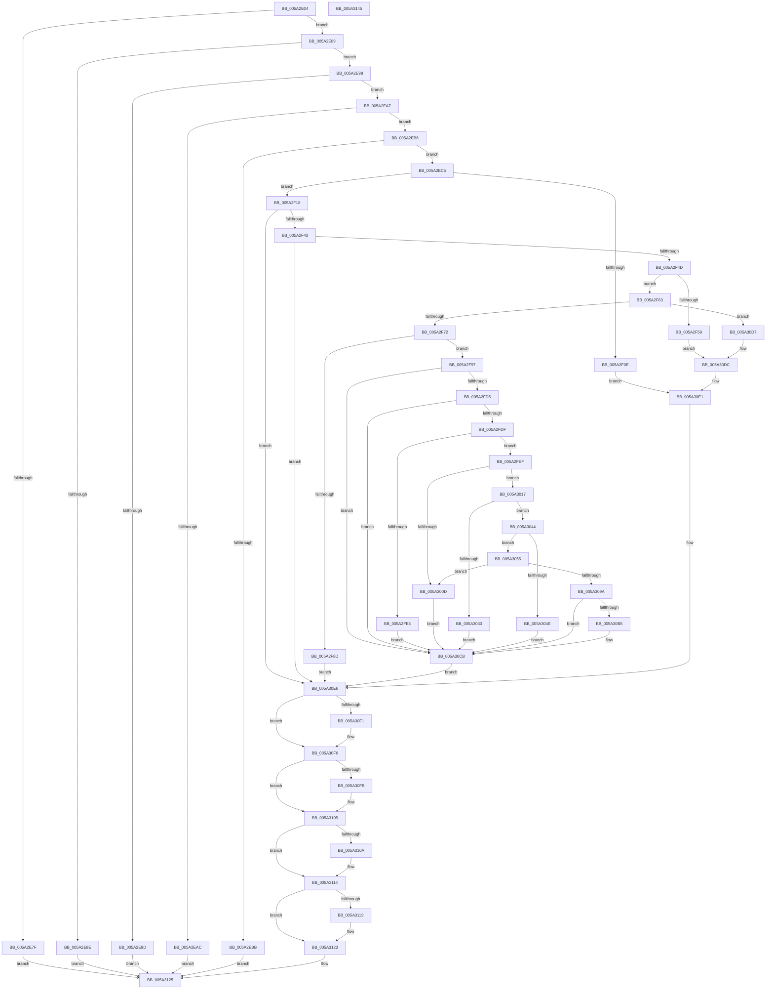

# SecureDump_LoadCertAndProvisionKey

- RVA: `0x005A2E04`–`0x005A3146` (길이 `834` bytes)
- VA: `0x00000001405A2E04`
- 실행 섹션: `.text`
- PDB 이름 있음: `예`; PDB Function 태그: `아니요`
- unwind 정보 RVA: `0x000C7D9C`
- 디코드: `223`개 명령, `834/834` bytes 표시
- 미해석 바이트: `0` (있으면 어셈블리에 `.byte`로 보존)

> 이 문서는 커널 이미지의 기계어와 PDB 기호를 분석해 생성했습니다. 4번과 5번은 함수 원형과 자료형을 바이너리 사용 방식에서 추정한 C 해석이며 원본 소스 복구 결과는 아닙니다.

## 1. Dependencies

- 직접 호출 지점: **16**; 고유 호출 대상: **10**
- 직접 호출자로 확인된 함수: **1**
- RIP 상대 이미지 참조: **1**

### Outgoing calls
- `0x005A2F03` → [ZwOpenFile](../6A/ZwOpenFile_function_006AD730.md) (function, `0x006AD730`)
- `0x005A2F34` → [ZwQueryInformationFile](../6A/ZwQueryInformationFile_function_006AD2F0.md) (function, `0x006AD2F0`)
- `0x005A2F80` → [ExAllocatePool2](../../poolcode/B8/ExAllocatePool2_function_00B820F0.md) (function, `0x00B820F0`)
- `0x005A2FC6` → [ZwReadFile](../6A/ZwReadFile_function_006AD190.md) (function, `0x006AD190`)
- `0x005A3000` → [ExAllocatePool2](../../poolcode/B8/ExAllocatePool2_function_00B820F0.md) (function, `0x00B820F0`)
- `0x005A3025` → [SecureDump_ValidateAmeCertChain](SecureDump_ValidateAmeCertChain_function_005A38B0.md) (function, `0x005A38B0`)
- `0x005A3035` → [SecureDump_LogErrorEvent](SecureDump_LogErrorEvent_function_005A314C.md) (function, `0x005A314C`)
- `0x005A3089` → [ExAllocatePool2](../../poolcode/B8/ExAllocatePool2_function_00B820F0.md) (function, `0x00B820F0`)
- `0x005A30AA` → [SecureDump_ConvertBinaryToHexString](SecureDump_ConvertBinaryToHexString_function_005A2500.md) (function, `0x005A2500`)
- `0x005A30D0` → [ExFreePoolWithTag](../../poolcode/B8/ExFreePoolWithTag_function_00B82870.md) (function, `0x00B82870`)
- `0x005A30E1` → [SecureDump_LogErrorEvent](SecureDump_LogErrorEvent_function_005A314C.md) (function, `0x005A314C`)
- `0x005A30F1` → [ZwClose](../6A/ZwClose_function_006AD2B0.md) (function, `0x006AD2B0`)
- `0x005A3100` → [ExFreePoolWithTag](../../poolcode/B8/ExFreePoolWithTag_function_00B82870.md) (function, `0x00B82870`)
- `0x005A310F` → [ExFreePoolWithTag](../../poolcode/B8/ExFreePoolWithTag_function_00B82870.md) (function, `0x00B82870`)
- `0x005A311E` → [ExFreePoolWithTag](../../poolcode/B8/ExFreePoolWithTag_function_00B82870.md) (function, `0x00B82870`)
- `0x005A312C` → [_security_check_cookie](../6A/_security_check_cookie_function_006AC640.md) (function, `0x006AC640`)

### Direct callers
- [SecureDump_ProvisionCrashDumpKey](SecureDump_ProvisionCrashDumpKey_function_005A33C8.md) at `0x005A344F`

### Static image references
- `0x005A2E1D` → RVA `0x00E0A740` (`.data`; read)

## 2. Other-region calls and transfers

- 다른 실행 섹션으로 향하는 call: **7**
  - `0x005A2F80` → [ExAllocatePool2](../../poolcode/B8/ExAllocatePool2_function_00B820F0.md) (`.text` → `POOLCODE`)
  - `0x005A3000` → [ExAllocatePool2](../../poolcode/B8/ExAllocatePool2_function_00B820F0.md) (`.text` → `POOLCODE`)
  - `0x005A3089` → [ExAllocatePool2](../../poolcode/B8/ExAllocatePool2_function_00B820F0.md) (`.text` → `POOLCODE`)
  - `0x005A30D0` → [ExFreePoolWithTag](../../poolcode/B8/ExFreePoolWithTag_function_00B82870.md) (`.text` → `POOLCODE`)
  - `0x005A3100` → [ExFreePoolWithTag](../../poolcode/B8/ExFreePoolWithTag_function_00B82870.md) (`.text` → `POOLCODE`)
  - `0x005A310F` → [ExFreePoolWithTag](../../poolcode/B8/ExFreePoolWithTag_function_00B82870.md) (`.text` → `POOLCODE`)
  - `0x005A311E` → [ExFreePoolWithTag](../../poolcode/B8/ExFreePoolWithTag_function_00B82870.md) (`.text` → `POOLCODE`)
- 별도 외부 분기/꼬리 이동을 확인하지 못했습니다.

## 3. Assembly (complete function range)

```asm
005A2E04  40 55                           push rbp
005A2E06  53                              push rbx
005A2E07  56                              push rsi
005A2E08  57                              push rdi
005A2E09  41 54                           push r12
005A2E0B  41 55                           push r13
005A2E0D  41 56                           push r14
005A2E0F  41 57                           push r15
005A2E11  48 8D 6C 24 E9                  lea rbp, [rsp - 0x17]
005A2E16  48 81 EC F8 00 00 00            sub rsp, 0xf8
005A2E1D  48 8B 05 1C 79 86 00            mov rax, qword ptr [rip + 0x86791c]
005A2E24  48 33 C4                        xor rax, rsp
005A2E27  48 89 45 FF                     mov qword ptr [rbp - 1], rax
005A2E2B  48 83 4C 24 58 FF               or qword ptr [rsp + 0x58], 0xffffffffffffffff
005A2E31  49 8B C1                        mov rax, r9
005A2E34  83 65 BB 00                     and dword ptr [rbp - 0x45], 0
005A2E38  33 FF                           xor edi, edi
005A2E3A  83 65 D3 00                     and dword ptr [rbp - 0x2d], 0
005A2E3E  45 33 D2                        xor r10d, r10d
005A2E41  48 83 65 8F 00                  and qword ptr [rbp - 0x71], 0
005A2E46  0F 57 C0                        xorps xmm0, xmm0
005A2E49  4D 8B C8                        mov r9, r8
005A2E4C  4C 89 45 9F                     mov qword ptr [rbp - 0x61], r8
005A2E50  4C 8B C2                        mov r8, rdx
005A2E53  48 89 55 97                     mov qword ptr [rbp - 0x69], rdx
005A2E57  48 8B 55 7F                     mov rdx, qword ptr [rbp + 0x7f]
005A2E5B  33 F6                           xor esi, esi
005A2E5D  45 33 F6                        xor r14d, r14d
005A2E60  48 89 55 AF                     mov qword ptr [rbp - 0x51], rdx
005A2E64  48 89 45 A7                     mov qword ptr [rbp - 0x59], rax
005A2E68  48 89 7C 24 50                  mov qword ptr [rsp + 0x50], rdi
005A2E6D  4C 89 55 F7                     mov qword ptr [rbp - 9], r10
005A2E71  0F 11 44 24 60                  movups xmmword ptr [rsp + 0x60], xmm0
005A2E76  0F 11 45 E7                     movups xmmword ptr [rbp - 0x19], xmm0
005A2E7A  48 85 C9                        test rcx, rcx
005A2E7D  75 0A                           jne 0x1405a2e89
005A2E7F  B8 EF 00 00 C0                  mov eax, 0xc00000ef
005A2E84  E9 9C 02 00 00                  jmp 0x1405a3125
005A2E89  4D 85 C0                        test r8, r8
005A2E8C  75 0A                           jne 0x1405a2e98
005A2E8E  B8 F0 00 00 C0                  mov eax, 0xc00000f0
005A2E93  E9 8D 02 00 00                  jmp 0x1405a3125
005A2E98  4D 85 C9                        test r9, r9
005A2E9B  75 0A                           jne 0x1405a2ea7
005A2E9D  B8 F1 00 00 C0                  mov eax, 0xc00000f1
005A2EA2  E9 7E 02 00 00                  jmp 0x1405a3125
005A2EA7  48 85 C0                        test rax, rax
005A2EAA  75 0A                           jne 0x1405a2eb6
005A2EAC  B8 F2 00 00 C0                  mov eax, 0xc00000f2
005A2EB1  E9 6F 02 00 00                  jmp 0x1405a3125
005A2EB6  48 85 D2                        test rdx, rdx
005A2EB9  75 0A                           jne 0x1405a2ec5
005A2EBB  B8 F3 00 00 C0                  mov eax, 0xc00000f3
005A2EC0  E9 60 02 00 00                  jmp 0x1405a3125
005A2EC5  48 21 75 BF                     and qword ptr [rbp - 0x41], rsi
005A2EC9  4C 8D 4C 24 60                  lea r9, [rsp + 0x60]
005A2ECE  48 89 4D C7                     mov qword ptr [rbp - 0x39], rcx
005A2ED2  4C 8D 45 B7                     lea r8, [rbp - 0x49]
005A2ED6  48 8D 4C 24 58                  lea rcx, [rsp + 0x58]
005A2EDB  C7 44 24 28 60 00 00 00         mov dword ptr [rsp + 0x28], 0x60
005A2EE3  BA 89 00 12 00                  mov edx, 0x120089
005A2EE8  C7 45 B7 30 00 00 00            mov dword ptr [rbp - 0x49], 0x30
005A2EEF  C7 45 CF 40 02 00 00            mov dword ptr [rbp - 0x31], 0x240
005A2EF6  F3 0F 7F 45 D7                  movdqu xmmword ptr [rbp - 0x29], xmm0
005A2EFB  C7 44 24 20 01 00 00 00         mov dword ptr [rsp + 0x20], 1
005A2F03  E8 28 A8 10 00                  call 0x1406ad730
005A2F08  8B D8                           mov ebx, eax
005A2F0A  85 C0                           test eax, eax
005A2F0C  79 0A                           jns 0x1405a2f18
005A2F0E  B9 05 00 00 00                  mov ecx, 5
005A2F13  E9 C9 01 00 00                  jmp 0x1405a30e1
005A2F18  48 8B 4C 24 58                  mov rcx, qword ptr [rsp + 0x58]
005A2F1D  4C 8D 45 E7                     lea r8, [rbp - 0x19]
005A2F21  41 B9 18 00 00 00               mov r9d, 0x18
005A2F27  C7 44 24 20 05 00 00 00         mov dword ptr [rsp + 0x20], 5
005A2F2F  48 8D 54 24 60                  lea rdx, [rsp + 0x60]
005A2F34  E8 B7 A3 10 00                  call 0x1406ad2f0
005A2F39  8B D8                           mov ebx, eax
005A2F3B  85 C0                           test eax, eax
005A2F3D  0F 88 A3 01 00 00               js 0x1405a30e6
005A2F43  39 74 24 60                     cmp dword ptr [rsp + 0x60], esi
005A2F47  0F 8C 99 01 00 00               jl 0x1405a30e6
005A2F4D  4C 8B 65 EF                     mov r12, qword ptr [rbp - 0x11]
005A2F51  45 8B FC                        mov r15d, r12d
005A2F54  4D 3B FC                        cmp r15, r12
005A2F57  74 0A                           je 0x1405a2f63
005A2F59  BB 9A 00 00 C0                  mov ebx, 0xc000009a
005A2F5E  E9 79 01 00 00                  jmp 0x1405a30dc
005A2F63  41 8D 47 FF                     lea eax, [r15 - 1]
005A2F67  3D FF 3F 00 00                  cmp eax, 0x3fff
005A2F6C  0F 87 65 01 00 00               ja 0x1405a30d7
005A2F72  41 B8 53 64 6D 70               mov r8d, 0x706d6453
005A2F78  49 8B D7                        mov rdx, r15
005A2F7B  B9 40 00 00 00                  mov ecx, 0x40
005A2F80  E8 6B F1 5D 00                  call 0x140b820f0
005A2F85  4C 8B E8                        mov r13, rax
005A2F88  48 85 C0                        test rax, rax
005A2F8B  75 0A                           jne 0x1405a2f97
005A2F8D  BB 9A 00 00 C0                  mov ebx, 0xc000009a
005A2F92  E9 4F 01 00 00                  jmp 0x1405a30e6
005A2F97  48 21 74 24 40                  and qword ptr [rsp + 0x40], rsi
005A2F9C  48 8D 45 8F                     lea rax, [rbp - 0x71]
005A2FA0  48 8B 4C 24 58                  mov rcx, qword ptr [rsp + 0x58]
005A2FA5  45 33 C9                        xor r9d, r9d
005A2FA8  48 89 44 24 38                  mov qword ptr [rsp + 0x38], rax
005A2FAD  45 33 C0                        xor r8d, r8d
005A2FB0  44 89 64 24 30                  mov dword ptr [rsp + 0x30], r12d
005A2FB5  48 8D 44 24 60                  lea rax, [rsp + 0x60]
005A2FBA  4C 89 6C 24 28                  mov qword ptr [rsp + 0x28], r13
005A2FBF  33 D2                           xor edx, edx
005A2FC1  48 89 44 24 20                  mov qword ptr [rsp + 0x20], rax
005A2FC6  E8 C5 A1 10 00                  call 0x1406ad190
005A2FCB  8B D8                           mov ebx, eax
005A2FCD  85 C0                           test eax, eax
005A2FCF  0F 88 F6 00 00 00               js 0x1405a30cb
005A2FD5  39 74 24 60                     cmp dword ptr [rsp + 0x60], esi
005A2FD9  0F 8C EC 00 00 00               jl 0x1405a30cb
005A2FDF  4C 39 7D 87                     cmp qword ptr [rbp - 0x79], r15
005A2FE3  74 0A                           je 0x1405a2fef
005A2FE5  BB 7B 00 00 C0                  mov ebx, 0xc000007b
005A2FEA  E9 DC 00 00 00                  jmp 0x1405a30cb
005A2FEF  BA 48 00 00 00                  mov edx, 0x48
005A2FF4  41 BF 53 64 6D 70               mov r15d, 0x706d6453
005A2FFA  45 8B C7                        mov r8d, r15d
005A2FFD  8D 4A F8                        lea ecx, [rdx - 8]
005A3000  E8 EB F0 5D 00                  call 0x140b820f0
005A3005  48 8B F0                        mov rsi, rax
005A3008  48 85 C0                        test rax, rax
005A300B  75 0A                           jne 0x1405a3017
005A300D  BB 9A 00 00 C0                  mov ebx, 0xc000009a
005A3012  E9 B4 00 00 00                  jmp 0x1405a30cb
005A3017  4C 8B CE                        mov r9, rsi
005A301A  4C 8D 44 24 50                  lea r8, [rsp + 0x50]
005A301F  41 8B D4                        mov edx, r12d
005A3022  49 8B CD                        mov rcx, r13
005A3025  E8 86 08 00 00                  call 0x1405a38b0
005A302A  8B D8                           mov ebx, eax
005A302C  85 C0                           test eax, eax
005A302E  79 14                           jns 0x1405a3044
005A3030  B9 06 00 00 00                  mov ecx, 6
005A3035  E8 12 01 00 00                  call 0x1405a314c
005A303A  48 8B 7C 24 50                  mov rdi, qword ptr [rsp + 0x50]
005A303F  E9 87 00 00 00                  jmp 0x1405a30cb
005A3044  48 8B 7C 24 50                  mov rdi, qword ptr [rsp + 0x50]
005A3049  48 85 FF                        test rdi, rdi
005A304C  75 07                           jne 0x1405a3055
005A304E  BB 01 00 00 C0                  mov ebx, 0xc0000001
005A3053  EB 76                           jmp 0x1405a30cb
005A3055  8B 57 0C                        mov edx, dword ptr [rdi + 0xc]
005A3058  45 8B C7                        mov r8d, r15d
005A305B  44 8B 4F 08                     mov r9d, dword ptr [rdi + 8]
005A305F  83 C2 18                        add edx, 0x18
005A3062  48 8B 45 97                     mov rax, qword ptr [rbp - 0x69]
005A3066  44 03 CA                        add r9d, edx
005A3069  48 89 38                        mov qword ptr [rax], rdi
005A306C  33 FF                           xor edi, edi
005A306E  48 8B 45 9F                     mov rax, qword ptr [rbp - 0x61]
005A3072  8D 4F 40                        lea ecx, [rdi + 0x40]
005A3075  44 89 08                        mov dword ptr [rax], r9d
005A3078  0F B6 46 04                     movzx eax, byte ptr [rsi + 4]
005A307C  8D 04 85 02 00 00 00            lea eax, [rax*4 + 2]
005A3083  8B D0                           mov edx, eax
005A3085  89 44 24 50                     mov dword ptr [rsp + 0x50], eax
005A3089  E8 62 F0 5D 00                  call 0x140b820f0
005A308E  4C 8B F0                        mov r14, rax
005A3091  48 85 C0                        test rax, rax
005A3094  0F 84 73 FF FF FF               je 0x1405a300d
005A309A  0F B6 56 04                     movzx edx, byte ptr [rsi + 4]
005A309E  48 8D 4E 05                     lea rcx, [rsi + 5]
005A30A2  4C 8D 4C 24 50                  lea r9, [rsp + 0x50]
005A30A7  4C 8B C0                        mov r8, rax
005A30AA  E8 51 F4 FF FF                  call 0x1405a2500
005A30AF  8B D8                           mov ebx, eax
005A30B1  85 C0                           test eax, eax
005A30B3  78 16                           js 0x1405a30cb
005A30B5  48 8B 45 A7                     mov rax, qword ptr [rbp - 0x59]
005A30B9  48 8B 4D AF                     mov rcx, qword ptr [rbp - 0x51]
005A30BD  4C 89 30                        mov qword ptr [rax], r14
005A30C0  45 33 F6                        xor r14d, r14d
005A30C3  8B 44 24 50                     mov eax, dword ptr [rsp + 0x50]
005A30C7  33 DB                           xor ebx, ebx
005A30C9  89 01                           mov dword ptr [rcx], eax
005A30CB  33 D2                           xor edx, edx
005A30CD  49 8B CD                        mov rcx, r13
005A30D0  E8 9B F7 5D 00                  call 0x140b82870
005A30D5  EB 0F                           jmp 0x1405a30e6
005A30D7  BB 7B 00 00 C0                  mov ebx, 0xc000007b
005A30DC  B9 07 00 00 00                  mov ecx, 7
005A30E1  E8 66 00 00 00                  call 0x1405a314c
005A30E6  48 8B 4C 24 58                  mov rcx, qword ptr [rsp + 0x58]
005A30EB  48 83 F9 FF                     cmp rcx, -1
005A30EF  74 05                           je 0x1405a30f6
005A30F1  E8 BA A1 10 00                  call 0x1406ad2b0
005A30F6  48 85 FF                        test rdi, rdi
005A30F9  74 0A                           je 0x1405a3105
005A30FB  33 D2                           xor edx, edx
005A30FD  48 8B CF                        mov rcx, rdi
005A3100  E8 6B F7 5D 00                  call 0x140b82870
005A3105  48 85 F6                        test rsi, rsi
005A3108  74 0A                           je 0x1405a3114
005A310A  33 D2                           xor edx, edx
005A310C  48 8B CE                        mov rcx, rsi
005A310F  E8 5C F7 5D 00                  call 0x140b82870
005A3114  4D 85 F6                        test r14, r14
005A3117  74 0A                           je 0x1405a3123
005A3119  33 D2                           xor edx, edx
005A311B  49 8B CE                        mov rcx, r14
005A311E  E8 4D F7 5D 00                  call 0x140b82870
005A3123  8B C3                           mov eax, ebx
005A3125  48 8B 4D FF                     mov rcx, qword ptr [rbp - 1]
005A3129  48 33 CC                        xor rcx, rsp
005A312C  E8 0F 95 10 00                  call 0x1406ac640
005A3131  48 81 C4 F8 00 00 00            add rsp, 0xf8
005A3138  41 5F                           pop r15
005A313A  41 5E                           pop r14
005A313C  41 5D                           pop r13
005A313E  41 5C                           pop r12
005A3140  5F                              pop rdi
005A3141  5E                              pop rsi
005A3142  5B                              pop rbx
005A3143  5D                              pop rbp
005A3144  C3                              ret
005A3145  CC                              int3
```

## 4. C-style interpretation (structured pseudocode)

```c
__int64 __fastcall SecureDump_LoadCertAndProvisionKey(__int64 a1, __int64 a2, __int64 a3, __int64 a4, __int64 a5)
{
    __int64 result;
    __int64 v_r10;
    __int64 v_r14;
    __int64 v_rbx;
    __int64 v_rdi;
    __int64 v_rsi;
    __int64 v_rsp;
    unsigned __int64 v_stack_m100;
    unsigned int v_stack_m108;
    unsigned int v_stack_m110;
    unsigned int v_stack_m118;
    unsigned __int64 v_stack_m57;
    unsigned __int64 v_stack_m58;
    unsigned __int64 v_stack_m60;
    unsigned __int64 v_stack_m68;
    unsigned __int64 v_stack_m70;
    unsigned __int64 v_stack_m80;
    unsigned int v_stack_m84;
    unsigned int v_stack_m88;
    unsigned __int64 v_stack_m90;
    unsigned __int64 v_stack_m98;
    unsigned int v_stack_m9C;
    unsigned __int64 v_stack_mA0;
    unsigned __int64 v_stack_mA8;
    unsigned __int64 v_stack_mB0;
    unsigned __int64 v_stack_mB8;
    unsigned __int64 v_stack_mC0;
    unsigned __int64 v_stack_mC8;
    unsigned __int64 v_stack_mD0;
    unsigned __int64 v_stack_mD8;
    unsigned __int64 v_stack_mE0;
    unsigned __int64 v_stack_mE8;
    unsigned __int64 v_stack_mF8;

    v_rsp = (v_rsp) - (248);
    result = (*(unsigned __int64 *)(v_rip + 8812828)) ^ (v_rsp);
    v_stack_m58 = result;
    v_rdi = 0;
    v_r10 = 0;
    v_stack_mB8 = a3;
    v_stack_mC0 = a2;
    v_rsi = 0;
    v_r14 = 0;
    v_stack_mA8 = a5;
    v_stack_mB0 = a4;
    v_stack_mE8 = 0;
    v_stack_m60 = 0;
    v_stack_mD8 = v_xmm0;
    v_stack_m70 = v_xmm0;
    if (a1 != 0) goto loc_005A2E89;
    goto loc_005A3125;
loc_005A2E89:
    if (a2 != 0) goto loc_005A2E98;
    goto loc_005A3125;
loc_005A2E98:
    if (a3 != 0) goto loc_005A2EA7;
    goto loc_005A3125;
loc_005A2EA7:
    if ((unsigned int)(0xC00000F1ULL) != 0) goto loc_005A2EB6;
    goto loc_005A3125;
loc_005A2EB6:
    if (a5 != 0) goto loc_005A2EC5;
    goto loc_005A3125;
loc_005A2EC5:
    v_stack_m90 = a1;
    v_stack_m110 = 96;
    v_stack_mA0 = 48;
    v_stack_m88 = 576;
    v_stack_m80 = v_xmm0;
    v_stack_m118 = 1;
    result = ZwOpenFile(v_stack_mE0, (unsigned int)(0x120089ULL), v_stack_mA0, v_stack_mD8);
    if (!sign_flag) goto loc_005A2F18;
    goto loc_005A30E1;
loc_005A2F18:
    v_stack_m118 = 5;
    result = ZwQueryInformationFile(v_stack_mE0, v_stack_mD8, v_stack_m70, 24);
    if (sign_flag) goto loc_005A30E6;
    if (v_stack_mD8 < 0) goto loc_005A30E6;
    if (((unsigned int)((unsigned int)(v_stack_m68))) == v_stack_m68) goto loc_005A2F63;
    goto loc_005A30DC;
loc_005A2F63:
    if (((unsigned int)((unsigned int)((unsigned int)(v_stack_m68)) - 1)) > 0x3FFFULL) goto loc_005A30D7;
    result = ExAllocatePool2(64, (unsigned int)((unsigned int)(v_stack_m68)), (unsigned int)(0x706D6453ULL), 24);
    if (result != 0) goto loc_005A2F97;
    goto loc_005A30E6;
loc_005A2F97:
    a4 = 0;
    v_stack_m100 = v_stack_mC8;
    a3 = 0;
    v_stack_m108 = (unsigned int)(v_stack_m68);
    v_stack_m110 = result;
    a2 = 0;
    v_stack_m118 = v_stack_mD8;
    result = ZwReadFile(v_stack_mE0, a2, a3, a4);
    if (sign_flag) goto loc_005A30CB;
    if (v_stack_mD8 < 0) goto loc_005A30CB;
    if (v_stack_mD0 == ((unsigned int)((unsigned int)(v_stack_m68)))) goto loc_005A2FEF;
    goto loc_005A30CB;
loc_005A2FEF:
    result = ExAllocatePool2(72 - 8, 72, (unsigned int)((unsigned int)((unsigned int)(0x706D6453ULL))), a4);
    if (result != 0) goto loc_005A3017;
loc_005A300D:
    goto loc_005A30CB;
loc_005A3017:
    result = SecureDump_ValidateAmeCertChain(result, (unsigned int)((unsigned int)(v_stack_m68)), v_stack_mE8, result);
    if (!sign_flag) goto loc_005A3044;
    result = SecureDump_LogErrorEvent(6, (unsigned int)((unsigned int)(v_stack_m68)), v_stack_mE8, result);
    goto loc_005A30CB;
loc_005A3044:
    if (v_stack_mE8 != 0) goto loc_005A3055;
    goto loc_005A30CB;
loc_005A3055:
    a2 = (unsigned int)(((unsigned int)(*(unsigned int *)(v_stack_mE8 + 12))) + (24));
    a4 = (unsigned int)(((unsigned int)(*(unsigned int *)(v_stack_mE8 + 8))) + ((unsigned int)(a2)));
    *(unsigned __int64 *)(v_stack_mC0) = v_stack_mE8;
    v_rdi = 0;
    *(unsigned int *)(v_stack_mB8) = (unsigned int)(a4);
    v_stack_mE8 = (unsigned int)(*(unsigned __int8 *)(result + 4) * 4 + 2);
    result = ExAllocatePool2(v_rdi + 64, (unsigned int)((unsigned int)(*(unsigned __int8 *)(result + 4) * 4 + 2)), (unsigned int)((unsigned int)((unsigned int)(0x706D6453ULL))), a4);
    if (result == 0) goto loc_005A300D;
    result = SecureDump_ConvertBinaryToHexString(result + 5, *(unsigned __int8 *)(result + 4), result, v_stack_mE8);
    v_rbx = (unsigned int)((unsigned int)(result));
    v_r14 = result;
    if (!(sign_flag)) {
        result = v_stack_mB0;
        a1 = v_stack_mA8;
        *(unsigned __int64 *)(result) = result;
        v_r14 = 0;
        result = v_stack_mE8;
        v_rbx = 0;
        *(unsigned int *)(a1) = (unsigned int)(result);
    }
    a2 = 0;
    result = ExFreePoolWithTag(result, a2, result, v_stack_mE8);
    goto loc_005A30E6;
loc_005A30D7:
loc_005A30DC:
loc_005A30E1:
    result = SecureDump_LogErrorEvent(7, a2, result, v_stack_mE8);
loc_005A30E6:
    if (v_stack_mE0 != -1) {
        result = ZwClose(v_stack_mE0, a2, result, v_stack_mE8);
    }
    if (0 != 0) {
        a2 = 0;
        a1 = 0;
        result = ExFreePoolWithTag(a1, a2, result, v_stack_mE8);
    }
    if (result != 0) {
        a2 = 0;
        a1 = result;
        result = ExFreePoolWithTag(a1, a2, result, v_stack_mE8);
    }
    if (0 != 0) {
        a2 = 0;
        a1 = 0;
        result = ExFreePoolWithTag(a1, a2, result, v_stack_mE8);
    }
loc_005A3125:
    a1 = (v_stack_m58) ^ (v_rsp);
    result = _security_check_cookie(a1, a2, result, v_stack_mE8);
    v_rsp = (v_rsp) + (248);
    return result;
}
```

## 5. (Beta) C Style

```c
int64_t SecureDump_LoadCertAndProvisionKey(int64_t Arg1, int64_t Arg2, int64_t Arg3, int64_t Arg4, int64_t Arg5)
{
    int64_t result;
    int64_t local_r10;
    int64_t local_r14;
    int64_t local_rbx;
    int64_t local_rdi;
    int64_t local_rsi;
    int64_t local_rsp;
    uint64_t v_stack_m100;
    uint32_t v_stack_m108;
    uint32_t v_stack_m110;
    uint32_t v_stack_m118;
    uint64_t v_stack_m57;
    uint64_t v_stack_m58;
    uint64_t v_stack_m60;
    uint64_t v_stack_m68;
    uint64_t v_stack_m70;
    uint64_t v_stack_m80;
    uint32_t v_stack_m84;
    uint32_t v_stack_m88;
    uint64_t v_stack_m90;
    uint64_t v_stack_m98;
    uint32_t v_stack_m9C;
    uint64_t v_stack_mA0;
    uint64_t v_stack_mA8;
    uint64_t v_stack_mB0;
    uint64_t v_stack_mB8;
    uint64_t v_stack_mC0;
    uint64_t v_stack_mC8;
    uint64_t v_stack_mD0;
    uint64_t v_stack_mD8;
    uint64_t v_stack_mE0;
    uint64_t v_stack_mE8;
    uint64_t v_stack_mF8;

    local_rsp = (local_rsp) - (248);
    result = (*(uint64_t *)(v_rip + 0x86791C)) ^ (local_rsp);
    v_stack_m58 = result;
    local_rdi = 0;
    local_r10 = 0;
    v_stack_mB8 = Arg3;
    v_stack_mC0 = Arg2;
    local_rsi = 0;
    local_r14 = 0;
    v_stack_mA8 = Arg5;
    v_stack_mB0 = Arg4;
    v_stack_mE8 = 0;
    v_stack_m60 = 0;
    v_stack_mD8 = v_xmm0;
    v_stack_m70 = v_xmm0;
    if (Arg1 != 0) goto loc_005A2E89;
    goto loc_005A3125;
loc_005A2E89:
    if (Arg2 != 0) goto loc_005A2E98;
    goto loc_005A3125;
loc_005A2E98:
    if (Arg3 != 0) goto loc_005A2EA7;
    goto loc_005A3125;
loc_005A2EA7:
    if ((uint32_t)(0xC00000F1ULL) != 0) goto loc_005A2EB6;
    goto loc_005A3125;
loc_005A2EB6:
    if (Arg5 != 0) goto loc_005A2EC5;
    goto loc_005A3125;
loc_005A2EC5:
    v_stack_m90 = Arg1;
    v_stack_m110 = 96;
    v_stack_mA0 = 48;
    v_stack_m88 = 576;
    v_stack_m80 = v_xmm0;
    v_stack_m118 = 1;
    result = ZwOpenFile(v_stack_mE0, (uint32_t)(0x120089ULL), v_stack_mA0, v_stack_mD8);
    if (!sign_flag) goto loc_005A2F18;
    goto loc_005A30E1;
loc_005A2F18:
    v_stack_m118 = 5;
    result = ZwQueryInformationFile(v_stack_mE0, v_stack_mD8, v_stack_m70, 24);
    if (sign_flag) goto loc_005A30E6;
    if (v_stack_mD8 < 0) goto loc_005A30E6;
    if (((uint32_t)((uint32_t)(v_stack_m68))) == v_stack_m68) goto loc_005A2F63;
    goto loc_005A30DC;
loc_005A2F63:
    if (((uint32_t)((uint32_t)((uint32_t)(v_stack_m68)) - 1)) > 0x3FFFULL) goto loc_005A30D7;
    result = ExAllocatePool2(64, (uint32_t)((uint32_t)(v_stack_m68)), (uint32_t)(0x706D6453ULL), 24);
    if (result != 0) goto loc_005A2F97;
    goto loc_005A30E6;
loc_005A2F97:
    Arg4 = 0;
    v_stack_m100 = v_stack_mC8;
    Arg3 = 0;
    v_stack_m108 = (uint32_t)(v_stack_m68);
    v_stack_m110 = result;
    Arg2 = 0;
    v_stack_m118 = v_stack_mD8;
    result = ZwReadFile(v_stack_mE0, Arg2, Arg3, Arg4);
    if (sign_flag) goto loc_005A30CB;
    if (v_stack_mD8 < 0) goto loc_005A30CB;
    if (v_stack_mD0 == ((uint32_t)((uint32_t)(v_stack_m68)))) goto loc_005A2FEF;
    goto loc_005A30CB;
loc_005A2FEF:
    result = ExAllocatePool2(72 - 8, 72, (uint32_t)((uint32_t)((uint32_t)(0x706D6453ULL))), Arg4);
    if (result != 0) goto loc_005A3017;
loc_005A300D:
    goto loc_005A30CB;
loc_005A3017:
    result = SecureDump_ValidateAmeCertChain(result, (uint32_t)((uint32_t)(v_stack_m68)), v_stack_mE8, result);
    if (!sign_flag) goto loc_005A3044;
    result = SecureDump_LogErrorEvent(6, (uint32_t)((uint32_t)(v_stack_m68)), v_stack_mE8, result);
    goto loc_005A30CB;
loc_005A3044:
    if (v_stack_mE8 != 0) goto loc_005A3055;
    goto loc_005A30CB;
loc_005A3055:
    Arg2 = (uint32_t)(((uint32_t)(*(uint32_t *)(v_stack_mE8 + 0xC))) + (24));
    Arg4 = (uint32_t)(((uint32_t)(*(uint32_t *)(v_stack_mE8 + 0x8))) + ((uint32_t)(Arg2)));
    *(uint64_t *)(v_stack_mC0) = v_stack_mE8;
    local_rdi = 0;
    *(uint32_t *)(v_stack_mB8) = (uint32_t)(Arg4);
    v_stack_mE8 = (uint32_t)(*(uint8_t *)(result + 0x4) * 4 + 2);
    result = ExAllocatePool2(local_rdi + 64, (uint32_t)((uint32_t)(*(uint8_t *)(result + 0x4) * 4 + 2)), (uint32_t)((uint32_t)((uint32_t)(0x706D6453ULL))), Arg4);
    if (result == 0) goto loc_005A300D;
    result = SecureDump_ConvertBinaryToHexString(result + 5, *(uint8_t *)(result + 0x4), result, v_stack_mE8);
    local_rbx = (uint32_t)((uint32_t)(result));
    local_r14 = result;
    if (!(sign_flag)) {
        result = v_stack_mB0;
        Arg1 = v_stack_mA8;
        *(uint64_t *)(result) = result;
        local_r14 = 0;
        result = v_stack_mE8;
        local_rbx = 0;
        *(uint32_t *)(Arg1) = (uint32_t)(result);
    }
    Arg2 = 0;
    result = ExFreePoolWithTag(result, Arg2, result, v_stack_mE8);
    goto loc_005A30E6;
loc_005A30D7:
loc_005A30DC:
loc_005A30E1:
    result = SecureDump_LogErrorEvent(7, Arg2, result, v_stack_mE8);
loc_005A30E6:
    if (v_stack_mE0 != -1) {
        result = ZwClose(v_stack_mE0, Arg2, result, v_stack_mE8);
    }
    if (0 != 0) {
        Arg2 = 0;
        Arg1 = 0;
        result = ExFreePoolWithTag(Arg1, Arg2, result, v_stack_mE8);
    }
    if (result != 0) {
        Arg2 = 0;
        Arg1 = result;
        result = ExFreePoolWithTag(Arg1, Arg2, result, v_stack_mE8);
    }
    if (0 != 0) {
        Arg2 = 0;
        Arg1 = 0;
        result = ExFreePoolWithTag(Arg1, Arg2, result, v_stack_mE8);
    }
loc_005A3125:
    Arg1 = (v_stack_m58) ^ (local_rsp);
    result = _security_check_cookie(Arg1, Arg2, result, v_stack_mE8);
    local_rsp = (local_rsp) + (248);
    return result;
}
```

## 6. Execution-region graph

[열기: 2D/3D 그래프와 함수 탐색 컨트롤 패널](../../../control-panel.html?section=text&rva=0x005A2E04&view=graph)

- 2D 그래프는 위에서 아래로 흐르고, 3D 그래프는 빈 공간을 드래그해 회전합니다. Shift+드래그는 이동, 휠은 확대·축소, 함수 노드 선택은 대상 보고서 이동입니다.

### Static fallback


