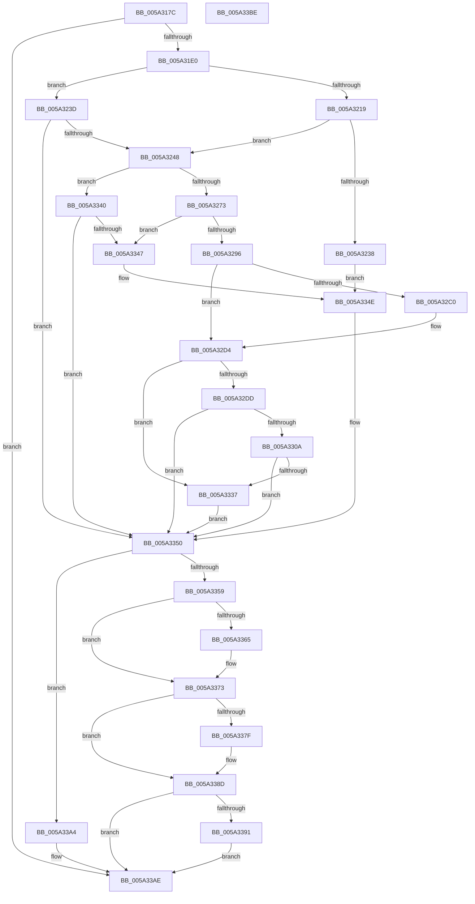

# SecureDump_PrepareForInit

- RVA: `0x005A317C`–`0x005A33BF` (길이 `579` bytes)
- VA: `0x00000001405A317C`
- 실행 섹션: `.text`
- PDB 이름 있음: `예`; PDB Function 태그: `아니요`
- unwind 정보 RVA: `0x000987BC`
- 디코드: `132`개 명령, `579/579` bytes 표시
- 미해석 바이트: `0` (있으면 어셈블리에 `.byte`로 보존)

> 이 문서는 커널 이미지의 기계어와 PDB 기호를 분석해 생성했습니다. 4번과 5번은 함수 원형과 자료형을 바이너리 사용 방식에서 추정한 C 해석이며 원본 소스 복구 결과는 아닙니다.

## 1. Dependencies

- 직접 호출 지점: **11**; 고유 호출 대상: **3**
- 직접 호출자로 확인된 함수: **1**
- RIP 상대 이미지 참조: **22**

### Outgoing calls
- `0x005A3210` → [SecureDump_ReadRegistry](SecureDump_ReadRegistry_function_005A3668.md) (function, `0x005A3668`)
- `0x005A3227` → [ExFreePoolWithTag](../../poolcode/B8/ExFreePoolWithTag_function_00B82870.md) (function, `0x00B82870`)
- `0x005A3266` → [SecureDump_ReadRegistry](SecureDump_ReadRegistry_function_005A3668.md) (function, `0x005A3668`)
- `0x005A3281` → [ExFreePoolWithTag](../../poolcode/B8/ExFreePoolWithTag_function_00B82870.md) (function, `0x00B82870`)
- `0x005A32B7` → [SecureDump_ReadRegistry](SecureDump_ReadRegistry_function_005A3668.md) (function, `0x005A3668`)
- `0x005A32CF` → [ExFreePoolWithTag](../../poolcode/B8/ExFreePoolWithTag_function_00B82870.md) (function, `0x00B82870`)
- `0x005A3301` → [SecureDump_ReadRegistry](SecureDump_ReadRegistry_function_005A3668.md) (function, `0x005A3668`)
- `0x005A332E` → [SecureDump_ReadRegistry](SecureDump_ReadRegistry_function_005A3668.md) (function, `0x005A3668`)
- `0x005A3367` → [ExFreePoolWithTag](../../poolcode/B8/ExFreePoolWithTag_function_00B82870.md) (function, `0x00B82870`)
- `0x005A3381` → [ExFreePoolWithTag](../../poolcode/B8/ExFreePoolWithTag_function_00B82870.md) (function, `0x00B82870`)
- `0x005A339D` → [SecureDump_LogErrorEvent](SecureDump_LogErrorEvent_function_005A314C.md) (function, `0x005A314C`)

### Direct callers
- [IoInitSystemPreDrivers](../../init/C2/IoInitSystemPreDrivers_function_00C2AC3C.md) at `0x00C2BA17`

### Static image references
- `0x005A3199` → RVA `0x006CA730` (` ?? ::FNODOBFM::`string'`; read)
- `0x005A31A4` → RVA `0x006C9970` (` ?? ::FNODOBFM::`string'`; read)
- `0x005A31AF` → RVA `0x006CA800` (` ?? ::FNODOBFM::`string'`; read)
- `0x005A31D0` → RVA `0x00E660BC` (`.data`; write)
- `0x005A31EA` → RVA `0x006CA8B0` (` ?? ::FNODOBFM::`string'`; read)
- `0x005A3202` → RVA `0x00E661B8` (`.data`; read)
- `0x005A3209` → RVA `0x00E661C8` (`.data`; read)
- `0x005A3221` → RVA `0x00E661B8` (`.data`; write)
- `0x005A325B` → RVA `0x006CA630` (` ?? ::FNODOBFM::`string'`; read)
- `0x005A327B` → RVA `0x00E661BC` (`.data`; write)
- `0x005A3286` → RVA `0x00E661BC` (`.data`; read)
- `0x005A32AC` → RVA `0x006CA660` (` ?? ::FNODOBFM::`string'`; read)
- `0x005A32C6` → RVA `0x00E66208` (`.data`; read)
- `0x005A32EA` → RVA `0x00E661C0` (`.data`; read)
- `0x005A32F6` → RVA `0x006CA6A0` (` ?? ::FNODOBFM::`string'`; read)
- `0x005A330A` → RVA `0x00E661CC` (`.data`; read)
- `0x005A3317` → RVA `0x00E661D0` (`.data`; read)
- `0x005A3323` → RVA `0x006CA6C0` (` ?? ::FNODOBFM::`string'`; read)
- `0x005A3350` → RVA `0x00E660BC` (`.data`; read)
- `0x005A336C` → RVA `0x00E661C0` (`.data`; write)
- `0x005A3386` → RVA `0x00E661D0` (`.data`; write)
- `0x005A3393` → RVA `0x00E661B0` (`.data`; write)

## 2. Other-region calls and transfers

- 다른 실행 섹션으로 향하는 call: **5**
  - `0x005A3227` → [ExFreePoolWithTag](../../poolcode/B8/ExFreePoolWithTag_function_00B82870.md) (`.text` → `POOLCODE`)
  - `0x005A3281` → [ExFreePoolWithTag](../../poolcode/B8/ExFreePoolWithTag_function_00B82870.md) (`.text` → `POOLCODE`)
  - `0x005A32CF` → [ExFreePoolWithTag](../../poolcode/B8/ExFreePoolWithTag_function_00B82870.md) (`.text` → `POOLCODE`)
  - `0x005A3367` → [ExFreePoolWithTag](../../poolcode/B8/ExFreePoolWithTag_function_00B82870.md) (`.text` → `POOLCODE`)
  - `0x005A3381` → [ExFreePoolWithTag](../../poolcode/B8/ExFreePoolWithTag_function_00B82870.md) (`.text` → `POOLCODE`)
- 별도 외부 분기/꼬리 이동을 확인하지 못했습니다.

## 3. Assembly (complete function range)

```asm
005A317C  48 89 5C 24 10                  mov qword ptr [rsp + 0x10], rbx
005A3181  55                              push rbp
005A3182  56                              push rsi
005A3183  57                              push rdi
005A3184  48 8B EC                        mov rbp, rsp
005A3187  48 83 EC 60                     sub rsp, 0x60
005A318B  33 F6                           xor esi, esi
005A318D  48 C7 45 E0 C8 00 CA 00         mov qword ptr [rbp - 0x20], 0xca00c8
005A3195  48 89 75 30                     mov qword ptr [rbp + 0x30], rsi
005A3199  48 8D 05 90 75 12 00            lea rax, [rip + 0x127590]
005A31A0  48 89 45 E8                     mov qword ptr [rbp - 0x18], rax
005A31A4  48 8D 05 C5 67 12 00            lea rax, [rip + 0x1267c5]
005A31AB  48 89 45 D8                     mov qword ptr [rbp - 0x28], rax
005A31AF  48 8D 05 4A 76 12 00            lea rax, [rip + 0x12764a]
005A31B6  48 89 45 F8                     mov qword ptr [rbp - 8], rax
005A31BA  48 8B FA                        mov rdi, rdx
005A31BD  48 C7 45 D0 7E 00 80 00         mov qword ptr [rbp - 0x30], 0x80007e
005A31C5  8D 5E 02                        lea ebx, [rsi + 2]
005A31C8  48 C7 45 F0 A4 00 A6 00         mov qword ptr [rbp - 0x10], 0xa600a4
005A31D0  C6 05 E5 2E 8C 00 01            mov byte ptr [rip + 0x8c2ee5], 1
005A31D7  48 85 D2                        test rdx, rdx
005A31DA  0F 84 CE 01 00 00               je 0x1405a33ae
005A31E0  0F 57 C0                        xorps xmm0, xmm0
005A31E3  40 88 32                        mov byte ptr [rdx], sil
005A31E6  48 8D 45 20                     lea rax, [rbp + 0x20]
005A31EA  48 8D 15 BF 76 12 00            lea rdx, [rip + 0x1276bf]
005A31F1  48 89 44 24 20                  mov qword ptr [rsp + 0x20], rax
005A31F6  4C 8D 4D 30                     lea r9, [rbp + 0x30]
005A31FA  44 8D 46 04                     lea r8d, [rsi + 4]
005A31FE  48 8D 4D F0                     lea rcx, [rbp - 0x10]
005A3202  0F 11 05 AF 2F 8C 00            movups xmmword ptr [rip + 0x8c2faf], xmm0
005A3209  0F 11 05 B8 2F 8C 00            movups xmmword ptr [rip + 0x8c2fb8], xmm0
005A3210  E8 53 04 00 00                  call 0x1405a3668
005A3215  85 C0                           test eax, eax
005A3217  78 24                           js 0x1405a323d
005A3219  48 8B 4D 30                     mov rcx, qword ptr [rbp + 0x30]
005A321D  33 D2                           xor edx, edx
005A321F  8B 01                           mov eax, dword ptr [rcx]
005A3221  89 05 91 2F 8C 00               mov dword ptr [rip + 0x8c2f91], eax
005A3227  E8 44 F6 5D 00                  call 0x140b82870
005A322C  39 35 86 2F 8C 00               cmp dword ptr [rip + 0x8c2f86], esi
005A3232  48 89 75 30                     mov qword ptr [rbp + 0x30], rsi
005A3236  74 10                           je 0x1405a3248
005A3238  E9 11 01 00 00                  jmp 0x1405a334e
005A323D  3D 34 00 00 C0                  cmp eax, 0xc0000034
005A3242  0F 85 08 01 00 00               jne 0x1405a3350
005A3248  48 8D 45 20                     lea rax, [rbp + 0x20]
005A324C  41 B8 04 00 00 00               mov r8d, 4
005A3252  4C 8D 4D 30                     lea r9, [rbp + 0x30]
005A3256  48 89 44 24 20                  mov qword ptr [rsp + 0x20], rax
005A325B  48 8D 15 CE 73 12 00            lea rdx, [rip + 0x1273ce]
005A3262  48 8D 4D D0                     lea rcx, [rbp - 0x30]
005A3266  E8 FD 03 00 00                  call 0x1405a3668
005A326B  85 C0                           test eax, eax
005A326D  0F 88 CD 00 00 00               js 0x1405a3340
005A3273  48 8B 4D 30                     mov rcx, qword ptr [rbp + 0x30]
005A3277  33 D2                           xor edx, edx
005A3279  8B 01                           mov eax, dword ptr [rcx]
005A327B  89 05 3B 2F 8C 00               mov dword ptr [rip + 0x8c2f3b], eax
005A3281  E8 EA F5 5D 00                  call 0x140b82870
005A3286  39 35 30 2F 8C 00               cmp dword ptr [rip + 0x8c2f30], esi
005A328C  48 89 75 30                     mov qword ptr [rbp + 0x30], rsi
005A3290  0F 84 B1 00 00 00               je 0x1405a3347
005A3296  48 8D 45 20                     lea rax, [rbp + 0x20]
005A329A  C6 07 01                        mov byte ptr [rdi], 1
005A329D  4C 8D 4D 30                     lea r9, [rbp + 0x30]
005A32A1  48 89 44 24 20                  mov qword ptr [rsp + 0x20], rax
005A32A6  41 B8 04 00 00 00               mov r8d, 4
005A32AC  48 8D 15 AD 73 12 00            lea rdx, [rip + 0x1273ad]
005A32B3  48 8D 4D D0                     lea rcx, [rbp - 0x30]
005A32B7  E8 AC 03 00 00                  call 0x1405a3668
005A32BC  85 C0                           test eax, eax
005A32BE  78 14                           js 0x1405a32d4
005A32C0  48 8B 4D 30                     mov rcx, qword ptr [rbp + 0x30]
005A32C4  39 31                           cmp dword ptr [rcx], esi
005A32C6  0F 97 05 3B 2F 8C 00            seta byte ptr [rip + 0x8c2f3b]
005A32CD  33 D2                           xor edx, edx
005A32CF  E8 9C F5 5D 00                  call 0x140b82870
005A32D4  40 38 35 2D 2F 8C 00            cmp byte ptr [rip + 0x8c2f2d], sil
005A32DB  75 5A                           jne 0x1405a3337
005A32DD  48 8D 05 E4 2E 8C 00            lea rax, [rip + 0x8c2ee4]
005A32E4  41 B8 03 00 00 00               mov r8d, 3
005A32EA  4C 8D 0D CF 2E 8C 00            lea r9, [rip + 0x8c2ecf]
005A32F1  48 89 44 24 20                  mov qword ptr [rsp + 0x20], rax
005A32F6  48 8D 15 A3 73 12 00            lea rdx, [rip + 0x1273a3]
005A32FD  48 8D 4D E0                     lea rcx, [rbp - 0x20]
005A3301  E8 62 03 00 00                  call 0x1405a3668
005A3306  85 C0                           test eax, eax
005A3308  78 46                           js 0x1405a3350
005A330A  48 8D 05 BB 2E 8C 00            lea rax, [rip + 0x8c2ebb]
005A3311  41 B8 01 00 00 00               mov r8d, 1
005A3317  4C 8D 0D B2 2E 8C 00            lea r9, [rip + 0x8c2eb2]
005A331E  48 89 44 24 20                  mov qword ptr [rsp + 0x20], rax
005A3323  48 8D 15 96 73 12 00            lea rdx, [rip + 0x127396]
005A332A  48 8D 4D E0                     lea rcx, [rbp - 0x20]
005A332E  E8 35 03 00 00                  call 0x1405a3668
005A3333  85 C0                           test eax, eax
005A3335  78 19                           js 0x1405a3350
005A3337  40 88 35 7E 2D 8C 00            mov byte ptr [rip + 0x8c2d7e], sil
005A333E  EB 10                           jmp 0x1405a3350
005A3340  3D 34 00 00 C0                  cmp eax, 0xc0000034
005A3345  75 09                           jne 0x1405a3350
005A3347  40 88 35 6E 2D 8C 00            mov byte ptr [rip + 0x8c2d6e], sil
005A334E  8B DE                           mov ebx, esi
005A3350  80 3D 65 2D 8C 00 01            cmp byte ptr [rip + 0x8c2d65], 1
005A3357  75 4B                           jne 0x1405a33a4
005A3359  48 8B 0D 60 2E 8C 00            mov rcx, qword ptr [rip + 0x8c2e60]
005A3360  48 85 C9                        test rcx, rcx
005A3363  74 0E                           je 0x1405a3373
005A3365  33 D2                           xor edx, edx
005A3367  E8 04 F5 5D 00                  call 0x140b82870
005A336C  48 89 35 4D 2E 8C 00            mov qword ptr [rip + 0x8c2e4d], rsi
005A3373  48 8B 0D 56 2E 8C 00            mov rcx, qword ptr [rip + 0x8c2e56]
005A337A  48 85 C9                        test rcx, rcx
005A337D  74 0E                           je 0x1405a338d
005A337F  33 D2                           xor edx, edx
005A3381  E8 EA F4 5D 00                  call 0x140b82870
005A3386  48 89 35 43 2E 8C 00            mov qword ptr [rip + 0x8c2e43], rsi
005A338D  85 DB                           test ebx, ebx
005A338F  74 1D                           je 0x1405a33ae
005A3391  8B CB                           mov ecx, ebx
005A3393  C7 05 13 2E 8C 00 03 00 00 00   mov dword ptr [rip + 0x8c2e13], 3
005A339D  E8 AA FD FF FF                  call 0x1405a314c
005A33A2  EB 0A                           jmp 0x1405a33ae
005A33A4  C7 05 02 2E 8C 00 01 00 00 00   mov dword ptr [rip + 0x8c2e02], 1
005A33AE  48 8B 9C 24 88 00 00 00         mov rbx, qword ptr [rsp + 0x88]
005A33B6  48 83 C4 60                     add rsp, 0x60
005A33BA  5F                              pop rdi
005A33BB  5E                              pop rsi
005A33BC  5D                              pop rbp
005A33BD  C3                              ret
005A33BE  CC                              int3
```

## 4. C-style interpretation (structured pseudocode)

```c
__int64 __fastcall SecureDump_PrepareForInit(__int64 a1, __int64 a2)
{
    __int64 result;
    __int64 v_rsi;
    __int64 v_rsp;
    unsigned __int64 v_stack_m20;
    unsigned __int64 v_stack_m28;
    unsigned __int64 v_stack_m30;
    unsigned __int64 v_stack_m38;
    unsigned __int64 v_stack_m40;
    unsigned __int64 v_stack_m48;
    unsigned __int64 v_stack_m58;
    unsigned __int64 v_stack_p10;
    unsigned __int64 v_stack_p18;
    unsigned __int64 v_stack_p8;

    v_stack_p10 = v_rbx;
    v_rsp = (v_rsp) - (96);
    v_rsi = 0;
    v_stack_m38 = 0xCA00C8ULL;
    v_stack_p18 = 0;
    v_stack_m30 = v_rip + 1209744;
    v_stack_m40 = v_rip + 1206213;
    v_stack_m20 = v_rip + 1209930;
    v_stack_m48 = 0x80007EULL;
    v_stack_m28 = 0xA600A4ULL;
    *(unsigned __int8 *)(v_rip + 9187045) = 1;
    if (a2 == 0) goto loc_005A33AE;
    *(unsigned __int8 *)(a2) = 0;
    v_stack_m58 = v_stack_p8;
    *(unsigned __int64 *)(v_rip + 9187247) = v_xmm0;
    *(unsigned __int64 *)(v_rip + 9187256) = v_xmm0;
    result = SecureDump_ReadRegistry(v_stack_m28, v_rip + 1210047, v_rsi + 4, v_stack_p18);
    if (sign_flag) goto loc_005A323D;
    a2 = 0;
    *(unsigned int *)(v_rip + 9187217) = (unsigned int)((unsigned int)(*(unsigned int *)(v_stack_p18)));
    result = ExFreePoolWithTag(v_stack_p18, a2, v_rsi + 4, v_stack_p18);
    v_stack_p18 = 0;
    if ((*(unsigned int *)(v_rip + 9187206)) == 0) goto loc_005A3248;
    goto loc_005A334E;
loc_005A323D:
    if (((unsigned int)(result)) != 0xC0000034ULL) goto loc_005A3350;
loc_005A3248:
    v_stack_m58 = v_stack_p8;
    result = SecureDump_ReadRegistry(v_stack_m48, v_rip + 1209294, 4, v_stack_p18);
    if (sign_flag) goto loc_005A3340;
    a2 = 0;
    *(unsigned int *)(v_rip + 9187131) = (unsigned int)((unsigned int)(*(unsigned int *)(v_stack_p18)));
    result = ExFreePoolWithTag(v_stack_p18, a2, 4, v_stack_p18);
    v_stack_p18 = 0;
    if ((*(unsigned int *)(v_rip + 9187120)) == 0) goto loc_005A3347;
    *(unsigned __int8 *)(a2) = 1;
    v_stack_m58 = v_stack_p8;
    result = SecureDump_ReadRegistry(v_stack_m48, v_rip + 1209261, 4, v_stack_p18);
    if (!(sign_flag)) {
        a1 = v_stack_p18;
        a2 = 0;
        result = ExFreePoolWithTag(a1, a2, 4, v_stack_p18);
    }
    if ((*(unsigned __int8 *)(v_rip + 9187117)) != 0) goto loc_005A3337;
    v_stack_m58 = v_rip + 9187044;
    result = SecureDump_ReadRegistry(v_stack_m38, v_rip + 1209251, 3, v_rip + 9187023);
    if (sign_flag) goto loc_005A3350;
    v_stack_m58 = v_rip + 9187003;
    result = SecureDump_ReadRegistry(v_stack_m38, v_rip + 1209238, 1, v_rip + 9186994);
    if (sign_flag) goto loc_005A3350;
loc_005A3337:
    *(unsigned __int8 *)(v_rip + 9186686) = 0;
    goto loc_005A3350;
loc_005A3340:
    if (((unsigned int)(result)) != 0xC0000034ULL) goto loc_005A3350;
loc_005A3347:
    *(unsigned __int8 *)(v_rip + 9186670) = 0;
loc_005A334E:
loc_005A3350:
    if ((*(unsigned __int8 *)(v_rip + 9186661)) != 1) goto loc_005A33A4;
    if (*(unsigned __int64 *)(v_rip + 9186912) != 0) {
        a2 = 0;
        result = ExFreePoolWithTag(*(unsigned __int64 *)(v_rip + 9186912), a2, 1, v_rip + 9186994);
        *(unsigned __int64 *)(v_rip + 9186893) = 0;
    }
    if (*(unsigned __int64 *)(v_rip + 9186902) != 0) {
        a2 = 0;
        result = ExFreePoolWithTag(*(unsigned __int64 *)(v_rip + 9186902), a2, 1, v_rip + 9186994);
        *(unsigned __int64 *)(v_rip + 9186883) = 0;
    }
    if (0 == 0) goto loc_005A33AE;
    *(unsigned int *)(v_rip + 9186835) = 3;
    result = SecureDump_LogErrorEvent(0, a2, 1, v_rip + 9186994);
    goto loc_005A33AE;
loc_005A33A4:
    *(unsigned int *)(v_rip + 9186818) = 1;
loc_005A33AE:
    v_rsp = (v_rsp) + (96);
    return result;
}
```

## 5. (Beta) C Style

```c
int64_t SecureDump_PrepareForInit(int64_t Arg1, void *Arg2)
{
    uint8_t *arg2 = (uint8_t *)Arg2;

    int64_t result;
    int64_t local_rsi;
    int64_t local_rsp;
    uint64_t v_stack_m20;
    uint64_t v_stack_m28;
    uint64_t v_stack_m30;
    uint64_t v_stack_m38;
    uint64_t v_stack_m40;
    uint64_t v_stack_m48;
    uint64_t v_stack_m58;
    uint64_t v_stack_p10;
    uint64_t v_stack_p18;
    uint64_t v_stack_p8;

    v_stack_p10 = local_rbx;
    local_rsp = (local_rsp) - (96);
    local_rsi = 0;
    v_stack_m38 = 0xCA00C8ULL;
    v_stack_p18 = 0;
    v_stack_m30 = v_rip + 1209744;
    v_stack_m40 = v_rip + 1206213;
    v_stack_m20 = v_rip + 1209930;
    v_stack_m48 = 0x80007EULL;
    v_stack_m28 = 0xA600A4ULL;
    *(uint8_t *)(v_rip + 0x8C2EE5) = 1;
    if (Arg2 == NULL) goto loc_005A33AE;
    *(uint8_t *)(arg2) = 0;
    v_stack_m58 = v_stack_p8;
    *(uint64_t *)(v_rip + 0x8C2FAF) = v_xmm0;
    *(uint64_t *)(v_rip + 0x8C2FB8) = v_xmm0;
    result = SecureDump_ReadRegistry(v_stack_m28, v_rip + 1210047, local_rsi + 4, v_stack_p18);
    if (sign_flag) goto loc_005A323D;
    Arg2 = 0;
    *(uint32_t *)(v_rip + 0x8C2F91) = (uint32_t)((uint32_t)(*(uint32_t *)(v_stack_p18)));
    result = ExFreePoolWithTag(v_stack_p18, Arg2, local_rsi + 4, v_stack_p18);
    v_stack_p18 = 0;
    if ((*(uint32_t *)(v_rip + 0x8C2F86)) == 0) goto loc_005A3248;
    goto loc_005A334E;
loc_005A323D:
    if (((uint32_t)(result)) != 0xC0000034ULL) goto loc_005A3350;
loc_005A3248:
    v_stack_m58 = v_stack_p8;
    result = SecureDump_ReadRegistry(v_stack_m48, v_rip + 1209294, 4, v_stack_p18);
    if (sign_flag) goto loc_005A3340;
    Arg2 = 0;
    *(uint32_t *)(v_rip + 0x8C2F3B) = (uint32_t)((uint32_t)(*(uint32_t *)(v_stack_p18)));
    result = ExFreePoolWithTag(v_stack_p18, Arg2, 4, v_stack_p18);
    v_stack_p18 = 0;
    if ((*(uint32_t *)(v_rip + 0x8C2F30)) == 0) goto loc_005A3347;
    *(uint8_t *)(arg2) = 1;
    v_stack_m58 = v_stack_p8;
    result = SecureDump_ReadRegistry(v_stack_m48, v_rip + 1209261, 4, v_stack_p18);
    if (!(sign_flag)) {
        Arg1 = v_stack_p18;
        Arg2 = 0;
        result = ExFreePoolWithTag(Arg1, Arg2, 4, v_stack_p18);
    }
    if ((*(uint8_t *)(v_rip + 0x8C2F2D)) != 0) goto loc_005A3337;
    v_stack_m58 = v_rip + 9187044;
    result = SecureDump_ReadRegistry(v_stack_m38, v_rip + 1209251, 3, v_rip + 9187023);
    if (sign_flag) goto loc_005A3350;
    v_stack_m58 = v_rip + 9187003;
    result = SecureDump_ReadRegistry(v_stack_m38, v_rip + 1209238, 1, v_rip + 9186994);
    if (sign_flag) goto loc_005A3350;
loc_005A3337:
    *(uint8_t *)(v_rip + 0x8C2D7E) = 0;
    goto loc_005A3350;
loc_005A3340:
    if (((uint32_t)(result)) != 0xC0000034ULL) goto loc_005A3350;
loc_005A3347:
    *(uint8_t *)(v_rip + 0x8C2D6E) = 0;
loc_005A334E:
loc_005A3350:
    if ((*(uint8_t *)(v_rip + 0x8C2D65)) != 1) goto loc_005A33A4;
    if (*(uint64_t *)(v_rip + 0x8C2E60) != 0) {
        Arg2 = 0;
        result = ExFreePoolWithTag(*(uint64_t *)(v_rip + 0x8C2E60), Arg2, 1, v_rip + 9186994);
        *(uint64_t *)(v_rip + 0x8C2E4D) = 0;
    }
    if (*(uint64_t *)(v_rip + 0x8C2E56) != 0) {
        Arg2 = 0;
        result = ExFreePoolWithTag(*(uint64_t *)(v_rip + 0x8C2E56), Arg2, 1, v_rip + 9186994);
        *(uint64_t *)(v_rip + 0x8C2E43) = 0;
    }
    if (0 == 0) goto loc_005A33AE;
    *(uint32_t *)(v_rip + 0x8C2E13) = 3;
    result = SecureDump_LogErrorEvent(0, Arg2, 1, v_rip + 9186994);
    goto loc_005A33AE;
loc_005A33A4:
    *(uint32_t *)(v_rip + 0x8C2E02) = 1;
loc_005A33AE:
    local_rsp = (local_rsp) + (96);
    return result;
}
```

### 관측된 메모리 오프셋

구조체 형식이 확인되지 않은 접근은 인자 기준의 오프셋으로만 기록했습니다.

| 기준 인자 | 오프셋 표현 | 폭 (bit) | 접근 |
|---|---:|---:|---|
| `Arg2` | `+ 0x0` | `8` | `W` |

## 6. Execution-region graph

[열기: 2D/3D 그래프와 함수 탐색 컨트롤 패널](../../../control-panel.html?section=text&rva=0x005A317C&view=graph)

- 2D 그래프는 위에서 아래로 흐르고, 3D 그래프는 빈 공간을 드래그해 회전합니다. Shift+드래그는 이동, 휠은 확대·축소, 함수 노드 선택은 대상 보고서 이동입니다.

### Static fallback


