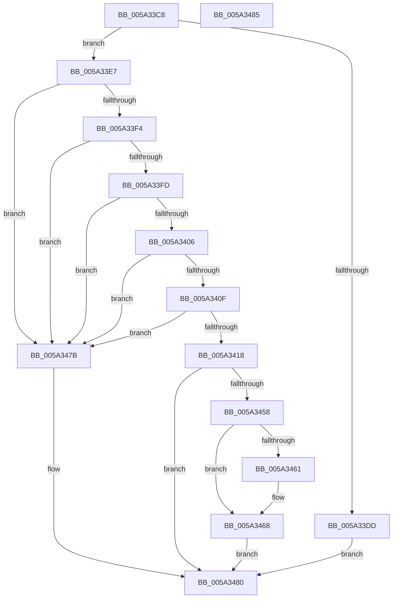

# SecureDump_ProvisionCrashDumpKey

- RVA: `0x005A33C8`–`0x005A3486` (길이 `190` bytes)
- VA: `0x00000001405A33C8`
- 실행 섹션: `.text`
- PDB 이름 있음: `예`; PDB Function 태그: `아니요`
- unwind 정보 RVA: `0x00063458`
- 디코드: `39`개 명령, `190/190` bytes 표시
- 미해석 바이트: `0` (있으면 어셈블리에 `.byte`로 보존)

> 이 문서는 커널 이미지의 기계어와 PDB 기호를 분석해 생성했습니다. 4번과 5번은 함수 원형과 자료형을 바이너리 사용 방식에서 추정한 C 해석이며 원본 소스 복구 결과는 아닙니다.

## 1. Dependencies

- 직접 호출 지점: **2**; 고유 호출 대상: **2**
- 직접 호출자로 확인된 함수: **2**
- RIP 상대 이미지 참조: **14**

### Outgoing calls
- `0x005A3424` → [RtlInitUnicodeString](../42/RtlInitUnicodeString_function_0042A780.md) (function, `0x0042A780`)
- `0x005A344F` → [SecureDump_LoadCertAndProvisionKey](SecureDump_LoadCertAndProvisionKey_function_005A2E04.md) (function, `0x005A2E04`)

### Direct callers
- [SecureDump_ReInitialize](SecureDump_ReInitialize_function_005A348C.md) at `0x005A3561`
- [IoInitSystemPreDrivers](../../init/C2/IoInitSystemPreDrivers_function_00C2AC3C.md) at `0x00C2BC5B`

### Static image references
- `0x005A33CC` → RVA `0x00E661B0` (`.data`; read)
- `0x005A33E7` → RVA `0x00E660BC` (`.data`; read)
- `0x005A33F4` → RVA `0x00E66208` (`.data`; read)
- `0x005A33FD` → RVA `0x00E661BC` (`.data`; read)
- `0x005A3406` → RVA `0x00E661B8` (`.data`; read)
- `0x005A340F` → RVA `0x00E0A9BA` (`.data`; read)
- `0x005A3418` → RVA `0x006CA6E0` (` ?? ::FNODOBFM::`string'`; read)
- `0x005A3429` → RVA `0x00E661CC` (`.data`; read)
- `0x005A3430` → RVA `0x00E661D0` (`.data`; read)
- `0x005A343C` → RVA `0x00E661C8` (`.data`; read)
- `0x005A3443` → RVA `0x00E661C0` (`.data`; read)
- `0x005A3461` → RVA `0x00E661A8` (`.data`; write)
- `0x005A3468` → RVA `0x00E661B0` (`.data`; write)
- `0x005A3472` → RVA `0x00E661B4` (`.data`; write)

## 2. Other-region calls and transfers

- 다른 실행 섹션으로 향하는 call: **0**
- 별도 외부 분기/꼬리 이동을 확인하지 못했습니다.

## 3. Assembly (complete function range)

```asm
005A33C8  48 83 EC 48                     sub rsp, 0x48
005A33CC  83 3D DD 2D 8C 00 00            cmp dword ptr [rip + 0x8c2ddd], 0
005A33D3  0F 57 C0                        xorps xmm0, xmm0
005A33D6  0F 11 44 24 30                  movups xmmword ptr [rsp + 0x30], xmm0
005A33DB  75 0A                           jne 0x1405a33e7
005A33DD  B8 84 01 00 C0                  mov eax, 0xc0000184
005A33E2  E9 99 00 00 00                  jmp 0x1405a3480
005A33E7  80 3D CE 2C 8C 00 00            cmp byte ptr [rip + 0x8c2cce], 0
005A33EE  0F 85 87 00 00 00               jne 0x1405a347b
005A33F4  80 3D 0D 2E 8C 00 00            cmp byte ptr [rip + 0x8c2e0d], 0
005A33FB  74 7E                           je 0x1405a347b
005A33FD  83 3D B8 2D 8C 00 00            cmp dword ptr [rip + 0x8c2db8], 0
005A3404  74 75                           je 0x1405a347b
005A3406  83 3D AB 2D 8C 00 00            cmp dword ptr [rip + 0x8c2dab], 0
005A340D  75 6C                           jne 0x1405a347b
005A340F  80 3D A4 75 86 00 00            cmp byte ptr [rip + 0x8675a4], 0
005A3416  74 63                           je 0x1405a347b
005A3418  48 8D 15 C1 72 12 00            lea rdx, [rip + 0x1272c1]
005A341F  48 8D 4C 24 30                  lea rcx, [rsp + 0x30]
005A3424  E8 57 73 E8 FF                  call 0x14042a780
005A3429  48 8D 05 9C 2D 8C 00            lea rax, [rip + 0x8c2d9c]
005A3430  4C 8D 0D 99 2D 8C 00            lea r9, [rip + 0x8c2d99]
005A3437  48 89 44 24 20                  mov qword ptr [rsp + 0x20], rax
005A343C  4C 8D 05 85 2D 8C 00            lea r8, [rip + 0x8c2d85]
005A3443  48 8D 15 76 2D 8C 00            lea rdx, [rip + 0x8c2d76]
005A344A  48 8D 4C 24 30                  lea rcx, [rsp + 0x30]
005A344F  E8 B0 F9 FF FF                  call 0x1405a2e04
005A3454  85 C0                           test eax, eax
005A3456  79 28                           jns 0x1405a3480
005A3458  83 3D 51 2D 8C 00 01            cmp dword ptr [rip + 0x8c2d51], 1
005A345F  75 07                           jne 0x1405a3468
005A3461  C6 05 40 2D 8C 00 01            mov byte ptr [rip + 0x8c2d40], 1
005A3468  C7 05 3E 2D 8C 00 03 00 00 00   mov dword ptr [rip + 0x8c2d3e], 3
005A3472  C6 05 3B 2D 8C 00 00            mov byte ptr [rip + 0x8c2d3b], 0
005A3479  EB 05                           jmp 0x1405a3480
005A347B  B8 01 00 00 C0                  mov eax, 0xc0000001
005A3480  48 83 C4 48                     add rsp, 0x48
005A3484  C3                              ret
005A3485  CC                              int3
```

## 4. C-style interpretation (structured pseudocode)

```c
__int64 __fastcall SecureDump_ProvisionCrashDumpKey(void)
{
    __int64 result;
    __int64 v_rsp;
    unsigned __int64 v_stack_m18;
    unsigned __int64 v_stack_m28;

    v_rsp = (v_rsp) - (72);
    v_stack_m18 = v_xmm0;
    if ((*(unsigned int *)(v_rip + 9186781)) != 0) goto loc_005A33E7;
    goto loc_005A3480;
loc_005A33E7:
    if ((*(unsigned __int8 *)(v_rip + 9186510)) != 0) goto loc_005A347B;
    if ((*(unsigned __int8 *)(v_rip + 9186829)) == 0) goto loc_005A347B;
    if ((*(unsigned int *)(v_rip + 9186744)) == 0) goto loc_005A347B;
    if ((*(unsigned int *)(v_rip + 9186731)) != 0) goto loc_005A347B;
    if ((*(unsigned __int8 *)(v_rip + 8811940)) == 0) goto loc_005A347B;
    result = RtlInitUnicodeString(v_stack_m18, v_rip + 1209025, a3, a4);
    v_stack_m28 = v_rip + 9186716;
    result = SecureDump_LoadCertAndProvisionKey(v_stack_m18, v_rip + 9186678, v_rip + 9186693, v_rip + 9186713);
    if (!sign_flag) goto loc_005A3480;
    if ((*(unsigned int *)(v_rip + 9186641)) == 1) {
        *(unsigned __int8 *)(v_rip + 9186624) = 1;
    }
    *(unsigned int *)(v_rip + 9186622) = 3;
    *(unsigned __int8 *)(v_rip + 9186619) = 0;
    goto loc_005A3480;
loc_005A347B:
loc_005A3480:
    v_rsp = (v_rsp) + (72);
    return (unsigned int)(0xC0000001ULL);
}
```

## 5. (Beta) C Style

```c
void SecureDump_ProvisionCrashDumpKey(void)
{
    int64_t result;
    int64_t local_rsp;
    uint64_t v_stack_m18;
    uint64_t v_stack_m28;

    local_rsp = (local_rsp) - (72);
    v_stack_m18 = v_xmm0;
    if ((*(uint32_t *)(v_rip + 0x8C2DDD)) != 0) goto loc_005A33E7;
    goto loc_005A3480;
loc_005A33E7:
    if ((*(uint8_t *)(v_rip + 0x8C2CCE)) != 0) goto loc_005A347B;
    if ((*(uint8_t *)(v_rip + 0x8C2E0D)) == 0) goto loc_005A347B;
    if ((*(uint32_t *)(v_rip + 0x8C2DB8)) == 0) goto loc_005A347B;
    if ((*(uint32_t *)(v_rip + 0x8C2DAB)) != 0) goto loc_005A347B;
    if ((*(uint8_t *)(v_rip + 0x8675A4)) == 0) goto loc_005A347B;
    result = RtlInitUnicodeString(v_stack_m18, v_rip + 1209025, a3, a4);
    v_stack_m28 = v_rip + 9186716;
    result = SecureDump_LoadCertAndProvisionKey(v_stack_m18, v_rip + 9186678, v_rip + 9186693, v_rip + 9186713);
    if (!sign_flag) goto loc_005A3480;
    if ((*(uint32_t *)(v_rip + 0x8C2D51)) == 1) {
        *(uint8_t *)(v_rip + 0x8C2D40) = 1;
    }
    *(uint32_t *)(v_rip + 0x8C2D3E) = 3;
    *(uint8_t *)(v_rip + 0x8C2D3B) = 0;
    goto loc_005A3480;
loc_005A347B:
loc_005A3480:
    local_rsp = (local_rsp) + (72);
    return (uint32_t)(0xC0000001ULL);
}
```

## 6. Execution-region graph

[열기: 2D/3D 그래프와 함수 탐색 컨트롤 패널](../../../control-panel.html?section=text&rva=0x005A33C8&view=graph)

- 2D 그래프는 위에서 아래로 흐르고, 3D 그래프는 빈 공간을 드래그해 회전합니다. Shift+드래그는 이동, 휠은 확대·축소, 함수 노드 선택은 대상 보고서 이동입니다.

### Static fallback


