# SecureDump_ReInitialize

- RVA: `0x005A348C`–`0x005A3661` (길이 `469` bytes)
- VA: `0x00000001405A348C`
- 실행 섹션: `.text`
- PDB 이름 있음: `예`; PDB Function 태그: `아니요`
- unwind 정보 RVA: `0x0005CAAC`
- 디코드: `106`개 명령, `469/469` bytes 표시
- 미해석 바이트: `0` (있으면 어셈블리에 `.byte`로 보존)

> 이 문서는 커널 이미지의 기계어와 PDB 기호를 분석해 생성했습니다. 4번과 5번은 함수 원형과 자료형을 바이너리 사용 방식에서 추정한 C 해석이며 원본 소스 복구 결과는 아닙니다.

## 1. Dependencies

- 직접 호출 지점: **13**; 고유 호출 대상: **6**
- 직접 호출자로 확인된 함수: **1**
- RIP 상대 이미지 참조: **20**

### Outgoing calls
- `0x005A34EF` → [BCryptCloseAlgorithmProvider](../60/BCryptCloseAlgorithmProvider_function_006064D8.md) (function, `0x006064D8`)
- `0x005A3507` → [BCryptDestroyKey](../60/BCryptDestroyKey_function_00606530.md) (function, `0x00606530`)
- `0x005A3521` → [ExFreePoolWithTag](../../poolcode/B8/ExFreePoolWithTag_function_00B82870.md) (function, `0x00B82870`)
- `0x005A353B` → [ExFreePoolWithTag](../../poolcode/B8/ExFreePoolWithTag_function_00B82870.md) (function, `0x00B82870`)
- `0x005A3555` → [ExFreePoolWithTag](../../poolcode/B8/ExFreePoolWithTag_function_00B82870.md) (function, `0x00B82870`)
- `0x005A3561` → [SecureDump_ProvisionCrashDumpKey](SecureDump_ProvisionCrashDumpKey_function_005A33C8.md) (function, `0x005A33C8`)
- `0x005A356C` → [SecureDump_SymmetricEncryptionSetup](SecureDump_SymmetricEncryptionSetup_function_005A3774.md) (function, `0x005A3774`)
- `0x005A3577` → [SecureDump_EncryptSymmetricKeyWithPublicKey](SecureDump_EncryptSymmetricKeyWithPublicKey_function_005A27A4.md) (function, `0x005A27A4`)
- `0x005A35C9` → [BCryptCloseAlgorithmProvider](../60/BCryptCloseAlgorithmProvider_function_006064D8.md) (function, `0x006064D8`)
- `0x005A35E1` → [BCryptDestroyKey](../60/BCryptDestroyKey_function_00606530.md) (function, `0x00606530`)
- `0x005A35FB` → [ExFreePoolWithTag](../../poolcode/B8/ExFreePoolWithTag_function_00B82870.md) (function, `0x00B82870`)
- `0x005A3615` → [ExFreePoolWithTag](../../poolcode/B8/ExFreePoolWithTag_function_00B82870.md) (function, `0x00B82870`)
- `0x005A362F` → [ExFreePoolWithTag](../../poolcode/B8/ExFreePoolWithTag_function_00B82870.md) (function, `0x00B82870`)

### Direct callers
- [IoProvisionCrashDumpKey](../59/IoProvisionCrashDumpKey_function_00592BF0.md) at `0x00592C18`

### Static image references
- `0x005A3498` → RVA `0x00E660BC` (`.data`; read)
- `0x005A34A5` → RVA `0x00E0A9BA` (`.data`; read)
- `0x005A34B2` → RVA `0x00E661B0` (`.data`; read)
- `0x005A34CA` → RVA `0x00E661BC` (`.data`; read)
- `0x005A34D6` → RVA `0x00E66208` (`.data`; read)
- `0x005A34E3` → RVA `0x00E661E8` (`.data`; read)
- `0x005A34F4` → RVA `0x00E661E8` (`.data`; write)
- `0x005A34FB` → RVA `0x00E661F0` (`.data`; read)
- `0x005A350C` → RVA `0x00E661F0` (`.data`; write)
- `0x005A3513` → RVA `0x00E661D8` (`.data`; read)
- `0x005A3526` → RVA `0x00E661D8` (`.data`; write)
- `0x005A352D` → RVA `0x00E661D0` (`.data`; read)
- `0x005A3540` → RVA `0x00E661D0` (`.data`; write)
- `0x005A3547` → RVA `0x00E661C0` (`.data`; read)
- `0x005A355A` → RVA `0x00E661C0` (`.data`; write)
- `0x005A3582` → RVA `0x00E661E0` (`.data`; read)
- `0x005A358E` → RVA `0x00E661B4` (`.data`; write)
- `0x005A3595` → RVA `0x00E661CC` (`.data`; read)
- `0x005A35A1` → RVA `0x00E661B0` (`.data`; write)
- `0x005A35AB` → RVA `0x00E66200` (`.data`; write)

## 2. Other-region calls and transfers

- 다른 실행 섹션으로 향하는 call: **6**
  - `0x005A3521` → [ExFreePoolWithTag](../../poolcode/B8/ExFreePoolWithTag_function_00B82870.md) (`.text` → `POOLCODE`)
  - `0x005A353B` → [ExFreePoolWithTag](../../poolcode/B8/ExFreePoolWithTag_function_00B82870.md) (`.text` → `POOLCODE`)
  - `0x005A3555` → [ExFreePoolWithTag](../../poolcode/B8/ExFreePoolWithTag_function_00B82870.md) (`.text` → `POOLCODE`)
  - `0x005A35FB` → [ExFreePoolWithTag](../../poolcode/B8/ExFreePoolWithTag_function_00B82870.md) (`.text` → `POOLCODE`)
  - `0x005A3615` → [ExFreePoolWithTag](../../poolcode/B8/ExFreePoolWithTag_function_00B82870.md) (`.text` → `POOLCODE`)
  - `0x005A362F` → [ExFreePoolWithTag](../../poolcode/B8/ExFreePoolWithTag_function_00B82870.md) (`.text` → `POOLCODE`)
- 별도 외부 분기/꼬리 이동을 확인하지 못했습니다.

## 3. Assembly (complete function range)

```asm
005A348C  48 89 5C 24 08                  mov qword ptr [rsp + 8], rbx
005A3491  57                              push rdi
005A3492  48 83 EC 20                     sub rsp, 0x20
005A3496  33 FF                           xor edi, edi
005A3498  40 38 3D 1D 2C 8C 00            cmp byte ptr [rip + 0x8c2c1d], dil
005A349F  0F 85 AB 01 00 00               jne 0x1405a3650
005A34A5  40 38 3D 0E 75 86 00            cmp byte ptr [rip + 0x86750e], dil
005A34AC  0F 84 9E 01 00 00               je 0x1405a3650
005A34B2  8B 05 F8 2C 8C 00               mov eax, dword ptr [rip + 0x8c2cf8]
005A34B8  83 C0 FE                        add eax, -2
005A34BB  83 F8 01                        cmp eax, 1
005A34BE  76 0A                           jbe 0x1405a34ca
005A34C0  B8 84 01 00 C0                  mov eax, 0xc0000184
005A34C5  E9 8B 01 00 00                  jmp 0x1405a3655
005A34CA  39 3D EC 2C 8C 00               cmp dword ptr [rip + 0x8c2cec], edi
005A34D0  0F 84 73 01 00 00               je 0x1405a3649
005A34D6  40 38 3D 2B 2D 8C 00            cmp byte ptr [rip + 0x8c2d2b], dil
005A34DD  0F 84 66 01 00 00               je 0x1405a3649
005A34E3  48 8B 0D FE 2C 8C 00            mov rcx, qword ptr [rip + 0x8c2cfe]
005A34EA  48 85 C9                        test rcx, rcx
005A34ED  74 0C                           je 0x1405a34fb
005A34EF  E8 E4 2F 06 00                  call 0x1406064d8
005A34F4  48 89 3D ED 2C 8C 00            mov qword ptr [rip + 0x8c2ced], rdi
005A34FB  48 8B 0D EE 2C 8C 00            mov rcx, qword ptr [rip + 0x8c2cee]
005A3502  48 85 C9                        test rcx, rcx
005A3505  74 0C                           je 0x1405a3513
005A3507  E8 24 30 06 00                  call 0x140606530
005A350C  48 89 3D DD 2C 8C 00            mov qword ptr [rip + 0x8c2cdd], rdi
005A3513  48 8B 0D BE 2C 8C 00            mov rcx, qword ptr [rip + 0x8c2cbe]
005A351A  48 85 C9                        test rcx, rcx
005A351D  74 0E                           je 0x1405a352d
005A351F  33 D2                           xor edx, edx
005A3521  E8 4A F3 5D 00                  call 0x140b82870
005A3526  48 89 3D AB 2C 8C 00            mov qword ptr [rip + 0x8c2cab], rdi
005A352D  48 8B 0D 9C 2C 8C 00            mov rcx, qword ptr [rip + 0x8c2c9c]
005A3534  48 85 C9                        test rcx, rcx
005A3537  74 0E                           je 0x1405a3547
005A3539  33 D2                           xor edx, edx
005A353B  E8 30 F3 5D 00                  call 0x140b82870
005A3540  48 89 3D 89 2C 8C 00            mov qword ptr [rip + 0x8c2c89], rdi
005A3547  48 8B 0D 72 2C 8C 00            mov rcx, qword ptr [rip + 0x8c2c72]
005A354E  48 85 C9                        test rcx, rcx
005A3551  74 0E                           je 0x1405a3561
005A3553  33 D2                           xor edx, edx
005A3555  E8 16 F3 5D 00                  call 0x140b82870
005A355A  48 89 3D 5F 2C 8C 00            mov qword ptr [rip + 0x8c2c5f], rdi
005A3561  E8 62 FE FF FF                  call 0x1405a33c8
005A3566  8B D8                           mov ebx, eax
005A3568  85 C0                           test eax, eax
005A356A  78 4A                           js 0x1405a35b6
005A356C  E8 03 02 00 00                  call 0x1405a3774
005A3571  8B D8                           mov ebx, eax
005A3573  85 C0                           test eax, eax
005A3575  78 3F                           js 0x1405a35b6
005A3577  E8 28 F2 FF FF                  call 0x1405a27a4
005A357C  8B D8                           mov ebx, eax
005A357E  85 C0                           test eax, eax
005A3580  78 34                           js 0x1405a35b6
005A3582  8B 15 58 2C 8C 00               mov edx, dword ptr [rip + 0x8c2c58]
005A3588  81 C2 57 20 00 00               add edx, 0x2057
005A358E  C6 05 1F 2C 8C 00 01            mov byte ptr [rip + 0x8c2c1f], 1
005A3595  03 15 31 2C 8C 00               add edx, dword ptr [rip + 0x8c2c31]
005A359B  81 E2 00 F0 FF FF               and edx, 0xfffff000
005A35A1  C7 05 05 2C 8C 00 02 00 00 00   mov dword ptr [rip + 0x8c2c05], 2
005A35AB  89 15 4F 2C 8C 00               mov dword ptr [rip + 0x8c2c4f], edx
005A35B1  E9 8F 00 00 00                  jmp 0x1405a3645
005A35B6  48 8B 0D 2B 2C 8C 00            mov rcx, qword ptr [rip + 0x8c2c2b]
005A35BD  40 88 3D F0 2B 8C 00            mov byte ptr [rip + 0x8c2bf0], dil
005A35C4  48 85 C9                        test rcx, rcx
005A35C7  74 0C                           je 0x1405a35d5
005A35C9  E8 0A 2F 06 00                  call 0x1406064d8
005A35CE  48 89 3D 13 2C 8C 00            mov qword ptr [rip + 0x8c2c13], rdi
005A35D5  48 8B 0D 14 2C 8C 00            mov rcx, qword ptr [rip + 0x8c2c14]
005A35DC  48 85 C9                        test rcx, rcx
005A35DF  74 0C                           je 0x1405a35ed
005A35E1  E8 4A 2F 06 00                  call 0x140606530
005A35E6  48 89 3D 03 2C 8C 00            mov qword ptr [rip + 0x8c2c03], rdi
005A35ED  48 8B 0D E4 2B 8C 00            mov rcx, qword ptr [rip + 0x8c2be4]
005A35F4  48 85 C9                        test rcx, rcx
005A35F7  74 0E                           je 0x1405a3607
005A35F9  33 D2                           xor edx, edx
005A35FB  E8 70 F2 5D 00                  call 0x140b82870
005A3600  48 89 3D D1 2B 8C 00            mov qword ptr [rip + 0x8c2bd1], rdi
005A3607  48 8B 0D C2 2B 8C 00            mov rcx, qword ptr [rip + 0x8c2bc2]
005A360E  48 85 C9                        test rcx, rcx
005A3611  74 0E                           je 0x1405a3621
005A3613  33 D2                           xor edx, edx
005A3615  E8 56 F2 5D 00                  call 0x140b82870
005A361A  48 89 3D AF 2B 8C 00            mov qword ptr [rip + 0x8c2baf], rdi
005A3621  48 8B 0D 98 2B 8C 00            mov rcx, qword ptr [rip + 0x8c2b98]
005A3628  48 85 C9                        test rcx, rcx
005A362B  74 0E                           je 0x1405a363b
005A362D  33 D2                           xor edx, edx
005A362F  E8 3C F2 5D 00                  call 0x140b82870
005A3634  48 89 3D 85 2B 8C 00            mov qword ptr [rip + 0x8c2b85], rdi
005A363B  C7 05 6B 2B 8C 00 03 00 00 00   mov dword ptr [rip + 0x8c2b6b], 3
005A3645  8B C3                           mov eax, ebx
005A3647  EB 0C                           jmp 0x1405a3655
005A3649  B8 10 00 00 C0                  mov eax, 0xc0000010
005A364E  EB 05                           jmp 0x1405a3655
005A3650  B8 01 00 00 C0                  mov eax, 0xc0000001
005A3655  48 8B 5C 24 30                  mov rbx, qword ptr [rsp + 0x30]
005A365A  48 83 C4 20                     add rsp, 0x20
005A365E  5F                              pop rdi
005A365F  C3                              ret
005A3660  CC                              int3
```

## 4. C-style interpretation (structured pseudocode)

```c
__int64 __fastcall SecureDump_ReInitialize(__int64 a1, int a2)
{
    __int64 result;
    __int64 v_rdi;
    __int64 v_rsp;
    unsigned __int64 v_stack_p8;

    v_stack_p8 = v_rbx;
    v_rsp = (v_rsp) - (32);
    v_rdi = 0;
    if ((*(unsigned __int8 *)(v_rip + 9186333)) != 0) goto loc_005A3650;
    if ((*(unsigned __int8 *)(v_rip + 8811790)) == 0) goto loc_005A3650;
    result = (unsigned int)(((unsigned int)(*(unsigned int *)(v_rip + 9186552))) + (-2));
    if (((unsigned int)(result)) <= 1) goto loc_005A34CA;
    goto loc_005A3655;
loc_005A34CA:
    if ((*(unsigned int *)(v_rip + 9186540)) == 0) goto loc_005A3649;
    if ((*(unsigned __int8 *)(v_rip + 9186603)) == 0) goto loc_005A3649;
    result = (unsigned int)(0xC0000184ULL);
    if (*(unsigned __int64 *)(v_rip + 9186558) != 0) {
        result = BCryptCloseAlgorithmProvider(*(unsigned __int64 *)(v_rip + 9186558), a2, a3, a4);
        *(unsigned __int64 *)(v_rip + 9186541) = 0;
    }
    if (*(unsigned __int64 *)(v_rip + 9186542) != 0) {
        result = BCryptDestroyKey(*(unsigned __int64 *)(v_rip + 9186542), a2, a3, a4);
        *(unsigned __int64 *)(v_rip + 9186525) = 0;
    }
    if (*(unsigned __int64 *)(v_rip + 9186494) != 0) {
        a2 = 0;
        result = ExFreePoolWithTag(*(unsigned __int64 *)(v_rip + 9186494), a2, a3, a4);
        *(unsigned __int64 *)(v_rip + 9186475) = 0;
    }
    if (*(unsigned __int64 *)(v_rip + 9186460) != 0) {
        a2 = 0;
        result = ExFreePoolWithTag(*(unsigned __int64 *)(v_rip + 9186460), a2, a3, a4);
        *(unsigned __int64 *)(v_rip + 9186441) = 0;
    }
    if (*(unsigned __int64 *)(v_rip + 9186418) != 0) {
        a2 = 0;
        result = ExFreePoolWithTag(*(unsigned __int64 *)(v_rip + 9186418), a2, a3, a4);
        *(unsigned __int64 *)(v_rip + 9186399) = 0;
    }
    result = SecureDump_ProvisionCrashDumpKey(*(unsigned __int64 *)(v_rip + 9186418), a2, a3, a4);
    if (sign_flag) goto loc_005A35B6;
    result = SecureDump_SymmetricEncryptionSetup(*(unsigned __int64 *)(v_rip + 9186418), a2, a3, a4);
    if (sign_flag) goto loc_005A35B6;
    result = SecureDump_EncryptSymmetricKeyWithPublicKey(*(unsigned __int64 *)(v_rip + 9186418), a2, a3, a4);
    if (sign_flag) goto loc_005A35B6;
    a2 = (unsigned int)(((unsigned int)(*(unsigned int *)(v_rip + 9186392))) + (0x2057ULL));
    *(unsigned __int8 *)(v_rip + 9186335) = 1;
    a2 = (unsigned int)((a2) + (*(unsigned int *)(v_rip + 9186353)));
    a2 = (unsigned int)((a2) & (0xFFFFF000ULL));
    *(unsigned int *)(v_rip + 9186309) = 2;
    *(unsigned int *)(v_rip + 9186383) = a2;
    goto loc_005A3645;
loc_005A35B6:
    *(unsigned __int8 *)(v_rip + 9186288) = 0;
    if (*(unsigned __int64 *)(v_rip + 9186347) != 0) {
        result = BCryptCloseAlgorithmProvider(*(unsigned __int64 *)(v_rip + 9186347), a2, a3, a4);
        *(unsigned __int64 *)(v_rip + 9186323) = 0;
    }
    if (*(unsigned __int64 *)(v_rip + 9186324) != 0) {
        result = BCryptDestroyKey(*(unsigned __int64 *)(v_rip + 9186324), a2, a3, a4);
        *(unsigned __int64 *)(v_rip + 9186307) = 0;
    }
    if (*(unsigned __int64 *)(v_rip + 9186276) != 0) {
        a2 = 0;
        result = ExFreePoolWithTag(*(unsigned __int64 *)(v_rip + 9186276), a2, a3, a4);
        *(unsigned __int64 *)(v_rip + 9186257) = 0;
    }
    if (*(unsigned __int64 *)(v_rip + 9186242) != 0) {
        a2 = 0;
        result = ExFreePoolWithTag(*(unsigned __int64 *)(v_rip + 9186242), a2, a3, a4);
        *(unsigned __int64 *)(v_rip + 9186223) = 0;
    }
    if (*(unsigned __int64 *)(v_rip + 9186200) != 0) {
        a2 = 0;
        result = ExFreePoolWithTag(*(unsigned __int64 *)(v_rip + 9186200), a2, a3, a4);
        *(unsigned __int64 *)(v_rip + 9186181) = 0;
    }
    *(unsigned int *)(v_rip + 9186155) = 3;
loc_005A3645:
    goto loc_005A3655;
loc_005A3649:
    goto loc_005A3655;
loc_005A3650:
loc_005A3655:
    v_rsp = (v_rsp) + (32);
    return (unsigned int)(0xC0000001ULL);
}
```

## 5. (Beta) C Style

```c
int64_t SecureDump_ReInitialize(int64_t Arg1, int32_t Arg2)
{
    int64_t result;
    int64_t local_rdi;
    int64_t local_rsp;
    uint64_t v_stack_p8;

    v_stack_p8 = local_rbx;
    local_rsp = (local_rsp) - (32);
    local_rdi = 0;
    if ((*(uint8_t *)(v_rip + 0x8C2C1D)) != 0) goto loc_005A3650;
    if ((*(uint8_t *)(v_rip + 0x86750E)) == 0) goto loc_005A3650;
    result = (uint32_t)(((uint32_t)(*(uint32_t *)(v_rip + 0x8C2CF8))) + (-2));
    if (((uint32_t)(result)) <= 1) goto loc_005A34CA;
    goto loc_005A3655;
loc_005A34CA:
    if ((*(uint32_t *)(v_rip + 0x8C2CEC)) == 0) goto loc_005A3649;
    if ((*(uint8_t *)(v_rip + 0x8C2D2B)) == 0) goto loc_005A3649;
    result = (uint32_t)(0xC0000184ULL);
    if (*(uint64_t *)(v_rip + 0x8C2CFE) != 0) {
        result = BCryptCloseAlgorithmProvider(*(uint64_t *)(v_rip + 0x8C2CFE), Arg2, a3, a4);
        *(uint64_t *)(v_rip + 0x8C2CED) = 0;
    }
    if (*(uint64_t *)(v_rip + 0x8C2CEE) != 0) {
        result = BCryptDestroyKey(*(uint64_t *)(v_rip + 0x8C2CEE), Arg2, a3, a4);
        *(uint64_t *)(v_rip + 0x8C2CDD) = 0;
    }
    if (*(uint64_t *)(v_rip + 0x8C2CBE) != 0) {
        Arg2 = 0;
        result = ExFreePoolWithTag(*(uint64_t *)(v_rip + 0x8C2CBE), Arg2, a3, a4);
        *(uint64_t *)(v_rip + 0x8C2CAB) = 0;
    }
    if (*(uint64_t *)(v_rip + 0x8C2C9C) != 0) {
        Arg2 = 0;
        result = ExFreePoolWithTag(*(uint64_t *)(v_rip + 0x8C2C9C), Arg2, a3, a4);
        *(uint64_t *)(v_rip + 0x8C2C89) = 0;
    }
    if (*(uint64_t *)(v_rip + 0x8C2C72) != 0) {
        Arg2 = 0;
        result = ExFreePoolWithTag(*(uint64_t *)(v_rip + 0x8C2C72), Arg2, a3, a4);
        *(uint64_t *)(v_rip + 0x8C2C5F) = 0;
    }
    result = SecureDump_ProvisionCrashDumpKey(*(uint64_t *)(v_rip + 0x8C2C72), Arg2, a3, a4);
    if (sign_flag) goto loc_005A35B6;
    result = SecureDump_SymmetricEncryptionSetup(*(uint64_t *)(v_rip + 0x8C2C72), Arg2, a3, a4);
    if (sign_flag) goto loc_005A35B6;
    result = SecureDump_EncryptSymmetricKeyWithPublicKey(*(uint64_t *)(v_rip + 0x8C2C72), Arg2, a3, a4);
    if (sign_flag) goto loc_005A35B6;
    Arg2 = (uint32_t)(((uint32_t)(*(uint32_t *)(v_rip + 0x8C2C58))) + (0x2057ULL));
    *(uint8_t *)(v_rip + 0x8C2C1F) = 1;
    Arg2 = (uint32_t)((Arg2) + (*(uint32_t *)(v_rip + 0x8C2C31)));
    Arg2 = (uint32_t)((Arg2) & (0xFFFFF000ULL));
    *(uint32_t *)(v_rip + 0x8C2C05) = 2;
    *(uint32_t *)(v_rip + 0x8C2C4F) = Arg2;
    goto loc_005A3645;
loc_005A35B6:
    *(uint8_t *)(v_rip + 0x8C2BF0) = 0;
    if (*(uint64_t *)(v_rip + 0x8C2C2B) != 0) {
        result = BCryptCloseAlgorithmProvider(*(uint64_t *)(v_rip + 0x8C2C2B), Arg2, a3, a4);
        *(uint64_t *)(v_rip + 0x8C2C13) = 0;
    }
    if (*(uint64_t *)(v_rip + 0x8C2C14) != 0) {
        result = BCryptDestroyKey(*(uint64_t *)(v_rip + 0x8C2C14), Arg2, a3, a4);
        *(uint64_t *)(v_rip + 0x8C2C03) = 0;
    }
    if (*(uint64_t *)(v_rip + 0x8C2BE4) != 0) {
        Arg2 = 0;
        result = ExFreePoolWithTag(*(uint64_t *)(v_rip + 0x8C2BE4), Arg2, a3, a4);
        *(uint64_t *)(v_rip + 0x8C2BD1) = 0;
    }
    if (*(uint64_t *)(v_rip + 0x8C2BC2) != 0) {
        Arg2 = 0;
        result = ExFreePoolWithTag(*(uint64_t *)(v_rip + 0x8C2BC2), Arg2, a3, a4);
        *(uint64_t *)(v_rip + 0x8C2BAF) = 0;
    }
    if (*(uint64_t *)(v_rip + 0x8C2B98) != 0) {
        Arg2 = 0;
        result = ExFreePoolWithTag(*(uint64_t *)(v_rip + 0x8C2B98), Arg2, a3, a4);
        *(uint64_t *)(v_rip + 0x8C2B85) = 0;
    }
    *(uint32_t *)(v_rip + 0x8C2B6B) = 3;
loc_005A3645:
    goto loc_005A3655;
loc_005A3649:
    goto loc_005A3655;
loc_005A3650:
loc_005A3655:
    local_rsp = (local_rsp) + (32);
    return (uint32_t)(0xC0000001ULL);
}
```

## 6. Execution-region graph

[열기: 2D/3D 그래프와 함수 탐색 컨트롤 패널](../../../control-panel.html?section=text&rva=0x005A348C&view=graph)

- 2D 그래프는 위에서 아래로 흐르고, 3D 그래프는 빈 공간을 드래그해 회전합니다. Shift+드래그는 이동, 휠은 확대·축소, 함수 노드 선택은 대상 보고서 이동입니다.

### Static fallback

```mermaid
flowchart TD
  bb_005A348C[BB_005A348C]
  bb_005A34A5[BB_005A34A5]
  bb_005A34B2[BB_005A34B2]
  bb_005A34C0[BB_005A34C0]
  bb_005A34CA[BB_005A34CA]
  bb_005A34D6[BB_005A34D6]
  bb_005A34E3[BB_005A34E3]
  bb_005A34EF[BB_005A34EF]
  bb_005A34FB[BB_005A34FB]
  bb_005A3507[BB_005A3507]
  bb_005A3513[BB_005A3513]
  bb_005A351F[BB_005A351F]
  bb_005A352D[BB_005A352D]
  bb_005A3539[BB_005A3539]
  bb_005A3547[BB_005A3547]
  bb_005A3553[BB_005A3553]
  bb_005A3561[BB_005A3561]
  bb_005A356C[BB_005A356C]
  bb_005A3577[BB_005A3577]
  bb_005A3582[BB_005A3582]
  bb_005A35B6[BB_005A35B6]
  bb_005A35C9[BB_005A35C9]
  bb_005A35D5[BB_005A35D5]
  bb_005A35E1[BB_005A35E1]
  bb_005A35ED[BB_005A35ED]
  bb_005A35F9[BB_005A35F9]
  bb_005A3607[BB_005A3607]
  bb_005A3613[BB_005A3613]
  bb_005A3621[BB_005A3621]
  bb_005A362D[BB_005A362D]
  bb_005A363B[BB_005A363B]
  bb_005A3645[BB_005A3645]
  bb_005A3649[BB_005A3649]
  bb_005A3650[BB_005A3650]
  bb_005A3655[BB_005A3655]
  bb_005A3660[BB_005A3660]
  bb_005A348C -->|branch| bb_005A3650
  bb_005A348C -->|fallthrough| bb_005A34A5
  bb_005A34A5 -->|branch| bb_005A3650
  bb_005A34A5 -->|fallthrough| bb_005A34B2
  bb_005A34B2 -->|branch| bb_005A34CA
  bb_005A34B2 -->|fallthrough| bb_005A34C0
  bb_005A34C0 -->|branch| bb_005A3655
  bb_005A34CA -->|branch| bb_005A3649
  bb_005A34CA -->|fallthrough| bb_005A34D6
  bb_005A34D6 -->|branch| bb_005A3649
  bb_005A34D6 -->|fallthrough| bb_005A34E3
  bb_005A34E3 -->|branch| bb_005A34FB
  bb_005A34E3 -->|fallthrough| bb_005A34EF
  bb_005A34EF -->|flow| bb_005A34FB
  bb_005A34FB -->|branch| bb_005A3513
  bb_005A34FB -->|fallthrough| bb_005A3507
  bb_005A3507 -->|flow| bb_005A3513
  bb_005A3513 -->|branch| bb_005A352D
  bb_005A3513 -->|fallthrough| bb_005A351F
  bb_005A351F -->|flow| bb_005A352D
  bb_005A352D -->|branch| bb_005A3547
  bb_005A352D -->|fallthrough| bb_005A3539
  bb_005A3539 -->|flow| bb_005A3547
  bb_005A3547 -->|branch| bb_005A3561
  bb_005A3547 -->|fallthrough| bb_005A3553
  bb_005A3553 -->|flow| bb_005A3561
  bb_005A3561 -->|branch| bb_005A35B6
  bb_005A3561 -->|fallthrough| bb_005A356C
  bb_005A356C -->|branch| bb_005A35B6
  bb_005A356C -->|fallthrough| bb_005A3577
  bb_005A3577 -->|branch| bb_005A35B6
  bb_005A3577 -->|fallthrough| bb_005A3582
  bb_005A3582 -->|branch| bb_005A3645
  bb_005A35B6 -->|branch| bb_005A35D5
  bb_005A35B6 -->|fallthrough| bb_005A35C9
  bb_005A35C9 -->|flow| bb_005A35D5
  bb_005A35D5 -->|branch| bb_005A35ED
  bb_005A35D5 -->|fallthrough| bb_005A35E1
  bb_005A35E1 -->|flow| bb_005A35ED
  bb_005A35ED -->|branch| bb_005A3607
  bb_005A35ED -->|fallthrough| bb_005A35F9
  bb_005A35F9 -->|flow| bb_005A3607
  bb_005A3607 -->|branch| bb_005A3621
  bb_005A3607 -->|fallthrough| bb_005A3613
  bb_005A3613 -->|flow| bb_005A3621
  bb_005A3621 -->|branch| bb_005A363B
  bb_005A3621 -->|fallthrough| bb_005A362D
  bb_005A362D -->|flow| bb_005A363B
  bb_005A363B -->|flow| bb_005A3645
  bb_005A3645 -->|branch| bb_005A3655
  bb_005A3649 -->|branch| bb_005A3655
  bb_005A3650 -->|flow| bb_005A3655
```


