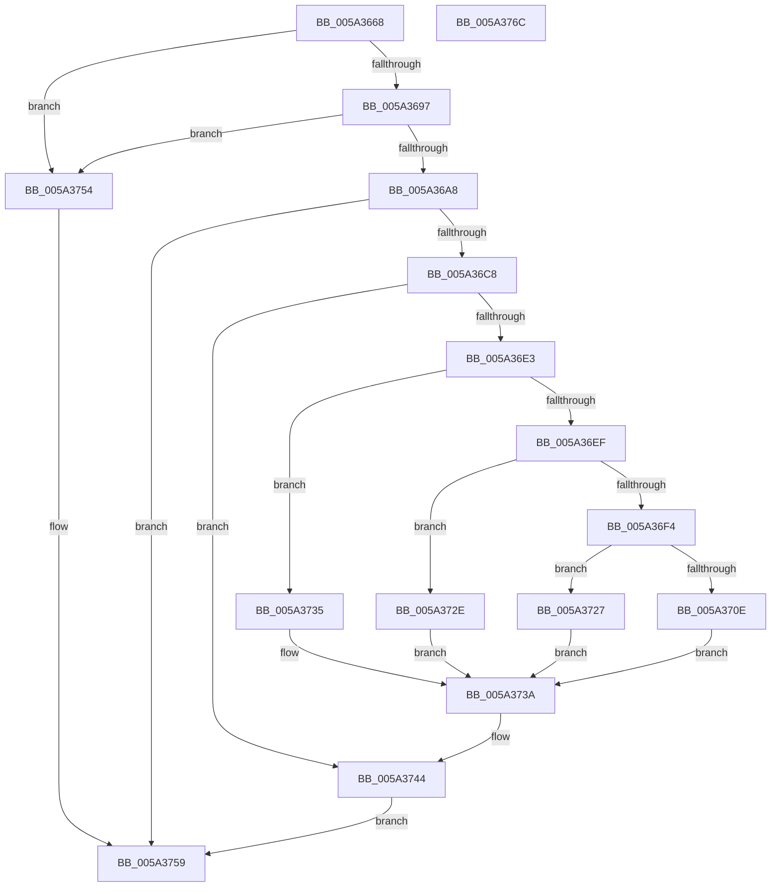

# SecureDump_ReadRegistry

- RVA: `0x005A3668`–`0x005A376D` (길이 `261` bytes)
- VA: `0x00000001405A3668`
- 실행 섹션: `.text`
- PDB 이름 있음: `예`; PDB Function 태그: `아니요`
- unwind 정보 RVA: `0x000AB20C`
- 디코드: `76`개 명령, `261/261` bytes 표시
- 미해석 바이트: `0` (있으면 어셈블리에 `.byte`로 보존)

> 이 문서는 커널 이미지의 기계어와 PDB 기호를 분석해 생성했습니다. 4번과 5번은 함수 원형과 자료형을 바이너리 사용 방식에서 추정한 C 해석이며 원본 소스 복구 결과는 아닙니다.

## 1. Dependencies

- 직접 호출 지점: **6**; 고유 호출 대상: **6**
- 직접 호출자로 확인된 함수: **1**
- RIP 상대 이미지 참조: **0**

### Outgoing calls
- `0x005A36BB` → [IopOpenRegistryKey](../../page/A8/IopOpenRegistryKey_function_00A8F200.md) (function, `0x00A8F200`)
- `0x005A36D8` → [IopGetRegistryValue](../../page/99/IopGetRegistryValue_function_009990EC.md) (function, `0x009990EC`)
- `0x005A3701` → [ExAllocatePool2](../../poolcode/B8/ExAllocatePool2_function_00B820F0.md) (function, `0x00B820F0`)
- `0x005A3720` → [memcpy](../6C/memcpy_function_006C6840.md) (function, `0x006C6840`)
- `0x005A373F` → [ExFreePoolWithTag](../../poolcode/B8/ExFreePoolWithTag_function_00B82870.md) (function, `0x00B82870`)
- `0x005A374B` → [ObCloseHandle](../../page/8A/ObCloseHandle_function_008A1870.md) (function, `0x008A1870`)

### Direct callers
- [SecureDump_PrepareForInit](SecureDump_PrepareForInit_function_005A317C.md) at `0x005A3210`
- [SecureDump_PrepareForInit](SecureDump_PrepareForInit_function_005A317C.md) at `0x005A3266`
- [SecureDump_PrepareForInit](SecureDump_PrepareForInit_function_005A317C.md) at `0x005A32B7`
- [SecureDump_PrepareForInit](SecureDump_PrepareForInit_function_005A317C.md) at `0x005A3301`
- [SecureDump_PrepareForInit](SecureDump_PrepareForInit_function_005A317C.md) at `0x005A332E`

### Static image references
- 디코드된 RIP-relative 메모리 참조가 없습니다.

## 2. Other-region calls and transfers

- 다른 실행 섹션으로 향하는 call: **5**
  - `0x005A36BB` → [IopOpenRegistryKey](../../page/A8/IopOpenRegistryKey_function_00A8F200.md) (`.text` → `PAGE`)
  - `0x005A36D8` → [IopGetRegistryValue](../../page/99/IopGetRegistryValue_function_009990EC.md) (`.text` → `PAGE`)
  - `0x005A3701` → [ExAllocatePool2](../../poolcode/B8/ExAllocatePool2_function_00B820F0.md) (`.text` → `POOLCODE`)
  - `0x005A373F` → [ExFreePoolWithTag](../../poolcode/B8/ExFreePoolWithTag_function_00B82870.md) (`.text` → `POOLCODE`)
  - `0x005A374B` → [ObCloseHandle](../../page/8A/ObCloseHandle_function_008A1870.md) (`.text` → `PAGE`)
- 별도 외부 분기/꼬리 이동을 확인하지 못했습니다.

## 3. Assembly (complete function range)

```asm
005A3668  48 8B C4                        mov rax, rsp
005A366B  48 89 58 08                     mov qword ptr [rax + 8], rbx
005A366F  48 89 68 10                     mov qword ptr [rax + 0x10], rbp
005A3673  56                              push rsi
005A3674  57                              push rdi
005A3675  41 56                           push r14
005A3677  48 83 EC 40                     sub rsp, 0x40
005A367B  48 83 60 20 00                  and qword ptr [rax + 0x20], 0
005A3680  4D 8B F1                        mov r14, r9
005A3683  48 83 60 D8 00                  and qword ptr [rax - 0x28], 0
005A3688  41 8B E8                        mov ebp, r8d
005A368B  48 8B DA                        mov rbx, rdx
005A368E  4D 85 C9                        test r9, r9
005A3691  0F 84 BD 00 00 00               je 0x1405a3754
005A3697  48 8B B4 24 80 00 00 00         mov rsi, qword ptr [rsp + 0x80]
005A369F  48 85 F6                        test rsi, rsi
005A36A2  0F 84 AC 00 00 00               je 0x1405a3754
005A36A8  4C 8B C1                        mov r8, rcx
005A36AB  C6 40 C8 00                     mov byte ptr [rax - 0x38], 0
005A36AF  48 8D 48 20                     lea rcx, [rax + 0x20]
005A36B3  41 B9 19 00 02 00               mov r9d, 0x20019
005A36B9  33 D2                           xor edx, edx
005A36BB  E8 40 BB 4E 00                  call 0x140a8f200
005A36C0  85 C0                           test eax, eax
005A36C2  0F 88 91 00 00 00               js 0x1405a3759
005A36C8  48 8B 4C 24 78                  mov rcx, qword ptr [rsp + 0x78]
005A36CD  4C 8D 4C 24 30                  lea r9, [rsp + 0x30]
005A36D2  45 33 C0                        xor r8d, r8d
005A36D5  48 8B D3                        mov rdx, rbx
005A36D8  E8 0F 5A 3F 00                  call 0x1409990ec
005A36DD  8B D8                           mov ebx, eax
005A36DF  85 C0                           test eax, eax
005A36E1  78 61                           js 0x1405a3744
005A36E3  48 8B 7C 24 30                  mov rdi, qword ptr [rsp + 0x30]
005A36E8  8B 47 0C                        mov eax, dword ptr [rdi + 0xc]
005A36EB  85 C0                           test eax, eax
005A36ED  74 46                           je 0x1405a3735
005A36EF  3B 6F 04                        cmp ebp, dword ptr [rdi + 4]
005A36F2  75 3A                           jne 0x1405a372e
005A36F4  8B D0                           mov edx, eax
005A36F6  B9 40 00 00 00                  mov ecx, 0x40
005A36FB  41 B8 53 64 6D 70               mov r8d, 0x706d6453
005A3701  E8 EA E9 5D 00                  call 0x140b820f0
005A3706  49 89 06                        mov qword ptr [r14], rax
005A3709  48 85 C0                        test rax, rax
005A370C  74 19                           je 0x1405a3727
005A370E  8B 47 0C                        mov eax, dword ptr [rdi + 0xc]
005A3711  89 06                           mov dword ptr [rsi], eax
005A3713  8B 57 08                        mov edx, dword ptr [rdi + 8]
005A3716  44 8B 47 0C                     mov r8d, dword ptr [rdi + 0xc]
005A371A  48 03 D7                        add rdx, rdi
005A371D  49 8B 0E                        mov rcx, qword ptr [r14]
005A3720  E8 1B 31 12 00                  call 0x1406c6840
005A3725  EB 13                           jmp 0x1405a373a
005A3727  BB 9A 00 00 C0                  mov ebx, 0xc000009a
005A372C  EB 0C                           jmp 0x1405a373a
005A372E  BB 24 00 00 C0                  mov ebx, 0xc0000024
005A3733  EB 05                           jmp 0x1405a373a
005A3735  BB 04 00 00 C0                  mov ebx, 0xc0000004
005A373A  33 D2                           xor edx, edx
005A373C  48 8B CF                        mov rcx, rdi
005A373F  E8 2C F1 5D 00                  call 0x140b82870
005A3744  48 8B 4C 24 78                  mov rcx, qword ptr [rsp + 0x78]
005A3749  33 D2                           xor edx, edx
005A374B  E8 20 E1 2F 00                  call 0x1408a1870
005A3750  8B C3                           mov eax, ebx
005A3752  EB 05                           jmp 0x1405a3759
005A3754  B8 0D 00 00 C0                  mov eax, 0xc000000d
005A3759  48 8B 5C 24 60                  mov rbx, qword ptr [rsp + 0x60]
005A375E  48 8B 6C 24 68                  mov rbp, qword ptr [rsp + 0x68]
005A3763  48 83 C4 40                     add rsp, 0x40
005A3767  41 5E                           pop r14
005A3769  5F                              pop rdi
005A376A  5E                              pop rsi
005A376B  C3                              ret
005A376C  CC                              int3
```

## 4. C-style interpretation (structured pseudocode)

```c
__int64 __fastcall SecureDump_ReadRegistry(__int64 a1, __int64 a2, int a3, __int64 a4, __int64 a5)
{
    __int64 result;
    __int64 v_rsp;
    unsigned __int64 v_stack_m28;
    unsigned __int64 v_stack_p10;
    unsigned __int64 v_stack_p20;
    unsigned __int64 v_stack_p8;

    *(unsigned __int64 *)(v_rsp + 8) = v_rbx;
    *(unsigned __int64 *)(v_rsp + 16) = v_rbp;
    v_rsp = (v_rsp) - (64);
    if (a4 == 0) goto loc_005A3754;
    if (a5 == 0) goto loc_005A3754;
    *(unsigned __int8 *)(v_rsp - 56) = 0;
    a2 = 0;
    result = IopOpenRegistryKey(v_rsp + 32, a2, a1, (unsigned int)(0x20019ULL));
    if (sign_flag) goto loc_005A3759;
    a3 = 0;
    result = IopGetRegistryValue(v_stack_p20, 0, a3, v_stack_m28);
    if (sign_flag) goto loc_005A3744;
    if ((unsigned int)((unsigned int)(*(unsigned int *)(v_stack_m28 + 12))) == 0) goto loc_005A3735;
    if (((unsigned int)((unsigned int)(a3))) != (*(unsigned int *)(v_stack_m28 + 4))) goto loc_005A372E;
    result = ExAllocatePool2(64, (unsigned int)((unsigned int)((unsigned int)(*(unsigned int *)(v_stack_m28 + 12)))), (unsigned int)(0x706D6453ULL), v_stack_m28);
    *(unsigned __int64 *)(a4) = result;
    if (result == 0) goto loc_005A3727;
    *(unsigned int *)(a5) = (unsigned int)((unsigned int)(*(unsigned int *)(v_stack_m28 + 12)));
    a2 = ((unsigned int)(*(unsigned int *)(v_stack_m28 + 8))) + (v_stack_m28);
    result = memcpy(*(unsigned __int64 *)(a4), a2, (unsigned int)(*(unsigned int *)(v_stack_m28 + 12)), v_stack_m28);
    goto loc_005A373A;
loc_005A3727:
    goto loc_005A373A;
loc_005A372E:
    goto loc_005A373A;
loc_005A3735:
loc_005A373A:
    a2 = 0;
    result = ExFreePoolWithTag(v_stack_m28, a2, (unsigned int)(*(unsigned int *)(v_stack_m28 + 12)), v_stack_m28);
loc_005A3744:
    a2 = 0;
    result = ObCloseHandle(v_stack_p20, a2, (unsigned int)(*(unsigned int *)(v_stack_m28 + 12)), v_stack_m28);
    goto loc_005A3759;
loc_005A3754:
loc_005A3759:
    v_rsp = (v_rsp) + (64);
    return (unsigned int)(0xC000000DULL);
}
```

## 5. (Beta) C Style

```c
int64_t SecureDump_ReadRegistry(int64_t Arg1, int64_t Arg2, int32_t Arg3, void *Arg4, int64_t Arg5)
{
    uint8_t *arg4 = (uint8_t *)Arg4;

    int64_t result;
    int64_t local_rsp;
    uint64_t v_stack_m28;
    uint64_t v_stack_p10;
    uint64_t v_stack_p20;
    uint64_t v_stack_p8;

    *(uint64_t *)(local_rsp + 0x8) = local_rbx;
    *(uint64_t *)(local_rsp + 0x10) = local_rbp;
    local_rsp = (local_rsp) - (64);
    if (Arg4 == NULL) goto loc_005A3754;
    if (Arg5 == 0) goto loc_005A3754;
    *(uint8_t *)(local_rsp - 0x38) = 0;
    Arg2 = 0;
    result = IopOpenRegistryKey(local_rsp + 32, Arg2, Arg1, (uint32_t)(0x20019ULL));
    if (sign_flag) goto loc_005A3759;
    Arg3 = 0;
    result = IopGetRegistryValue(v_stack_p20, 0, Arg3, v_stack_m28);
    if (sign_flag) goto loc_005A3744;
    if ((uint32_t)((uint32_t)(*(uint32_t *)(v_stack_m28 + 0xC))) == 0) goto loc_005A3735;
    if (((uint32_t)((uint32_t)(Arg3))) != (*(uint32_t *)(v_stack_m28 + 0x4))) goto loc_005A372E;
    result = ExAllocatePool2(64, (uint32_t)((uint32_t)((uint32_t)(*(uint32_t *)(v_stack_m28 + 0xC)))), (uint32_t)(0x706D6453ULL), v_stack_m28);
    *(uint64_t *)(arg4) = result;
    if (result == 0) goto loc_005A3727;
    *(uint32_t *)(Arg5) = (uint32_t)((uint32_t)(*(uint32_t *)(v_stack_m28 + 0xC)));
    Arg2 = ((uint32_t)(*(uint32_t *)(v_stack_m28 + 0x8))) + (v_stack_m28);
    result = memcpy(*(uint64_t *)(arg4), Arg2, (uint32_t)(*(uint32_t *)(v_stack_m28 + 0xC)), v_stack_m28);
    goto loc_005A373A;
loc_005A3727:
    goto loc_005A373A;
loc_005A372E:
    goto loc_005A373A;
loc_005A3735:
loc_005A373A:
    Arg2 = 0;
    result = ExFreePoolWithTag(v_stack_m28, Arg2, (uint32_t)(*(uint32_t *)(v_stack_m28 + 0xC)), v_stack_m28);
loc_005A3744:
    Arg2 = 0;
    result = ObCloseHandle(v_stack_p20, Arg2, (uint32_t)(*(uint32_t *)(v_stack_m28 + 0xC)), v_stack_m28);
    goto loc_005A3759;
loc_005A3754:
loc_005A3759:
    local_rsp = (local_rsp) + (64);
    return (uint32_t)(0xC000000DULL);
}
```

### 관측된 메모리 오프셋

구조체 형식이 확인되지 않은 접근은 인자 기준의 오프셋으로만 기록했습니다.

| 기준 인자 | 오프셋 표현 | 폭 (bit) | 접근 |
|---|---:|---:|---|
| `Arg4` | `+ 0x0` | `64` | `R` |
| `Arg4` | `+ 0x0` | `64` | `W` |

## 6. Execution-region graph

[열기: 2D/3D 그래프와 함수 탐색 컨트롤 패널](../../../control-panel.html?section=text&rva=0x005A3668&view=graph)

- 2D 그래프는 위에서 아래로 흐르고, 3D 그래프는 빈 공간을 드래그해 회전합니다. Shift+드래그는 이동, 휠은 확대·축소, 함수 노드 선택은 대상 보고서 이동입니다.

### Static fallback


