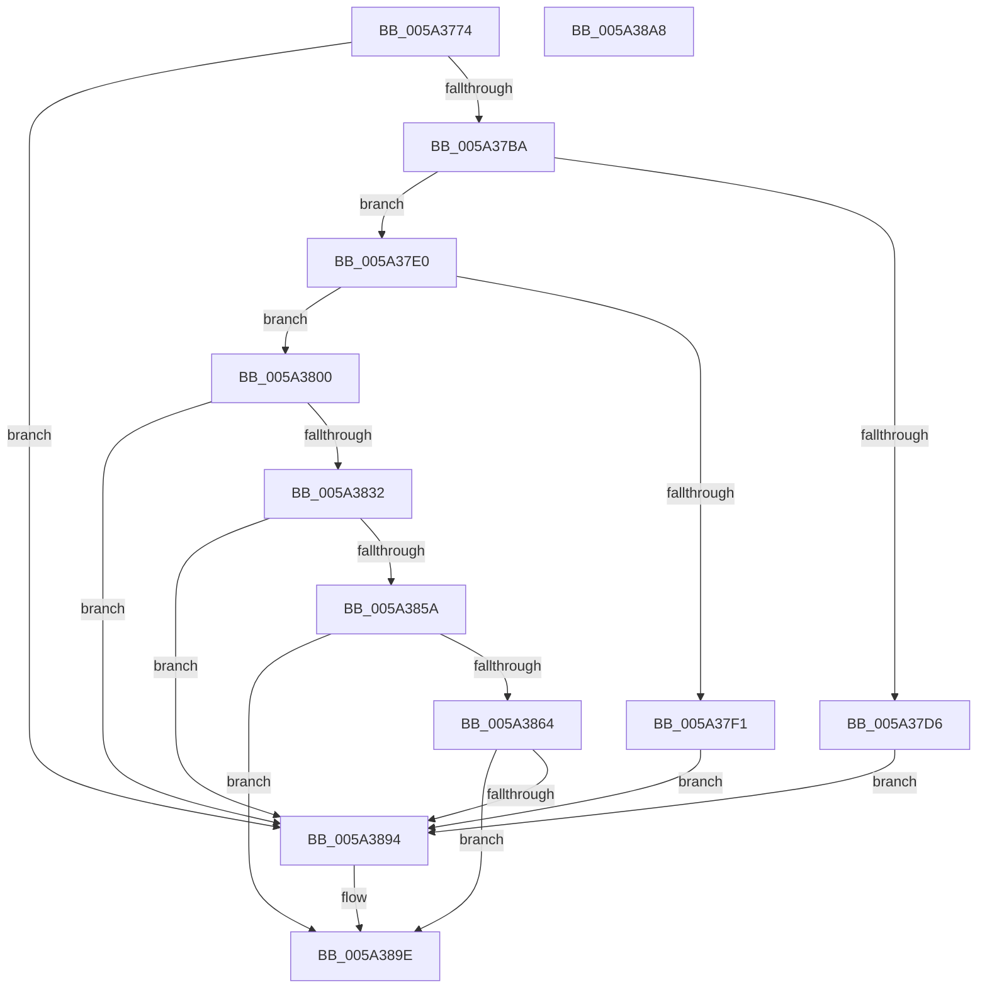

# SecureDump_SymmetricEncryptionSetup

- RVA: `0x005A3774`–`0x005A38A9` (길이 `309` bytes)
- VA: `0x00000001405A3774`
- 실행 섹션: `.text`
- PDB 이름 있음: `예`; PDB Function 태그: `아니요`
- unwind 정보 RVA: `0x000C7D8C`
- 디코드: `77`개 명령, `309/309` bytes 표시
- 미해석 바이트: `0` (있으면 어셈블리에 `.byte`로 보존)

> 이 문서는 커널 이미지의 기계어와 PDB 기호를 분석해 생성했습니다. 4번과 5번은 함수 원형과 자료형을 바이너리 사용 방식에서 추정한 C 해석이며 원본 소스 복구 결과는 아닙니다.

## 1. Dependencies

- 직접 호출 지점: **9**; 고유 호출 대상: **8**
- 직접 호출자로 확인된 함수: **2**
- RIP 상대 이미지 참조: **9**

### Outgoing calls
- `0x005A37AB` → [BCryptOpenAlgorithmProvider](../../page/AB/BCryptOpenAlgorithmProvider_function_00ABF200.md) (function, `0x00ABF200`)
- `0x005A37C9` → [ExAllocatePool2](../../poolcode/B8/ExAllocatePool2_function_00B820F0.md) (function, `0x00B820F0`)
- `0x005A37E6` → [BCryptGenRandom](../60/BCryptGenRandom_function_00606588.md) (function, `0x00606588`)
- `0x005A37F6` → [ExFreePoolWithTag](../../poolcode/B8/ExFreePoolWithTag_function_00B82870.md) (function, `0x00B82870`)
- `0x005A381D` → [BCryptGenerateSymmetricKey](../../page/79/BCryptGenerateSymmetricKey_function_0079C828.md) (function, `0x0079C828`)
- `0x005A3829` → [ExFreePoolWithTag](../../poolcode/B8/ExFreePoolWithTag_function_00B82870.md) (function, `0x00B82870`)
- `0x005A384F` → [BCryptGetProperty](../../page/A5/BCryptGetProperty_function_00A56158.md) (function, `0x00A56158`)
- `0x005A3889` → [BCryptSetProperty](../../page/79/BCryptSetProperty_function_0079C950.md) (function, `0x0079C950`)
- `0x005A3899` → [SecureDump_LogErrorEvent](SecureDump_LogErrorEvent_function_005A314C.md) (function, `0x005A314C`)

### Direct callers
- [SecureDump_Init](SecureDump_Init_function_005A2CC4.md) at `0x005A2CE4`
- [SecureDump_ReInitialize](SecureDump_ReInitialize_function_005A348C.md) at `0x005A356C`

### Static image references
- `0x005A3781` → RVA `0x006CA930` (` ?? ::FNODOBFM::`string'`; read)
- `0x005A378D` → RVA `0x006CA970` (` ?? ::FNODOBFM::`string'`; read)
- `0x005A379A` → RVA `0x00E661F8` (`.data`; write)
- `0x005A37A4` → RVA `0x00E661E8` (`.data`; read)
- `0x005A3807` → RVA `0x00E661F0` (`.data`; read)
- `0x005A3848` → RVA `0x006CA980` (` ?? ::FNODOBFM::`string'`; read)
- `0x005A386B` → RVA `0x00E661E4` (`.data`; read)
- `0x005A3878` → RVA `0x00E661E4` (`.data`; write)
- `0x005A3882` → RVA `0x006CA9A0` (` ?? ::FNODOBFM::`string'`; read)

## 2. Other-region calls and transfers

- 다른 실행 섹션으로 향하는 call: **7**
  - `0x005A37AB` → [BCryptOpenAlgorithmProvider](../../page/AB/BCryptOpenAlgorithmProvider_function_00ABF200.md) (`.text` → `PAGE`)
  - `0x005A37C9` → [ExAllocatePool2](../../poolcode/B8/ExAllocatePool2_function_00B820F0.md) (`.text` → `POOLCODE`)
  - `0x005A37F6` → [ExFreePoolWithTag](../../poolcode/B8/ExFreePoolWithTag_function_00B82870.md) (`.text` → `POOLCODE`)
  - `0x005A381D` → [BCryptGenerateSymmetricKey](../../page/79/BCryptGenerateSymmetricKey_function_0079C828.md) (`.text` → `PAGE`)
  - `0x005A3829` → [ExFreePoolWithTag](../../poolcode/B8/ExFreePoolWithTag_function_00B82870.md) (`.text` → `POOLCODE`)
  - `0x005A384F` → [BCryptGetProperty](../../page/A5/BCryptGetProperty_function_00A56158.md) (`.text` → `PAGE`)
  - `0x005A3889` → [BCryptSetProperty](../../page/79/BCryptSetProperty_function_0079C950.md) (`.text` → `PAGE`)
- 별도 외부 분기/꼬리 이동을 확인하지 못했습니다.

## 3. Assembly (complete function range)

```asm
005A3774  40 53                           push rbx
005A3776  56                              push rsi
005A3777  57                              push rdi
005A3778  48 83 EC 40                     sub rsp, 0x40
005A377C  83 64 24 68 00                  and dword ptr [rsp + 0x68], 0
005A3781  4C 8D 05 A8 71 12 00            lea r8, [rip + 0x1271a8]
005A3788  83 64 24 60 00                  and dword ptr [rsp + 0x60], 0
005A378D  48 8D 15 DC 71 12 00            lea rdx, [rip + 0x1271dc]
005A3794  41 B9 01 00 00 00               mov r9d, 1
005A379A  C7 05 54 2A 8C 00 01 00 00 00   mov dword ptr [rip + 0x8c2a54], 1
005A37A4  48 8D 0D 3D 2A 8C 00            lea rcx, [rip + 0x8c2a3d]
005A37AB  E8 50 BA 51 00                  call 0x140abf200
005A37B0  8B D8                           mov ebx, eax
005A37B2  85 C0                           test eax, eax
005A37B4  0F 88 DA 00 00 00               js 0x1405a3894
005A37BA  BE 40 00 00 00                  mov esi, 0x40
005A37BF  41 B8 53 64 6D 70               mov r8d, 0x706d6453
005A37C5  8B D6                           mov edx, esi
005A37C7  8B CE                           mov ecx, esi
005A37C9  E8 22 E9 5D 00                  call 0x140b820f0
005A37CE  48 8B F8                        mov rdi, rax
005A37D1  48 85 C0                        test rax, rax
005A37D4  75 0A                           jne 0x1405a37e0
005A37D6  BB 9A 00 00 C0                  mov ebx, 0xc000009a
005A37DB  E9 B4 00 00 00                  jmp 0x1405a3894
005A37E0  44 8B C6                        mov r8d, esi
005A37E3  48 8B D7                        mov rdx, rdi
005A37E6  E8 9D 2D 06 00                  call 0x140606588
005A37EB  8B D8                           mov ebx, eax
005A37ED  85 C0                           test eax, eax
005A37EF  79 0F                           jns 0x1405a3800
005A37F1  33 D2                           xor edx, edx
005A37F3  48 8B CF                        mov rcx, rdi
005A37F6  E8 75 F0 5D 00                  call 0x140b82870
005A37FB  E9 94 00 00 00                  jmp 0x1405a3894
005A3800  48 8B 0D E1 29 8C 00            mov rcx, qword ptr [rip + 0x8c29e1]
005A3807  48 8D 15 E2 29 8C 00            lea rdx, [rip + 0x8c29e2]
005A380E  89 74 24 28                     mov dword ptr [rsp + 0x28], esi
005A3812  45 33 C9                        xor r9d, r9d
005A3815  45 33 C0                        xor r8d, r8d
005A3818  48 89 7C 24 20                  mov qword ptr [rsp + 0x20], rdi
005A381D  E8 06 90 1F 00                  call 0x14079c828
005A3822  33 D2                           xor edx, edx
005A3824  48 8B CF                        mov rcx, rdi
005A3827  8B D8                           mov ebx, eax
005A3829  E8 42 F0 5D 00                  call 0x140b82870
005A382E  85 DB                           test ebx, ebx
005A3830  78 62                           js 0x1405a3894
005A3832  48 8B 0D B7 29 8C 00            mov rcx, qword ptr [rip + 0x8c29b7]
005A3839  48 8D 44 24 68                  lea rax, [rsp + 0x68]
005A383E  4C 8D 44 24 60                  lea r8, [rsp + 0x60]
005A3843  48 89 44 24 20                  mov qword ptr [rsp + 0x20], rax
005A3848  48 8D 15 31 71 12 00            lea rdx, [rip + 0x127131]
005A384F  E8 04 29 4B 00                  call 0x140a56158
005A3854  8B D8                           mov ebx, eax
005A3856  85 C0                           test eax, eax
005A3858  78 3A                           js 0x1405a3894
005A385A  81 7C 24 60 00 02 00 00         cmp dword ptr [rsp + 0x60], 0x200
005A3862  75 3A                           jne 0x1405a389e
005A3864  48 8B 0D 85 29 8C 00            mov rcx, qword ptr [rip + 0x8c2985]
005A386B  4C 8D 05 72 29 8C 00            lea r8, [rip + 0x8c2972]
005A3872  41 B9 04 00 00 00               mov r9d, 4
005A3878  C7 05 62 29 8C 00 00 10 00 00   mov dword ptr [rip + 0x8c2962], 0x1000
005A3882  48 8D 15 17 71 12 00            lea rdx, [rip + 0x127117]
005A3889  E8 C2 90 1F 00                  call 0x14079c950
005A388E  8B D8                           mov ebx, eax
005A3890  85 C0                           test eax, eax
005A3892  79 0A                           jns 0x1405a389e
005A3894  B9 01 00 00 00                  mov ecx, 1
005A3899  E8 AE F8 FF FF                  call 0x1405a314c
005A389E  8B C3                           mov eax, ebx
005A38A0  48 83 C4 40                     add rsp, 0x40
005A38A4  5F                              pop rdi
005A38A5  5E                              pop rsi
005A38A6  5B                              pop rbx
005A38A7  C3                              ret
005A38A8  CC                              int3
```

## 4. C-style interpretation (structured pseudocode)

```c
__int64 __fastcall SecureDump_SymmetricEncryptionSetup(void)
{
    __int64 result;
    __int64 v_rsp;
    unsigned int v_stack_m30;
    unsigned __int64 v_stack_m38;
    unsigned int v_stack_p10;
    unsigned int v_stack_p8;

    v_rsp = (v_rsp) - (64);
    *(unsigned int *)(v_rip + 9185876) = 1;
    result = BCryptOpenAlgorithmProvider(v_rip + 9185853, v_rip + 1208796, v_rip + 1208744, 1);
    if (sign_flag) goto loc_005A3894;
    result = ExAllocatePool2(64, 64, (unsigned int)(0x706D6453ULL), 1);
    if (result != 0) goto loc_005A37E0;
    goto loc_005A3894;
loc_005A37E0:
    result = BCryptGenRandom(64, result, 64, 1);
    if (!sign_flag) goto loc_005A3800;
    a2 = 0;
    result = ExFreePoolWithTag(result, a2, 64, 1);
    goto loc_005A3894;
loc_005A3800:
    v_stack_m30 = 64;
    a4 = 0;
    a3 = 0;
    v_stack_m38 = result;
    result = BCryptGenerateSymmetricKey(*(unsigned __int64 *)(v_rip + 9185761), v_rip + 9185762, a3, a4);
    a2 = 0;
    result = ExFreePoolWithTag(result, a2, a3, a4);
    if (sign_flag) goto loc_005A3894;
    v_stack_m38 = v_stack_p10;
    result = BCryptGetProperty(*(unsigned __int64 *)(v_rip + 9185719), v_rip + 1208625, v_stack_p8, a4);
    if (sign_flag) goto loc_005A3894;
    if (v_stack_p8 != 512) goto loc_005A389E;
    *(unsigned int *)(v_rip + 9185634) = 0x1000ULL;
    result = BCryptSetProperty(*(unsigned __int64 *)(v_rip + 9185669), v_rip + 1208599, v_rip + 9185650, 4);
    if (sign_flag) {
        a1 = 1;
        result = SecureDump_LogErrorEvent(a1, v_rip + 1208599, v_rip + 9185650, 4);
    }
    v_rsp = (v_rsp) + (64);
    return (unsigned int)((unsigned int)((unsigned int)((unsigned int)(result))));
}
```

## 5. (Beta) C Style

```c
void SecureDump_SymmetricEncryptionSetup(void)
{
    int64_t result;
    int64_t local_rsp;
    uint32_t v_stack_m30;
    uint64_t v_stack_m38;
    uint32_t v_stack_p10;
    uint32_t v_stack_p8;

    local_rsp = (local_rsp) - (64);
    *(uint32_t *)(v_rip + 0x8C2A54) = 1;
    result = BCryptOpenAlgorithmProvider(v_rip + 9185853, v_rip + 1208796, v_rip + 1208744, 1);
    if (sign_flag) goto loc_005A3894;
    result = ExAllocatePool2(64, 64, (uint32_t)(0x706D6453ULL), 1);
    if (result != 0) goto loc_005A37E0;
    goto loc_005A3894;
loc_005A37E0:
    result = BCryptGenRandom(64, result, 64, 1);
    if (!sign_flag) goto loc_005A3800;
    a2 = 0;
    result = ExFreePoolWithTag(result, a2, 64, 1);
    goto loc_005A3894;
loc_005A3800:
    v_stack_m30 = 64;
    a4 = 0;
    a3 = 0;
    v_stack_m38 = result;
    result = BCryptGenerateSymmetricKey(*(uint64_t *)(v_rip + 0x8C29E1), v_rip + 9185762, a3, a4);
    a2 = 0;
    result = ExFreePoolWithTag(result, a2, a3, a4);
    if (sign_flag) goto loc_005A3894;
    v_stack_m38 = v_stack_p10;
    result = BCryptGetProperty(*(uint64_t *)(v_rip + 0x8C29B7), v_rip + 1208625, v_stack_p8, a4);
    if (sign_flag) goto loc_005A3894;
    if (v_stack_p8 != 512) goto loc_005A389E;
    *(uint32_t *)(v_rip + 0x8C2962) = 0x1000ULL;
    result = BCryptSetProperty(*(uint64_t *)(v_rip + 0x8C2985), v_rip + 1208599, v_rip + 9185650, 4);
    if (sign_flag) {
        a1 = 1;
        result = SecureDump_LogErrorEvent(a1, v_rip + 1208599, v_rip + 9185650, 4);
    }
    local_rsp = (local_rsp) + (64);
    return (uint32_t)((uint32_t)((uint32_t)((uint32_t)(result))));
}
```

## 6. Execution-region graph

[열기: 2D/3D 그래프와 함수 탐색 컨트롤 패널](../../../control-panel.html?section=text&rva=0x005A3774&view=graph)

- 2D 그래프는 위에서 아래로 흐르고, 3D 그래프는 빈 공간을 드래그해 회전합니다. Shift+드래그는 이동, 휠은 확대·축소, 함수 노드 선택은 대상 보고서 이동입니다.

### Static fallback


