# SecureDump_ValidateAmeCertChain

- RVA: `0x005A38B0`–`0x005A3A8B` (길이 `475` bytes)
- VA: `0x00000001405A38B0`
- 실행 섹션: `.text`
- PDB 이름 있음: `예`; PDB Function 태그: `아니요`
- unwind 정보 RVA: `0x000C7DC0`
- 디코드: `122`개 명령, `475/475` bytes 표시
- 미해석 바이트: `0` (있으면 어셈블리에 `.byte`로 보존)

> 이 문서는 커널 이미지의 기계어와 PDB 기호를 분석해 생성했습니다. 4번과 5번은 함수 원형과 자료형을 바이너리 사용 방식에서 추정한 C 해석이며 원본 소스 복구 결과는 아닙니다.

## 1. Dependencies

- 직접 호출 지점: **8**; 고유 호출 대상: **7**
- 직접 호출자로 확인된 함수: **1**
- RIP 상대 이미지 참조: **1**

### Outgoing calls
- `0x005A391F` → [MincrypK_ParseCertificateChainWithPolicy](../../page/83/MincrypK_ParseCertificateChainWithPolicy_function_0083751C.md) (function, `0x0083751C`)
- `0x005A3956` → [MincryptGetRootKeyFromPolicy](../../page/83/MincryptGetRootKeyFromPolicy_function_00839670.md) (function, `0x00839670`)
- `0x005A3962` → [MincryptGetLeafKeyFromPolicy](../../page/83/MincryptGetLeafKeyFromPolicy_function_00839640.md) (function, `0x00839640`)
- `0x005A39D0` → [RtlCompareMemory](../6B/RtlCompareMemory_function_006BA670.md) (function, `0x006BA670`)
- `0x005A39FB` → [RtlCompareMemory](../6B/RtlCompareMemory_function_006BA670.md) (function, `0x006BA670`)
- `0x005A3A33` → [MinCrypK_HashMemory](../../page/83/MinCrypK_HashMemory_function_00836174.md) (function, `0x00836174`)
- `0x005A3A50` → [SecureDump_ConvertToRsaBlob](SecureDump_ConvertToRsaBlob_function_005A26E0.md) (function, `0x005A26E0`)
- `0x005A3A69` → [MincryptFreePolicyInfo](../../page/83/MincryptFreePolicyInfo_function_00839608.md) (function, `0x00839608`)

### Direct callers
- [SecureDump_LoadCertAndProvisionKey](SecureDump_LoadCertAndProvisionKey_function_005A2E04.md) at `0x005A3025`

### Static image references
- `0x005A39C6` → RVA `0x00027840` (`.rdata`; read)

## 2. Other-region calls and transfers

- 다른 실행 섹션으로 향하는 call: **5**
  - `0x005A391F` → [MincrypK_ParseCertificateChainWithPolicy](../../page/83/MincrypK_ParseCertificateChainWithPolicy_function_0083751C.md) (`.text` → `PAGE`)
  - `0x005A3956` → [MincryptGetRootKeyFromPolicy](../../page/83/MincryptGetRootKeyFromPolicy_function_00839670.md) (`.text` → `PAGE`)
  - `0x005A3962` → [MincryptGetLeafKeyFromPolicy](../../page/83/MincryptGetLeafKeyFromPolicy_function_00839640.md) (`.text` → `PAGE`)
  - `0x005A3A33` → [MinCrypK_HashMemory](../../page/83/MinCrypK_HashMemory_function_00836174.md) (`.text` → `PAGE`)
  - `0x005A3A69` → [MincryptFreePolicyInfo](../../page/83/MincryptFreePolicyInfo_function_00839608.md) (`.text` → `PAGE`)
- 별도 외부 분기/꼬리 이동을 확인하지 못했습니다.

## 3. Assembly (complete function range)

```asm
005A38B0  48 89 5C 24 10                  mov qword ptr [rsp + 0x10], rbx
005A38B5  48 89 74 24 18                  mov qword ptr [rsp + 0x18], rsi
005A38BA  48 89 7C 24 20                  mov qword ptr [rsp + 0x20], rdi
005A38BF  55                              push rbp
005A38C0  41 54                           push r12
005A38C2  41 56                           push r14
005A38C4  48 8B EC                        mov rbp, rsp
005A38C7  48 83 EC 70                     sub rsp, 0x70
005A38CB  0F 57 C0                        xorps xmm0, xmm0
005A38CE  49 8B F9                        mov rdi, r9
005A38D1  4D 8B F0                        mov r14, r8
005A38D4  0F 11 45 D0                     movups xmmword ptr [rbp - 0x30], xmm0
005A38D8  0F 11 45 E0                     movups xmmword ptr [rbp - 0x20], xmm0
005A38DC  0F 11 45 F0                     movups xmmword ptr [rbp - 0x10], xmm0
005A38E0  48 85 C9                        test rcx, rcx
005A38E3  75 0A                           jne 0x1405a38ef
005A38E5  BB EF 00 00 C0                  mov ebx, 0xc00000ef
005A38EA  E9 76 01 00 00                  jmp 0x1405a3a65
005A38EF  85 D2                           test edx, edx
005A38F1  75 0A                           jne 0x1405a38fd
005A38F3  BB F0 00 00 C0                  mov ebx, 0xc00000f0
005A38F8  E9 68 01 00 00                  jmp 0x1405a3a65
005A38FD  4D 85 F6                        test r14, r14
005A3900  75 0A                           jne 0x1405a390c
005A3902  BB F1 00 00 C0                  mov ebx, 0xc00000f1
005A3907  E9 59 01 00 00                  jmp 0x1405a3a65
005A390C  48 85 FF                        test rdi, rdi
005A390F  75 0A                           jne 0x1405a391b
005A3911  BB F2 00 00 C0                  mov ebx, 0xc00000f2
005A3916  E9 4A 01 00 00                  jmp 0x1405a3a65
005A391B  4C 8D 45 D0                     lea r8, [rbp - 0x30]
005A391F  E8 F8 3B 29 00                  call 0x14083751c
005A3924  8B D8                           mov ebx, eax
005A3926  85 C0                           test eax, eax
005A3928  0F 88 37 01 00 00               js 0x1405a3a65
005A392E  83 7D D0 00                     cmp dword ptr [rbp - 0x30], 0
005A3932  0F 84 28 01 00 00               je 0x1405a3a60
005A3938  4C 8B 45 E0                     mov r8, qword ptr [rbp - 0x20]
005A393C  4D 85 C0                        test r8, r8
005A393F  0F 84 1B 01 00 00               je 0x1405a3a60
005A3945  F7 45 D8 00 00 FF FF            test dword ptr [rbp - 0x28], 0xffff0000
005A394C  0F 85 0E 01 00 00               jne 0x1405a3a60
005A3952  48 8D 4D D0                     lea rcx, [rbp - 0x30]
005A3956  E8 15 5D 29 00                  call 0x140839670
005A395B  48 8D 4D D0                     lea rcx, [rbp - 0x30]
005A395F  4C 8B C8                        mov r9, rax
005A3962  E8 D9 5C 29 00                  call 0x140839640
005A3967  48 8B F0                        mov rsi, rax
005A396A  4D 85 C9                        test r9, r9
005A396D  0F 84 ED 00 00 00               je 0x1405a3a60
005A3973  48 85 C0                        test rax, rax
005A3976  0F 84 E4 00 00 00               je 0x1405a3a60
005A397C  41 83 78 30 03                  cmp dword ptr [r8 + 0x30], 3
005A3981  0F 85 D9 00 00 00               jne 0x1405a3a60
005A3987  41 83 78 10 03                  cmp dword ptr [r8 + 0x10], 3
005A398C  0F 85 CE 00 00 00               jne 0x1405a3a60
005A3992  48 B8 14 00 00 00 80 F7 FF FF   movabs rax, 0xfffff78000000014
005A399C  48 8B 00                        mov rax, qword ptr [rax]
005A399F  48 3B 45 F0                     cmp rax, qword ptr [rbp - 0x10]
005A39A3  0F 8C B0 00 00 00               jl 0x1405a3a59
005A39A9  48 3B 45 F8                     cmp rax, qword ptr [rbp - 8]
005A39AD  0F 8F A6 00 00 00               jg 0x1405a3a59
005A39B3  41 BC 08 00 00 00               mov r12d, 8
005A39B9  45 39 21                        cmp dword ptr [r9], r12d
005A39BC  0F 85 9E 00 00 00               jne 0x1405a3a60
005A39C2  49 8B 49 08                     mov rcx, qword ptr [r9 + 8]
005A39C6  48 8D 15 73 3E A8 FF            lea rdx, [rip - 0x57c18d]
005A39CD  45 8B C4                        mov r8d, r12d
005A39D0  E8 9B 6C 11 00                  call 0x1406ba670
005A39D5  49 3B C4                        cmp rax, r12
005A39D8  0F 85 82 00 00 00               jne 0x1405a3a60
005A39DE  48 8B 5D E0                     mov rbx, qword ptr [rbp - 0x20]
005A39E2  48 8B 4B 28                     mov rcx, qword ptr [rbx + 0x28]
005A39E6  66 44 39 61 50                  cmp word ptr [rcx + 0x50], r12w
005A39EB  75 73                           jne 0x1405a3a60
005A39ED  48 8B 49 48                     mov rcx, qword ptr [rcx + 0x48]
005A39F1  48 8D 15 48 3E A8 FF            lea rdx, [rip - 0x57c1b8]
005A39F8  45 8B C4                        mov r8d, r12d
005A39FB  E8 70 6C 11 00                  call 0x1406ba670
005A3A00  49 3B C4                        cmp rax, r12
005A3A03  75 5B                           jne 0x1405a3a60
005A3A05  48 8B 4B 28                     mov rcx, qword ptr [rbx + 0x28]
005A3A09  4C 8D 4F 05                     lea r9, [rdi + 5]
005A3A0D  33 C0                           xor eax, eax
005A3A0F  4C 8D 45 C0                     lea r8, [rbp - 0x40]
005A3A13  21 45 20                        and dword ptr [rbp + 0x20], eax
005A3A16  89 45 C4                        mov dword ptr [rbp - 0x3c], eax
005A3A19  21 45 C4                        and dword ptr [rbp - 0x3c], eax
005A3A1C  48 8B 41 70                     mov rax, qword ptr [rcx + 0x70]
005A3A20  48 89 45 C8                     mov qword ptr [rbp - 0x38], rax
005A3A24  8B 41 68                        mov eax, dword ptr [rcx + 0x68]
005A3A27  89 45 C0                        mov dword ptr [rbp - 0x40], eax
005A3A2A  48 8D 45 20                     lea rax, [rbp + 0x20]
005A3A2E  48 89 44 24 20                  mov qword ptr [rsp + 0x20], rax
005A3A33  E8 3C 27 29 00                  call 0x140836174
005A3A38  8B D8                           mov ebx, eax
005A3A3A  85 C0                           test eax, eax
005A3A3C  78 27                           js 0x1405a3a65
005A3A3E  8A 45 20                        mov al, byte ptr [rbp + 0x20]
005A3A41  49 8B D6                        mov rdx, r14
005A3A44  48 8B CE                        mov rcx, rsi
005A3A47  88 47 04                        mov byte ptr [rdi + 4], al
005A3A4A  C7 07 04 80 00 00               mov dword ptr [rdi], 0x8004
005A3A50  E8 8B EC FF FF                  call 0x1405a26e0
005A3A55  8B D8                           mov ebx, eax
005A3A57  EB 0C                           jmp 0x1405a3a65
005A3A59  BB 05 06 00 C0                  mov ebx, 0xc0000605
005A3A5E  EB 05                           jmp 0x1405a3a65
005A3A60  BB 28 04 00 C0                  mov ebx, 0xc0000428
005A3A65  48 8D 4D D0                     lea rcx, [rbp - 0x30]
005A3A69  E8 9A 5B 29 00                  call 0x140839608
005A3A6E  4C 8D 5C 24 70                  lea r11, [rsp + 0x70]
005A3A73  8B C3                           mov eax, ebx
005A3A75  49 8B 5B 28                     mov rbx, qword ptr [r11 + 0x28]
005A3A79  49 8B 73 30                     mov rsi, qword ptr [r11 + 0x30]
005A3A7D  49 8B 7B 38                     mov rdi, qword ptr [r11 + 0x38]
005A3A81  49 8B E3                        mov rsp, r11
005A3A84  41 5E                           pop r14
005A3A86  41 5C                           pop r12
005A3A88  5D                              pop rbp
005A3A89  C3                              ret
005A3A8A  CC                              int3
```

## 4. C-style interpretation (structured pseudocode)

```c
__int64 __fastcall SecureDump_ValidateAmeCertChain(__int64 a1, int a2, __int64 a3, __int64 a4)
{
    __int64 result;
    __int64 v_rsp;
    unsigned __int64 v_stack_m18;
    unsigned __int64 v_stack_m20;
    unsigned __int64 v_stack_m28;
    unsigned __int64 v_stack_m38;
    unsigned int v_stack_m40;
    unsigned __int64 v_stack_m48;
    unsigned __int64 v_stack_m50;
    unsigned int v_stack_m54;
    unsigned __int64 v_stack_m58;
    unsigned __int64 v_stack_m68;
    unsigned __int64 v_stack_p10;
    unsigned __int64 v_stack_p18;
    unsigned __int64 v_stack_p20;
    unsigned int v_stack_p8;

    v_stack_p10 = v_rbx;
    v_stack_p18 = v_rsi;
    v_stack_p20 = v_rdi;
    v_rsp = (v_rsp) - (112);
    v_stack_m48 = v_xmm0;
    v_stack_m38 = v_xmm0;
    v_stack_m28 = v_xmm0;
    if (a1 != 0) goto loc_005A38EF;
    goto loc_005A3A65;
loc_005A38EF:
    if (a2 != 0) goto loc_005A38FD;
    goto loc_005A3A65;
loc_005A38FD:
    if (a3 != 0) goto loc_005A390C;
    goto loc_005A3A65;
loc_005A390C:
    if (a4 != 0) goto loc_005A391B;
    goto loc_005A3A65;
loc_005A391B:
    result = MincrypK_ParseCertificateChainWithPolicy(a1, a2, v_stack_m48, a4);
    if (sign_flag) goto loc_005A3A65;
    if (v_stack_m48 == 0) goto loc_005A3A60;
    if (v_stack_m38 == 0) goto loc_005A3A60;
    if (((v_stack_m40) & (0xFFFF0000ULL)) != 0) goto loc_005A3A60;
    result = MincryptGetRootKeyFromPolicy(v_stack_m48, a2, v_stack_m38, a4);
    result = MincryptGetLeafKeyFromPolicy(v_stack_m48, a2, v_stack_m38, result);
    if (result == 0) goto loc_005A3A60;
    if (result == 0) goto loc_005A3A60;
    if ((*(unsigned int *)(v_stack_m38 + 48)) != 3) goto loc_005A3A60;
    if ((*(unsigned int *)(v_stack_m38 + 16)) != 3) goto loc_005A3A60;
    if ((*(unsigned __int64 *)(result)) < v_stack_m28) goto loc_005A3A59;
    if ((*(unsigned __int64 *)(result)) > v_stack_m20) goto loc_005A3A59;
    if ((*(unsigned int *)(result)) != 8) goto loc_005A3A60;
    result = RtlCompareMemory(*(unsigned __int64 *)(result + 8), v_rip - 5751181, 8, result);
    if (result != 8) goto loc_005A3A60;
    if ((*(unsigned __int16 *)(*(unsigned __int64 *)(v_stack_m38 + 40) + 80)) != 8) goto loc_005A3A60;
    result = RtlCompareMemory(*(unsigned __int64 *)(*(unsigned __int64 *)(v_stack_m38 + 40) + 72), v_rip - 5751224, 8, result);
    if (result != 8) goto loc_005A3A60;
    result = 0;
    v_stack_m54 = 0;
    v_stack_m50 = *(unsigned __int64 *)(*(unsigned __int64 *)(v_stack_m38 + 40) + 112);
    v_stack_m58 = (unsigned int)((unsigned int)(*(unsigned int *)(*(unsigned __int64 *)(v_stack_m38 + 40) + 104)));
    v_stack_m68 = v_stack_p8;
    result = MinCrypK_HashMemory(*(unsigned __int64 *)(v_stack_m38 + 40), v_rip - 5751224, v_stack_m58, a4 + 5);
    if (sign_flag) goto loc_005A3A65;
    *(unsigned __int8 *)(a4 + 4) = (unsigned __int8)(v_stack_p8);
    *(unsigned int *)(a4) = 0x8004ULL;
    result = SecureDump_ConvertToRsaBlob(result, a3, v_stack_m58, a4 + 5);
    goto loc_005A3A65;
loc_005A3A59:
    goto loc_005A3A65;
loc_005A3A60:
loc_005A3A65:
    result = MincryptFreePolicyInfo(v_stack_m48, a3, v_stack_m58, a4 + 5);
    return (unsigned int)((unsigned int)((unsigned int)(0xC0000428ULL)));
}
```

## 5. (Beta) C Style

```c
int64_t SecureDump_ValidateAmeCertChain(int64_t Arg1, int32_t Arg2, int64_t Arg3, int64_t Arg4)
{
    int64_t result;
    int64_t local_rsp;
    uint64_t v_stack_m18;
    uint64_t v_stack_m20;
    uint64_t v_stack_m28;
    uint64_t v_stack_m38;
    uint32_t v_stack_m40;
    uint64_t v_stack_m48;
    uint64_t v_stack_m50;
    uint32_t v_stack_m54;
    uint64_t v_stack_m58;
    uint64_t v_stack_m68;
    uint64_t v_stack_p10;
    uint64_t v_stack_p18;
    uint64_t v_stack_p20;
    uint32_t v_stack_p8;

    v_stack_p10 = local_rbx;
    v_stack_p18 = local_rsi;
    v_stack_p20 = local_rdi;
    local_rsp = (local_rsp) - (112);
    v_stack_m48 = v_xmm0;
    v_stack_m38 = v_xmm0;
    v_stack_m28 = v_xmm0;
    if (Arg1 != 0) goto loc_005A38EF;
    goto loc_005A3A65;
loc_005A38EF:
    if (Arg2 != 0) goto loc_005A38FD;
    goto loc_005A3A65;
loc_005A38FD:
    if (Arg3 != 0) goto loc_005A390C;
    goto loc_005A3A65;
loc_005A390C:
    if (Arg4 != 0) goto loc_005A391B;
    goto loc_005A3A65;
loc_005A391B:
    result = MincrypK_ParseCertificateChainWithPolicy(Arg1, Arg2, v_stack_m48, Arg4);
    if (sign_flag) goto loc_005A3A65;
    if (v_stack_m48 == 0) goto loc_005A3A60;
    if (v_stack_m38 == 0) goto loc_005A3A60;
    if (((v_stack_m40) & (0xFFFF0000ULL)) != 0) goto loc_005A3A60;
    result = MincryptGetRootKeyFromPolicy(v_stack_m48, Arg2, v_stack_m38, Arg4);
    result = MincryptGetLeafKeyFromPolicy(v_stack_m48, Arg2, v_stack_m38, result);
    if (result == 0) goto loc_005A3A60;
    if (result == 0) goto loc_005A3A60;
    if ((*(uint32_t *)(v_stack_m38 + 0x30)) != 3) goto loc_005A3A60;
    if ((*(uint32_t *)(v_stack_m38 + 0x10)) != 3) goto loc_005A3A60;
    if ((*(uint64_t *)(result)) < v_stack_m28) goto loc_005A3A59;
    if ((*(uint64_t *)(result)) > v_stack_m20) goto loc_005A3A59;
    if ((*(uint32_t *)(result)) != 8) goto loc_005A3A60;
    result = RtlCompareMemory(*(uint64_t *)(result + 0x8), v_rip - 5751181, 8, result);
    if (result != 8) goto loc_005A3A60;
    if ((*(uint16_t *)(*(uint64_t *)(v_stack_m38 + 0x28) + 0x50)) != 8) goto loc_005A3A60;
    result = RtlCompareMemory(*(uint64_t *)(*(uint64_t *)(v_stack_m38 + 0x28) + 0x48), v_rip - 5751224, 8, result);
    if (result != 8) goto loc_005A3A60;
    result = 0;
    v_stack_m54 = 0;
    v_stack_m50 = *(uint64_t *)(*(uint64_t *)(v_stack_m38 + 0x28) + 0x70);
    v_stack_m58 = (uint32_t)((uint32_t)(*(uint32_t *)(*(uint64_t *)(v_stack_m38 + 0x28) + 0x68)));
    v_stack_m68 = v_stack_p8;
    result = MinCrypK_HashMemory(*(uint64_t *)(v_stack_m38 + 0x28), v_rip - 5751224, v_stack_m58, Arg4 + 5);
    if (sign_flag) goto loc_005A3A65;
    *(uint8_t *)(Arg4 + 0x4) = (uint8_t)(v_stack_p8);
    *(uint32_t *)(Arg4) = 0x8004ULL;
    result = SecureDump_ConvertToRsaBlob(result, Arg3, v_stack_m58, Arg4 + 5);
    goto loc_005A3A65;
loc_005A3A59:
    goto loc_005A3A65;
loc_005A3A60:
loc_005A3A65:
    result = MincryptFreePolicyInfo(v_stack_m48, Arg3, v_stack_m58, Arg4 + 5);
    return (uint32_t)((uint32_t)((uint32_t)(0xC0000428ULL)));
}
```

## 6. Execution-region graph

[열기: 2D/3D 그래프와 함수 탐색 컨트롤 패널](../../../control-panel.html?section=text&rva=0x005A38B0&view=graph)

- 2D 그래프는 위에서 아래로 흐르고, 3D 그래프는 빈 공간을 드래그해 회전합니다. Shift+드래그는 이동, 휠은 확대·축소, 함수 노드 선택은 대상 보고서 이동입니다.

### Static fallback

```mermaid
flowchart TD
  bb_005A38B0[BB_005A38B0]
  bb_005A38E5[BB_005A38E5]
  bb_005A38EF[BB_005A38EF]
  bb_005A38F3[BB_005A38F3]
  bb_005A38FD[BB_005A38FD]
  bb_005A3902[BB_005A3902]
  bb_005A390C[BB_005A390C]
  bb_005A3911[BB_005A3911]
  bb_005A391B[BB_005A391B]
  bb_005A392E[BB_005A392E]
  bb_005A3938[BB_005A3938]
  bb_005A3945[BB_005A3945]
  bb_005A3952[BB_005A3952]
  bb_005A3973[BB_005A3973]
  bb_005A397C[BB_005A397C]
  bb_005A3987[BB_005A3987]
  bb_005A3992[BB_005A3992]
  bb_005A39A9[BB_005A39A9]
  bb_005A39B3[BB_005A39B3]
  bb_005A39C2[BB_005A39C2]
  bb_005A39DE[BB_005A39DE]
  bb_005A39ED[BB_005A39ED]
  bb_005A3A05[BB_005A3A05]
  bb_005A3A3E[BB_005A3A3E]
  bb_005A3A59[BB_005A3A59]
  bb_005A3A60[BB_005A3A60]
  bb_005A3A65[BB_005A3A65]
  bb_005A3A8A[BB_005A3A8A]
  bb_005A38B0 -->|branch| bb_005A38EF
  bb_005A38B0 -->|fallthrough| bb_005A38E5
  bb_005A38E5 -->|branch| bb_005A3A65
  bb_005A38EF -->|branch| bb_005A38FD
  bb_005A38EF -->|fallthrough| bb_005A38F3
  bb_005A38F3 -->|branch| bb_005A3A65
  bb_005A38FD -->|branch| bb_005A390C
  bb_005A38FD -->|fallthrough| bb_005A3902
  bb_005A3902 -->|branch| bb_005A3A65
  bb_005A390C -->|branch| bb_005A391B
  bb_005A390C -->|fallthrough| bb_005A3911
  bb_005A3911 -->|branch| bb_005A3A65
  bb_005A391B -->|branch| bb_005A3A65
  bb_005A391B -->|fallthrough| bb_005A392E
  bb_005A392E -->|branch| bb_005A3A60
  bb_005A392E -->|fallthrough| bb_005A3938
  bb_005A3938 -->|branch| bb_005A3A60
  bb_005A3938 -->|fallthrough| bb_005A3945
  bb_005A3945 -->|branch| bb_005A3A60
  bb_005A3945 -->|fallthrough| bb_005A3952
  bb_005A3952 -->|branch| bb_005A3A60
  bb_005A3952 -->|fallthrough| bb_005A3973
  bb_005A3973 -->|branch| bb_005A3A60
  bb_005A3973 -->|fallthrough| bb_005A397C
  bb_005A397C -->|branch| bb_005A3A60
  bb_005A397C -->|fallthrough| bb_005A3987
  bb_005A3987 -->|branch| bb_005A3A60
  bb_005A3987 -->|fallthrough| bb_005A3992
  bb_005A3992 -->|branch| bb_005A3A59
  bb_005A3992 -->|fallthrough| bb_005A39A9
  bb_005A39A9 -->|branch| bb_005A3A59
  bb_005A39A9 -->|fallthrough| bb_005A39B3
  bb_005A39B3 -->|branch| bb_005A3A60
  bb_005A39B3 -->|fallthrough| bb_005A39C2
  bb_005A39C2 -->|branch| bb_005A3A60
  bb_005A39C2 -->|fallthrough| bb_005A39DE
  bb_005A39DE -->|branch| bb_005A3A60
  bb_005A39DE -->|fallthrough| bb_005A39ED
  bb_005A39ED -->|branch| bb_005A3A60
  bb_005A39ED -->|fallthrough| bb_005A3A05
  bb_005A3A05 -->|branch| bb_005A3A65
  bb_005A3A05 -->|fallthrough| bb_005A3A3E
  bb_005A3A3E -->|branch| bb_005A3A65
  bb_005A3A59 -->|branch| bb_005A3A65
  bb_005A3A60 -->|flow| bb_005A3A65
```


