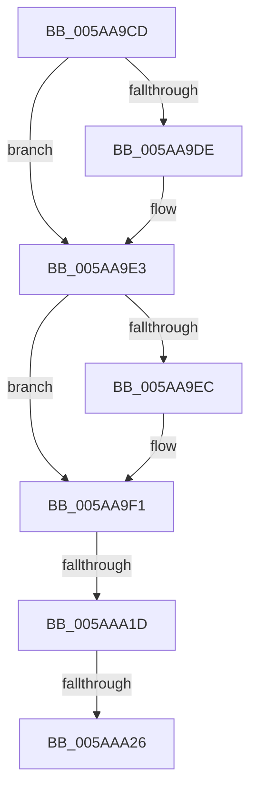

# sub_005AA9CD

- RVA: `0x005AA9CD`–`0x005AAA29` (길이 `92` bytes)
- VA: `0x00000001405AA9CD`
- 실행 섹션: `.text`
- PDB 이름 있음: `아니요`; PDB Function 태그: `아니요`
- unwind 정보 RVA: `0x000C95D4`
- 디코드: `20`개 명령, `92/92` bytes 표시
- 미해석 바이트: `0` (있으면 어셈블리에 `.byte`로 보존)

> 이 문서는 커널 이미지의 기계어와 PDB 기호를 분석해 생성했습니다. 4번과 5번은 함수 원형과 자료형을 바이너리 사용 방식에서 추정한 C 해석이며 원본 소스 복구 결과는 아닙니다.

## 1. Dependencies

- 직접 호출 지점: **3**; 고유 호출 대상: **3**
- 직접 호출자로 확인된 함수: **0**
- RIP 상대 이미지 참조: **4**

### Outgoing calls
- `0x005AA9DE` → [KcsanReportTelemetry](KcsanReportTelemetry_function_005AF360.md) (function, `0x005AF360`)
- `0x005AA9EC` → [KasaniReportTelemetry](KasaniReportTelemetry_function_005AB1D0.md) (function, `0x005AB1D0`)
- `0x005AA9FC` → [KeAcquireSpinLockRaiseToDpc](../20/KeAcquireSpinLockRaiseToDpc_function_00208470.md) (function, `0x00208470`)

### Direct callers
- 이 함수 시작 RVA로 연결되는 직접 call은 확인되지 않았습니다. 간접 호출은 완전히 역산할 수 없습니다.

### Static image references
- `0x005AA9E3` → RVA `0x00FCEC69` (`ALMOSTRO`; read)
- `0x005AA9F5` → RVA `0x00F65500` (`.data`; read)
- `0x005AAA01` → RVA `0x00E663D8` (`.data`; read)
- `0x005AAA12` → RVA `0x00E663E0` (`.data`; read)

## 2. Other-region calls and transfers

- 다른 실행 섹션으로 향하는 call: **0**
- call이 아닌 외부 분기/꼬리 이동: **2**
  - `0x005AAA1B` → [sub_005AAA29](Unknown_function_005AAA29.md) (`tail-transfer`)
  - `0x005AAA20` → [sub_005AAB80](Unknown_function_005AAB80.md) (`tail-transfer`)

## 3. Assembly (complete function range)

```asm
005AA9CD  48 89 6C 24 60                  mov qword ptr [rsp + 0x60], rbp
005AA9D2  48 89 74 24 68                  mov qword ptr [rsp + 0x68], rsi
005AA9D7  4C 89 74 24 38                  mov qword ptr [rsp + 0x38], r14
005AA9DC  74 05                           je 0x1405aa9e3
005AA9DE  E8 7D 49 00 00                  call 0x1405af360
005AA9E3  80 3D 7F 42 A2 00 00            cmp byte ptr [rip + 0xa2427f], 0
005AA9EA  74 05                           je 0x1405aa9f1
005AA9EC  E8 DF 07 00 00                  call 0x1405ab1d0
005AA9F1  48 8B 6B 30                     mov rbp, qword ptr [rbx + 0x30]
005AA9F5  48 8D 0D 04 AB 9B 00            lea rcx, [rip + 0x9bab04]
005AA9FC  E8 6F DA C5 FF                  call 0x140208470
005AAA01  48 8B 1D D0 B9 8B 00            mov rbx, qword ptr [rip + 0x8bb9d0]
005AAA08  4C 8D 35 C9 B9 8B 00            lea r14, [rip + 0x8bb9c9]
005AAA0F  0F B6 F0                        movzx esi, al
005AAA12  48 8B 05 C7 B9 8B 00            mov rax, qword ptr [rip + 0x8bb9c7]
005AAA19  A8 01                           test al, 1
005AAA1B  74 0C                           je 0x1405aaa29
005AAA1D  48 85 DB                        test rbx, rbx
005AAA20  0F 84 5A 01 00 00               je 0x1405aab80
005AAA26  49 33 DE                        xor rbx, r14
```

## 4. C-style interpretation (structured pseudocode)

```c
__int64 __fastcall sub_005AA9CD(void)
{
    __int64 result;
    __int64 v_rbx;
    unsigned __int64 v_stack_p38;
    unsigned __int64 v_stack_p60;
    unsigned __int64 v_stack_p68;

    v_stack_p60 = v_rbp;
    v_stack_p68 = v_rsi;
    v_stack_p38 = v_r14;
    if (!(condition_is_equal)) {
        result = KcsanReportTelemetry(a1, a2, a3, a4);
    }
    if ((*(unsigned __int8 *)(v_rip + 10633855)) != 0) {
        result = KasaniReportTelemetry(a1, a2, a3, a4);
    }
    result = KeAcquireSpinLockRaiseToDpc(v_rip + 10201860, a2, a3, a4);
    v_rbx = (*(unsigned __int64 *)(v_rip + 9157072)) ^ (v_rip + 9157065);
    return *(unsigned __int64 *)(v_rip + 9157063);
}
```

## 5. (Beta) C Style

```c
void sub_005AA9CD(void)
{
    int64_t result;
    int64_t local_rbx;
    uint64_t v_stack_p38;
    uint64_t v_stack_p60;
    uint64_t v_stack_p68;

    v_stack_p60 = local_rbp;
    v_stack_p68 = local_rsi;
    v_stack_p38 = local_r14;
    if (!(condition_is_equal)) {
        result = KcsanReportTelemetry(a1, a2, a3, a4);
    }
    if ((*(uint8_t *)(v_rip + 0xA2427F)) != 0) {
        result = KasaniReportTelemetry(a1, a2, a3, a4);
    }
    result = KeAcquireSpinLockRaiseToDpc(v_rip + 10201860, a2, a3, a4);
    local_rbx = (*(uint64_t *)(v_rip + 0x8BB9D0)) ^ (v_rip + 9157065);
    return *(uint64_t *)(v_rip + 0x8BB9C7);
}
```

## 6. Execution-region graph

[열기: 2D/3D 그래프와 함수 탐색 컨트롤 패널](../../../control-panel.html?section=text&rva=0x005AA9CD&view=graph)

- 2D 그래프는 위에서 아래로 흐르고, 3D 그래프는 빈 공간을 드래그해 회전합니다. Shift+드래그는 이동, 휠은 확대·축소, 함수 노드 선택은 대상 보고서 이동입니다.

### Static fallback


