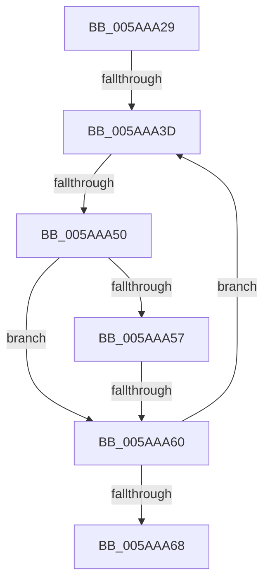

# sub_005AAA29

- RVA: `0x005AAA29`–`0x005AAA71` (길이 `72` bytes)
- VA: `0x00000001405AAA29`
- 실행 섹션: `.text`
- PDB 이름 있음: `아니요`; PDB Function 태그: `아니요`
- unwind 정보 RVA: `0x000C95F0`
- 디코드: `20`개 명령, `72/72` bytes 표시
- 미해석 바이트: `0` (있으면 어셈블리에 `.byte`로 보존)

> 이 문서는 커널 이미지의 기계어와 PDB 기호를 분석해 생성했습니다. 4번과 5번은 함수 원형과 자료형을 바이너리 사용 방식에서 추정한 C 해석이며 원본 소스 복구 결과는 아닙니다.

## 1. Dependencies

- 직접 호출 지점: **1**; 고유 호출 대상: **1**
- 직접 호출자로 확인된 함수: **0**
- RIP 상대 이미지 참조: **0**

### Outgoing calls
- `0x005AAA43` → [KasanUnloadInfoCompare](KasanUnloadInfoCompare_function_005AADC0.md) (function, `0x005AADC0`)

### Direct callers
- 이 함수 시작 RVA로 연결되는 직접 call은 확인되지 않았습니다. 간접 호출은 완전히 역산할 수 없습니다.

### Static image references
- 디코드된 RIP-relative 메모리 참조가 없습니다.

## 2. Other-region calls and transfers

- 다른 실행 섹션으로 향하는 call: **0**
- call이 아닌 외부 분기/꼬리 이동: **4**
  - `0x005AAA37` → [sub_005AAC07](Unknown_function_005AAC07.md) (`tail-transfer`)
  - `0x005AAA4A` → [sub_005AAB92](Unknown_function_005AAB92.md) (`tail-transfer`)
  - `0x005AAA5A` → [sub_005AAB92 + 0x1B](Unknown_function_005AAB92.md) (`tail-transfer`)
  - `0x005AAA6B` → [sub_005AAC07](Unknown_function_005AAC07.md) (`tail-transfer`)

## 3. Assembly (complete function range)

```asm
005AAA29  48 89 7C 24 70                  mov qword ptr [rsp + 0x70], rdi
005AAA2E  0F B6 F8                        movzx edi, al
005AAA31  83 E7 01                        and edi, 1
005AAA34  48 85 DB                        test rbx, rbx
005AAA37  0F 84 CA 01 00 00               je 0x1405aac07
005AAA3D  48 8B D3                        mov rdx, rbx
005AAA40  48 8B CD                        mov rcx, rbp
005AAA43  E8 78 03 00 00                  call 0x1405aadc0
005AAA48  85 C0                           test eax, eax
005AAA4A  0F 89 42 01 00 00               jns 0x1405aab92
005AAA50  48 8B 03                        mov rax, qword ptr [rbx]
005AAA53  85 FF                           test edi, edi
005AAA55  74 09                           je 0x1405aaa60
005AAA57  48 85 C0                        test rax, rax
005AAA5A  0F 85 4D 01 00 00               jne 0x1405aabad
005AAA60  48 8B D8                        mov rbx, rax
005AAA63  48 85 DB                        test rbx, rbx
005AAA66  75 D5                           jne 0x1405aaa3d
005AAA68  48 85 DB                        test rbx, rbx
005AAA6B  0F 84 96 01 00 00               je 0x1405aac07
```

## 4. C-style interpretation (structured pseudocode)

```c
__int64 __fastcall sub_005AAA29(void)
{
    __int64 result;
    __int64 v_rdi;
    unsigned __int64 v_stack_p70;

    v_stack_p70 = v_rdi;
    v_rdi = (unsigned int)(((unsigned __int8)(result)) & (1));
loc_005AAA3D:
    result = KasanUnloadInfoCompare(v_rbp, v_rbx, a3, a4);
    if ((unsigned int)(v_rdi) == 0) goto loc_005AAA60;
loc_005AAA60:
    if (*(unsigned __int64 *)(v_rbx) != 0) goto loc_005AAA3D;
}
```

## 5. (Beta) C Style

```c
void sub_005AAA29(void)
{
    int64_t result;
    int64_t local_rdi;
    uint64_t v_stack_p70;

    v_stack_p70 = local_rdi;
    local_rdi = (uint32_t)(((uint8_t)(result)) & (1));
loc_005AAA3D:
    result = KasanUnloadInfoCompare(local_rbp, local_rbx, a3, a4);
    if ((uint32_t)(local_rdi) == 0) goto loc_005AAA60;
loc_005AAA60:
    if (*(uint64_t *)(local_rbx) != 0) goto loc_005AAA3D;
}
```

## 6. Execution-region graph

[열기: 2D/3D 그래프와 함수 탐색 컨트롤 패널](../../../control-panel.html?section=text&rva=0x005AAA29&view=graph)

- 2D 그래프는 위에서 아래로 흐르고, 3D 그래프는 빈 공간을 드래그해 회전합니다. Shift+드래그는 이동, 휠은 확대·축소, 함수 노드 선택은 대상 보고서 이동입니다.

### Static fallback


