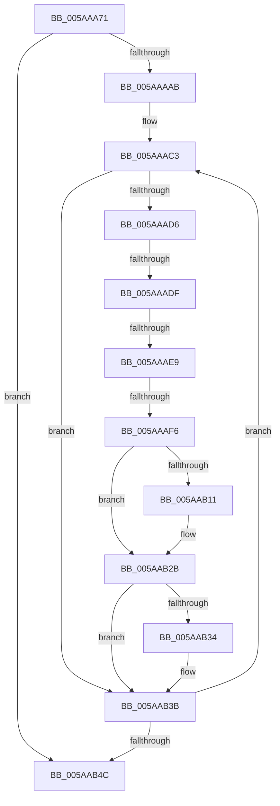

# sub_005AAA71

- RVA: `0x005AAA71`–`0x005AAB65` (길이 `244` bytes)
- VA: `0x00000001405AAA71`
- 실행 섹션: `.text`
- PDB 이름 있음: `아니요`; PDB Function 태그: `아니요`
- unwind 정보 RVA: `0x000C9604`
- 디코드: `56`개 명령, `244/244` bytes 표시
- 미해석 바이트: `0` (있으면 어셈블리에 `.byte`로 보존)

> 이 문서는 커널 이미지의 기계어와 PDB 기호를 분석해 생성했습니다. 4번과 5번은 함수 원형과 자료형을 바이너리 사용 방식에서 추정한 C 해석이며 원본 소스 복구 결과는 아닙니다.

## 1. Dependencies

- 직접 호출 지점: **4**; 고유 호출 대상: **4**
- 직접 호출자로 확인된 함수: **0**
- RIP 상대 이미지 참조: **3**

### Outgoing calls
- `0x005AAA86` → [RtlRbRemoveNode](../2E/RtlRbRemoveNode_function_002E4C10.md) (function, `0x002E4C10`)
- `0x005AAA96` → [KeReleaseSpinLock](../39/KeReleaseSpinLock_function_00392BA0.md) (function, `0x00392BA0`)
- `0x005AAB19` → [memset](../6C/memset_function_006C6C40.md) (function, `0x006C6C40`)
- `0x005AAB51` → [ExFreePoolWithTag](../../poolcode/B8/ExFreePoolWithTag_function_00B82870.md) (function, `0x00B82870`)

### Direct callers
- 이 함수 시작 RVA로 연결되는 직접 call은 확인되지 않았습니다. 간접 호출은 완전히 역산할 수 없습니다.

### Static image references
- `0x005AAA8F` → RVA `0x00F65500` (`.data`; read)
- `0x005AAAC3` → RVA `0x00FCEC68` (`ALMOSTRO`; read)
- `0x005AAB01` → RVA `0x00FC6ED8` (`ALMOSTRO`; read)

## 2. Other-region calls and transfers

- 다른 실행 섹션으로 향하는 call: **1**
  - `0x005AAB51` → [ExFreePoolWithTag](../../poolcode/B8/ExFreePoolWithTag_function_00B82870.md) (`.text` → `POOLCODE`)
- call이 아닌 외부 분기/꼬리 이동: **3**
  - `0x005AAAD9` → [sub_005AABB5 + 0x35](Unknown_function_005AABB5.md) (`tail-transfer`)
  - `0x005AAAE3` → [sub_005AABB5 + 0x19](Unknown_function_005AABB5.md) (`tail-transfer`)
  - `0x005AAAF0` → [sub_005AABB5](Unknown_function_005AABB5.md) (`tail-transfer`)

## 3. Assembly (complete function range)

```asm
005AAA71  4C 89 64 24 48                  mov qword ptr [rsp + 0x48], r12
005AAA76  48 8B D3                        mov rdx, rbx
005AAA79  4C 89 6C 24 40                  mov qword ptr [rsp + 0x40], r13
005AAA7E  49 8B CE                        mov rcx, r14
005AAA81  4C 89 7C 24 30                  mov qword ptr [rsp + 0x30], r15
005AAA86  E8 85 A1 D3 FF                  call 0x1402e4c10
005AAA8B  40 0F B6 D6                     movzx edx, sil
005AAA8F  48 8D 0D 6A AA 9B 00            lea rcx, [rip + 0x9baa6a]
005AAA96  E8 05 81 DE FF                  call 0x140392ba0
005AAA9B  33 ED                           xor ebp, ebp
005AAA9D  4C 8D 63 20                     lea r12, [rbx + 0x20]
005AAAA1  49 39 2C 24                     cmp qword ptr [r12], rbp
005AAAA5  0F 86 A1 00 00 00               jbe 0x1405aab4c
005AAAAB  4C 8D 73 28                     lea r14, [rbx + 0x28]
005AAAAF  48 B9 00 00 00 00 00 80 00 00   movabs rcx, 0x800000000000
005AAAB9  49 BD 00 00 00 00 00 80 FF FF   movabs r13, 0xffff800000000000
005AAAC3  80 3D 9E 41 A2 00 00            cmp byte ptr [rip + 0xa2419e], 0
005AAACA  4C 8B FB                        mov r15, rbx
005AAACD  49 8B 7E 08                     mov rdi, qword ptr [r14 + 8]
005AAAD1  4D 8B 0E                        mov r9, qword ptr [r14]
005AAAD4  74 65                           je 0x1405aab3b
005AAAD6  4D 3B CD                        cmp r9, r13
005AAAD9  0F 82 0B 01 00 00               jb 0x1405aabea
005AAADF  41 F6 C1 07                     test r9b, 7
005AAAE3  0F 85 E5 00 00 00               jne 0x1405aabce
005AAAE9  49 8D 04 39                     lea rax, [r9 + rdi]
005AAAED  49 3B C1                        cmp rax, r9
005AAAF0  0F 82 BF 00 00 00               jb 0x1405aabb5
005AAAF6  49 8D 34 09                     lea rsi, [r9 + rcx]
005AAAFA  48 8B DF                        mov rbx, rdi
005AAAFD  48 C1 EE 03                     shr rsi, 3
005AAB01  48 03 35 D0 C3 A1 00            add rsi, qword ptr [rip + 0xa1c3d0]
005AAB08  48 C1 EB 03                     shr rbx, 3
005AAB0C  48 85 DB                        test rbx, rbx
005AAB0F  74 1A                           je 0x1405aab2b
005AAB11  4C 8B C3                        mov r8, rbx
005AAB14  33 D2                           xor edx, edx
005AAB16  48 8B CE                        mov rcx, rsi
005AAB19  E8 22 C1 11 00                  call 0x1406c6c40
005AAB1E  48 03 F3                        add rsi, rbx
005AAB21  48 B9 00 00 00 00 00 80 00 00   movabs rcx, 0x800000000000
005AAB2B  49 8B DF                        mov rbx, r15
005AAB2E  40 F6 C7 07                     test dil, 7
005AAB32  74 07                           je 0x1405aab3b
005AAB34  40 80 E7 07                     and dil, 7
005AAB38  40 88 3E                        mov byte ptr [rsi], dil
005AAB3B  48 FF C5                        inc rbp
005AAB3E  49 83 C6 10                     add r14, 0x10
005AAB42  49 3B 2C 24                     cmp rbp, qword ptr [r12]
005AAB46  0F 82 77 FF FF FF               jb 0x1405aaac3
005AAB4C  33 D2                           xor edx, edx
005AAB4E  48 8B CB                        mov rcx, rbx
005AAB51  E8 1A 7D 5D 00                  call 0x140b82870
005AAB56  4C 8B 6C 24 40                  mov r13, qword ptr [rsp + 0x40]
005AAB5B  4C 8B 7C 24 30                  mov r15, qword ptr [rsp + 0x30]
005AAB60  4C 8B 64 24 48                  mov r12, qword ptr [rsp + 0x48]
```

## 4. C-style interpretation (structured pseudocode)

```c
__int64 __fastcall sub_005AAA71(__int64 a1, __int64 a2, __int64 a3, __int64 a4, __int64 a5, __int64 a6, __int64 a7, __int64 a8, __int64 a9)
{
    __int64 result;
    __int64 v_r14;
    __int64 v_rbp;
    __int64 v_rbx;
    __int64 v_rdi;
    __int64 v_rsi;
    unsigned __int64 v_stack_p30;
    unsigned __int64 v_stack_p40;
    unsigned __int64 v_stack_p48;

    v_stack_p48 = v_r12;
    v_stack_p40 = v_r13;
    v_stack_p30 = v_r15;
    result = RtlRbRemoveNode(v_r14, v_rbx, a3, a4);
    result = KeReleaseSpinLock(v_rip + 10201706, (unsigned __int8)(v_rsi), a3, a4);
    v_rbp = 0;
    if ((*(unsigned __int64 *)(v_rbx + 32)) <= 0) goto loc_005AAB4C;
loc_005AAAC3:
    if ((*(unsigned __int8 *)(v_rip + 10633630)) == 0) goto loc_005AAB3B;
    v_rsi = (*(unsigned __int64 *)(v_rbx + 40) + v_rip + 10201706 * 1) >> (3);
    v_rsi = (v_rsi) + (*(unsigned __int64 *)(v_rip + 10601424));
    v_rbx = (*(unsigned __int64 *)(v_rbx + 40 + 8)) >> (3);
    result = *(unsigned __int64 *)(v_rbx + 40) + *(unsigned __int64 *)(v_rbx + 40 + 8) * 1;
    if (v_rbx != 0) {
        a3 = v_rbx;
        a2 = 0;
        a1 = v_rsi;
        result = memset(a1, a2, a3, *(unsigned __int64 *)(v_rbx + 40));
        v_rsi = (v_rsi) + (v_rbx);
    }
    v_rdi = *(unsigned __int64 *)(v_rbx + 40 + 8);
    if ((((unsigned __int8)(*(unsigned __int64 *)(v_rbx + 40 + 8))) & (7)) != 0) {
        v_rdi = (unsigned __int8)((*(unsigned __int64 *)(v_rbx + 40 + 8)) & (7));
        *(unsigned __int8 *)(v_rsi) = (unsigned __int8)(v_rdi);
    }
    v_rbp = (v_rbp) + 1;
    v_r14 = (v_rbx + 40) + (16);
    if (v_rbp < (*(unsigned __int64 *)(v_rbx + 32))) goto loc_005AAAC3;
loc_005AAB4C:
    a2 = 0;
    result = ExFreePoolWithTag(v_rbx, a2, a3, *(unsigned __int64 *)(v_rbx + 40));
    return result;
}
```

## 5. (Beta) C Style

```c
int64_t sub_005AAA71(int64_t Arg1, int64_t Arg2, int64_t Arg3, int64_t Arg4, uint64_t Arg5, int64_t Arg6, uint64_t Arg7, int64_t Arg8, int64_t Arg9)
{
    int64_t result;
    int64_t local_r14;
    int64_t local_rbp;
    int64_t local_rbx;
    int64_t local_rdi;
    int64_t local_rsi;
    uint64_t v_stack_p30;
    uint64_t v_stack_p40;
    uint64_t v_stack_p48;

    v_stack_p48 = local_r12;
    v_stack_p40 = local_r13;
    v_stack_p30 = local_r15;
    result = RtlRbRemoveNode(local_r14, local_rbx, Arg3, Arg4);
    result = KeReleaseSpinLock(v_rip + 10201706, (uint8_t)(local_rsi), Arg3, Arg4);
    local_rbp = 0;
    if ((*(uint64_t *)(local_rbx + 0x20)) <= 0) goto loc_005AAB4C;
loc_005AAAC3:
    if ((*(uint8_t *)(v_rip + 0xA2419E)) == 0) goto loc_005AAB3B;
    local_rsi = (*(uint64_t *)(local_rbx + 0x28) + v_rip + 10201706 * 1) >> (3);
    local_rsi = (local_rsi) + (*(uint64_t *)(v_rip + 0xA1C3D0));
    local_rbx = (*(uint64_t *)(local_rbx + 0x28 + 0x8)) >> (3);
    result = *(uint64_t *)(local_rbx + 0x28) + *(uint64_t *)(local_rbx + 0x28 + 0x8) * 1;
    if (local_rbx != 0) {
        Arg3 = local_rbx;
        Arg2 = 0;
        Arg1 = local_rsi;
        result = memset(Arg1, Arg2, Arg3, *(uint64_t *)(local_rbx + 0x28));
        local_rsi = (local_rsi) + (local_rbx);
    }
    local_rdi = *(uint64_t *)(local_rbx + 0x28 + 0x8);
    if ((((uint8_t)(*(uint64_t *)(local_rbx + 0x28 + 0x8))) & (7)) != 0) {
        local_rdi = (uint8_t)((*(uint64_t *)(local_rbx + 0x28 + 0x8)) & (7));
        *(uint8_t *)(local_rsi) = (uint8_t)(local_rdi);
    }
    local_rbp = (local_rbp) + 1;
    local_r14 = (local_rbx + 40) + (16);
    if (local_rbp < (*(uint64_t *)(local_rbx + 0x20))) goto loc_005AAAC3;
loc_005AAB4C:
    Arg2 = 0;
    result = ExFreePoolWithTag(local_rbx, Arg2, Arg3, *(uint64_t *)(local_rbx + 0x28));
    return result;
}
```

## 6. Execution-region graph

[열기: 2D/3D 그래프와 함수 탐색 컨트롤 패널](../../../control-panel.html?section=text&rva=0x005AAA71&view=graph)

- 2D 그래프는 위에서 아래로 흐르고, 3D 그래프는 빈 공간을 드래그해 회전합니다. Shift+드래그는 이동, 휠은 확대·축소, 함수 노드 선택은 대상 보고서 이동입니다.

### Static fallback


