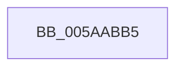

# sub_005AABB5

- RVA: `0x005AABB5`–`0x005AAC07` (길이 `82` bytes)
- VA: `0x00000001405AABB5`
- 실행 섹션: `.text`
- PDB 이름 있음: `아니요`; PDB Function 태그: `아니요`
- unwind 정보 RVA: `0x000C9690`
- 디코드: `18`개 명령, `82/82` bytes 표시
- 미해석 바이트: `0` (있으면 어셈블리에 `.byte`로 보존)

> 이 문서는 커널 이미지의 기계어와 PDB 기호를 분석해 생성했습니다. 4번과 5번은 함수 원형과 자료형을 바이너리 사용 방식에서 추정한 C 해석이며 원본 소스 복구 결과는 아닙니다.

## 1. Dependencies

- 직접 호출 지점: **3**; 고유 호출 대상: **1**
- 직접 호출자로 확인된 함수: **0**
- RIP 상대 이미지 참조: **0**

### Outgoing calls
- `0x005AABC8` → [KeBugCheckEx](../4F/KeBugCheckEx_function_004FD660.md) (function, `0x004FD660`)
- `0x005AABE4` → [KeBugCheckEx](../4F/KeBugCheckEx_function_004FD660.md) (function, `0x004FD660`)
- `0x005AAC01` → [KeBugCheckEx](../4F/KeBugCheckEx_function_004FD660.md) (function, `0x004FD660`)

### Direct callers
- 이 함수 시작 RVA로 연결되는 직접 call은 확인되지 않았습니다. 간접 호출은 완전히 역산할 수 없습니다.

### Static image references
- 디코드된 RIP-relative 메모리 참조가 없습니다.

## 2. Other-region calls and transfers

- 다른 실행 섹션으로 향하는 call: **0**
- 별도 외부 분기/꼬리 이동을 확인하지 못했습니다.

## 3. Assembly (complete function range)

```asm
005AABB5  BA 02 00 00 00                  mov edx, 2
005AABBA  48 89 7C 24 20                  mov qword ptr [rsp + 0x20], rdi
005AABBF  B9 F1 01 00 00                  mov ecx, 0x1f1
005AABC4  44 8D 42 01                     lea r8d, [rdx + 1]
005AABC8  E8 93 2A F5 FF                  call 0x1404fd660
005AABCD  CC                              int3
005AABCE  BA 02 00 00 00                  mov edx, 2
005AABD3  48 C7 44 24 20 08 00 00 00      mov qword ptr [rsp + 0x20], 8
005AABDC  44 8B C2                        mov r8d, edx
005AABDF  B9 F1 01 00 00                  mov ecx, 0x1f1
005AABE4  E8 77 2A F5 FF                  call 0x1404fd660
005AABE9  CC                              int3
005AABEA  BA 02 00 00 00                  mov edx, 2
005AABEF  48 C7 44 24 20 00 00 00 00      mov qword ptr [rsp + 0x20], 0
005AABF8  B9 F1 01 00 00                  mov ecx, 0x1f1
005AABFD  44 8D 42 FF                     lea r8d, [rdx - 1]
005AAC01  E8 5A 2A F5 FF                  call 0x1404fd660
005AAC06  CC                              int3
```

## 4. C-style interpretation (structured pseudocode)

```c
__int64 __fastcall sub_005AABB5(void)
{
    __int64 result;
    unsigned __int64 v_stack_p20;

    v_stack_p20 = v_rdi;
    result = KeBugCheckEx(497, 2, 2 + 1, a4);
    v_stack_p20 = 8;
    result = KeBugCheckEx(497, 2, 2, a4);
    v_stack_p20 = 0;
    result = KeBugCheckEx(497, 2, 2 - 1, a4);
    return result;
}
```

## 5. (Beta) C Style

```c
void sub_005AABB5(void)
{
    int64_t result;
    uint64_t v_stack_p20;

    v_stack_p20 = local_rdi;
    result = KeBugCheckEx(497, 2, 2 + 1, a4);
    v_stack_p20 = 8;
    result = KeBugCheckEx(497, 2, 2, a4);
    v_stack_p20 = 0;
    result = KeBugCheckEx(497, 2, 2 - 1, a4);
    return result;
}
```

## 6. Execution-region graph

[열기: 2D/3D 그래프와 함수 탐색 컨트롤 패널](../../../control-panel.html?section=text&rva=0x005AABB5&view=graph)

- 2D 그래프는 위에서 아래로 흐르고, 3D 그래프는 빈 공간을 드래그해 회전합니다. Shift+드래그는 이동, 휠은 확대·축소, 함수 노드 선택은 대상 보고서 이동입니다.

### Static fallback


