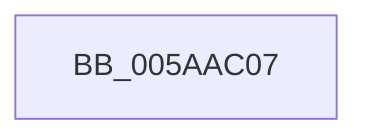

# sub_005AAC07

- RVA: `0x005AAC07`–`0x005AAC1C` (길이 `21` bytes)
- VA: `0x00000001405AAC07`
- 실행 섹션: `.text`
- PDB 이름 있음: `아니요`; PDB Function 태그: `아니요`
- unwind 정보 RVA: `0x000C9670`
- 디코드: `4`개 명령, `21/21` bytes 표시
- 미해석 바이트: `0` (있으면 어셈블리에 `.byte`로 보존)

> 이 문서는 커널 이미지의 기계어와 PDB 기호를 분석해 생성했습니다. 4번과 5번은 함수 원형과 자료형을 바이너리 사용 방식에서 추정한 C 해석이며 원본 소스 복구 결과는 아닙니다.

## 1. Dependencies

- 직접 호출 지점: **1**; 고유 호출 대상: **1**
- 직접 호출자로 확인된 함수: **0**
- RIP 상대 이미지 참조: **1**

### Outgoing calls
- `0x005AAC12` → [KeReleaseSpinLock](../39/KeReleaseSpinLock_function_00392BA0.md) (function, `0x00392BA0`)

### Direct callers
- 이 함수 시작 RVA로 연결되는 직접 call은 확인되지 않았습니다. 간접 호출은 완전히 역산할 수 없습니다.

### Static image references
- `0x005AAC0B` → RVA `0x00F65500` (`.data`; read)

## 2. Other-region calls and transfers

- 다른 실행 섹션으로 향하는 call: **0**
- call이 아닌 외부 분기/꼬리 이동: **1**
  - `0x005AAC17` → [sub_005AAB65](Unknown_function_005AAB65.md) (`tail-transfer`)

## 3. Assembly (complete function range)

```asm
005AAC07  40 0F B6 D6                     movzx edx, sil
005AAC0B  48 8D 0D EE A8 9B 00            lea rcx, [rip + 0x9ba8ee]
005AAC12  E8 89 7F DE FF                  call 0x140392ba0
005AAC17  E9 49 FF FF FF                  jmp 0x1405aab65
```

## 4. C-style interpretation (structured pseudocode)

```c
__int64 __fastcall sub_005AAC07(void)
{
    __int64 result;

    result = KeReleaseSpinLock(v_rip + 10201326, (unsigned __int8)(v_rsi), a3, a4);
}
```

## 5. (Beta) C Style

```c
void sub_005AAC07(void)
{
    int64_t result;

    result = KeReleaseSpinLock(v_rip + 10201326, (uint8_t)(local_rsi), a3, a4);
}
```

## 6. Execution-region graph

[열기: 2D/3D 그래프와 함수 탐색 컨트롤 패널](../../../control-panel.html?section=text&rva=0x005AAC07&view=graph)

- 2D 그래프는 위에서 아래로 흐르고, 3D 그래프는 빈 공간을 드래그해 회전합니다. Shift+드래그는 이동, 휠은 확대·축소, 함수 노드 선택은 대상 보고서 이동입니다.

### Static fallback


