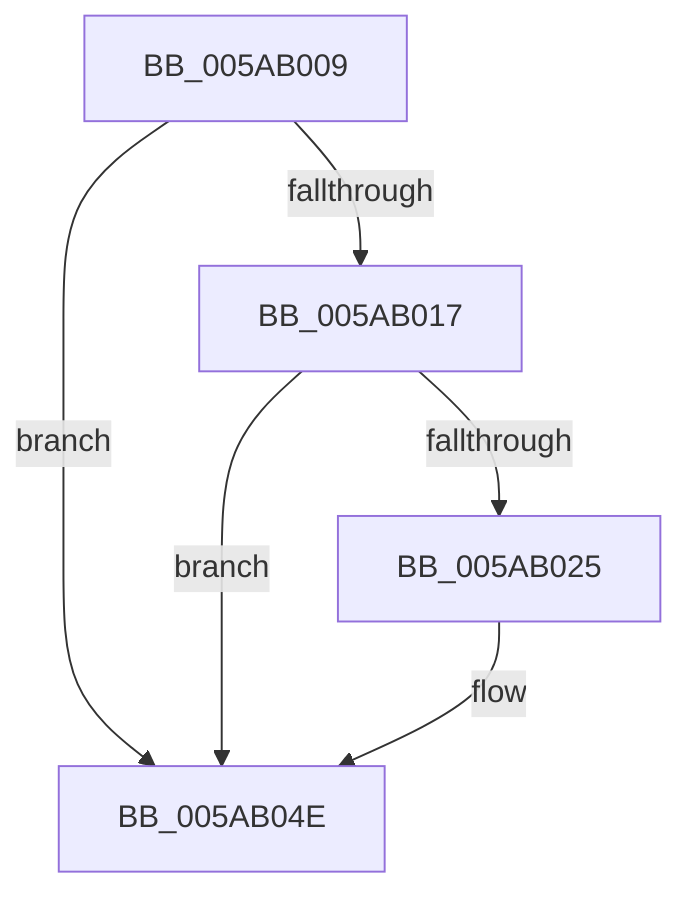

# sub_005AB009

- RVA: `0x005AB009`–`0x005AB06E` (길이 `101` bytes)
- VA: `0x00000001405AB009`
- 실행 섹션: `.text`
- PDB 이름 있음: `아니요`; PDB Function 태그: `아니요`
- unwind 정보 RVA: `0x000C95A4`
- 디코드: `26`개 명령, `101/101` bytes 표시
- 미해석 바이트: `0` (있으면 어셈블리에 `.byte`로 보존)

> 이 문서는 커널 이미지의 기계어와 PDB 기호를 분석해 생성했습니다. 4번과 5번은 함수 원형과 자료형을 바이너리 사용 방식에서 추정한 C 해석이며 원본 소스 복구 결과는 아닙니다.

## 1. Dependencies

- 직접 호출 지점: **2**; 고유 호출 대상: **2**
- 직접 호출자로 확인된 함수: **0**
- RIP 상대 이미지 참조: **0**

### Outgoing calls
- `0x005AB02C` → [RtlUnicodeStringCopy](../3D/RtlUnicodeStringCopy_function_003D4130.md) (function, `0x003D4130`)
- `0x005AB056` → [MiUnlockLoaderEntry](../2A/MiUnlockLoaderEntry_function_002A3E28.md) (function, `0x002A3E28`)

### Direct callers
- 이 함수 시작 RVA로 연결되는 직접 call은 확인되지 않았습니다. 간접 호출은 완전히 역산할 수 없습니다.

### Static image references
- 디코드된 RIP-relative 메모리 참조가 없습니다.

## 2. Other-region calls and transfers

- 다른 실행 섹션으로 향하는 call: **0**
- call이 아닌 외부 분기/꼬리 이동: **1**
  - `0x005AB06C` → [sub_005AB06E + 0x9](Unknown_function_005AB06E.md) (`tail-transfer`)

## 3. Assembly (complete function range)

```asm
005AB009  48 89 6C 24 40                  mov qword ptr [rsp + 0x40], rbp
005AB00E  48 8B 68 30                     mov rbp, qword ptr [rax + 0x30]
005AB012  48 3B FD                        cmp rdi, rbp
005AB015  72 37                           jb 0x1405ab04e
005AB017  8B 80 98 00 00 00               mov eax, dword ptr [rax + 0x98]
005AB01D  48 03 C5                        add rax, rbp
005AB020  48 3B F8                        cmp rdi, rax
005AB023  73 29                           jae 0x1405ab04e
005AB025  48 8D 53 58                     lea rdx, [rbx + 0x58]
005AB029  49 8B CC                        mov rcx, r12
005AB02C  E8 FF 90 E2 FF                  call 0x1403d4130
005AB031  2B FD                           sub edi, ebp
005AB033  8B F0                           mov esi, eax
005AB035  41 89 3F                        mov dword ptr [r15], edi
005AB038  8B 8B 9C 00 00 00               mov ecx, dword ptr [rbx + 0x9c]
005AB03E  41 89 0E                        mov dword ptr [r14], ecx
005AB041  48 8B 4C 24 60                  mov rcx, qword ptr [rsp + 0x60]
005AB046  8B 93 98 00 00 00               mov edx, dword ptr [rbx + 0x98]
005AB04C  89 11                           mov dword ptr [rcx], edx
005AB04E  BA 02 00 00 00                  mov edx, 2
005AB053  48 8B CB                        mov rcx, rbx
005AB056  E8 CD 8D CF FF                  call 0x1402a3e28
005AB05B  65 48 8B 0C 25 88 01 00 00      mov rcx, qword ptr gs:[0x188]
005AB064  48 8B 6C 24 40                  mov rbp, qword ptr [rsp + 0x40]
005AB069  48 85 C9                        test rcx, rcx
005AB06C  75 09                           jne 0x1405ab077
```

## 4. C-style interpretation (structured pseudocode)

```c
__int64 __fastcall sub_005AB009(__int64 a1, __int64 a2, __int64 a3, __int64 a4, __int64 a5, __int64 a6, __int64 a7, __int64 a8, __int64 a9, __int64 a10, __int64 a11, __int64 a12)
{
    __int64 result;
    __int64 v_rdi;
    __int64 v_rsi;
    unsigned __int64 v_stack_p40;

    v_stack_p40 = v_rbp;
    if (v_rdi < (*(unsigned __int64 *)(result + 48))) goto loc_005AB04E;
    result = ((unsigned int)(*(unsigned int *)(result + 152))) + (*(unsigned __int64 *)(result + 48));
    if (v_rdi < result) {
        a2 = v_rbx + 88;
        a1 = v_r12;
        result = RtlUnicodeStringCopy(a1, a2, a3, a4);
        v_rdi = (unsigned int)((v_rdi) - ((unsigned int)(*(unsigned __int64 *)(result + 48))));
        v_rsi = (unsigned int)(result);
        *(unsigned int *)(v_r15) = (unsigned int)(v_rdi);
        a1 = *(unsigned int *)(v_rbx + 156);
        *(unsigned int *)(v_r14) = (unsigned int)(a1);
        a1 = a12;
        a2 = *(unsigned int *)(v_rbx + 152);
        *(unsigned int *)(a1) = (unsigned int)(a2);
    }
    result = MiUnlockLoaderEntry(v_rbx, 2, a3, a4);
}
```

## 5. (Beta) C Style

```c
int64_t sub_005AB009(int64_t Arg1, int64_t Arg2, int64_t Arg3, int64_t Arg4, uint64_t Arg5, uint64_t Arg6, uint64_t Arg7, int64_t Arg8, uint64_t Arg9, uint64_t Arg10, uint64_t Arg11, void *Arg12)
{
    uint8_t *arg12 = (uint8_t *)Arg12;

    int64_t result;
    int64_t local_rdi;
    int64_t local_rsi;
    uint64_t v_stack_p40;

    v_stack_p40 = local_rbp;
    if (local_rdi < (*(uint64_t *)(result + 0x30))) goto loc_005AB04E;
    result = ((uint32_t)(*(uint32_t *)(result + 0x98))) + (*(uint64_t *)(result + 0x30));
    if (local_rdi < result) {
        Arg2 = local_rbx + 88;
        Arg1 = local_r12;
        result = RtlUnicodeStringCopy(Arg1, Arg2, Arg3, Arg4);
        local_rdi = (uint32_t)((local_rdi) - ((uint32_t)(*(uint64_t *)(result + 0x30))));
        local_rsi = (uint32_t)(result);
        *(uint32_t *)(local_r15) = (uint32_t)(local_rdi);
        Arg1 = *(uint32_t *)(local_rbx + 0x9C);
        *(uint32_t *)(local_r14) = (uint32_t)(Arg1);
        Arg1 = Arg12;
        Arg2 = *(uint32_t *)(local_rbx + 0x98);
        *(uint32_t *)(Arg1) = (uint32_t)(Arg2);
    }
    result = MiUnlockLoaderEntry(local_rbx, 2, Arg3, Arg4);
}
```

### 관측된 메모리 오프셋

구조체 형식이 확인되지 않은 접근은 인자 기준의 오프셋으로만 기록했습니다.

| 기준 인자 | 오프셋 표현 | 폭 (bit) | 접근 |
|---|---:|---:|---|
| `Arg12` | `+ 0x0` | `32` | `W` |

## 6. Execution-region graph

[열기: 2D/3D 그래프와 함수 탐색 컨트롤 패널](../../../control-panel.html?section=text&rva=0x005AB009&view=graph)

- 2D 그래프는 위에서 아래로 흐르고, 3D 그래프는 빈 공간을 드래그해 회전합니다. Shift+드래그는 이동, 휠은 확대·축소, 함수 노드 선택은 대상 보고서 이동입니다.

### Static fallback


