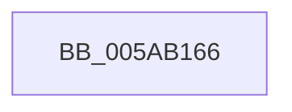

# sub_005AB166

- RVA: `0x005AB166`–`0x005AB1AB` (길이 `69` bytes)
- VA: `0x00000001405AB166`
- 실행 섹션: `.text`
- PDB 이름 있음: `아니요`; PDB Function 태그: `아니요`
- unwind 정보 RVA: `0x000C96C8`
- 디코드: `17`개 명령, `69/69` bytes 표시
- 미해석 바이트: `0` (있으면 어셈블리에 `.byte`로 보존)

> 이 문서는 커널 이미지의 기계어와 PDB 기호를 분석해 생성했습니다. 4번과 5번은 함수 원형과 자료형을 바이너리 사용 방식에서 추정한 C 해석이며 원본 소스 복구 결과는 아닙니다.

## 1. Dependencies

- 직접 호출 지점: **1**; 고유 호출 대상: **1**
- 직접 호출자로 확인된 함수: **0**
- RIP 상대 이미지 참조: **0**

### Outgoing calls
- `0x005AB19D` → [RtlCaptureStackBackTrace](../2F/RtlCaptureStackBackTrace_function_002F9FF0.md) (function, `0x002F9FF0`)

### Direct callers
- 이 함수 시작 RVA로 연결되는 직접 call은 확인되지 않았습니다. 간접 호출은 완전히 역산할 수 없습니다.

### Static image references
- 디코드된 RIP-relative 메모리 참조가 없습니다.

## 2. Other-region calls and transfers

- 다른 실행 섹션으로 향하는 call: **0**
- 별도 외부 분기/꼬리 이동을 확인하지 못했습니다.

## 3. Assembly (complete function range)

```asm
005AB166  48 89 5C 24 40                  mov qword ptr [rsp + 0x40], rbx
005AB16B  48 63 C8                        movsxd rcx, eax
005AB16E  0F B6 44 24 60                  movzx eax, byte ptr [rsp + 0x60]
005AB173  48 69 D9 A8 00 00 00            imul rbx, rcx, 0xa8
005AB17A  33 C9                           xor ecx, ecx
005AB17C  48 03 DA                        add rbx, rdx
005AB17F  4C 89 4B 20                     mov qword ptr [rbx + 0x20], r9
005AB183  4C 8D 43 30                     lea r8, [rbx + 0x30]
005AB187  45 33 C9                        xor r9d, r9d
005AB18A  4C 89 53 08                     mov qword ptr [rbx + 8], r10
005AB18E  48 89 73 10                     mov qword ptr [rbx + 0x10], rsi
005AB192  40 88 7B 18                     mov byte ptr [rbx + 0x18], dil
005AB196  88 43 28                        mov byte ptr [rbx + 0x28], al
005AB199  41 8D 51 10                     lea edx, [r9 + 0x10]
005AB19D  E8 4E EE D4 FF                  call 0x1402f9ff0
005AB1A2  C6 43 29 01                     mov byte ptr [rbx + 0x29], 1
005AB1A6  48 8B 5C 24 40                  mov rbx, qword ptr [rsp + 0x40]
```

## 4. C-style interpretation (structured pseudocode)

```c
__int64 __fastcall sub_005AB166(__int64 a1, __int64 a2, __int64 a3, __int64 a4, __int64 a5, __int64 a6, __int64 a7, __int64 a8, __int64 a9, __int64 a10, __int64 a11, unsigned __int8 a12)
{
    __int64 result;
    __int64 v_rbx;
    unsigned __int64 v_stack_p40;

    v_stack_p40 = v_rbx;
    v_rbx = (v_rbx) * ((int)((unsigned int)(result)));
    a1 = 0;
    v_rbx = (v_rbx) + (a2);
    *(unsigned __int64 *)(v_rbx + 32) = a4;
    a4 = 0;
    *(unsigned __int64 *)(v_rbx + 8) = v_r10;
    *(unsigned __int64 *)(v_rbx + 16) = v_rsi;
    *(unsigned __int8 *)(v_rbx + 24) = (unsigned __int8)(v_rdi);
    *(unsigned __int8 *)(v_rbx + 40) = a12;
    result = RtlCaptureStackBackTrace(a1, a4 + 16, v_rbx + 48, a4);
    *(unsigned __int8 *)(v_rbx + 41) = 1;
    return result;
}
```

## 5. (Beta) C Style

```c
int64_t sub_005AB166(int64_t Arg1, int64_t Arg2, int64_t Arg3, int64_t Arg4, uint64_t Arg5, uint64_t Arg6, uint64_t Arg7, int64_t Arg8, uint64_t Arg9, uint64_t Arg10, uint64_t Arg11, uint8_t Arg12)
{
    int64_t result;
    int64_t local_rbx;
    uint64_t v_stack_p40;

    v_stack_p40 = local_rbx;
    local_rbx = (local_rbx) * ((int32_t)((uint32_t)(result)));
    Arg1 = 0;
    local_rbx = (local_rbx) + (Arg2);
    *(uint64_t *)(local_rbx + 0x20) = Arg4;
    Arg4 = 0;
    *(uint64_t *)(local_rbx + 0x8) = local_r10;
    *(uint64_t *)(local_rbx + 0x10) = local_rsi;
    *(uint8_t *)(local_rbx + 0x18) = (uint8_t)(local_rdi);
    *(uint8_t *)(local_rbx + 0x28) = Arg12;
    result = RtlCaptureStackBackTrace(Arg1, Arg4 + 16, local_rbx + 48, Arg4);
    *(uint8_t *)(local_rbx + 0x29) = 1;
    return result;
}
```

## 6. Execution-region graph

[열기: 2D/3D 그래프와 함수 탐색 컨트롤 패널](../../../control-panel.html?section=text&rva=0x005AB166&view=graph)

- 2D 그래프는 위에서 아래로 흐르고, 3D 그래프는 빈 공간을 드래그해 회전합니다. Shift+드래그는 이동, 휠은 확대·축소, 함수 노드 선택은 대상 보고서 이동입니다.

### Static fallback


