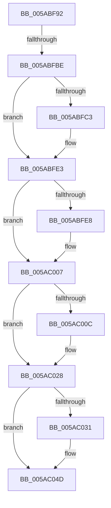

# sub_005ABF92

- RVA: `0x005ABF92`–`0x005AC050` (길이 `190` bytes)
- VA: `0x00000001405ABF92`
- 실행 섹션: `.text`
- PDB 이름 있음: `아니요`; PDB Function 태그: `아니요`
- unwind 정보 RVA: `0x000C94C8`
- 디코드: `48`개 명령, `190/190` bytes 표시
- 미해석 바이트: `0` (있으면 어셈블리에 `.byte`로 보존)

> 이 문서는 커널 이미지의 기계어와 PDB 기호를 분석해 생성했습니다. 4번과 5번은 함수 원형과 자료형을 바이너리 사용 방식에서 추정한 C 해석이며 원본 소스 복구 결과는 아닙니다.

## 1. Dependencies

- 직접 호출 지점: **4**; 고유 호출 대상: **1**
- 직접 호출자로 확인된 함수: **0**
- RIP 상대 이미지 참조: **1**

### Outgoing calls
- `0x005ABFDD` → [KeBugCheckEx](../4F/KeBugCheckEx_function_004FD660.md) (function, `0x004FD660`)
- `0x005AC001` → [KeBugCheckEx](../4F/KeBugCheckEx_function_004FD660.md) (function, `0x004FD660`)
- `0x005AC022` → [KeBugCheckEx](../4F/KeBugCheckEx_function_004FD660.md) (function, `0x004FD660`)
- `0x005AC047` → [KeBugCheckEx](../4F/KeBugCheckEx_function_004FD660.md) (function, `0x004FD660`)

### Direct callers
- 이 함수 시작 RVA로 연결되는 직접 call은 확인되지 않았습니다. 간접 호출은 완전히 역산할 수 없습니다.

### Static image references
- `0x005ABFB1` → RVA `0x00FCEC68` (`ALMOSTRO`; read)

## 2. Other-region calls and transfers

- 다른 실행 섹션으로 향하는 call: **0**
- call이 아닌 외부 분기/꼬리 이동: **1**
  - `0x005ABFB8` → [sub_005AC0D9](Unknown_function_005AC0D9.md) (`tail-transfer`)

## 3. Assembly (complete function range)

```asm
005ABF92  48 89 6C 24 50                  mov qword ptr [rsp + 0x50], rbp
005ABF97  48 8B CF                        mov rcx, rdi
005ABF9A  4C 89 74 24 30                  mov qword ptr [rsp + 0x30], r14
005ABF9F  48 8D 6F FF                     lea rbp, [rdi - 1]
005ABFA3  4C 8B F5                        mov r14, rbp
005ABFA6  41 83 E6 1F                     and r14d, 0x1f
005ABFAA  49 2B CE                        sub rcx, r14
005ABFAD  48 83 C1 1F                     add rcx, 0x1f
005ABFB1  80 3D B0 2C A2 00 00            cmp byte ptr [rip + 0xa22cb0], 0
005ABFB8  0F 84 1B 01 00 00               je 0x1405ac0d9
005ABFBE  48 3B DA                        cmp rbx, rdx
005ABFC1  73 20                           jae 0x1405abfe3
005ABFC3  BA 02 00 00 00                  mov edx, 2
005ABFC8  48 C7 44 24 20 00 00 00 00      mov qword ptr [rsp + 0x20], 0
005ABFD1  4C 8B CB                        mov r9, rbx
005ABFD4  B9 F1 01 00 00                  mov ecx, 0x1f1
005ABFD9  44 8D 42 FF                     lea r8d, [rdx - 1]
005ABFDD  E8 7E 16 F5 FF                  call 0x1404fd660
005ABFE2  CC                              int3
005ABFE3  F6 C3 07                        test bl, 7
005ABFE6  74 1F                           je 0x1405ac007
005ABFE8  BA 02 00 00 00                  mov edx, 2
005ABFED  48 C7 44 24 20 08 00 00 00      mov qword ptr [rsp + 0x20], 8
005ABFF6  44 8B C2                        mov r8d, edx
005ABFF9  4C 8B CB                        mov r9, rbx
005ABFFC  B9 F1 01 00 00                  mov ecx, 0x1f1
005AC001  E8 5A 16 F5 FF                  call 0x1404fd660
005AC006  CC                              int3
005AC007  48 3B F9                        cmp rdi, rcx
005AC00A  76 1C                           jbe 0x1405ac028
005AC00C  BA 02 00 00 00                  mov edx, 2
005AC011  48 89 4C 24 20                  mov qword ptr [rsp + 0x20], rcx
005AC016  4C 8B CF                        mov r9, rdi
005AC019  B9 F1 01 00 00                  mov ecx, 0x1f1
005AC01E  44 8D 42 01                     lea r8d, [rdx + 1]
005AC022  E8 39 16 F5 FF                  call 0x1404fd660
005AC027  CC                              int3
005AC028  48 8D 04 19                     lea rax, [rcx + rbx]
005AC02C  48 3B C3                        cmp rax, rbx
005AC02F  73 1C                           jae 0x1405ac04d
005AC031  BA 02 00 00 00                  mov edx, 2
005AC036  48 89 4C 24 20                  mov qword ptr [rsp + 0x20], rcx
005AC03B  4C 8B CB                        mov r9, rbx
005AC03E  B9 F1 01 00 00                  mov ecx, 0x1f1
005AC043  44 8D 42 01                     lea r8d, [rdx + 1]
005AC047  E8 14 16 F5 FF                  call 0x1404fd660
005AC04C  CC                              int3
005AC04D  83 E5 07                        and ebp, 7
```

## 4. C-style interpretation (structured pseudocode)

```c
__int64 __fastcall sub_005ABF92(__int64 a1, __int64 a2)
{
    __int64 result;
    __int64 v_r14;
    __int64 v_rbp;
    unsigned __int64 v_stack_p20;
    unsigned __int64 v_stack_p30;
    unsigned __int64 v_stack_p50;

    v_stack_p50 = v_rbp;
    v_stack_p30 = v_r14;
    v_r14 = (unsigned int)((v_rdi - 1) & (31));
    a1 = (v_rdi) - (v_r14);
    a1 = (a1) + (31);
    if (v_rbx < a2) {
        a2 = 2;
        v_stack_p20 = 0;
        a4 = v_rbx;
        a1 = 497;
        a3 = a2 - 1;
        result = KeBugCheckEx(a1, a2, a3, a4);
    }
    if ((((unsigned __int8)(v_rbx)) & (7)) != 0) {
        a2 = 2;
        v_stack_p20 = 8;
        a3 = (unsigned int)(a2);
        a4 = v_rbx;
        a1 = 497;
        result = KeBugCheckEx(a1, a2, a3, a4);
    }
    if (v_rdi >= = a1) {
        a2 = 2;
        v_stack_p20 = a1;
        a4 = v_rdi;
        a1 = 497;
        a3 = a2 + 1;
        result = KeBugCheckEx(a1, a2, a3, a4);
    }
    result = a1 + v_rbx * 1;
    if ((a1 + v_rbx * 1) < v_rbx) {
        a2 = 2;
        v_stack_p20 = a1;
        a4 = v_rbx;
        a1 = 497;
        a3 = a2 + 1;
        result = KeBugCheckEx(a1, a2, a3, a4);
    }
    v_rbp = (unsigned int)((v_rdi - 1) & (7));
    return result;
}
```

## 5. (Beta) C Style

```c
int64_t sub_005ABF92(int64_t Arg1, int64_t Arg2)
{
    int64_t result;
    int64_t local_r14;
    int64_t local_rbp;
    uint64_t v_stack_p20;
    uint64_t v_stack_p30;
    uint64_t v_stack_p50;

    v_stack_p50 = local_rbp;
    v_stack_p30 = local_r14;
    local_r14 = (uint32_t)((local_rdi - 1) & (31));
    Arg1 = (local_rdi) - (local_r14);
    Arg1 = (Arg1) + (31);
    if (local_rbx < Arg2) {
        Arg2 = 2;
        v_stack_p20 = 0;
        a4 = local_rbx;
        Arg1 = 497;
        a3 = Arg2 - 1;
        result = KeBugCheckEx(Arg1, Arg2, a3, a4);
    }
    if ((((uint8_t)(local_rbx)) & (7)) != 0) {
        Arg2 = 2;
        v_stack_p20 = 8;
        a3 = (uint32_t)(Arg2);
        a4 = local_rbx;
        Arg1 = 497;
        result = KeBugCheckEx(Arg1, Arg2, a3, a4);
    }
    if (local_rdi >= = Arg1) {
        Arg2 = 2;
        v_stack_p20 = Arg1;
        a4 = local_rdi;
        Arg1 = 497;
        a3 = Arg2 + 1;
        result = KeBugCheckEx(Arg1, Arg2, a3, a4);
    }
    result = Arg1 + local_rbx * 1;
    if ((Arg1 + local_rbx * 1) < local_rbx) {
        Arg2 = 2;
        v_stack_p20 = Arg1;
        a4 = local_rbx;
        Arg1 = 497;
        a3 = Arg2 + 1;
        result = KeBugCheckEx(Arg1, Arg2, a3, a4);
    }
    local_rbp = (uint32_t)((local_rdi - 1) & (7));
    return result;
}
```

## 6. Execution-region graph

[열기: 2D/3D 그래프와 함수 탐색 컨트롤 패널](../../../control-panel.html?section=text&rva=0x005ABF92&view=graph)

- 2D 그래프는 위에서 아래로 흐르고, 3D 그래프는 빈 공간을 드래그해 회전합니다. Shift+드래그는 이동, 휠은 확대·축소, 함수 노드 선택은 대상 보고서 이동입니다.

### Static fallback


