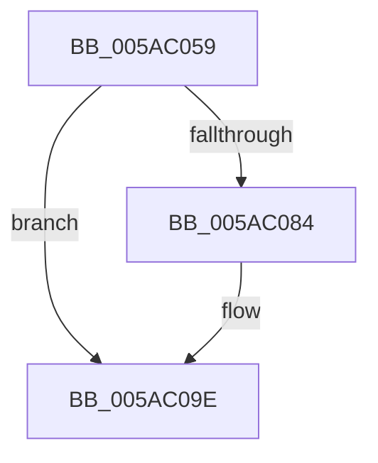

# sub_005AC059

- RVA: `0x005AC059`–`0x005AC0A9` (길이 `80` bytes)
- VA: `0x00000001405AC059`
- 실행 섹션: `.text`
- PDB 이름 있음: `아니요`; PDB Function 태그: `아니요`
- unwind 정보 RVA: `0x000C94F4`
- 디코드: `21`개 명령, `80/80` bytes 표시
- 미해석 바이트: `0` (있으면 어셈블리에 `.byte`로 보존)

> 이 문서는 커널 이미지의 기계어와 PDB 기호를 분석해 생성했습니다. 4번과 5번은 함수 원형과 자료형을 바이너리 사용 방식에서 추정한 C 해석이며 원본 소스 복구 결과는 아닙니다.

## 1. Dependencies

- 직접 호출 지점: **1**; 고유 호출 대상: **1**
- 직접 호출자로 확인된 함수: **0**
- RIP 상대 이미지 참조: **1**

### Outgoing calls
- `0x005AC08C` → [memset](../6C/memset_function_006C6C40.md) (function, `0x006C6C40`)

### Direct callers
- 이 함수 시작 RVA로 연결되는 직접 call은 확인되지 않았습니다. 간접 호출은 완전히 역산할 수 없습니다.

### Static image references
- `0x005AC06B` → RVA `0x00FC52D8` (`ALMOSTRO`; read)

## 2. Other-region calls and transfers

- 다른 실행 섹션으로 향하는 call: **0**
- call이 아닌 외부 분기/꼬리 이동: **1**
  - `0x005AC0A7` → [sub_005AC0A9 + 0xB](Unknown_function_005AC0A9.md) (`tail-transfer`)

## 3. Assembly (complete function range)

```asm
005AC059  4C 89 64 24 60                  mov qword ptr [rsp + 0x60], r12
005AC05E  83 E0 07                        and eax, 7
005AC061  48 8B F3                        mov rsi, rbx
005AC064  48 2B E8                        sub rbp, rax
005AC067  48 C1 EE 03                     shr rsi, 3
005AC06B  48 03 35 66 92 A1 00            add rsi, qword ptr [rip + 0xa19266]
005AC072  48 2B EF                        sub rbp, rdi
005AC075  4C 8B E7                        mov r12, rdi
005AC078  48 03 E9                        add rbp, rcx
005AC07B  49 C1 EC 03                     shr r12, 3
005AC07F  4D 85 E4                        test r12, r12
005AC082  74 1A                           je 0x1405ac09e
005AC084  4D 8B C4                        mov r8, r12
005AC087  33 D2                           xor edx, edx
005AC089  48 8B CE                        mov rcx, rsi
005AC08C  E8 AF AB 11 00                  call 0x1406c6c40
005AC091  49 03 F4                        add rsi, r12
005AC094  48 BA 00 00 00 00 00 80 FF FF   movabs rdx, 0xffff800000000000
005AC09E  4C 8B 64 24 60                  mov r12, qword ptr [rsp + 0x60]
005AC0A3  40 F6 C7 07                     test dil, 7
005AC0A7  74 0B                           je 0x1405ac0b4
```

## 4. C-style interpretation (structured pseudocode)

```c
__int64 __fastcall sub_005AC059(__int64 a1, int a2, __int64 a3, __int64 a4, __int64 a5, __int64 a6, __int64 a7, __int64 a8, __int64 a9, __int64 a10, __int64 a11, __int64 a12)
{
    __int64 result;
    __int64 v_r12;
    __int64 v_rbp;
    __int64 v_rsi;
    unsigned __int64 v_stack_p60;

    v_stack_p60 = v_r12;
    result = (unsigned int)((result) & (7));
    v_rbp = (v_rbp) - (result);
    v_rsi = (v_rbx) >> (3);
    v_rsi = (v_rsi) + (*(unsigned __int64 *)(v_rip + 10588774));
    v_rbp = (v_rbp) - (v_rdi);
    v_rbp = (v_rbp) + (a1);
    v_r12 = (v_rdi) >> (3);
    if (v_r12 != 0) {
        a3 = v_r12;
        a2 = 0;
        a1 = v_rsi;
        result = memset(a1, a2, a3, a4);
        v_rsi = (v_rsi) + (v_r12);
    }
}
```

## 5. (Beta) C Style

```c
int64_t sub_005AC059(int64_t Arg1, int32_t Arg2, int64_t Arg3, int64_t Arg4, uint64_t Arg5, uint64_t Arg6, uint64_t Arg7, uint64_t Arg8, uint64_t Arg9, uint64_t Arg10, uint64_t Arg11, int64_t Arg12)
{
    int64_t result;
    int64_t local_r12;
    int64_t local_rbp;
    int64_t local_rsi;
    uint64_t v_stack_p60;

    v_stack_p60 = local_r12;
    result = (uint32_t)((result) & (7));
    local_rbp = (local_rbp) - (result);
    local_rsi = (local_rbx) >> (3);
    local_rsi = (local_rsi) + (*(uint64_t *)(v_rip + 0xA19266));
    local_rbp = (local_rbp) - (local_rdi);
    local_rbp = (local_rbp) + (Arg1);
    local_r12 = (local_rdi) >> (3);
    if (local_r12 != 0) {
        Arg3 = local_r12;
        Arg2 = 0;
        Arg1 = local_rsi;
        result = memset(Arg1, Arg2, Arg3, Arg4);
        local_rsi = (local_rsi) + (local_r12);
    }
}
```

## 6. Execution-region graph

[열기: 2D/3D 그래프와 함수 탐색 컨트롤 패널](../../../control-panel.html?section=text&rva=0x005AC059&view=graph)

- 2D 그래프는 위에서 아래로 흐르고, 3D 그래프는 빈 공간을 드래그해 회전합니다. Shift+드래그는 이동, 휠은 확대·축소, 함수 노드 선택은 대상 보고서 이동입니다.

### Static fallback


