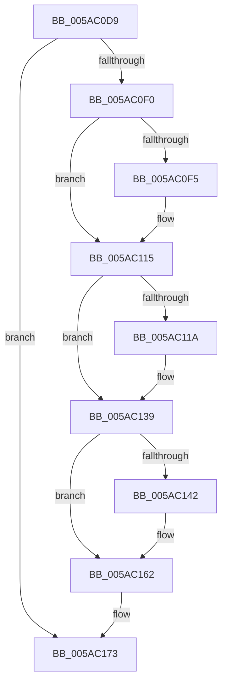

# sub_005AC0D9

- RVA: `0x005AC0D9`–`0x005AC184` (길이 `171` bytes)
- VA: `0x00000001405AC0D9`
- 실행 섹션: `.text`
- PDB 이름 있음: `아니요`; PDB Function 태그: `아니요`
- unwind 정보 RVA: `0x000C9518`
- 디코드: `42`개 명령, `171/171` bytes 표시
- 미해석 바이트: `0` (있으면 어셈블리에 `.byte`로 보존)

> 이 문서는 커널 이미지의 기계어와 PDB 기호를 분석해 생성했습니다. 4번과 5번은 함수 원형과 자료형을 바이너리 사용 방식에서 추정한 C 해석이며 원본 소스 복구 결과는 아닙니다.

## 1. Dependencies

- 직접 호출 지점: **3**; 고유 호출 대상: **1**
- 직접 호출자로 확인된 함수: **0**
- RIP 상대 이미지 참조: **2**

### Outgoing calls
- `0x005AC10F` → [KeBugCheckEx](../4F/KeBugCheckEx_function_004FD660.md) (function, `0x004FD660`)
- `0x005AC133` → [KeBugCheckEx](../4F/KeBugCheckEx_function_004FD660.md) (function, `0x004FD660`)
- `0x005AC15C` → [KeBugCheckEx](../4F/KeBugCheckEx_function_004FD660.md) (function, `0x004FD660`)

### Direct callers
- 이 함수 시작 RVA로 연결되는 직접 call은 확인되지 않았습니다. 간접 호출은 완전히 역산할 수 없습니다.

### Static image references
- `0x005AC0E3` → RVA `0x00FCEC68` (`ALMOSTRO`; read)
- `0x005AC166` → RVA `0x00FC52D8` (`ALMOSTRO`; read)

## 2. Other-region calls and transfers

- 다른 실행 섹션으로 향하는 call: **0**
- 별도 외부 분기/꼬리 이동을 확인하지 못했습니다.

## 3. Assembly (complete function range)

```asm
005AC0D9  49 2B DE                        sub rbx, r14
005AC0DC  48 8D 4F 1F                     lea rcx, [rdi + 0x1f]
005AC0E0  48 03 CB                        add rcx, rbx
005AC0E3  80 3D 7E 2B A2 00 00            cmp byte ptr [rip + 0xa22b7e], 0
005AC0EA  0F 84 83 00 00 00               je 0x1405ac173
005AC0F0  48 3B CA                        cmp rcx, rdx
005AC0F3  73 20                           jae 0x1405ac115
005AC0F5  BA 02 00 00 00                  mov edx, 2
005AC0FA  48 C7 44 24 20 00 00 00 00      mov qword ptr [rsp + 0x20], 0
005AC103  4C 8B C9                        mov r9, rcx
005AC106  B9 F1 01 00 00                  mov ecx, 0x1f1
005AC10B  44 8D 42 FF                     lea r8d, [rdx - 1]
005AC10F  E8 4C 15 F5 FF                  call 0x1404fd660
005AC114  CC                              int3
005AC115  F6 C1 07                        test cl, 7
005AC118  74 1F                           je 0x1405ac139
005AC11A  BA 02 00 00 00                  mov edx, 2
005AC11F  48 C7 44 24 20 08 00 00 00      mov qword ptr [rsp + 0x20], 8
005AC128  4C 8B C9                        mov r9, rcx
005AC12B  44 8B C2                        mov r8d, edx
005AC12E  B9 F1 01 00 00                  mov ecx, 0x1f1
005AC133  E8 28 15 F5 FF                  call 0x1404fd660
005AC138  CC                              int3
005AC139  48 8D 41 20                     lea rax, [rcx + 0x20]
005AC13D  48 3B C1                        cmp rax, rcx
005AC140  73 20                           jae 0x1405ac162
005AC142  BA 02 00 00 00                  mov edx, 2
005AC147  48 C7 44 24 20 20 00 00 00      mov qword ptr [rsp + 0x20], 0x20
005AC150  4C 8B C9                        mov r9, rcx
005AC153  B9 F1 01 00 00                  mov ecx, 0x1f1
005AC158  44 8D 42 01                     lea r8d, [rdx + 1]
005AC15C  E8 FF 14 F5 FF                  call 0x1404fd660
005AC161  CC                              int3
005AC162  48 C1 E9 03                     shr rcx, 3
005AC166  48 03 0D 6B 91 A1 00            add rcx, qword ptr [rip + 0xa1916b]
005AC16D  C7 01 83 83 83 83               mov dword ptr [rcx], 0x83838383
005AC173  48 8B 6C 24 50                  mov rbp, qword ptr [rsp + 0x50]
005AC178  4C 8B 74 24 30                  mov r14, qword ptr [rsp + 0x30]
005AC17D  48 83 C4 38                     add rsp, 0x38
005AC181  5F                              pop rdi
005AC182  5B                              pop rbx
005AC183  C3                              ret
```

## 4. C-style interpretation (structured pseudocode)

```c
__int64 __fastcall sub_005AC0D9(__int64 a1, __int64 a2, __int64 a3, __int64 a4, __int64 a5, __int64 a6, __int64 a7, __int64 a8, __int64 a9, __int64 a10)
{
    __int64 result;
    __int64 v_rbx;
    __int64 v_rsp;
    unsigned __int64 v_stack_p20;

    v_rbx = (v_rbx) - (v_r14);
    a1 = (v_rdi + 31) + (v_rbx);
    if ((*(unsigned __int8 *)(v_rip + 10627966)) == 0) goto loc_005AC173;
    if (a1 < a2) {
        a2 = 2;
        v_stack_p20 = 0;
        a4 = a1;
        a1 = 497;
        a3 = a2 - 1;
        result = KeBugCheckEx(a1, a2, a3, a4);
    }
    if ((((unsigned __int8)(a1)) & (7)) != 0) {
        a2 = 2;
        v_stack_p20 = 8;
        a4 = a1;
        a3 = (unsigned int)(a2);
        a1 = 497;
        result = KeBugCheckEx(a1, a2, a3, a4);
    }
    result = a1 + 32;
    if ((a1 + 32) < a1) {
        a2 = 2;
        v_stack_p20 = 32;
        a4 = a1;
        a1 = 497;
        a3 = a2 + 1;
        result = KeBugCheckEx(a1, a2, a3, a4);
    }
    a1 = (a1) >> (3);
    a1 = (a1) + (*(unsigned __int64 *)(v_rip + 10588523));
    *(unsigned int *)(a1) = 0x83838383ULL;
loc_005AC173:
    v_rsp = (v_rsp) + (56);
    return result;
}
```

## 5. (Beta) C Style

```c
int64_t sub_005AC0D9(int64_t Arg1, int64_t Arg2, int64_t Arg3, int64_t Arg4, uint64_t Arg5, int64_t Arg6, uint64_t Arg7, uint64_t Arg8, uint64_t Arg9, int64_t Arg10)
{
    int64_t result;
    int64_t local_rbx;
    int64_t local_rsp;
    uint64_t v_stack_p20;

    local_rbx = (local_rbx) - (local_r14);
    Arg1 = (local_rdi + 31) + (local_rbx);
    if ((*(uint8_t *)(v_rip + 0xA22B7E)) == 0) goto loc_005AC173;
    if (Arg1 < Arg2) {
        Arg2 = 2;
        v_stack_p20 = 0;
        Arg4 = Arg1;
        Arg1 = 497;
        Arg3 = Arg2 - 1;
        result = KeBugCheckEx(Arg1, Arg2, Arg3, Arg4);
    }
    if ((((uint8_t)(Arg1)) & (7)) != 0) {
        Arg2 = 2;
        v_stack_p20 = 8;
        Arg4 = Arg1;
        Arg3 = (uint32_t)(Arg2);
        Arg1 = 497;
        result = KeBugCheckEx(Arg1, Arg2, Arg3, Arg4);
    }
    result = Arg1 + 32;
    if ((Arg1 + 32) < Arg1) {
        Arg2 = 2;
        v_stack_p20 = 32;
        Arg4 = Arg1;
        Arg1 = 497;
        Arg3 = Arg2 + 1;
        result = KeBugCheckEx(Arg1, Arg2, Arg3, Arg4);
    }
    Arg1 = (Arg1) >> (3);
    Arg1 = (Arg1) + (*(uint64_t *)(v_rip + 0xA1916B));
    *(uint32_t *)(Arg1) = 0x83838383ULL;
loc_005AC173:
    local_rsp = (local_rsp) + (56);
    return result;
}
```

## 6. Execution-region graph

[열기: 2D/3D 그래프와 함수 탐색 컨트롤 패널](../../../control-panel.html?section=text&rva=0x005AC0D9&view=graph)

- 2D 그래프는 위에서 아래로 흐르고, 3D 그래프는 빈 공간을 드래그해 회전합니다. Shift+드래그는 이동, 휠은 확대·축소, 함수 노드 선택은 대상 보고서 이동입니다.

### Static fallback


