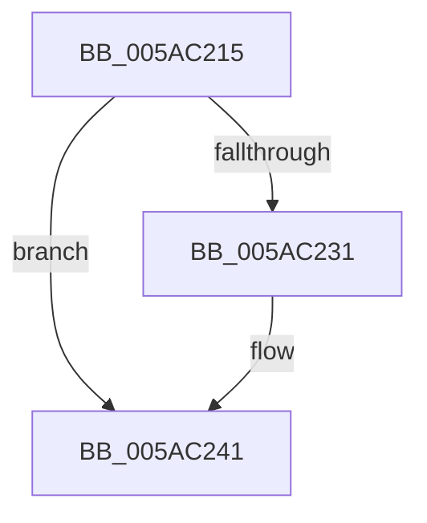

# sub_005AC215

- RVA: `0x005AC215`–`0x005AC24C` (길이 `55` bytes)
- VA: `0x00000001405AC215`
- 실행 섹션: `.text`
- PDB 이름 있음: `아니요`; PDB Function 태그: `아니요`
- unwind 정보 RVA: `0x000C9494`
- 디코드: `15`개 명령, `55/55` bytes 표시
- 미해석 바이트: `0` (있으면 어셈블리에 `.byte`로 보존)

> 이 문서는 커널 이미지의 기계어와 PDB 기호를 분석해 생성했습니다. 4번과 5번은 함수 원형과 자료형을 바이너리 사용 방식에서 추정한 C 해석이며 원본 소스 복구 결과는 아닙니다.

## 1. Dependencies

- 직접 호출 지점: **1**; 고유 호출 대상: **1**
- 직접 호출자로 확인된 함수: **0**
- RIP 상대 이미지 참조: **1**

### Outgoing calls
- `0x005AC239` → [memset](../6C/memset_function_006C6C40.md) (function, `0x006C6C40`)

### Direct callers
- 이 함수 시작 RVA로 연결되는 직접 call은 확인되지 않았습니다. 간접 호출은 완전히 역산할 수 없습니다.

### Static image references
- `0x005AC221` → RVA `0x00FC52D8` (`ALMOSTRO`; read)

## 2. Other-region calls and transfers

- 다른 실행 섹션으로 향하는 call: **0**
- call이 아닌 외부 분기/꼬리 이동: **1**
  - `0x005AC24A` → [sub_005AC24C + 0x7](Unknown_function_005AC24C.md) (`tail-transfer`)

## 3. Assembly (complete function range)

```asm
005AC215  48 89 74 24 40                  mov qword ptr [rsp + 0x40], rsi
005AC21A  48 8B F7                        mov rsi, rdi
005AC21D  48 C1 EB 03                     shr rbx, 3
005AC221  48 03 1D B0 90 A1 00            add rbx, qword ptr [rip + 0xa190b0]
005AC228  48 C1 EE 03                     shr rsi, 3
005AC22C  48 85 F6                        test rsi, rsi
005AC22F  74 10                           je 0x1405ac241
005AC231  4C 8B C6                        mov r8, rsi
005AC234  33 D2                           xor edx, edx
005AC236  48 8B CB                        mov rcx, rbx
005AC239  E8 02 AA 11 00                  call 0x1406c6c40
005AC23E  48 03 DE                        add rbx, rsi
005AC241  48 8B 74 24 40                  mov rsi, qword ptr [rsp + 0x40]
005AC246  40 F6 C7 07                     test dil, 7
005AC24A  74 07                           je 0x1405ac253
```

## 4. C-style interpretation (structured pseudocode)

```c
__int64 __fastcall sub_005AC215(__int64 a1, int a2, __int64 a3, __int64 a4, __int64 a5, __int64 a6, __int64 a7, __int64 a8)
{
    __int64 result;
    __int64 v_rbx;
    __int64 v_rsi;
    unsigned __int64 v_stack_p40;

    v_stack_p40 = v_rsi;
    v_rbx = (v_rbx) >> (3);
    v_rbx = (v_rbx) + (*(unsigned __int64 *)(v_rip + 10588336));
    v_rsi = (v_rdi) >> (3);
    if (v_rsi != 0) {
        a3 = v_rsi;
        a2 = 0;
        a1 = v_rbx;
        result = memset(a1, a2, a3, a4);
        v_rbx = (v_rbx) + (v_rsi);
    }
}
```

## 5. (Beta) C Style

```c
int64_t sub_005AC215(int64_t Arg1, int32_t Arg2, int64_t Arg3, int64_t Arg4, uint64_t Arg5, uint64_t Arg6, uint64_t Arg7, int64_t Arg8)
{
    int64_t result;
    int64_t local_rbx;
    int64_t local_rsi;
    uint64_t v_stack_p40;

    v_stack_p40 = local_rsi;
    local_rbx = (local_rbx) >> (3);
    local_rbx = (local_rbx) + (*(uint64_t *)(v_rip + 0xA190B0));
    local_rsi = (local_rdi) >> (3);
    if (local_rsi != 0) {
        Arg3 = local_rsi;
        Arg2 = 0;
        Arg1 = local_rbx;
        result = memset(Arg1, Arg2, Arg3, Arg4);
        local_rbx = (local_rbx) + (local_rsi);
    }
}
```

## 6. Execution-region graph

[열기: 2D/3D 그래프와 함수 탐색 컨트롤 패널](../../../control-panel.html?section=text&rva=0x005AC215&view=graph)

- 2D 그래프는 위에서 아래로 흐르고, 3D 그래프는 빈 공간을 드래그해 회전합니다. Shift+드래그는 이동, 휠은 확대·축소, 함수 노드 선택은 대상 보고서 이동입니다.

### Static fallback


