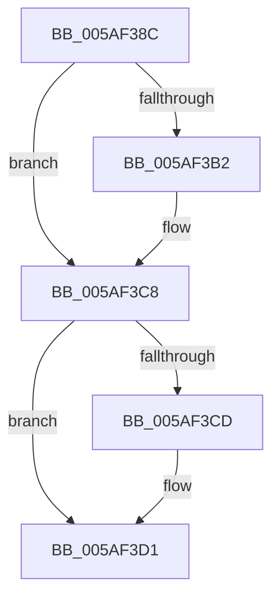

# sub_005AF38C

- RVA: `0x005AF38C`–`0x005AF3E2` (길이 `86` bytes)
- VA: `0x00000001405AF38C`
- 실행 섹션: `.text`
- PDB 이름 있음: `아니요`; PDB Function 태그: `아니요`
- unwind 정보 RVA: `0x000C97CC`
- 디코드: `19`개 명령, `86/86` bytes 표시
- 미해석 바이트: `0` (있으면 어셈블리에 `.byte`로 보존)

> 이 문서는 커널 이미지의 기계어와 PDB 기호를 분석해 생성했습니다. 4번과 5번은 함수 원형과 자료형을 바이너리 사용 방식에서 추정한 C 해석이며 원본 소스 복구 결과는 아닙니다.

## 1. Dependencies

- 직접 호출 지점: **2**; 고유 호출 대상: **2**
- 직접 호출자로 확인된 함수: **0**
- RIP 상대 이미지 참조: **4**

### Outgoing calls
- `0x005AF39E` → [KeAbPreAcquire](../21/KeAbPreAcquire_function_00210230.md) (function, `0x00210230`)
- `0x005AF3C3` → [ExfAcquirePushLockExclusiveEx](../20/ExfAcquirePushLockExclusiveEx_function_0020FC90.md) (function, `0x0020FC90`)

### Direct callers
- 이 함수 시작 RVA로 연결되는 직접 call은 확인되지 않았습니다. 간접 호출은 완전히 역산할 수 없습니다.

### Static image references
- `0x005AF3A3` → RVA `0x00F654F0` (`.data`; read/write)
- `0x005AF3B2` → RVA `0x00F654F0` (`.data`; read)
- `0x005AF3D1` → RVA `0x00F59CE8` (`.data`; read)
- `0x005AF3D8` → RVA `0x00F59CE4` (`.data`; read)

## 2. Other-region calls and transfers

- 다른 실행 섹션으로 향하는 call: **0**
- call이 아닌 외부 분기/꼬리 이동: **1**
  - `0x005AF3E0` → [sub_005AF42E](Unknown_function_005AF42E.md) (`tail-transfer`)

## 3. Assembly (complete function range)

```asm
005AF38C  48 89 9C 24 C0 00 00 00         mov qword ptr [rsp + 0xc0], rbx
005AF394  33 D2                           xor edx, edx
005AF396  66 FF 88 E4 01 00 00            dec word ptr [rax + 0x1e4]
005AF39D  90                              nop
005AF39E  E8 8D 0E C6 FF                  call 0x140210230
005AF3A3  F0 48 0F BA 2D 43 61 9B 00 00   lock bts qword ptr [rip + 0x9b6143], 0
005AF3AD  48 8B D8                        mov rbx, rax
005AF3B0  73 16                           jae 0x1405af3c8
005AF3B2  4C 8D 05 37 61 9B 00            lea r8, [rip + 0x9b6137]
005AF3B9  48 8B D0                        mov rdx, rax
005AF3BC  48 8D 0D 2D 61 9B 00            lea rcx, [rip + 0x9b612d]
005AF3C3  E8 C8 08 C6 FF                  call 0x14020fc90
005AF3C8  48 85 DB                        test rbx, rbx
005AF3CB  74 04                           je 0x1405af3d1
005AF3CD  C6 43 0A 01                     mov byte ptr [rbx + 0xa], 1
005AF3D1  48 63 1D 10 A9 9A 00            movsxd rbx, dword ptr [rip + 0x9aa910]
005AF3D8  8B 0D 06 A9 9A 00               mov ecx, dword ptr [rip + 0x9aa906]
005AF3DE  3B D9                           cmp ebx, ecx
005AF3E0  7D 4C                           jge 0x1405af42e
```

## 4. C-style interpretation (structured pseudocode)

```c
__int64 __fastcall sub_005AF38C(__int64 a1, int a2)
{
    __int64 result;
    unsigned __int64 v_stack_pC0;

    v_stack_pC0 = v_rbx;
    a2 = 0;
    result = KeAbPreAcquire(a1, a2, a3, a4);
    if (!(condition_is_above_or_equal)) {
        a3 = v_rip + 10182967;
        a2 = result;
        a1 = v_rip + 10182957;
        result = ExfAcquirePushLockExclusiveEx(a1, a2, a3, a4);
    }
    if (result != 0) {
        *(unsigned __int8 *)(result + 10) = 1;
    }
}
```

## 5. (Beta) C Style

```c
int64_t sub_005AF38C(int64_t Arg1, int32_t Arg2)
{
    int64_t result;
    uint64_t v_stack_pC0;

    v_stack_pC0 = local_rbx;
    Arg2 = 0;
    result = KeAbPreAcquire(Arg1, Arg2, a3, a4);
    if (!(condition_is_above_or_equal)) {
        a3 = v_rip + 10182967;
        Arg2 = result;
        Arg1 = v_rip + 10182957;
        result = ExfAcquirePushLockExclusiveEx(Arg1, Arg2, a3, a4);
    }
    if (result != 0) {
        *(uint8_t *)(result + 0xA) = 1;
    }
}
```

## 6. Execution-region graph

[열기: 2D/3D 그래프와 함수 탐색 컨트롤 패널](../../../control-panel.html?section=text&rva=0x005AF38C&view=graph)

- 2D 그래프는 위에서 아래로 흐르고, 3D 그래프는 빈 공간을 드래그해 회전합니다. Shift+드래그는 이동, 휠은 확대·축소, 함수 노드 선택은 대상 보고서 이동입니다.

### Static fallback


