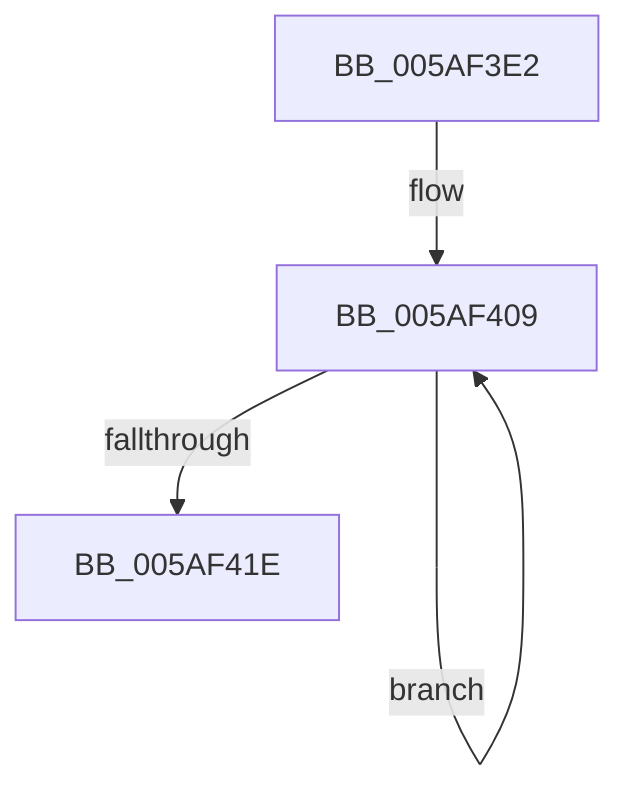

# sub_005AF3E2

- RVA: `0x005AF3E2`–`0x005AF42E` (길이 `76` bytes)
- VA: `0x00000001405AF3E2`
- 실행 섹션: `.text`
- PDB 이름 있음: `아니요`; PDB Function 태그: `아니요`
- unwind 정보 RVA: `0x000C97E0`
- 디코드: `15`개 명령, `76/76` bytes 표시
- 미해석 바이트: `0` (있으면 어셈블리에 `.byte`로 보존)

> 이 문서는 커널 이미지의 기계어와 PDB 기호를 분석해 생성했습니다. 4번과 5번은 함수 원형과 자료형을 바이너리 사용 방식에서 추정한 C 해석이며 원본 소스 복구 결과는 아닙니다.

## 1. Dependencies

- 직접 호출 지점: **1**; 고유 호출 대상: **1**
- 직접 호출자로 확인된 함수: **0**
- RIP 상대 이미지 참조: **1**

### Outgoing calls
- `0x005AF40C` → [KcsaniSendReport](KcsaniSendReport_function_005AF980.md) (function, `0x005AF980`)

### Direct callers
- 이 함수 시작 RVA로 연결되는 직접 call은 확인되지 않았습니다. 간접 호출은 완전히 역산할 수 없습니다.

### Static image references
- `0x005AF3EA` → RVA `0x00F59CF0` (`.data`; read)

## 2. Other-region calls and transfers

- 다른 실행 섹션으로 향하는 call: **0**
- 별도 외부 분기/꼬리 이동을 확인하지 못했습니다.

## 3. Assembly (complete function range)

```asm
005AF3E2  48 89 B4 24 C8 00 00 00         mov qword ptr [rsp + 0xc8], rsi
005AF3EA  48 8D 05 FF A8 9A 00            lea rax, [rip + 0x9aa8ff]
005AF3F1  48 89 BC 24 B0 00 00 00         mov qword ptr [rsp + 0xb0], rdi
005AF3F9  2B CB                           sub ecx, ebx
005AF3FB  48 69 FB B8 00 00 00            imul rdi, rbx, 0xb8
005AF402  8B F1                           mov esi, ecx
005AF404  48 03 F8                        add rdi, rax
005AF407  03 D9                           add ebx, ecx
005AF409  48 8B CF                        mov rcx, rdi
005AF40C  E8 6F 05 00 00                  call 0x1405af980
005AF411  48 81 C7 B8 00 00 00            add rdi, 0xb8
005AF418  48 83 EE 01                     sub rsi, 1
005AF41C  75 EB                           jne 0x1405af409
005AF41E  48 8B BC 24 B0 00 00 00         mov rdi, qword ptr [rsp + 0xb0]
005AF426  48 8B B4 24 C8 00 00 00         mov rsi, qword ptr [rsp + 0xc8]
```

## 4. C-style interpretation (structured pseudocode)

```c
__int64 __fastcall sub_005AF3E2(int a1, __int64 a2, __int64 a3, __int64 a4, __int64 a5, __int64 a6, __int64 a7, __int64 a8, __int64 a9, __int64 a10, __int64 a11, __int64 a12, __int64 a13, __int64 a14, __int64 a15, __int64 a16, __int64 a17, __int64 a18, __int64 a19, __int64 a20, __int64 a21, __int64 a22, __int64 a23, __int64 a24, __int64 a25)
{
    __int64 result;
    __int64 v_rbx;
    __int64 v_rdi;
    __int64 v_rsi;
    unsigned __int64 v_stack_pB0;
    unsigned __int64 v_stack_pC8;

    v_stack_pC8 = v_rsi;
    v_stack_pB0 = v_rdi;
    a1 = (unsigned int)((a1) - ((unsigned int)(v_rbx)));
    v_rdi = (v_rdi) * (v_rbx);
    v_rdi = (v_rdi) + (v_rip + 10135807);
    v_rbx = (unsigned int)((v_rbx) + (a1));
loc_005AF409:
    result = KcsaniSendReport(v_rdi, a2, a3, a4);
    v_rdi = (v_rdi) + (184);
    v_rsi = ((unsigned int)(a1)) - (1);
    if (condition_is_not_equal) goto loc_005AF409;
    return result;
}
```

## 5. (Beta) C Style

```c
int64_t sub_005AF3E2(int32_t Arg1, int64_t Arg2, int64_t Arg3, int64_t Arg4, uint64_t Arg5, uint64_t Arg6, uint64_t Arg7, uint64_t Arg8, uint64_t Arg9, uint64_t Arg10, uint64_t Arg11, uint64_t Arg12, uint64_t Arg13, uint64_t Arg14, uint64_t Arg15, uint64_t Arg16, uint64_t Arg17, uint64_t Arg18, uint64_t Arg19, uint64_t Arg20, uint64_t Arg21, int64_t Arg22, uint64_t Arg23, uint64_t Arg24, int64_t Arg25)
{
    int64_t result;
    int64_t local_rbx;
    int64_t local_rdi;
    int64_t local_rsi;
    uint64_t v_stack_pB0;
    uint64_t v_stack_pC8;

    v_stack_pC8 = local_rsi;
    v_stack_pB0 = local_rdi;
    Arg1 = (uint32_t)((Arg1) - ((uint32_t)(local_rbx)));
    local_rdi = (local_rdi) * (local_rbx);
    local_rdi = (local_rdi) + (v_rip + 10135807);
    local_rbx = (uint32_t)((local_rbx) + (Arg1));
loc_005AF409:
    result = KcsaniSendReport(local_rdi, Arg2, Arg3, Arg4);
    local_rdi = (local_rdi) + (184);
    local_rsi = ((uint32_t)(Arg1)) - (1);
    if (condition_is_not_equal) goto loc_005AF409;
    return result;
}
```

## 6. Execution-region graph

[열기: 2D/3D 그래프와 함수 탐색 컨트롤 패널](../../../control-panel.html?section=text&rva=0x005AF3E2&view=graph)

- 2D 그래프는 위에서 아래로 흐르고, 3D 그래프는 빈 공간을 드래그해 회전합니다. Shift+드래그는 이동, 휠은 확대·축소, 함수 노드 선택은 대상 보고서 이동입니다.

### Static fallback


