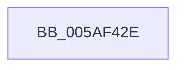

# sub_005AF42E

- RVA: `0x005AF42E`–`0x005AF44B` (길이 `29` bytes)
- VA: `0x00000001405AF42E`
- 실행 섹션: `.text`
- PDB 이름 있음: `아니요`; PDB Function 태그: `아니요`
- unwind 정보 RVA: `0x000C97F8`
- 디코드: `5`개 명령, `29/29` bytes 표시
- 미해석 바이트: `0` (있으면 어셈블리에 `.byte`로 보존)

> 이 문서는 커널 이미지의 기계어와 PDB 기호를 분석해 생성했습니다. 4번과 5번은 함수 원형과 자료형을 바이너리 사용 방식에서 추정한 C 해석이며 원본 소스 복구 결과는 아닙니다.

## 1. Dependencies

- 직접 호출 지점: **0**; 고유 호출 대상: **0**
- 직접 호출자로 확인된 함수: **0**
- RIP 상대 이미지 참조: **2**

### Outgoing calls
- 직접 디코드된 call 명령이 없습니다.

### Direct callers
- 이 함수 시작 RVA로 연결되는 직접 call은 확인되지 않았습니다. 간접 호출은 완전히 역산할 수 없습니다.

### Static image references
- `0x005AF42E` → RVA `0x00F59CEC` (`.data`; read)
- `0x005AF435` → RVA `0x00F59CE8` (`.data`; write)

## 2. Other-region calls and transfers

- 다른 실행 섹션으로 향하는 call: **0**
- call이 아닌 외부 분기/꼬리 이동: **1**
  - `0x005AF445` → [sub_005AF44B + 0x134](Unknown_function_005AF44B.md) (`tail-transfer`)

## 3. Assembly (complete function range)

```asm
005AF42E  0F B6 05 B7 A8 9A 00            movzx eax, byte ptr [rip + 0x9aa8b7]
005AF435  89 1D AD A8 9A 00               mov dword ptr [rip + 0x9aa8ad], ebx
005AF43B  48 8B 9C 24 C0 00 00 00         mov rbx, qword ptr [rsp + 0xc0]
005AF443  3C 01                           cmp al, 1
005AF445  0F 85 34 01 00 00               jne 0x1405af57f
```

## 4. C-style interpretation (structured pseudocode)

```c
__int64 __fastcall sub_005AF42E(__int64 a1, __int64 a2, __int64 a3, __int64 a4, __int64 a5, __int64 a6, __int64 a7, __int64 a8, __int64 a9, __int64 a10, __int64 a11, __int64 a12, __int64 a13, __int64 a14, __int64 a15, __int64 a16, __int64 a17, __int64 a18, __int64 a19, __int64 a20, __int64 a21, __int64 a22, __int64 a23, __int64 a24)
{
    *(unsigned int *)(v_rip + 10135725) = (unsigned int)(v_rbx);
}
```

## 5. (Beta) C Style

```c
int64_t sub_005AF42E(int64_t Arg1, int64_t Arg2, int64_t Arg3, int64_t Arg4, uint64_t Arg5, uint64_t Arg6, uint64_t Arg7, uint64_t Arg8, uint64_t Arg9, uint64_t Arg10, uint64_t Arg11, uint64_t Arg12, uint64_t Arg13, uint64_t Arg14, uint64_t Arg15, uint64_t Arg16, uint64_t Arg17, uint64_t Arg18, uint64_t Arg19, uint64_t Arg20, uint64_t Arg21, uint64_t Arg22, uint64_t Arg23, int64_t Arg24)
{
    *(uint32_t *)(v_rip + 0x9AA8AD) = (uint32_t)(local_rbx);
}
```

## 6. Execution-region graph

[열기: 2D/3D 그래프와 함수 탐색 컨트롤 패널](../../../control-panel.html?section=text&rva=0x005AF42E&view=graph)

- 2D 그래프는 위에서 아래로 흐르고, 3D 그래프는 빈 공간을 드래그해 회전합니다. Shift+드래그는 이동, 휠은 확대·축소, 함수 노드 선택은 대상 보고서 이동입니다.

### Static fallback


