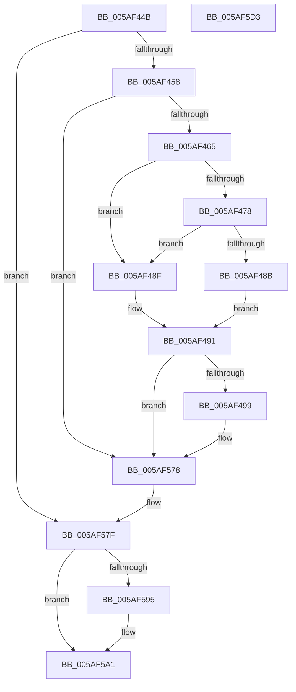

# sub_005AF44B

- RVA: `0x005AF44B`–`0x005AF5D4` (길이 `393` bytes)
- VA: `0x00000001405AF44B`
- 실행 섹션: `.text`
- PDB 이름 있음: `아니요`; PDB Function 태그: `아니요`
- unwind 정보 RVA: `0x000C9808`
- 디코드: `71`개 명령, `393/393` bytes 표시
- 미해석 바이트: `0` (있으면 어셈블리에 `.byte`로 보존)

> 이 문서는 커널 이미지의 기계어와 PDB 기호를 분석해 생성했습니다. 4번과 5번은 함수 원형과 자료형을 바이너리 사용 방식에서 추정한 C 해석이며 원본 소스 복구 결과는 아닙니다.

## 1. Dependencies

- 직접 호출 지점: **5**; 고유 호출 대상: **5**
- 직접 호출자로 확인된 함수: **0**
- RIP 상대 이미지 참조: **13**

### Outgoing calls
- `0x005AF573` → [EtwWriteEx](../25/EtwWriteEx_function_0025F0D0.md) (function, `0x0025F0D0`)
- `0x005AF59C` → [ExfTryToWakePushLock](../26/ExfTryToWakePushLock_function_00265DD0.md) (function, `0x00265DD0`)
- `0x005AF5A8` → [KeAbPostRelease](../2E/KeAbPostRelease_function_002E1600.md) (function, `0x002E1600`)
- `0x005AF5B6` → [KeLeaveCriticalRegionThread](../25/KeLeaveCriticalRegionThread_function_0025EFF0.md) (function, `0x0025EFF0`)
- `0x005AF5C6` → [_security_check_cookie](../6A/_security_check_cookie_function_006AC640.md) (function, `0x006AC640`)

### Direct callers
- 이 함수 시작 RVA로 연결되는 직접 call은 확인되지 않았습니다. 간접 호출은 완전히 역산할 수 없습니다.

### Static image references
- `0x005AF44B` → RVA `0x00F59CED` (`.data`; read)
- `0x005AF458` → RVA `0x00E07058` (`.data`; read)
- `0x005AF46F` → RVA `0x00E07068` (`.data`; read)
- `0x005AF478` → RVA `0x00E07070` (`.data`; read)
- `0x005AF4AB` → RVA `0x00043590` (`.rdata`; read)
- `0x005AF4D9` → RVA `0x00047A18` (`.rdata`; read)
- `0x005AF4E7` → RVA `0x00E07060` (`.data`; read)
- `0x005AF516` → RVA `0x00047A22` (`.rdata`; read)
- `0x005AF522` → RVA `0x0005BCFD` (`.rdata`; read)
- `0x005AF54B` → RVA `0x00E07078` (`.data`; read)
- `0x005AF578` → RVA `0x00F59CED` (`.data`; write)
- `0x005AF586` → RVA `0x00F654F0` (`.data`; read/write)
- `0x005AF595` → RVA `0x00F654F0` (`.data`; read)

## 2. Other-region calls and transfers

- 다른 실행 섹션으로 향하는 call: **0**
- 별도 외부 분기/꼬리 이동을 확인하지 못했습니다.

## 3. Assembly (complete function range)

```asm
005AF44B  80 3D 9B A8 9A 00 00            cmp byte ptr [rip + 0x9aa89b], 0
005AF452  0F 85 27 01 00 00               jne 0x1405af57f
005AF458  83 3D F9 7B 85 00 05            cmp dword ptr [rip + 0x857bf9], 5
005AF45F  0F 86 13 01 00 00               jbe 0x1405af578
005AF465  49 B8 00 00 00 00 00 40 00 00   movabs r8, 0x400000000000
005AF46F  4C 85 05 F2 7B 85 00            test qword ptr [rip + 0x857bf2], r8
005AF476  74 17                           je 0x1405af48f
005AF478  48 8B 05 F1 7B 85 00            mov rax, qword ptr [rip + 0x857bf1]
005AF47F  49 23 C0                        and rax, r8
005AF482  48 3B 05 E7 7B 85 00            cmp rax, qword ptr [rip + 0x857be7]
005AF489  75 04                           jne 0x1405af48f
005AF48B  B0 01                           mov al, 1
005AF48D  EB 02                           jmp 0x1405af491
005AF48F  32 C0                           xor al, al
005AF491  84 C0                           test al, al
005AF493  0F 84 DF 00 00 00               je 0x1405af578
005AF499  4C 89 44 24 58                  mov qword ptr [rsp + 0x58], r8
005AF49E  48 8D 44 24 48                  lea rax, [rsp + 0x48]
005AF4A3  48 89 84 24 80 00 00 00         mov qword ptr [rsp + 0x80], rax
005AF4AB  48 8D 0D DE 40 A9 FF            lea rcx, [rip - 0x56bf22]
005AF4B2  33 D2                           xor edx, edx
005AF4B4  48 C7 44 24 48 00 00 00 02      mov qword ptr [rsp + 0x48], 0x2000000
005AF4BD  48 8D 44 24 40                  lea rax, [rsp + 0x40]
005AF4C2  48 C7 84 24 88 00 00 00 08 00 00 00  mov qword ptr [rsp + 0x88], 8
005AF4CE  48 89 84 24 90 00 00 00         mov qword ptr [rsp + 0x90], rax
005AF4D6  45 33 C9                        xor r9d, r9d
005AF4D9  0F B7 05 38 85 A9 FF            movzx eax, word ptr [rip - 0x567ac8]
005AF4E0  45 33 C0                        xor r8d, r8d
005AF4E3  89 44 24 54                     mov dword ptr [rsp + 0x54], eax
005AF4E7  48 8B 05 72 7B 85 00            mov rax, qword ptr [rip + 0x857b72]
005AF4EE  48 89 44 24 60                  mov qword ptr [rsp + 0x60], rax
005AF4F3  C7 44 24 40 00 01 00 00         mov dword ptr [rsp + 0x40], 0x100
005AF4FB  48 C7 84 24 98 00 00 00 04 00 00 00  mov qword ptr [rsp + 0x98], 4
005AF507  C7 44 24 50 00 00 00 0B         mov dword ptr [rsp + 0x50], 0xb000000
005AF50F  0F B7 00                        movzx eax, word ptr [rax]
005AF512  89 44 24 68                     mov dword ptr [rsp + 0x68], eax
005AF516  48 8D 05 05 85 A9 FF            lea rax, [rip - 0x567afb]
005AF51D  48 89 44 24 70                  mov qword ptr [rsp + 0x70], rax
005AF522  48 8D 05 D4 C7 AA FF            lea rax, [rip - 0x55382c]
005AF529  2B C1                           sub eax, ecx
005AF52B  C7 44 24 6C 02 00 00 00         mov dword ptr [rsp + 0x6c], 2
005AF533  C7 44 24 78 2F 00 00 00         mov dword ptr [rsp + 0x78], 0x2f
005AF53B  C7 44 24 7C 01 00 00 00         mov dword ptr [rsp + 0x7c], 1
005AF543  89 44 24 44                     mov dword ptr [rsp + 0x44], eax
005AF547  8B 44 24 44                     mov eax, dword ptr [rsp + 0x44]
005AF54B  48 8B 0D 26 7B 85 00            mov rcx, qword ptr [rip + 0x857b26]
005AF552  48 8D 44 24 60                  lea rax, [rsp + 0x60]
005AF557  48 89 44 24 38                  mov qword ptr [rsp + 0x38], rax
005AF55C  C7 44 24 30 04 00 00 00         mov dword ptr [rsp + 0x30], 4
005AF564  48 89 54 24 28                  mov qword ptr [rsp + 0x28], rdx
005AF569  48 89 54 24 20                  mov qword ptr [rsp + 0x20], rdx
005AF56E  48 8D 54 24 50                  lea rdx, [rsp + 0x50]
005AF573  E8 58 FB CA FF                  call 0x14025f0d0
005AF578  C6 05 6E A7 9A 00 01            mov byte ptr [rip + 0x9aa76e], 1
005AF57F  48 C7 C0 FF FF FF FF            mov rax, 0xffffffffffffffff
005AF586  F0 48 0F C1 05 61 5F 9B 00      lock xadd qword ptr [rip + 0x9b5f61], rax
005AF58F  24 06                           and al, 6
005AF591  3C 02                           cmp al, 2
005AF593  75 0C                           jne 0x1405af5a1
005AF595  48 8D 0D 54 5F 9B 00            lea rcx, [rip + 0x9b5f54]
005AF59C  E8 2F 68 CB FF                  call 0x140265dd0
005AF5A1  48 8D 0D 48 5F 9B 00            lea rcx, [rip + 0x9b5f48]
005AF5A8  E8 53 20 D3 FF                  call 0x1402e1600
005AF5AD  65 48 8B 0C 25 88 01 00 00      mov rcx, qword ptr gs:[0x188]
005AF5B6  E8 35 FA CA FF                  call 0x14025eff0
005AF5BB  48 8B 8C 24 A0 00 00 00         mov rcx, qword ptr [rsp + 0xa0]
005AF5C3  48 33 CC                        xor rcx, rsp
005AF5C6  E8 75 D0 0F 00                  call 0x1406ac640
005AF5CB  48 81 C4 B8 00 00 00            add rsp, 0xb8
005AF5D2  C3                              ret
005AF5D3  CC                              int3
```

## 4. C-style interpretation (structured pseudocode)

```c
__int64 __fastcall sub_005AF44B(__int64 a1, int a2, __int64 a3, int a4, __int64 a5, __int64 a6, __int64 a7, __int64 a8, __int64 a9, __int64 a10, __int64 a11, __int64 a12, __int64 a13, __int64 a14, __int64 a15, __int64 a16, __int64 a17, __int64 a18, __int64 a19, __int64 a20)
{
    __int64 result;
    __int64 v_rsp;
    unsigned __int64 v_stack_p20;
    unsigned __int64 v_stack_p28;
    unsigned int v_stack_p30;
    unsigned __int64 v_stack_p38;
    unsigned int v_stack_p40;
    unsigned int v_stack_p44;
    unsigned __int64 v_stack_p48;
    unsigned int v_stack_p50;
    unsigned int v_stack_p54;
    unsigned __int64 v_stack_p58;
    unsigned __int64 v_stack_p60;
    unsigned int v_stack_p68;
    unsigned int v_stack_p6C;
    unsigned __int64 v_stack_p70;
    unsigned int v_stack_p78;
    unsigned int v_stack_p7C;
    unsigned __int64 v_stack_p80;
    unsigned __int64 v_stack_p88;
    unsigned __int64 v_stack_p90;
    unsigned __int64 v_stack_p98;

    if ((*(unsigned __int8 *)(v_rip + 10135707)) != 0) goto loc_005AF57F;
    if ((*(unsigned int *)(v_rip + 8748025)) <= 5) goto loc_005AF578;
    if (((*(unsigned __int64 *)(v_rip + 8748018)) & (a3)) == 0) goto loc_005AF48F;
    result = (*(unsigned __int64 *)(v_rip + 8748017)) & (a3);
    if (result != (*(unsigned __int64 *)(v_rip + 8748007))) goto loc_005AF48F;
    goto loc_005AF491;
loc_005AF48F:
    result = 0;
loc_005AF491:
    if (0 != 0) {
        v_stack_p58 = a3;
        result = a9;
        v_stack_p80 = result;
        a1 = v_rip - 5685026;
        a2 = 0;
        v_stack_p48 = 0x2000000ULL;
        result = a8;
        v_stack_p88 = 8;
        v_stack_p90 = result;
        a4 = 0;
        result = *(unsigned __int16 *)(v_rip - 5667528);
        a3 = 0;
        v_stack_p54 = (unsigned int)(result);
        result = *(unsigned __int64 *)(v_rip + 8747890);
        v_stack_p60 = result;
        v_stack_p40 = 256;
        v_stack_p98 = 4;
        v_stack_p50 = 0xB000000ULL;
        result = *(unsigned __int16 *)(result);
        v_stack_p68 = (unsigned int)(result);
        result = v_rip - 5667579;
        v_stack_p70 = result;
        result = v_rip - 5584940;
        result = (unsigned int)((result) - ((unsigned int)(a1)));
        v_stack_p6C = 2;
        v_stack_p78 = 47;
        v_stack_p7C = 1;
        v_stack_p44 = (unsigned int)(result);
        result = v_stack_p44;
        a1 = *(unsigned __int64 *)(v_rip + 8747814);
        result = a12;
        v_stack_p38 = result;
        v_stack_p30 = 4;
        v_stack_p28 = 0;
        v_stack_p20 = 0;
        a2 = a10;
        result = EtwWriteEx(a1, a2, a3, a4);
    }
    *(unsigned __int8 *)(v_rip + 10135406) = 1;
loc_005AF57F:
    result = (unsigned __int8)((-1) & (6));
    if (((unsigned __int8)(result)) == 2) {
        a1 = v_rip + 10182484;
        result = ExfTryToWakePushLock(a1, a2, a3, a4);
    }
    result = KeAbPostRelease(v_rip + 10182472, a2, a3, a4);
    result = KeLeaveCriticalRegionThread(*(unsigned __int64 *)(gs_base + (0 + 392)), a2, a3, a4);
    a1 = (a20) ^ (v_rsp);
    result = _security_check_cookie(a1, a2, a3, a4);
    v_rsp = (v_rsp) + (184);
    return result;
}
```

## 5. (Beta) C Style

```c
int64_t sub_005AF44B(int64_t Arg1, int32_t Arg2, int64_t Arg3, int32_t Arg4, uint64_t Arg5, uint64_t Arg6, uint64_t Arg7, int64_t Arg8, int64_t Arg9, int64_t Arg10, uint64_t Arg11, int64_t Arg12, uint64_t Arg13, uint64_t Arg14, uint64_t Arg15, uint64_t Arg16, uint64_t Arg17, uint64_t Arg18, uint64_t Arg19, int64_t Arg20)
{
    int64_t result;
    int64_t local_rsp;
    uint64_t v_stack_p20;
    uint64_t v_stack_p28;
    uint32_t v_stack_p30;
    uint64_t v_stack_p38;
    uint32_t v_stack_p40;
    uint32_t v_stack_p44;
    uint64_t v_stack_p48;
    uint32_t v_stack_p50;
    uint32_t v_stack_p54;
    uint64_t v_stack_p58;
    uint64_t v_stack_p60;
    uint32_t v_stack_p68;
    uint32_t v_stack_p6C;
    uint64_t v_stack_p70;
    uint32_t v_stack_p78;
    uint32_t v_stack_p7C;
    uint64_t v_stack_p80;
    uint64_t v_stack_p88;
    uint64_t v_stack_p90;
    uint64_t v_stack_p98;

    if ((*(uint8_t *)(v_rip + 0x9AA89B)) != 0) goto loc_005AF57F;
    if ((*(uint32_t *)(v_rip + 0x857BF9)) <= 5) goto loc_005AF578;
    if (((*(uint64_t *)(v_rip + 0x857BF2)) & (Arg3)) == 0) goto loc_005AF48F;
    result = (*(uint64_t *)(v_rip + 0x857BF1)) & (Arg3);
    if (result != (*(uint64_t *)(v_rip + 0x857BE7))) goto loc_005AF48F;
    goto loc_005AF491;
loc_005AF48F:
    result = 0;
loc_005AF491:
    if (0 != 0) {
        v_stack_p58 = Arg3;
        result = Arg9;
        v_stack_p80 = result;
        Arg1 = v_rip - 5685026;
        Arg2 = 0;
        v_stack_p48 = 0x2000000ULL;
        result = Arg8;
        v_stack_p88 = 8;
        v_stack_p90 = result;
        Arg4 = 0;
        result = *(uint16_t *)(v_rip - 0x567AC8);
        Arg3 = 0;
        v_stack_p54 = (uint32_t)(result);
        result = *(uint64_t *)(v_rip + 0x857B72);
        v_stack_p60 = result;
        v_stack_p40 = 256;
        v_stack_p98 = 4;
        v_stack_p50 = 0xB000000ULL;
        result = *(uint16_t *)(result);
        v_stack_p68 = (uint32_t)(result);
        result = v_rip - 5667579;
        v_stack_p70 = result;
        result = v_rip - 5584940;
        result = (uint32_t)((result) - ((uint32_t)(Arg1)));
        v_stack_p6C = 2;
        v_stack_p78 = 47;
        v_stack_p7C = 1;
        v_stack_p44 = (uint32_t)(result);
        result = v_stack_p44;
        Arg1 = *(uint64_t *)(v_rip + 0x857B26);
        result = Arg12;
        v_stack_p38 = result;
        v_stack_p30 = 4;
        v_stack_p28 = 0;
        v_stack_p20 = 0;
        Arg2 = Arg10;
        result = EtwWriteEx(Arg1, Arg2, Arg3, Arg4);
    }
    *(uint8_t *)(v_rip + 0x9AA76E) = 1;
loc_005AF57F:
    result = (uint8_t)((-1) & (6));
    if (((uint8_t)(result)) == 2) {
        Arg1 = v_rip + 10182484;
        result = ExfTryToWakePushLock(Arg1, Arg2, Arg3, Arg4);
    }
    result = KeAbPostRelease(v_rip + 10182472, Arg2, Arg3, Arg4);
    result = KeLeaveCriticalRegionThread(*(uint64_t *)(gs_base + (0 + 0x188)), Arg2, Arg3, Arg4);
    Arg1 = (Arg20) ^ (local_rsp);
    result = _security_check_cookie(Arg1, Arg2, Arg3, Arg4);
    local_rsp = (local_rsp) + (184);
    return result;
}
```

## 6. Execution-region graph

[열기: 2D/3D 그래프와 함수 탐색 컨트롤 패널](../../../control-panel.html?section=text&rva=0x005AF44B&view=graph)

- 2D 그래프는 위에서 아래로 흐르고, 3D 그래프는 빈 공간을 드래그해 회전합니다. Shift+드래그는 이동, 휠은 확대·축소, 함수 노드 선택은 대상 보고서 이동입니다.

### Static fallback


