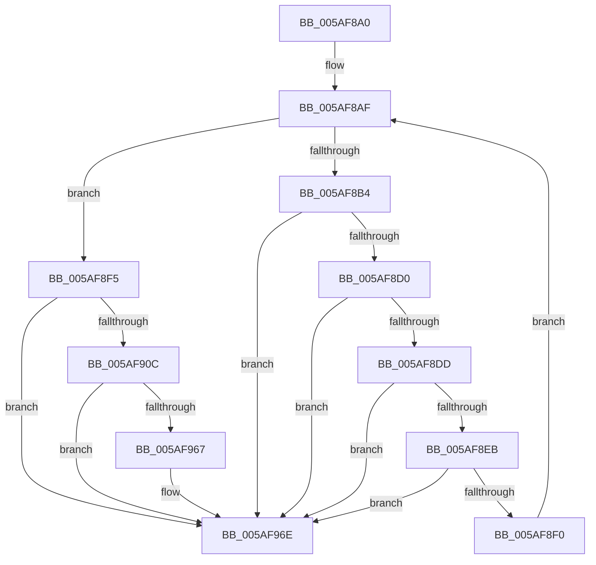

# sub_005AF8A0

- RVA: `0x005AF8A0`–`0x005AF973` (길이 `211` bytes)
- VA: `0x00000001405AF8A0`
- 실행 섹션: `.text`
- PDB 이름 있음: `아니요`; PDB Function 태그: `아니요`
- unwind 정보 RVA: `0x000C9794`
- 디코드: `48`개 명령, `211/211` bytes 표시
- 미해석 바이트: `0` (있으면 어셈블리에 `.byte`로 보존)

> 이 문서는 커널 이미지의 기계어와 PDB 기호를 분석해 생성했습니다. 4번과 5번은 함수 원형과 자료형을 바이너리 사용 방식에서 추정한 C 해석이며 원본 소스 복구 결과는 아닙니다.

## 1. Dependencies

- 직접 호출 지점: **1**; 고유 호출 대상: **1**
- 직접 호출자로 확인된 함수: **0**
- RIP 상대 이미지 참조: **5**

### Outgoing calls
- `0x005AF953` → [RtlCaptureStackBackTrace](../2F/RtlCaptureStackBackTrace_function_002F9FF0.md) (function, `0x002F9FF0`)

### Direct callers
- 이 함수 시작 RVA로 연결되는 직접 call은 확인되지 않았습니다. 간접 호출은 완전히 역산할 수 없습니다.

### Static image references
- `0x005AF8A8` → RVA `0x00F59CE0` (`.data`; read)
- `0x005AF8FA` → RVA `0x00F59CE0` (`.data`; read/write)
- `0x005AF91A` → RVA `0x00F59CF0` (`.data`; read)
- `0x005AF958` → RVA `0x00F59CE4` (`.data`; read/write)
- `0x005AF967` → RVA `0x00F59CEC` (`.data`; write)

## 2. Other-region calls and transfers

- 다른 실행 섹션으로 향하는 call: **0**
- 별도 외부 분기/꼬리 이동을 확인하지 못했습니다.

## 3. Assembly (complete function range)

```asm
005AF8A0  48 89 5C 24 30                  mov qword ptr [rsp + 0x30], rbx
005AF8A5  45 33 C0                        xor r8d, r8d
005AF8A8  48 8D 1D 31 A4 9A 00            lea rbx, [rip + 0x9aa431]
005AF8AF  45 3B C1                        cmp r8d, r9d
005AF8B2  73 41                           jae 0x1405af8f5
005AF8B4  4C 8B 57 20                     mov r10, qword ptr [rdi + 0x20]
005AF8B8  41 8B C0                        mov eax, r8d
005AF8BB  48 69 D0 B8 00 00 00            imul rdx, rax, 0xb8
005AF8C2  48 8B 4C 1A 28                  mov rcx, qword ptr [rdx + rbx + 0x28]
005AF8C7  49 3B CA                        cmp rcx, r10
005AF8CA  0F 84 9E 00 00 00               je 0x1405af96e
005AF8D0  49 8B 43 20                     mov rax, qword ptr [r11 + 0x20]
005AF8D4  48 3B C8                        cmp rcx, rax
005AF8D7  0F 84 91 00 00 00               je 0x1405af96e
005AF8DD  48 8B 4C 1A 48                  mov rcx, qword ptr [rdx + rbx + 0x48]
005AF8E2  49 3B CA                        cmp rcx, r10
005AF8E5  0F 84 83 00 00 00               je 0x1405af96e
005AF8EB  48 3B C8                        cmp rcx, rax
005AF8EE  74 7E                           je 0x1405af96e
005AF8F0  41 FF C0                        inc r8d
005AF8F3  EB BA                           jmp 0x1405af8af
005AF8F5  BB 01 00 00 00                  mov ebx, 1
005AF8FA  F0 0F C1 1D DE A3 9A 00         lock xadd dword ptr [rip + 0x9aa3de], ebx
005AF902  FF C3                           inc ebx
005AF904  81 FB 00 01 00 00               cmp ebx, 0x100
005AF90A  77 62                           ja 0x1405af96e
005AF90C  0F 10 47 08                     movups xmm0, xmmword ptr [rdi + 8]
005AF910  8D 4B FF                        lea ecx, [rbx - 1]
005AF913  45 33 C9                        xor r9d, r9d
005AF916  0F 10 4F 18                     movups xmm1, xmmword ptr [rdi + 0x18]
005AF91A  48 8D 05 CF A3 9A 00            lea rax, [rip + 0x9aa3cf]
005AF921  4C 69 C1 B8 00 00 00            imul r8, rcx, 0xb8
005AF928  41 8D 51 0F                     lea edx, [r9 + 0xf]
005AF92C  4C 03 C0                        add r8, rax
005AF92F  8D 4A F4                        lea ecx, [rdx - 0xc]
005AF932  41 0F 11 00                     movups xmmword ptr [r8], xmm0
005AF936  41 0F 11 48 10                  movups xmmword ptr [r8 + 0x10], xmm1
005AF93B  41 0F 10 43 08                  movups xmm0, xmmword ptr [r11 + 8]
005AF940  41 0F 11 40 20                  movups xmmword ptr [r8 + 0x20], xmm0
005AF945  41 0F 10 4B 18                  movups xmm1, xmmword ptr [r11 + 0x18]
005AF94A  41 0F 11 48 30                  movups xmmword ptr [r8 + 0x30], xmm1
005AF94F  49 83 C0 40                     add r8, 0x40
005AF953  E8 98 A6 D4 FF                  call 0x1402f9ff0
005AF958  F0 FF 05 85 A3 9A 00            lock inc dword ptr [rip + 0x9aa385]
005AF95F  81 FB 00 01 00 00               cmp ebx, 0x100
005AF965  75 07                           jne 0x1405af96e
005AF967  C6 05 7E A3 9A 00 01            mov byte ptr [rip + 0x9aa37e], 1
005AF96E  48 8B 5C 24 30                  mov rbx, qword ptr [rsp + 0x30]
```

## 4. C-style interpretation (structured pseudocode)

```c
__int64 __fastcall sub_005AF8A0(__int64 a1, __int64 a2, int a3, int a4, __int64 a5, __int64 a6)
{
    __int64 result;
    __int64 v_rbx;
    unsigned __int64 v_stack_p30;

    v_stack_p30 = v_rbx;
    a3 = 0;
loc_005AF8AF:
    if (0 >= a4) goto loc_005AF8F5;
    a2 = (a2) * (0);
    if ((*(unsigned __int64 *)(a2 + v_rip + 10134577 * 1 + 40)) == (*(unsigned __int64 *)(v_rdi + 32))) goto loc_005AF96E;
    if ((*(unsigned __int64 *)(a2 + v_rip + 10134577 * 1 + 40)) == (*(unsigned __int64 *)(v_r11 + 32))) goto loc_005AF96E;
    if ((*(unsigned __int64 *)(a2 + v_rip + 10134577 * 1 + 72)) == (*(unsigned __int64 *)(v_rdi + 32))) goto loc_005AF96E;
    if ((*(unsigned __int64 *)(a2 + v_rip + 10134577 * 1 + 72)) == (*(unsigned __int64 *)(v_r11 + 32))) goto loc_005AF96E;
    a3 = (unsigned int)((a3) + 1);
    goto loc_005AF8AF;
loc_005AF8F5:
    v_rbx = (unsigned int)((1) + 1);
    if (((unsigned int)(v_rbx)) > 256) goto loc_005AF96E;
    a4 = 0;
    a3 = (a3) * (v_rbx - 1);
    a3 = (a3) + (v_rip + 10134479);
    *(unsigned __int64 *)(a3) = v_xmm0;
    *(unsigned __int64 *)(a3 + 16) = v_xmm1;
    *(unsigned __int64 *)(a3 + 32) = v_xmm0;
    *(unsigned __int64 *)(a3 + 48) = v_xmm1;
    a3 = (a3) + (64);
    result = RtlCaptureStackBackTrace(a4 + 15 - 12, a4 + 15, a3, a4);
    if (((unsigned int)(v_rbx)) == 256) {
        *(unsigned __int8 *)(v_rip + 10134398) = 1;
    }
    return result;
}
```

## 5. (Beta) C Style

```c
int64_t sub_005AF8A0(int64_t Arg1, void *Arg2, int32_t Arg3, int32_t Arg4, uint64_t Arg5, int64_t Arg6)
{
    uint8_t *arg2 = (uint8_t *)Arg2;

    int64_t result;
    int64_t local_rbx;
    uint64_t v_stack_p30;

    v_stack_p30 = local_rbx;
    Arg3 = 0;
loc_005AF8AF:
    if (0 >= Arg4) goto loc_005AF8F5;
    Arg2 = (Arg2) * (0);
    if ((*(uint64_t *)(arg2 + v_rip + 0x9AA431 * 1 + 0x28)) == (*(uint64_t *)(local_rdi + 0x20))) goto loc_005AF96E;
    if ((*(uint64_t *)(arg2 + v_rip + 0x9AA431 * 1 + 0x28)) == (*(uint64_t *)(local_r11 + 0x20))) goto loc_005AF96E;
    if ((*(uint64_t *)(arg2 + v_rip + 0x9AA431 * 1 + 0x48)) == (*(uint64_t *)(local_rdi + 0x20))) goto loc_005AF96E;
    if ((*(uint64_t *)(arg2 + v_rip + 0x9AA431 * 1 + 0x48)) == (*(uint64_t *)(local_r11 + 0x20))) goto loc_005AF96E;
    Arg3 = (uint32_t)((Arg3) + 1);
    goto loc_005AF8AF;
loc_005AF8F5:
    local_rbx = (uint32_t)((1) + 1);
    if (((uint32_t)(local_rbx)) > 256) goto loc_005AF96E;
    Arg4 = 0;
    Arg3 = (Arg3) * (local_rbx - 1);
    Arg3 = (Arg3) + (v_rip + 10134479);
    *(uint64_t *)(Arg3) = v_xmm0;
    *(uint64_t *)(Arg3 + 0x10) = v_xmm1;
    *(uint64_t *)(Arg3 + 0x20) = v_xmm0;
    *(uint64_t *)(Arg3 + 0x30) = v_xmm1;
    Arg3 = (Arg3) + (64);
    result = RtlCaptureStackBackTrace(Arg4 + 15 - 12, Arg4 + 15, Arg3, Arg4);
    if (((uint32_t)(local_rbx)) == 256) {
        *(uint8_t *)(v_rip + 0x9AA37E) = 1;
    }
    return result;
}
```

### 관측된 메모리 오프셋

구조체 형식이 확인되지 않은 접근은 인자 기준의 오프셋으로만 기록했습니다.

| 기준 인자 | 오프셋 표현 | 폭 (bit) | 접근 |
|---|---:|---:|---|
| `Arg2` | `+ 0x28 + rbx*1` | `64` | `R` |
| `Arg2` | `+ 0x48 + rbx*1` | `64` | `R` |

## 6. Execution-region graph

[열기: 2D/3D 그래프와 함수 탐색 컨트롤 패널](../../../control-panel.html?section=text&rva=0x005AF8A0&view=graph)

- 2D 그래프는 위에서 아래로 흐르고, 3D 그래프는 빈 공간을 드래그해 회전합니다. Shift+드래그는 이동, 휠은 확대·축소, 함수 노드 선택은 대상 보고서 이동입니다.

### Static fallback


