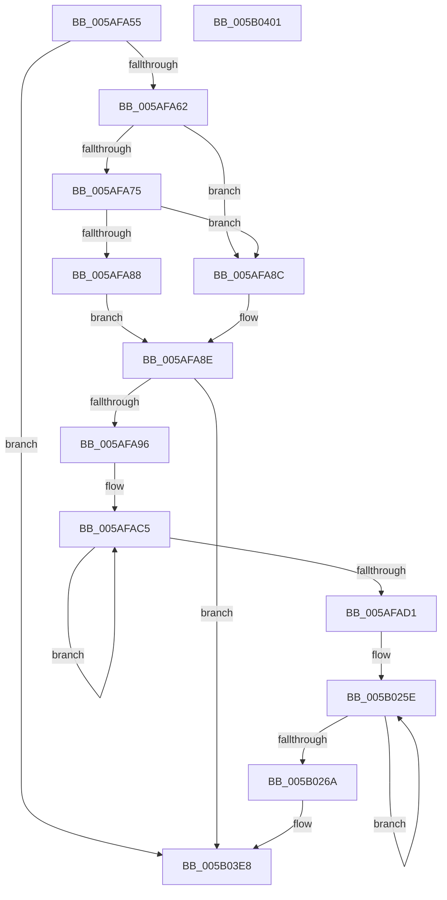

# sub_005AFA55

- RVA: `0x005AFA55`–`0x005B0402` (길이 `2,477` bytes)
- VA: `0x00000001405AFA55`
- 실행 섹션: `.text`
- PDB 이름 있음: `아니요`; PDB Function 태그: `아니요`
- unwind 정보 RVA: `0x000C9778`
- 디코드: `405`개 명령, `2,477/2,477` bytes 표시
- 미해석 바이트: `0` (있으면 어셈블리에 `.byte`로 보존)

> 이 문서는 커널 이미지의 기계어와 PDB 기호를 분석해 생성했습니다. 4번과 5번은 함수 원형과 자료형을 바이너리 사용 방식에서 추정한 C 해석이며 원본 소스 복구 결과는 아닙니다.

## 1. Dependencies

- 직접 호출 지점: **17**; 고유 호출 대상: **3**
- 직접 호출자로 확인된 함수: **0**
- RIP 상대 이미지 참조: **9**

### Outgoing calls
- `0x005AFB61` → [tlgCreate1Sz_wchar_t](../42/tlgCreate1Sz_wchar_t_function_00426198.md) (function, `0x00426198`)
- `0x005AFBD7` → [tlgCreate1Sz_wchar_t](../42/tlgCreate1Sz_wchar_t_function_00426198.md) (function, `0x00426198`)
- `0x005AFC4D` → [tlgCreate1Sz_wchar_t](../42/tlgCreate1Sz_wchar_t_function_00426198.md) (function, `0x00426198`)
- `0x005AFCC3` → [tlgCreate1Sz_wchar_t](../42/tlgCreate1Sz_wchar_t_function_00426198.md) (function, `0x00426198`)
- `0x005AFD39` → [tlgCreate1Sz_wchar_t](../42/tlgCreate1Sz_wchar_t_function_00426198.md) (function, `0x00426198`)
- `0x005AFDA9` → [tlgCreate1Sz_wchar_t](../42/tlgCreate1Sz_wchar_t_function_00426198.md) (function, `0x00426198`)
- `0x005AFE19` → [tlgCreate1Sz_wchar_t](../42/tlgCreate1Sz_wchar_t_function_00426198.md) (function, `0x00426198`)
- `0x005AFE89` → [tlgCreate1Sz_wchar_t](../42/tlgCreate1Sz_wchar_t_function_00426198.md) (function, `0x00426198`)
- `0x005AFEF9` → [tlgCreate1Sz_wchar_t](../42/tlgCreate1Sz_wchar_t_function_00426198.md) (function, `0x00426198`)
- `0x005AFF69` → [tlgCreate1Sz_wchar_t](../42/tlgCreate1Sz_wchar_t_function_00426198.md) (function, `0x00426198`)
- `0x005AFFD9` → [tlgCreate1Sz_wchar_t](../42/tlgCreate1Sz_wchar_t_function_00426198.md) (function, `0x00426198`)
- `0x005B0049` → [tlgCreate1Sz_wchar_t](../42/tlgCreate1Sz_wchar_t_function_00426198.md) (function, `0x00426198`)
- `0x005B00B9` → [tlgCreate1Sz_wchar_t](../42/tlgCreate1Sz_wchar_t_function_00426198.md) (function, `0x00426198`)
- `0x005B0129` → [tlgCreate1Sz_wchar_t](../42/tlgCreate1Sz_wchar_t_function_00426198.md) (function, `0x00426198`)
- `0x005B0199` → [tlgCreate1Sz_wchar_t](../42/tlgCreate1Sz_wchar_t_function_00426198.md) (function, `0x00426198`)
- `0x005B03E3` → [EtwWriteEx](../25/EtwWriteEx_function_0025F0D0.md) (function, `0x0025F0D0`)
- `0x005B03F2` → [_security_check_cookie](../6A/_security_check_cookie_function_006AC640.md) (function, `0x006AC640`)

### Direct callers
- 이 함수 시작 RVA로 연결되는 직접 call은 확인되지 않았습니다. 간접 호출은 완전히 역산할 수 없습니다.

### Static image references
- `0x005AFA55` → RVA `0x00E07058` (`.data`; read)
- `0x005AFA6C` → RVA `0x00E07068` (`.data`; read)
- `0x005AFA75` → RVA `0x00E07070` (`.data`; read)
- `0x005B02A8` → RVA `0x00043590` (`.rdata`; read)
- `0x005B0315` → RVA `0x00047A53` (`.rdata`; read)
- `0x005B031F` → RVA `0x00E07060` (`.data`; read)
- `0x005B0383` → RVA `0x00047A5D` (`.rdata`; read)
- `0x005B0391` → RVA `0x0005BCFD` (`.rdata`; read)
- `0x005B03BE` → RVA `0x00E07078` (`.data`; read)

## 2. Other-region calls and transfers

- 다른 실행 섹션으로 향하는 call: **0**
- 별도 외부 분기/꼬리 이동을 확인하지 못했습니다.

## 3. Assembly (complete function range)

```asm
005AFA55  83 3D FC 75 85 00 05            cmp dword ptr [rip + 0x8575fc], 5
005AFA5C  0F 86 86 09 00 00               jbe 0x1405b03e8
005AFA62  49 BB 00 00 00 00 00 40 00 00   movabs r11, 0x400000000000
005AFA6C  4C 85 1D F5 75 85 00            test qword ptr [rip + 0x8575f5], r11
005AFA73  74 17                           je 0x1405afa8c
005AFA75  48 8B 05 F4 75 85 00            mov rax, qword ptr [rip + 0x8575f4]
005AFA7C  49 23 C3                        and rax, r11
005AFA7F  48 3B 05 EA 75 85 00            cmp rax, qword ptr [rip + 0x8575ea]
005AFA86  75 04                           jne 0x1405afa8c
005AFA88  B0 01                           mov al, 1
005AFA8A  EB 02                           jmp 0x1405afa8e
005AFA8C  32 C0                           xor al, al
005AFA8E  84 C0                           test al, al
005AFA90  0F 84 52 09 00 00               je 0x1405b03e8
005AFA96  48 8D 45 18                     lea rax, [rbp + 0x18]
005AFA9A  48 C7 45 18 00 00 00 02         mov qword ptr [rbp + 0x18], 0x2000000
005AFAA2  49 C7 C1 FF FF FF FF            mov r9, 0xffffffffffffffff
005AFAA9  48 89 85 80 01 00 00            mov qword ptr [rbp + 0x180], rax
005AFAB0  49 8B C1                        mov rax, r9
005AFAB3  48 C7 85 88 01 00 00 08 00 00 00  mov qword ptr [rbp + 0x188], 8
005AFABE  45 33 D2                        xor r10d, r10d
005AFAC1  48 8D 4D 40                     lea rcx, [rbp + 0x40]
005AFAC5  66 44 39 54 41 02               cmp word ptr [rcx + rax*2 + 2], r10w
005AFACB  48 8D 40 01                     lea rax, [rax + 1]
005AFACF  75 F4                           jne 0x1405afac5
005AFAD1  8D 04 45 02 00 00 00            lea eax, [rax*2 + 2]
005AFAD8  44 89 95 9C 01 00 00            mov dword ptr [rbp + 0x19c], r10d
005AFADF  89 85 98 01 00 00               mov dword ptr [rbp + 0x198], eax
005AFAE5  48 8D 4D 40                     lea rcx, [rbp + 0x40]
005AFAE9  8B 85 C0 00 00 00               mov eax, dword ptr [rbp + 0xc0]
005AFAEF  48 8D 95 30 06 00 00            lea rdx, [rbp + 0x630]
005AFAF6  89 44 24 44                     mov dword ptr [rsp + 0x44], eax
005AFAFA  48 8D 44 24 44                  lea rax, [rsp + 0x44]
005AFAFF  48 89 85 A0 01 00 00            mov qword ptr [rbp + 0x1a0], rax
005AFB06  8B 85 C4 00 00 00               mov eax, dword ptr [rbp + 0xc4]
005AFB0C  89 44 24 48                     mov dword ptr [rsp + 0x48], eax
005AFB10  48 8D 44 24 48                  lea rax, [rsp + 0x48]
005AFB15  48 89 85 B0 01 00 00            mov qword ptr [rbp + 0x1b0], rax
005AFB1C  8B 85 C8 00 00 00               mov eax, dword ptr [rbp + 0xc8]
005AFB22  89 44 24 4C                     mov dword ptr [rsp + 0x4c], eax
005AFB26  48 8D 44 24 4C                  lea rax, [rsp + 0x4c]
005AFB2B  48 89 8D 90 01 00 00            mov qword ptr [rbp + 0x190], rcx
005AFB32  48 8D 8D D0 01 00 00            lea rcx, [rbp + 0x1d0]
005AFB39  48 89 85 C0 01 00 00            mov qword ptr [rbp + 0x1c0], rax
005AFB40  48 C7 85 A8 01 00 00 04 00 00 00  mov qword ptr [rbp + 0x1a8], 4
005AFB4B  48 C7 85 B8 01 00 00 04 00 00 00  mov qword ptr [rbp + 0x1b8], 4
005AFB56  48 C7 85 C8 01 00 00 04 00 00 00  mov qword ptr [rbp + 0x1c8], 4
005AFB61  E8 32 66 E7 FF                  call 0x140426198
005AFB66  8B 8D B0 06 00 00               mov ecx, dword ptr [rbp + 0x6b0]
005AFB6C  48 8D 44 24 50                  lea rax, [rsp + 0x50]
005AFB71  48 89 85 E0 01 00 00            mov qword ptr [rbp + 0x1e0], rax
005AFB78  48 8D 95 BC 06 00 00            lea rdx, [rbp + 0x6bc]
005AFB7F  8B 85 B4 06 00 00               mov eax, dword ptr [rbp + 0x6b4]
005AFB85  89 44 24 54                     mov dword ptr [rsp + 0x54], eax
005AFB89  48 8D 44 24 54                  lea rax, [rsp + 0x54]
005AFB8E  48 89 85 F0 01 00 00            mov qword ptr [rbp + 0x1f0], rax
005AFB95  8B 85 B8 06 00 00               mov eax, dword ptr [rbp + 0x6b8]
005AFB9B  89 44 24 58                     mov dword ptr [rsp + 0x58], eax
005AFB9F  48 8D 44 24 58                  lea rax, [rsp + 0x58]
005AFBA4  89 4C 24 50                     mov dword ptr [rsp + 0x50], ecx
005AFBA8  48 8D 8D 10 02 00 00            lea rcx, [rbp + 0x210]
005AFBAF  48 89 85 00 02 00 00            mov qword ptr [rbp + 0x200], rax
005AFBB6  48 C7 85 E8 01 00 00 04 00 00 00  mov qword ptr [rbp + 0x1e8], 4
005AFBC1  48 C7 85 F8 01 00 00 04 00 00 00  mov qword ptr [rbp + 0x1f8], 4
005AFBCC  48 C7 85 08 02 00 00 04 00 00 00  mov qword ptr [rbp + 0x208], 4
005AFBD7  E8 BC 65 E7 FF                  call 0x140426198
005AFBDC  8B 8D 3C 07 00 00               mov ecx, dword ptr [rbp + 0x73c]
005AFBE2  48 8D 44 24 5C                  lea rax, [rsp + 0x5c]
005AFBE7  48 89 85 20 02 00 00            mov qword ptr [rbp + 0x220], rax
005AFBEE  48 8D 95 48 07 00 00            lea rdx, [rbp + 0x748]
005AFBF5  8B 85 40 07 00 00               mov eax, dword ptr [rbp + 0x740]
005AFBFB  89 44 24 60                     mov dword ptr [rsp + 0x60], eax
005AFBFF  48 8D 44 24 60                  lea rax, [rsp + 0x60]
005AFC04  48 89 85 30 02 00 00            mov qword ptr [rbp + 0x230], rax
005AFC0B  8B 85 44 07 00 00               mov eax, dword ptr [rbp + 0x744]
005AFC11  89 44 24 64                     mov dword ptr [rsp + 0x64], eax
005AFC15  48 8D 44 24 64                  lea rax, [rsp + 0x64]
005AFC1A  89 4C 24 5C                     mov dword ptr [rsp + 0x5c], ecx
005AFC1E  48 8D 8D 50 02 00 00            lea rcx, [rbp + 0x250]
005AFC25  48 89 85 40 02 00 00            mov qword ptr [rbp + 0x240], rax
005AFC2C  48 C7 85 28 02 00 00 04 00 00 00  mov qword ptr [rbp + 0x228], 4
005AFC37  48 C7 85 38 02 00 00 04 00 00 00  mov qword ptr [rbp + 0x238], 4
005AFC42  48 C7 85 48 02 00 00 04 00 00 00  mov qword ptr [rbp + 0x248], 4
005AFC4D  E8 46 65 E7 FF                  call 0x140426198
005AFC52  8B 8D C8 07 00 00               mov ecx, dword ptr [rbp + 0x7c8]
005AFC58  48 8D 44 24 68                  lea rax, [rsp + 0x68]
005AFC5D  48 89 85 60 02 00 00            mov qword ptr [rbp + 0x260], rax
005AFC64  48 8D 95 D4 07 00 00            lea rdx, [rbp + 0x7d4]
005AFC6B  8B 85 CC 07 00 00               mov eax, dword ptr [rbp + 0x7cc]
005AFC71  89 44 24 6C                     mov dword ptr [rsp + 0x6c], eax
005AFC75  48 8D 44 24 6C                  lea rax, [rsp + 0x6c]
005AFC7A  48 89 85 70 02 00 00            mov qword ptr [rbp + 0x270], rax
005AFC81  8B 85 D0 07 00 00               mov eax, dword ptr [rbp + 0x7d0]
005AFC87  89 44 24 70                     mov dword ptr [rsp + 0x70], eax
005AFC8B  48 8D 44 24 70                  lea rax, [rsp + 0x70]
005AFC90  89 4C 24 68                     mov dword ptr [rsp + 0x68], ecx
005AFC94  48 8D 8D 90 02 00 00            lea rcx, [rbp + 0x290]
005AFC9B  48 89 85 80 02 00 00            mov qword ptr [rbp + 0x280], rax
005AFCA2  48 C7 85 68 02 00 00 04 00 00 00  mov qword ptr [rbp + 0x268], 4
005AFCAD  48 C7 85 78 02 00 00 04 00 00 00  mov qword ptr [rbp + 0x278], 4
005AFCB8  48 C7 85 88 02 00 00 04 00 00 00  mov qword ptr [rbp + 0x288], 4
005AFCC3  E8 D0 64 E7 FF                  call 0x140426198
005AFCC8  8B 8D 54 08 00 00               mov ecx, dword ptr [rbp + 0x854]
005AFCCE  48 8D 44 24 74                  lea rax, [rsp + 0x74]
005AFCD3  48 89 85 A0 02 00 00            mov qword ptr [rbp + 0x2a0], rax
005AFCDA  89 4C 24 74                     mov dword ptr [rsp + 0x74], ecx
005AFCDE  8B 85 58 08 00 00               mov eax, dword ptr [rbp + 0x858]
005AFCE4  48 8D 95 60 08 00 00            lea rdx, [rbp + 0x860]
005AFCEB  89 44 24 78                     mov dword ptr [rsp + 0x78], eax
005AFCEF  48 8D 8D D0 02 00 00            lea rcx, [rbp + 0x2d0]
005AFCF6  48 8D 44 24 78                  lea rax, [rsp + 0x78]
005AFCFB  48 C7 85 A8 02 00 00 04 00 00 00  mov qword ptr [rbp + 0x2a8], 4
005AFD06  48 89 85 B0 02 00 00            mov qword ptr [rbp + 0x2b0], rax
005AFD0D  8B 85 5C 08 00 00               mov eax, dword ptr [rbp + 0x85c]
005AFD13  89 44 24 7C                     mov dword ptr [rsp + 0x7c], eax
005AFD17  48 8D 44 24 7C                  lea rax, [rsp + 0x7c]
005AFD1C  48 89 85 C0 02 00 00            mov qword ptr [rbp + 0x2c0], rax
005AFD23  48 C7 85 B8 02 00 00 04 00 00 00  mov qword ptr [rbp + 0x2b8], 4
005AFD2E  48 C7 85 C8 02 00 00 04 00 00 00  mov qword ptr [rbp + 0x2c8], 4
005AFD39  E8 5A 64 E7 FF                  call 0x140426198
005AFD3E  8B 8D E0 08 00 00               mov ecx, dword ptr [rbp + 0x8e0]
005AFD44  48 8D 45 80                     lea rax, [rbp - 0x80]
005AFD48  48 89 85 E0 02 00 00            mov qword ptr [rbp + 0x2e0], rax
005AFD4F  48 8D 95 EC 08 00 00            lea rdx, [rbp + 0x8ec]
005AFD56  8B 85 E4 08 00 00               mov eax, dword ptr [rbp + 0x8e4]
005AFD5C  89 45 84                        mov dword ptr [rbp - 0x7c], eax
005AFD5F  48 8D 45 84                     lea rax, [rbp - 0x7c]
005AFD63  48 89 85 F0 02 00 00            mov qword ptr [rbp + 0x2f0], rax
005AFD6A  8B 85 E8 08 00 00               mov eax, dword ptr [rbp + 0x8e8]
005AFD70  89 45 88                        mov dword ptr [rbp - 0x78], eax
005AFD73  48 8D 45 88                     lea rax, [rbp - 0x78]
005AFD77  89 4D 80                        mov dword ptr [rbp - 0x80], ecx
005AFD7A  48 8D 8D 10 03 00 00            lea rcx, [rbp + 0x310]
005AFD81  48 89 85 00 03 00 00            mov qword ptr [rbp + 0x300], rax
005AFD88  48 C7 85 E8 02 00 00 04 00 00 00  mov qword ptr [rbp + 0x2e8], 4
005AFD93  48 C7 85 F8 02 00 00 04 00 00 00  mov qword ptr [rbp + 0x2f8], 4
005AFD9E  48 C7 85 08 03 00 00 04 00 00 00  mov qword ptr [rbp + 0x308], 4
005AFDA9  E8 EA 63 E7 FF                  call 0x140426198
005AFDAE  8B 8D 6C 09 00 00               mov ecx, dword ptr [rbp + 0x96c]
005AFDB4  48 8D 45 8C                     lea rax, [rbp - 0x74]
005AFDB8  48 89 85 20 03 00 00            mov qword ptr [rbp + 0x320], rax
005AFDBF  48 8D 95 78 09 00 00            lea rdx, [rbp + 0x978]
005AFDC6  8B 85 70 09 00 00               mov eax, dword ptr [rbp + 0x970]
005AFDCC  89 45 90                        mov dword ptr [rbp - 0x70], eax
005AFDCF  48 8D 45 90                     lea rax, [rbp - 0x70]
005AFDD3  48 89 85 30 03 00 00            mov qword ptr [rbp + 0x330], rax
005AFDDA  8B 85 74 09 00 00               mov eax, dword ptr [rbp + 0x974]
005AFDE0  89 45 94                        mov dword ptr [rbp - 0x6c], eax
005AFDE3  48 8D 45 94                     lea rax, [rbp - 0x6c]
005AFDE7  89 4D 8C                        mov dword ptr [rbp - 0x74], ecx
005AFDEA  48 8D 8D 50 03 00 00            lea rcx, [rbp + 0x350]
005AFDF1  48 89 85 40 03 00 00            mov qword ptr [rbp + 0x340], rax
005AFDF8  48 C7 85 28 03 00 00 04 00 00 00  mov qword ptr [rbp + 0x328], 4
005AFE03  48 C7 85 38 03 00 00 04 00 00 00  mov qword ptr [rbp + 0x338], 4
005AFE0E  48 C7 85 48 03 00 00 04 00 00 00  mov qword ptr [rbp + 0x348], 4
005AFE19  E8 7A 63 E7 FF                  call 0x140426198
005AFE1E  8B 8D F8 09 00 00               mov ecx, dword ptr [rbp + 0x9f8]
005AFE24  48 8D 45 98                     lea rax, [rbp - 0x68]
005AFE28  48 89 85 60 03 00 00            mov qword ptr [rbp + 0x360], rax
005AFE2F  48 8D 95 04 0A 00 00            lea rdx, [rbp + 0xa04]
005AFE36  8B 85 FC 09 00 00               mov eax, dword ptr [rbp + 0x9fc]
005AFE3C  89 45 9C                        mov dword ptr [rbp - 0x64], eax
005AFE3F  48 8D 45 9C                     lea rax, [rbp - 0x64]
005AFE43  48 89 85 70 03 00 00            mov qword ptr [rbp + 0x370], rax
005AFE4A  8B 85 00 0A 00 00               mov eax, dword ptr [rbp + 0xa00]
005AFE50  89 45 A0                        mov dword ptr [rbp - 0x60], eax
005AFE53  48 8D 45 A0                     lea rax, [rbp - 0x60]
005AFE57  89 4D 98                        mov dword ptr [rbp - 0x68], ecx
005AFE5A  48 8D 8D 90 03 00 00            lea rcx, [rbp + 0x390]
005AFE61  48 89 85 80 03 00 00            mov qword ptr [rbp + 0x380], rax
005AFE68  48 C7 85 68 03 00 00 04 00 00 00  mov qword ptr [rbp + 0x368], 4
005AFE73  48 C7 85 78 03 00 00 04 00 00 00  mov qword ptr [rbp + 0x378], 4
005AFE7E  48 C7 85 88 03 00 00 04 00 00 00  mov qword ptr [rbp + 0x388], 4
005AFE89  E8 0A 63 E7 FF                  call 0x140426198
005AFE8E  8B 8D 84 0A 00 00               mov ecx, dword ptr [rbp + 0xa84]
005AFE94  48 8D 45 A4                     lea rax, [rbp - 0x5c]
005AFE98  48 89 85 A0 03 00 00            mov qword ptr [rbp + 0x3a0], rax
005AFE9F  8B 85 88 0A 00 00               mov eax, dword ptr [rbp + 0xa88]
005AFEA5  89 45 A8                        mov dword ptr [rbp - 0x58], eax
005AFEA8  48 8D 45 A8                     lea rax, [rbp - 0x58]
005AFEAC  48 89 85 B0 03 00 00            mov qword ptr [rbp + 0x3b0], rax
005AFEB3  8B 85 8C 0A 00 00               mov eax, dword ptr [rbp + 0xa8c]
005AFEB9  89 45 AC                        mov dword ptr [rbp - 0x54], eax
005AFEBC  48 8D 45 AC                     lea rax, [rbp - 0x54]
005AFEC0  89 4D A4                        mov dword ptr [rbp - 0x5c], ecx
005AFEC3  48 C7 85 A8 03 00 00 04 00 00 00  mov qword ptr [rbp + 0x3a8], 4
005AFECE  48 C7 85 B8 03 00 00 04 00 00 00  mov qword ptr [rbp + 0x3b8], 4
005AFED9  48 8D 95 90 0A 00 00            lea rdx, [rbp + 0xa90]
005AFEE0  48 89 85 C0 03 00 00            mov qword ptr [rbp + 0x3c0], rax
005AFEE7  48 8D 8D D0 03 00 00            lea rcx, [rbp + 0x3d0]
005AFEEE  48 C7 85 C8 03 00 00 04 00 00 00  mov qword ptr [rbp + 0x3c8], 4
005AFEF9  E8 9A 62 E7 FF                  call 0x140426198
005AFEFE  8B 8D 10 0B 00 00               mov ecx, dword ptr [rbp + 0xb10]
005AFF04  48 8D 45 B0                     lea rax, [rbp - 0x50]
005AFF08  48 89 85 E0 03 00 00            mov qword ptr [rbp + 0x3e0], rax
005AFF0F  48 8D 95 1C 0B 00 00            lea rdx, [rbp + 0xb1c]
005AFF16  8B 85 14 0B 00 00               mov eax, dword ptr [rbp + 0xb14]
005AFF1C  89 45 B4                        mov dword ptr [rbp - 0x4c], eax
005AFF1F  48 8D 45 B4                     lea rax, [rbp - 0x4c]
005AFF23  48 89 85 F0 03 00 00            mov qword ptr [rbp + 0x3f0], rax
005AFF2A  8B 85 18 0B 00 00               mov eax, dword ptr [rbp + 0xb18]
005AFF30  89 45 B8                        mov dword ptr [rbp - 0x48], eax
005AFF33  48 8D 45 B8                     lea rax, [rbp - 0x48]
005AFF37  89 4D B0                        mov dword ptr [rbp - 0x50], ecx
005AFF3A  48 8D 8D 10 04 00 00            lea rcx, [rbp + 0x410]
005AFF41  48 89 85 00 04 00 00            mov qword ptr [rbp + 0x400], rax
005AFF48  48 C7 85 E8 03 00 00 04 00 00 00  mov qword ptr [rbp + 0x3e8], 4
005AFF53  48 C7 85 F8 03 00 00 04 00 00 00  mov qword ptr [rbp + 0x3f8], 4
005AFF5E  48 C7 85 08 04 00 00 04 00 00 00  mov qword ptr [rbp + 0x408], 4
005AFF69  E8 2A 62 E7 FF                  call 0x140426198
005AFF6E  8B 8D 9C 0B 00 00               mov ecx, dword ptr [rbp + 0xb9c]
005AFF74  48 8D 45 BC                     lea rax, [rbp - 0x44]
005AFF78  48 89 85 20 04 00 00            mov qword ptr [rbp + 0x420], rax
005AFF7F  48 8D 95 A8 0B 00 00            lea rdx, [rbp + 0xba8]
005AFF86  8B 85 A0 0B 00 00               mov eax, dword ptr [rbp + 0xba0]
005AFF8C  89 45 C0                        mov dword ptr [rbp - 0x40], eax
005AFF8F  48 8D 45 C0                     lea rax, [rbp - 0x40]
005AFF93  48 89 85 30 04 00 00            mov qword ptr [rbp + 0x430], rax
005AFF9A  8B 85 A4 0B 00 00               mov eax, dword ptr [rbp + 0xba4]
005AFFA0  89 45 C4                        mov dword ptr [rbp - 0x3c], eax
005AFFA3  48 8D 45 C4                     lea rax, [rbp - 0x3c]
005AFFA7  89 4D BC                        mov dword ptr [rbp - 0x44], ecx
005AFFAA  48 8D 8D 50 04 00 00            lea rcx, [rbp + 0x450]
005AFFB1  48 89 85 40 04 00 00            mov qword ptr [rbp + 0x440], rax
005AFFB8  48 C7 85 28 04 00 00 04 00 00 00  mov qword ptr [rbp + 0x428], 4
005AFFC3  48 C7 85 38 04 00 00 04 00 00 00  mov qword ptr [rbp + 0x438], 4
005AFFCE  48 C7 85 48 04 00 00 04 00 00 00  mov qword ptr [rbp + 0x448], 4
005AFFD9  E8 BA 61 E7 FF                  call 0x140426198
005AFFDE  8B 8D 28 0C 00 00               mov ecx, dword ptr [rbp + 0xc28]
005AFFE4  48 8D 45 C8                     lea rax, [rbp - 0x38]
005AFFE8  48 89 85 60 04 00 00            mov qword ptr [rbp + 0x460], rax
005AFFEF  48 8D 95 34 0C 00 00            lea rdx, [rbp + 0xc34]
005AFFF6  8B 85 2C 0C 00 00               mov eax, dword ptr [rbp + 0xc2c]
005AFFFC  89 45 CC                        mov dword ptr [rbp - 0x34], eax
005AFFFF  48 8D 45 CC                     lea rax, [rbp - 0x34]
005B0003  48 89 85 70 04 00 00            mov qword ptr [rbp + 0x470], rax
005B000A  8B 85 30 0C 00 00               mov eax, dword ptr [rbp + 0xc30]
005B0010  89 45 D0                        mov dword ptr [rbp - 0x30], eax
005B0013  48 8D 45 D0                     lea rax, [rbp - 0x30]
005B0017  89 4D C8                        mov dword ptr [rbp - 0x38], ecx
005B001A  48 8D 8D 90 04 00 00            lea rcx, [rbp + 0x490]
005B0021  48 89 85 80 04 00 00            mov qword ptr [rbp + 0x480], rax
005B0028  48 C7 85 68 04 00 00 04 00 00 00  mov qword ptr [rbp + 0x468], 4
005B0033  48 C7 85 78 04 00 00 04 00 00 00  mov qword ptr [rbp + 0x478], 4
005B003E  48 C7 85 88 04 00 00 04 00 00 00  mov qword ptr [rbp + 0x488], 4
005B0049  E8 4A 61 E7 FF                  call 0x140426198
005B004E  8B 8D B4 0C 00 00               mov ecx, dword ptr [rbp + 0xcb4]
005B0054  48 8D 45 D4                     lea rax, [rbp - 0x2c]
005B0058  48 89 85 A0 04 00 00            mov qword ptr [rbp + 0x4a0], rax
005B005F  48 8D 95 C0 0C 00 00            lea rdx, [rbp + 0xcc0]
005B0066  8B 85 B8 0C 00 00               mov eax, dword ptr [rbp + 0xcb8]
005B006C  89 45 D8                        mov dword ptr [rbp - 0x28], eax
005B006F  48 8D 45 D8                     lea rax, [rbp - 0x28]
005B0073  48 89 85 B0 04 00 00            mov qword ptr [rbp + 0x4b0], rax
005B007A  8B 85 BC 0C 00 00               mov eax, dword ptr [rbp + 0xcbc]
005B0080  89 45 DC                        mov dword ptr [rbp - 0x24], eax
005B0083  48 8D 45 DC                     lea rax, [rbp - 0x24]
005B0087  89 4D D4                        mov dword ptr [rbp - 0x2c], ecx
005B008A  48 8D 8D D0 04 00 00            lea rcx, [rbp + 0x4d0]
005B0091  48 89 85 C0 04 00 00            mov qword ptr [rbp + 0x4c0], rax
005B0098  48 C7 85 A8 04 00 00 04 00 00 00  mov qword ptr [rbp + 0x4a8], 4
005B00A3  48 C7 85 B8 04 00 00 04 00 00 00  mov qword ptr [rbp + 0x4b8], 4
005B00AE  48 C7 85 C8 04 00 00 04 00 00 00  mov qword ptr [rbp + 0x4c8], 4
005B00B9  E8 DA 60 E7 FF                  call 0x140426198
005B00BE  8B 8D 40 0D 00 00               mov ecx, dword ptr [rbp + 0xd40]
005B00C4  48 8D 45 E0                     lea rax, [rbp - 0x20]
005B00C8  48 89 85 E0 04 00 00            mov qword ptr [rbp + 0x4e0], rax
005B00CF  89 4D E0                        mov dword ptr [rbp - 0x20], ecx
005B00D2  8B 85 44 0D 00 00               mov eax, dword ptr [rbp + 0xd44]
005B00D8  48 8D 95 4C 0D 00 00            lea rdx, [rbp + 0xd4c]
005B00DF  89 45 E4                        mov dword ptr [rbp - 0x1c], eax
005B00E2  48 8D 8D 10 05 00 00            lea rcx, [rbp + 0x510]
005B00E9  48 8D 45 E4                     lea rax, [rbp - 0x1c]
005B00ED  48 C7 85 E8 04 00 00 04 00 00 00  mov qword ptr [rbp + 0x4e8], 4
005B00F8  48 89 85 F0 04 00 00            mov qword ptr [rbp + 0x4f0], rax
005B00FF  8B 85 48 0D 00 00               mov eax, dword ptr [rbp + 0xd48]
005B0105  89 45 E8                        mov dword ptr [rbp - 0x18], eax
005B0108  48 8D 45 E8                     lea rax, [rbp - 0x18]
005B010C  48 89 85 00 05 00 00            mov qword ptr [rbp + 0x500], rax
005B0113  48 C7 85 F8 04 00 00 04 00 00 00  mov qword ptr [rbp + 0x4f8], 4
005B011E  48 C7 85 08 05 00 00 04 00 00 00  mov qword ptr [rbp + 0x508], 4
005B0129  E8 6A 60 E7 FF                  call 0x140426198
005B012E  8B 8D CC 0D 00 00               mov ecx, dword ptr [rbp + 0xdcc]
005B0134  48 8D 45 EC                     lea rax, [rbp - 0x14]
005B0138  48 89 85 20 05 00 00            mov qword ptr [rbp + 0x520], rax
005B013F  48 8D 95 D8 0D 00 00            lea rdx, [rbp + 0xdd8]
005B0146  8B 85 D0 0D 00 00               mov eax, dword ptr [rbp + 0xdd0]
005B014C  89 45 F0                        mov dword ptr [rbp - 0x10], eax
005B014F  48 8D 45 F0                     lea rax, [rbp - 0x10]
005B0153  48 89 85 30 05 00 00            mov qword ptr [rbp + 0x530], rax
005B015A  8B 85 D4 0D 00 00               mov eax, dword ptr [rbp + 0xdd4]
005B0160  89 45 F4                        mov dword ptr [rbp - 0xc], eax
005B0163  48 8D 45 F4                     lea rax, [rbp - 0xc]
005B0167  89 4D EC                        mov dword ptr [rbp - 0x14], ecx
005B016A  48 8D 8D 50 05 00 00            lea rcx, [rbp + 0x550]
005B0171  48 89 85 40 05 00 00            mov qword ptr [rbp + 0x540], rax
005B0178  48 C7 85 28 05 00 00 04 00 00 00  mov qword ptr [rbp + 0x528], 4
005B0183  48 C7 85 38 05 00 00 04 00 00 00  mov qword ptr [rbp + 0x538], 4
005B018E  48 C7 85 48 05 00 00 04 00 00 00  mov qword ptr [rbp + 0x548], 4
005B0199  E8 FA 5F E7 FF                  call 0x140426198
005B019E  8B 8D 58 0E 00 00               mov ecx, dword ptr [rbp + 0xe58]
005B01A4  48 8D 45 F8                     lea rax, [rbp - 8]
005B01A8  48 89 85 60 05 00 00            mov qword ptr [rbp + 0x560], rax
005B01AF  8B 85 5C 0E 00 00               mov eax, dword ptr [rbp + 0xe5c]
005B01B5  89 45 FC                        mov dword ptr [rbp - 4], eax
005B01B8  48 8D 45 FC                     lea rax, [rbp - 4]
005B01BC  48 89 85 70 05 00 00            mov qword ptr [rbp + 0x570], rax
005B01C3  8B 85 60 0E 00 00               mov eax, dword ptr [rbp + 0xe60]
005B01C9  89 45 00                        mov dword ptr [rbp], eax
005B01CC  48 8D 45 00                     lea rax, [rbp]
005B01D0  48 89 85 80 05 00 00            mov qword ptr [rbp + 0x580], rax
005B01D7  48 8B 43 08                     mov rax, qword ptr [rbx + 8]
005B01DB  48 89 45 20                     mov qword ptr [rbp + 0x20], rax
005B01DF  48 8D 45 20                     lea rax, [rbp + 0x20]
005B01E3  48 89 85 90 05 00 00            mov qword ptr [rbp + 0x590], rax
005B01EA  0F B6 43 10                     movzx eax, byte ptr [rbx + 0x10]
005B01EE  88 44 24 40                     mov byte ptr [rsp + 0x40], al
005B01F2  48 8D 44 24 40                  lea rax, [rsp + 0x40]
005B01F7  48 89 85 A0 05 00 00            mov qword ptr [rbp + 0x5a0], rax
005B01FE  0F B6 43 11                     movzx eax, byte ptr [rbx + 0x11]
005B0202  88 44 24 41                     mov byte ptr [rsp + 0x41], al
005B0206  48 8D 44 24 41                  lea rax, [rsp + 0x41]
005B020B  48 89 85 B0 05 00 00            mov qword ptr [rbp + 0x5b0], rax
005B0212  48 8D 85 D0 00 00 00            lea rax, [rbp + 0xd0]
005B0219  89 4D F8                        mov dword ptr [rbp - 8], ecx
005B021C  48 C7 85 68 05 00 00 04 00 00 00  mov qword ptr [rbp + 0x568], 4
005B0227  48 C7 85 78 05 00 00 04 00 00 00  mov qword ptr [rbp + 0x578], 4
005B0232  48 C7 85 88 05 00 00 04 00 00 00  mov qword ptr [rbp + 0x588], 4
005B023D  48 C7 85 98 05 00 00 08 00 00 00  mov qword ptr [rbp + 0x598], 8
005B0248  48 C7 85 A8 05 00 00 01 00 00 00  mov qword ptr [rbp + 0x5a8], 1
005B0253  48 C7 85 B8 05 00 00 01 00 00 00  mov qword ptr [rbp + 0x5b8], 1
005B025E  66 46 39 54 48 02               cmp word ptr [rax + r9*2 + 2], r10w
005B0264  4D 8D 49 01                     lea r9, [r9 + 1]
005B0268  75 F4                           jne 0x1405b025e
005B026A  42 8D 04 4D 02 00 00 00         lea eax, [r9*2 + 2]
005B0272  44 89 95 CC 05 00 00            mov dword ptr [rbp + 0x5cc], r10d
005B0279  89 85 C8 05 00 00               mov dword ptr [rbp + 0x5c8], eax
005B027F  48 8D 8D D0 00 00 00            lea rcx, [rbp + 0xd0]
005B0286  8B 85 50 01 00 00               mov eax, dword ptr [rbp + 0x150]
005B028C  48 8D 55 30                     lea rdx, [rbp + 0x30]
005B0290  89 45 04                        mov dword ptr [rbp + 4], eax
005B0293  45 33 C9                        xor r9d, r9d
005B0296  48 89 8D C0 05 00 00            mov qword ptr [rbp + 0x5c0], rcx
005B029D  48 8D 45 04                     lea rax, [rbp + 4]
005B02A1  48 89 85 D0 05 00 00            mov qword ptr [rbp + 0x5d0], rax
005B02A8  48 8D 0D E1 32 A9 FF            lea rcx, [rip - 0x56cd1f]
005B02AF  8B 85 54 01 00 00               mov eax, dword ptr [rbp + 0x154]
005B02B5  45 33 C0                        xor r8d, r8d
005B02B8  89 45 08                        mov dword ptr [rbp + 8], eax
005B02BB  48 8D 45 08                     lea rax, [rbp + 8]
005B02BF  48 89 85 E0 05 00 00            mov qword ptr [rbp + 0x5e0], rax
005B02C6  8B 85 58 01 00 00               mov eax, dword ptr [rbp + 0x158]
005B02CC  89 45 0C                        mov dword ptr [rbp + 0xc], eax
005B02CF  48 8D 45 0C                     lea rax, [rbp + 0xc]
005B02D3  48 89 85 F0 05 00 00            mov qword ptr [rbp + 0x5f0], rax
005B02DA  48 8B 43 28                     mov rax, qword ptr [rbx + 0x28]
005B02DE  48 89 45 28                     mov qword ptr [rbp + 0x28], rax
005B02E2  48 8D 45 28                     lea rax, [rbp + 0x28]
005B02E6  48 89 85 00 06 00 00            mov qword ptr [rbp + 0x600], rax
005B02ED  0F B6 43 30                     movzx eax, byte ptr [rbx + 0x30]
005B02F1  88 44 24 42                     mov byte ptr [rsp + 0x42], al
005B02F5  48 8D 44 24 42                  lea rax, [rsp + 0x42]
005B02FA  48 89 85 10 06 00 00            mov qword ptr [rbp + 0x610], rax
005B0301  0F B6 43 31                     movzx eax, byte ptr [rbx + 0x31]
005B0305  88 44 24 43                     mov byte ptr [rsp + 0x43], al
005B0309  48 8D 44 24 43                  lea rax, [rsp + 0x43]
005B030E  48 89 85 20 06 00 00            mov qword ptr [rbp + 0x620], rax
005B0315  0F B7 05 37 77 A9 FF            movzx eax, word ptr [rip - 0x5688c9]
005B031C  89 45 34                        mov dword ptr [rbp + 0x34], eax
005B031F  48 8B 05 3A 6D 85 00            mov rax, qword ptr [rip + 0x856d3a]
005B0326  48 89 85 60 01 00 00            mov qword ptr [rbp + 0x160], rax
005B032D  48 C7 85 D8 05 00 00 04 00 00 00  mov qword ptr [rbp + 0x5d8], 4
005B0338  48 C7 85 E8 05 00 00 04 00 00 00  mov qword ptr [rbp + 0x5e8], 4
005B0343  48 C7 85 F8 05 00 00 04 00 00 00  mov qword ptr [rbp + 0x5f8], 4
005B034E  48 C7 85 08 06 00 00 08 00 00 00  mov qword ptr [rbp + 0x608], 8
005B0359  48 C7 85 18 06 00 00 01 00 00 00  mov qword ptr [rbp + 0x618], 1
005B0364  48 C7 85 28 06 00 00 01 00 00 00  mov qword ptr [rbp + 0x628], 1
005B036F  C7 45 30 00 00 00 0B            mov dword ptr [rbp + 0x30], 0xb000000
005B0376  4C 89 5D 38                     mov qword ptr [rbp + 0x38], r11
005B037A  0F B7 00                        movzx eax, word ptr [rax]
005B037D  89 85 68 01 00 00               mov dword ptr [rbp + 0x168], eax
005B0383  48 8D 05 D3 76 A9 FF            lea rax, [rip - 0x56892d]
005B038A  48 89 85 70 01 00 00            mov qword ptr [rbp + 0x170], rax
005B0391  48 8D 05 65 B9 AA FF            lea rax, [rip - 0x55469b]
005B0398  2B C1                           sub eax, ecx
005B039A  C7 85 6C 01 00 00 02 00 00 00   mov dword ptr [rbp + 0x16c], 2
005B03A4  C7 85 78 01 00 00 51 03 00 00   mov dword ptr [rbp + 0x178], 0x351
005B03AE  C7 85 7C 01 00 00 01 00 00 00   mov dword ptr [rbp + 0x17c], 1
005B03B8  89 45 10                        mov dword ptr [rbp + 0x10], eax
005B03BB  8B 45 10                        mov eax, dword ptr [rbp + 0x10]
005B03BE  48 8B 0D B3 6C 85 00            mov rcx, qword ptr [rip + 0x856cb3]
005B03C5  48 8D 85 60 01 00 00            lea rax, [rbp + 0x160]
005B03CC  48 89 44 24 38                  mov qword ptr [rsp + 0x38], rax
005B03D1  C7 44 24 30 4D 00 00 00         mov dword ptr [rsp + 0x30], 0x4d
005B03D9  4C 89 54 24 28                  mov qword ptr [rsp + 0x28], r10
005B03DE  4C 89 54 24 20                  mov qword ptr [rsp + 0x20], r10
005B03E3  E8 E8 EC CA FF                  call 0x14025f0d0
005B03E8  48 8B 8D 70 0E 00 00            mov rcx, qword ptr [rbp + 0xe70]
005B03EF  48 33 CC                        xor rcx, rsp
005B03F2  E8 49 C2 0F 00                  call 0x1406ac640
005B03F7  48 81 C4 88 0F 00 00            add rsp, 0xf88
005B03FE  5B                              pop rbx
005B03FF  5D                              pop rbp
005B0400  C3                              ret
005B0401  CC                              int3
```

## 4. C-style interpretation (structured pseudocode)

```c
__int64 __fastcall sub_005AFA55(__int64 a1, __int64 a2, int a3, __int64 a4, __int64 a5, __int64 a6, __int64 a7, __int64 a8, __int64 a9, __int64 a10, __int64 a11, __int64 a12, __int64 a13, __int64 a14, __int64 a15)
{
    __int64 result;
    __int64 v_r10;
    __int64 v_rsp;
    unsigned __int64 v_stack_p20;
    unsigned __int64 v_stack_p28;
    unsigned int v_stack_p30;
    unsigned __int64 v_stack_p38;
    unsigned __int8 v_stack_p40;
    unsigned __int8 v_stack_p41;
    unsigned __int8 v_stack_p42;
    unsigned __int8 v_stack_p43;
    unsigned int v_stack_p44;
    unsigned int v_stack_p48;
    unsigned int v_stack_p4C;
    unsigned int v_stack_p50;
    unsigned int v_stack_p54;
    unsigned int v_stack_p58;
    unsigned __int64 v_stack_p5C;
    unsigned int v_stack_p60;
    unsigned int v_stack_p64;
    unsigned int v_stack_p68;
    unsigned int v_stack_p6C;
    unsigned int v_stack_p70;
    unsigned __int64 v_stack_p74;
    unsigned int v_stack_p78;
    unsigned int v_stack_p7C;

    if ((*(unsigned int *)(v_rip + 8746492)) <= 5) goto loc_005B03E8;
    if (((*(unsigned __int64 *)(v_rip + 8746485)) & (v_r11)) == 0) goto loc_005AFA8C;
    result = (*(unsigned __int64 *)(v_rip + 8746484)) & (v_r11);
    if (result != (*(unsigned __int64 *)(v_rip + 8746474))) goto loc_005AFA8C;
    goto loc_005AFA8E;
loc_005AFA8C:
    result = 0;
loc_005AFA8E:
    if (0 == 0) goto loc_005B03E8;
    *(unsigned __int64 *)(v_rbp + 24) = 0x2000000ULL;
    *(unsigned __int64 *)(v_rbp + 384) = v_rbp + 24;
    *(unsigned __int64 *)(v_rbp + 392) = 8;
    v_r10 = 0;
loc_005AFAC5:
    if ((*(unsigned __int16 *)(v_rbp + 64 + -1 * 2 + 2)) != 0) goto loc_005AFAC5;
    *(unsigned int *)(v_rbp + 412) = 0;
    *(unsigned int *)(v_rbp + 408) = (unsigned int)(-1 + 1 * 2 + 2);
    v_stack_p44 = (unsigned int)((unsigned int)(*(unsigned int *)(v_rbp + 192)));
    *(unsigned __int64 *)(v_rbp + 416) = v_stack_p44;
    v_stack_p48 = (unsigned int)((unsigned int)(*(unsigned int *)(v_rbp + 196)));
    *(unsigned __int64 *)(v_rbp + 432) = a9;
    v_stack_p4C = (unsigned int)((unsigned int)(*(unsigned int *)(v_rbp + 200)));
    *(unsigned __int64 *)(v_rbp + 400) = v_rbp + 64;
    *(unsigned __int64 *)(v_rbp + 448) = v_stack_p4C;
    *(unsigned __int64 *)(v_rbp + 424) = 4;
    *(unsigned __int64 *)(v_rbp + 440) = 4;
    *(unsigned __int64 *)(v_rbp + 456) = 4;
    result = tlgCreate1Sz_wchar_t(v_rbp + 464, v_rbp + 1584, a3, -1);
    *(unsigned __int64 *)(v_rbp + 480) = a10;
    v_stack_p54 = (unsigned int)((unsigned int)(*(unsigned int *)(v_rbp + 1716)));
    *(unsigned __int64 *)(v_rbp + 496) = v_stack_p54;
    v_stack_p58 = (unsigned int)((unsigned int)(*(unsigned int *)(v_rbp + 1720)));
    v_stack_p50 = (unsigned int)((unsigned int)(*(unsigned int *)(v_rbp + 1712)));
    *(unsigned __int64 *)(v_rbp + 512) = a11;
    *(unsigned __int64 *)(v_rbp + 488) = 4;
    *(unsigned __int64 *)(v_rbp + 504) = 4;
    *(unsigned __int64 *)(v_rbp + 520) = 4;
    result = tlgCreate1Sz_wchar_t(v_rbp + 528, v_rbp + 1724, a3, -1);
    *(unsigned __int64 *)(v_rbp + 544) = v_stack_p5C;
    v_stack_p60 = (unsigned int)((unsigned int)(*(unsigned int *)(v_rbp + 1856)));
    *(unsigned __int64 *)(v_rbp + 560) = a12;
    v_stack_p64 = (unsigned int)((unsigned int)(*(unsigned int *)(v_rbp + 1860)));
    v_stack_p5C = (unsigned int)((unsigned int)(*(unsigned int *)(v_rbp + 1852)));
    *(unsigned __int64 *)(v_rbp + 576) = v_stack_p64;
    *(unsigned __int64 *)(v_rbp + 552) = 4;
    *(unsigned __int64 *)(v_rbp + 568) = 4;
    *(unsigned __int64 *)(v_rbp + 584) = 4;
    result = tlgCreate1Sz_wchar_t(v_rbp + 592, v_rbp + 1864, a3, -1);
    *(unsigned __int64 *)(v_rbp + 608) = a13;
    v_stack_p6C = (unsigned int)((unsigned int)(*(unsigned int *)(v_rbp + 1996)));
    *(unsigned __int64 *)(v_rbp + 624) = v_stack_p6C;
    v_stack_p70 = (unsigned int)((unsigned int)(*(unsigned int *)(v_rbp + 2000)));
    v_stack_p68 = (unsigned int)((unsigned int)(*(unsigned int *)(v_rbp + 1992)));
    *(unsigned __int64 *)(v_rbp + 640) = a14;
    *(unsigned __int64 *)(v_rbp + 616) = 4;
    *(unsigned __int64 *)(v_rbp + 632) = 4;
    *(unsigned __int64 *)(v_rbp + 648) = 4;
    result = tlgCreate1Sz_wchar_t(v_rbp + 656, v_rbp + 2004, a3, -1);
    *(unsigned __int64 *)(v_rbp + 672) = v_stack_p74;
    v_stack_p74 = (unsigned int)((unsigned int)(*(unsigned int *)(v_rbp + 2132)));
    v_stack_p78 = (unsigned int)((unsigned int)(*(unsigned int *)(v_rbp + 2136)));
    *(unsigned __int64 *)(v_rbp + 680) = 4;
    *(unsigned __int64 *)(v_rbp + 688) = a15;
    v_stack_p7C = (unsigned int)((unsigned int)(*(unsigned int *)(v_rbp + 2140)));
    *(unsigned __int64 *)(v_rbp + 704) = v_stack_p7C;
    *(unsigned __int64 *)(v_rbp + 696) = 4;
    *(unsigned __int64 *)(v_rbp + 712) = 4;
    result = tlgCreate1Sz_wchar_t(v_rbp + 720, v_rbp + 2144, a3, -1);
    *(unsigned __int64 *)(v_rbp + 736) = v_rbp - 128;
    *(unsigned int *)(v_rbp - 124) = (unsigned int)((unsigned int)(*(unsigned int *)(v_rbp + 2276)));
    *(unsigned __int64 *)(v_rbp + 752) = v_rbp - 124;
    *(unsigned int *)(v_rbp - 120) = (unsigned int)((unsigned int)(*(unsigned int *)(v_rbp + 2280)));
    *(unsigned int *)(v_rbp - 128) = (unsigned int)((unsigned int)(*(unsigned int *)(v_rbp + 2272)));
    *(unsigned __int64 *)(v_rbp + 768) = v_rbp - 120;
    *(unsigned __int64 *)(v_rbp + 744) = 4;
    *(unsigned __int64 *)(v_rbp + 760) = 4;
    *(unsigned __int64 *)(v_rbp + 776) = 4;
    result = tlgCreate1Sz_wchar_t(v_rbp + 784, v_rbp + 2284, a3, -1);
    *(unsigned __int64 *)(v_rbp + 800) = v_rbp - 116;
    *(unsigned int *)(v_rbp - 112) = (unsigned int)((unsigned int)(*(unsigned int *)(v_rbp + 2416)));
    *(unsigned __int64 *)(v_rbp + 816) = v_rbp - 112;
    *(unsigned int *)(v_rbp - 108) = (unsigned int)((unsigned int)(*(unsigned int *)(v_rbp + 2420)));
    *(unsigned int *)(v_rbp - 116) = (unsigned int)((unsigned int)(*(unsigned int *)(v_rbp + 2412)));
    *(unsigned __int64 *)(v_rbp + 832) = v_rbp - 108;
    *(unsigned __int64 *)(v_rbp + 808) = 4;
    *(unsigned __int64 *)(v_rbp + 824) = 4;
    *(unsigned __int64 *)(v_rbp + 840) = 4;
    result = tlgCreate1Sz_wchar_t(v_rbp + 848, v_rbp + 2424, a3, -1);
    *(unsigned __int64 *)(v_rbp + 864) = v_rbp - 104;
    *(unsigned int *)(v_rbp - 100) = (unsigned int)((unsigned int)(*(unsigned int *)(v_rbp + 2556)));
    *(unsigned __int64 *)(v_rbp + 880) = v_rbp - 100;
    *(unsigned int *)(v_rbp - 96) = (unsigned int)((unsigned int)(*(unsigned int *)(v_rbp + 2560)));
    *(unsigned int *)(v_rbp - 104) = (unsigned int)((unsigned int)(*(unsigned int *)(v_rbp + 2552)));
    *(unsigned __int64 *)(v_rbp + 896) = v_rbp - 96;
    *(unsigned __int64 *)(v_rbp + 872) = 4;
    *(unsigned __int64 *)(v_rbp + 888) = 4;
    *(unsigned __int64 *)(v_rbp + 904) = 4;
    result = tlgCreate1Sz_wchar_t(v_rbp + 912, v_rbp + 2564, a3, -1);
    *(unsigned __int64 *)(v_rbp + 928) = v_rbp - 92;
    *(unsigned int *)(v_rbp - 88) = (unsigned int)((unsigned int)(*(unsigned int *)(v_rbp + 2696)));
    *(unsigned __int64 *)(v_rbp + 944) = v_rbp - 88;
    *(unsigned int *)(v_rbp - 84) = (unsigned int)((unsigned int)(*(unsigned int *)(v_rbp + 2700)));
    *(unsigned int *)(v_rbp - 92) = (unsigned int)((unsigned int)(*(unsigned int *)(v_rbp + 2692)));
    *(unsigned __int64 *)(v_rbp + 936) = 4;
    *(unsigned __int64 *)(v_rbp + 952) = 4;
    *(unsigned __int64 *)(v_rbp + 960) = v_rbp - 84;
    *(unsigned __int64 *)(v_rbp + 968) = 4;
    result = tlgCreate1Sz_wchar_t(v_rbp + 976, v_rbp + 2704, a3, -1);
    *(unsigned __int64 *)(v_rbp + 992) = v_rbp - 80;
    *(unsigned int *)(v_rbp - 76) = (unsigned int)((unsigned int)(*(unsigned int *)(v_rbp + 2836)));
    *(unsigned __int64 *)(v_rbp + 1008) = v_rbp - 76;
    *(unsigned int *)(v_rbp - 72) = (unsigned int)((unsigned int)(*(unsigned int *)(v_rbp + 2840)));
    *(unsigned int *)(v_rbp - 80) = (unsigned int)((unsigned int)(*(unsigned int *)(v_rbp + 2832)));
    *(unsigned __int64 *)(v_rbp + 1024) = v_rbp - 72;
    *(unsigned __int64 *)(v_rbp + 1000) = 4;
    *(unsigned __int64 *)(v_rbp + 1016) = 4;
    *(unsigned __int64 *)(v_rbp + 1032) = 4;
    result = tlgCreate1Sz_wchar_t(v_rbp + 1040, v_rbp + 2844, a3, -1);
    *(unsigned __int64 *)(v_rbp + 1056) = v_rbp - 68;
    *(unsigned int *)(v_rbp - 64) = (unsigned int)((unsigned int)(*(unsigned int *)(v_rbp + 2976)));
    *(unsigned __int64 *)(v_rbp + 1072) = v_rbp - 64;
    *(unsigned int *)(v_rbp - 60) = (unsigned int)((unsigned int)(*(unsigned int *)(v_rbp + 2980)));
    *(unsigned int *)(v_rbp - 68) = (unsigned int)((unsigned int)(*(unsigned int *)(v_rbp + 2972)));
    *(unsigned __int64 *)(v_rbp + 1088) = v_rbp - 60;
    *(unsigned __int64 *)(v_rbp + 1064) = 4;
    *(unsigned __int64 *)(v_rbp + 1080) = 4;
    *(unsigned __int64 *)(v_rbp + 1096) = 4;
    result = tlgCreate1Sz_wchar_t(v_rbp + 1104, v_rbp + 2984, a3, -1);
    *(unsigned __int64 *)(v_rbp + 1120) = v_rbp - 56;
    *(unsigned int *)(v_rbp - 52) = (unsigned int)((unsigned int)(*(unsigned int *)(v_rbp + 3116)));
    *(unsigned __int64 *)(v_rbp + 1136) = v_rbp - 52;
    *(unsigned int *)(v_rbp - 48) = (unsigned int)((unsigned int)(*(unsigned int *)(v_rbp + 3120)));
    *(unsigned int *)(v_rbp - 56) = (unsigned int)((unsigned int)(*(unsigned int *)(v_rbp + 3112)));
    *(unsigned __int64 *)(v_rbp + 1152) = v_rbp - 48;
    *(unsigned __int64 *)(v_rbp + 1128) = 4;
    *(unsigned __int64 *)(v_rbp + 1144) = 4;
    *(unsigned __int64 *)(v_rbp + 1160) = 4;
    result = tlgCreate1Sz_wchar_t(v_rbp + 1168, v_rbp + 3124, a3, -1);
    *(unsigned __int64 *)(v_rbp + 1184) = v_rbp - 44;
    *(unsigned int *)(v_rbp - 40) = (unsigned int)((unsigned int)(*(unsigned int *)(v_rbp + 3256)));
    *(unsigned __int64 *)(v_rbp + 1200) = v_rbp - 40;
    *(unsigned int *)(v_rbp - 36) = (unsigned int)((unsigned int)(*(unsigned int *)(v_rbp + 3260)));
    *(unsigned int *)(v_rbp - 44) = (unsigned int)((unsigned int)(*(unsigned int *)(v_rbp + 3252)));
    *(unsigned __int64 *)(v_rbp + 1216) = v_rbp - 36;
    *(unsigned __int64 *)(v_rbp + 1192) = 4;
    *(unsigned __int64 *)(v_rbp + 1208) = 4;
    *(unsigned __int64 *)(v_rbp + 1224) = 4;
    result = tlgCreate1Sz_wchar_t(v_rbp + 1232, v_rbp + 3264, a3, -1);
    *(unsigned __int64 *)(v_rbp + 1248) = v_rbp - 32;
    *(unsigned int *)(v_rbp - 32) = (unsigned int)((unsigned int)(*(unsigned int *)(v_rbp + 3392)));
    *(unsigned int *)(v_rbp - 28) = (unsigned int)((unsigned int)(*(unsigned int *)(v_rbp + 3396)));
    *(unsigned __int64 *)(v_rbp + 1256) = 4;
    *(unsigned __int64 *)(v_rbp + 1264) = v_rbp - 28;
    *(unsigned int *)(v_rbp - 24) = (unsigned int)((unsigned int)(*(unsigned int *)(v_rbp + 3400)));
    *(unsigned __int64 *)(v_rbp + 1280) = v_rbp - 24;
    *(unsigned __int64 *)(v_rbp + 1272) = 4;
    *(unsigned __int64 *)(v_rbp + 1288) = 4;
    result = tlgCreate1Sz_wchar_t(v_rbp + 1296, v_rbp + 3404, a3, -1);
    *(unsigned __int64 *)(v_rbp + 1312) = v_rbp - 20;
    *(unsigned int *)(v_rbp - 16) = (unsigned int)((unsigned int)(*(unsigned int *)(v_rbp + 3536)));
    *(unsigned __int64 *)(v_rbp + 1328) = v_rbp - 16;
    *(unsigned int *)(v_rbp - 12) = (unsigned int)((unsigned int)(*(unsigned int *)(v_rbp + 3540)));
    *(unsigned int *)(v_rbp - 20) = (unsigned int)((unsigned int)(*(unsigned int *)(v_rbp + 3532)));
    *(unsigned __int64 *)(v_rbp + 1344) = v_rbp - 12;
    *(unsigned __int64 *)(v_rbp + 1320) = 4;
    *(unsigned __int64 *)(v_rbp + 1336) = 4;
    *(unsigned __int64 *)(v_rbp + 1352) = 4;
    result = tlgCreate1Sz_wchar_t(v_rbp + 1360, v_rbp + 3544, a3, -1);
    *(unsigned __int64 *)(v_rbp + 1376) = v_rbp - 8;
    *(unsigned int *)(v_rbp - 4) = (unsigned int)((unsigned int)(*(unsigned int *)(v_rbp + 3676)));
    *(unsigned __int64 *)(v_rbp + 1392) = v_rbp - 4;
    *(unsigned int *)(v_rbp) = (unsigned int)((unsigned int)(*(unsigned int *)(v_rbp + 3680)));
    *(unsigned __int64 *)(v_rbp + 1408) = v_rbp;
    *(unsigned __int64 *)(v_rbp + 32) = *(unsigned __int64 *)(v_rbx + 8);
    *(unsigned __int64 *)(v_rbp + 1424) = v_rbp + 32;
    v_stack_p40 = (unsigned __int8)(*(unsigned __int8 *)(v_rbx + 16));
    *(unsigned __int64 *)(v_rbp + 1440) = a8;
    v_stack_p41 = (unsigned __int8)(*(unsigned __int8 *)(v_rbx + 17));
    *(unsigned __int64 *)(v_rbp + 1456) = v_stack_p41;
    *(unsigned int *)(v_rbp - 8) = (unsigned int)((unsigned int)(*(unsigned int *)(v_rbp + 3672)));
    *(unsigned __int64 *)(v_rbp + 1384) = 4;
    *(unsigned __int64 *)(v_rbp + 1400) = 4;
    *(unsigned __int64 *)(v_rbp + 1416) = 4;
    *(unsigned __int64 *)(v_rbp + 1432) = 8;
    *(unsigned __int64 *)(v_rbp + 1448) = 1;
    *(unsigned __int64 *)(v_rbp + 1464) = 1;
loc_005B025E:
    if ((*(unsigned __int16 *)(v_rbp + 208 + -1 * 2 + 2)) != 0) goto loc_005B025E;
    *(unsigned int *)(v_rbp + 1484) = 0;
    *(unsigned int *)(v_rbp + 1480) = (unsigned int)(-1 + 1 * 2 + 2);
    *(unsigned int *)(v_rbp + 4) = (unsigned int)((unsigned int)(*(unsigned int *)(v_rbp + 336)));
    a4 = 0;
    *(unsigned __int64 *)(v_rbp + 1472) = v_rbp + 208;
    *(unsigned __int64 *)(v_rbp + 1488) = v_rbp + 4;
    a3 = 0;
    *(unsigned int *)(v_rbp + 8) = (unsigned int)((unsigned int)(*(unsigned int *)(v_rbp + 340)));
    *(unsigned __int64 *)(v_rbp + 1504) = v_rbp + 8;
    *(unsigned int *)(v_rbp + 12) = (unsigned int)((unsigned int)(*(unsigned int *)(v_rbp + 344)));
    *(unsigned __int64 *)(v_rbp + 1520) = v_rbp + 12;
    *(unsigned __int64 *)(v_rbp + 40) = *(unsigned __int64 *)(v_rbx + 40);
    *(unsigned __int64 *)(v_rbp + 1536) = v_rbp + 40;
    v_stack_p42 = (unsigned __int8)(*(unsigned __int8 *)(v_rbx + 48));
    *(unsigned __int64 *)(v_rbp + 1552) = v_stack_p42;
    v_stack_p43 = (unsigned __int8)(*(unsigned __int8 *)(v_rbx + 49));
    *(unsigned __int64 *)(v_rbp + 1568) = v_stack_p43;
    *(unsigned int *)(v_rbp + 52) = (unsigned int)(*(unsigned __int16 *)(v_rip - 5671113));
    *(unsigned __int64 *)(v_rbp + 352) = *(unsigned __int64 *)(v_rip + 8744250);
    *(unsigned __int64 *)(v_rbp + 1496) = 4;
    *(unsigned __int64 *)(v_rbp + 1512) = 4;
    *(unsigned __int64 *)(v_rbp + 1528) = 4;
    *(unsigned __int64 *)(v_rbp + 1544) = 8;
    *(unsigned __int64 *)(v_rbp + 1560) = 1;
    *(unsigned __int64 *)(v_rbp + 1576) = 1;
    *(unsigned int *)(v_rbp + 48) = 0xB000000ULL;
    *(unsigned __int64 *)(v_rbp + 56) = v_r11;
    *(unsigned int *)(v_rbp + 360) = (unsigned int)(*(unsigned __int16 *)(*(unsigned __int64 *)(v_rip + 8744250)));
    *(unsigned __int64 *)(v_rbp + 368) = v_rip - 5671213;
    result = (unsigned int)((v_rip - 5588635) - ((unsigned int)(v_rip - 5688607)));
    *(unsigned int *)(v_rbp + 364) = 2;
    *(unsigned int *)(v_rbp + 376) = 849;
    *(unsigned int *)(v_rbp + 380) = 1;
    *(unsigned int *)(v_rbp + 16) = (unsigned int)(result);
    v_stack_p38 = v_rbp + 352;
    v_stack_p30 = 77;
    v_stack_p28 = 0;
    v_stack_p20 = 0;
    result = EtwWriteEx(*(unsigned __int64 *)(v_rip + 8744115), v_rbp + 48, a3, a4);
loc_005B03E8:
    a1 = (*(unsigned __int64 *)(v_rbp + 3696)) ^ (v_rsp);
    result = _security_check_cookie(a1, v_rbp + 48, a3, a4);
    v_rsp = (v_rsp) + (0xF88ULL);
    return result;
}
```

## 5. (Beta) C Style

```c
int64_t sub_005AFA55(int64_t Arg1, int64_t Arg2, int32_t Arg3, int64_t Arg4, uint64_t Arg5, uint64_t Arg6, uint64_t Arg7, int64_t Arg8, int64_t Arg9, int64_t Arg10, int64_t Arg11, int64_t Arg12, int64_t Arg13, int64_t Arg14, int64_t Arg15)
{
    int64_t result;
    int64_t local_r10;
    int64_t local_rsp;
    uint64_t v_stack_p20;
    uint64_t v_stack_p28;
    uint32_t v_stack_p30;
    uint64_t v_stack_p38;
    uint8_t v_stack_p40;
    uint8_t v_stack_p41;
    uint8_t v_stack_p42;
    uint8_t v_stack_p43;
    uint32_t v_stack_p44;
    uint32_t v_stack_p48;
    uint32_t v_stack_p4C;
    uint32_t v_stack_p50;
    uint32_t v_stack_p54;
    uint32_t v_stack_p58;
    uint64_t v_stack_p5C;
    uint32_t v_stack_p60;
    uint32_t v_stack_p64;
    uint32_t v_stack_p68;
    uint32_t v_stack_p6C;
    uint32_t v_stack_p70;
    uint64_t v_stack_p74;
    uint32_t v_stack_p78;
    uint32_t v_stack_p7C;

    if ((*(uint32_t *)(v_rip + 0x8575FC)) <= 5) goto loc_005B03E8;
    if (((*(uint64_t *)(v_rip + 0x8575F5)) & (local_r11)) == 0) goto loc_005AFA8C;
    result = (*(uint64_t *)(v_rip + 0x8575F4)) & (local_r11);
    if (result != (*(uint64_t *)(v_rip + 0x8575EA))) goto loc_005AFA8C;
    goto loc_005AFA8E;
loc_005AFA8C:
    result = 0;
loc_005AFA8E:
    if (0 == 0) goto loc_005B03E8;
    *(uint64_t *)(local_rbp + 0x18) = 0x2000000ULL;
    *(uint64_t *)(local_rbp + 0x180) = local_rbp + 24;
    *(uint64_t *)(local_rbp + 0x188) = 8;
    local_r10 = 0;
loc_005AFAC5:
    if ((*(uint16_t *)(local_rbp + 0x40 + - 0x1 * 2 + 0x2)) != 0) goto loc_005AFAC5;
    *(uint32_t *)(local_rbp + 0x19C) = 0;
    *(uint32_t *)(local_rbp + 0x198) = (uint32_t)(-1 + 1 * 2 + 2);
    v_stack_p44 = (uint32_t)((uint32_t)(*(uint32_t *)(local_rbp + 0xC0)));
    *(uint64_t *)(local_rbp + 0x1A0) = v_stack_p44;
    v_stack_p48 = (uint32_t)((uint32_t)(*(uint32_t *)(local_rbp + 0xC4)));
    *(uint64_t *)(local_rbp + 0x1B0) = Arg9;
    v_stack_p4C = (uint32_t)((uint32_t)(*(uint32_t *)(local_rbp + 0xC8)));
    *(uint64_t *)(local_rbp + 0x190) = local_rbp + 64;
    *(uint64_t *)(local_rbp + 0x1C0) = v_stack_p4C;
    *(uint64_t *)(local_rbp + 0x1A8) = 4;
    *(uint64_t *)(local_rbp + 0x1B8) = 4;
    *(uint64_t *)(local_rbp + 0x1C8) = 4;
    result = tlgCreate1Sz_wchar_t(local_rbp + 464, local_rbp + 1584, Arg3, -1);
    *(uint64_t *)(local_rbp + 0x1E0) = Arg10;
    v_stack_p54 = (uint32_t)((uint32_t)(*(uint32_t *)(local_rbp + 0x6B4)));
    *(uint64_t *)(local_rbp + 0x1F0) = v_stack_p54;
    v_stack_p58 = (uint32_t)((uint32_t)(*(uint32_t *)(local_rbp + 0x6B8)));
    v_stack_p50 = (uint32_t)((uint32_t)(*(uint32_t *)(local_rbp + 0x6B0)));
    *(uint64_t *)(local_rbp + 0x200) = Arg11;
    *(uint64_t *)(local_rbp + 0x1E8) = 4;
    *(uint64_t *)(local_rbp + 0x1F8) = 4;
    *(uint64_t *)(local_rbp + 0x208) = 4;
    result = tlgCreate1Sz_wchar_t(local_rbp + 528, local_rbp + 1724, Arg3, -1);
    *(uint64_t *)(local_rbp + 0x220) = v_stack_p5C;
    v_stack_p60 = (uint32_t)((uint32_t)(*(uint32_t *)(local_rbp + 0x740)));
    *(uint64_t *)(local_rbp + 0x230) = Arg12;
    v_stack_p64 = (uint32_t)((uint32_t)(*(uint32_t *)(local_rbp + 0x744)));
    v_stack_p5C = (uint32_t)((uint32_t)(*(uint32_t *)(local_rbp + 0x73C)));
    *(uint64_t *)(local_rbp + 0x240) = v_stack_p64;
    *(uint64_t *)(local_rbp + 0x228) = 4;
    *(uint64_t *)(local_rbp + 0x238) = 4;
    *(uint64_t *)(local_rbp + 0x248) = 4;
    result = tlgCreate1Sz_wchar_t(local_rbp + 592, local_rbp + 1864, Arg3, -1);
    *(uint64_t *)(local_rbp + 0x260) = Arg13;
    v_stack_p6C = (uint32_t)((uint32_t)(*(uint32_t *)(local_rbp + 0x7CC)));
    *(uint64_t *)(local_rbp + 0x270) = v_stack_p6C;
    v_stack_p70 = (uint32_t)((uint32_t)(*(uint32_t *)(local_rbp + 0x7D0)));
    v_stack_p68 = (uint32_t)((uint32_t)(*(uint32_t *)(local_rbp + 0x7C8)));
    *(uint64_t *)(local_rbp + 0x280) = Arg14;
    *(uint64_t *)(local_rbp + 0x268) = 4;
    *(uint64_t *)(local_rbp + 0x278) = 4;
    *(uint64_t *)(local_rbp + 0x288) = 4;
    result = tlgCreate1Sz_wchar_t(local_rbp + 656, local_rbp + 2004, Arg3, -1);
    *(uint64_t *)(local_rbp + 0x2A0) = v_stack_p74;
    v_stack_p74 = (uint32_t)((uint32_t)(*(uint32_t *)(local_rbp + 0x854)));
    v_stack_p78 = (uint32_t)((uint32_t)(*(uint32_t *)(local_rbp + 0x858)));
    *(uint64_t *)(local_rbp + 0x2A8) = 4;
    *(uint64_t *)(local_rbp + 0x2B0) = Arg15;
    v_stack_p7C = (uint32_t)((uint32_t)(*(uint32_t *)(local_rbp + 0x85C)));
    *(uint64_t *)(local_rbp + 0x2C0) = v_stack_p7C;
    *(uint64_t *)(local_rbp + 0x2B8) = 4;
    *(uint64_t *)(local_rbp + 0x2C8) = 4;
    result = tlgCreate1Sz_wchar_t(local_rbp + 720, local_rbp + 2144, Arg3, -1);
    *(uint64_t *)(local_rbp + 0x2E0) = local_rbp - 128;
    *(uint32_t *)(local_rbp - 0x7C) = (uint32_t)((uint32_t)(*(uint32_t *)(local_rbp + 0x8E4)));
    *(uint64_t *)(local_rbp + 0x2F0) = local_rbp - 124;
    *(uint32_t *)(local_rbp - 0x78) = (uint32_t)((uint32_t)(*(uint32_t *)(local_rbp + 0x8E8)));
    *(uint32_t *)(local_rbp - 0x80) = (uint32_t)((uint32_t)(*(uint32_t *)(local_rbp + 0x8E0)));
    *(uint64_t *)(local_rbp + 0x300) = local_rbp - 120;
    *(uint64_t *)(local_rbp + 0x2E8) = 4;
    *(uint64_t *)(local_rbp + 0x2F8) = 4;
    *(uint64_t *)(local_rbp + 0x308) = 4;
    result = tlgCreate1Sz_wchar_t(local_rbp + 784, local_rbp + 2284, Arg3, -1);
    *(uint64_t *)(local_rbp + 0x320) = local_rbp - 116;
    *(uint32_t *)(local_rbp - 0x70) = (uint32_t)((uint32_t)(*(uint32_t *)(local_rbp + 0x970)));
    *(uint64_t *)(local_rbp + 0x330) = local_rbp - 112;
    *(uint32_t *)(local_rbp - 0x6C) = (uint32_t)((uint32_t)(*(uint32_t *)(local_rbp + 0x974)));
    *(uint32_t *)(local_rbp - 0x74) = (uint32_t)((uint32_t)(*(uint32_t *)(local_rbp + 0x96C)));
    *(uint64_t *)(local_rbp + 0x340) = local_rbp - 108;
    *(uint64_t *)(local_rbp + 0x328) = 4;
    *(uint64_t *)(local_rbp + 0x338) = 4;
    *(uint64_t *)(local_rbp + 0x348) = 4;
    result = tlgCreate1Sz_wchar_t(local_rbp + 848, local_rbp + 2424, Arg3, -1);
    *(uint64_t *)(local_rbp + 0x360) = local_rbp - 104;
    *(uint32_t *)(local_rbp - 0x64) = (uint32_t)((uint32_t)(*(uint32_t *)(local_rbp + 0x9FC)));
    *(uint64_t *)(local_rbp + 0x370) = local_rbp - 100;
    *(uint32_t *)(local_rbp - 0x60) = (uint32_t)((uint32_t)(*(uint32_t *)(local_rbp + 0xA00)));
    *(uint32_t *)(local_rbp - 0x68) = (uint32_t)((uint32_t)(*(uint32_t *)(local_rbp + 0x9F8)));
    *(uint64_t *)(local_rbp + 0x380) = local_rbp - 96;
    *(uint64_t *)(local_rbp + 0x368) = 4;
    *(uint64_t *)(local_rbp + 0x378) = 4;
    *(uint64_t *)(local_rbp + 0x388) = 4;
    result = tlgCreate1Sz_wchar_t(local_rbp + 912, local_rbp + 2564, Arg3, -1);
    *(uint64_t *)(local_rbp + 0x3A0) = local_rbp - 92;
    *(uint32_t *)(local_rbp - 0x58) = (uint32_t)((uint32_t)(*(uint32_t *)(local_rbp + 0xA88)));
    *(uint64_t *)(local_rbp + 0x3B0) = local_rbp - 88;
    *(uint32_t *)(local_rbp - 0x54) = (uint32_t)((uint32_t)(*(uint32_t *)(local_rbp + 0xA8C)));
    *(uint32_t *)(local_rbp - 0x5C) = (uint32_t)((uint32_t)(*(uint32_t *)(local_rbp + 0xA84)));
    *(uint64_t *)(local_rbp + 0x3A8) = 4;
    *(uint64_t *)(local_rbp + 0x3B8) = 4;
    *(uint64_t *)(local_rbp + 0x3C0) = local_rbp - 84;
    *(uint64_t *)(local_rbp + 0x3C8) = 4;
    result = tlgCreate1Sz_wchar_t(local_rbp + 976, local_rbp + 2704, Arg3, -1);
    *(uint64_t *)(local_rbp + 0x3E0) = local_rbp - 80;
    *(uint32_t *)(local_rbp - 0x4C) = (uint32_t)((uint32_t)(*(uint32_t *)(local_rbp + 0xB14)));
    *(uint64_t *)(local_rbp + 0x3F0) = local_rbp - 76;
    *(uint32_t *)(local_rbp - 0x48) = (uint32_t)((uint32_t)(*(uint32_t *)(local_rbp + 0xB18)));
    *(uint32_t *)(local_rbp - 0x50) = (uint32_t)((uint32_t)(*(uint32_t *)(local_rbp + 0xB10)));
    *(uint64_t *)(local_rbp + 0x400) = local_rbp - 72;
    *(uint64_t *)(local_rbp + 0x3E8) = 4;
    *(uint64_t *)(local_rbp + 0x3F8) = 4;
    *(uint64_t *)(local_rbp + 0x408) = 4;
    result = tlgCreate1Sz_wchar_t(local_rbp + 1040, local_rbp + 2844, Arg3, -1);
    *(uint64_t *)(local_rbp + 0x420) = local_rbp - 68;
    *(uint32_t *)(local_rbp - 0x40) = (uint32_t)((uint32_t)(*(uint32_t *)(local_rbp + 0xBA0)));
    *(uint64_t *)(local_rbp + 0x430) = local_rbp - 64;
    *(uint32_t *)(local_rbp - 0x3C) = (uint32_t)((uint32_t)(*(uint32_t *)(local_rbp + 0xBA4)));
    *(uint32_t *)(local_rbp - 0x44) = (uint32_t)((uint32_t)(*(uint32_t *)(local_rbp + 0xB9C)));
    *(uint64_t *)(local_rbp + 0x440) = local_rbp - 60;
    *(uint64_t *)(local_rbp + 0x428) = 4;
    *(uint64_t *)(local_rbp + 0x438) = 4;
    *(uint64_t *)(local_rbp + 0x448) = 4;
    result = tlgCreate1Sz_wchar_t(local_rbp + 1104, local_rbp + 2984, Arg3, -1);
    *(uint64_t *)(local_rbp + 0x460) = local_rbp - 56;
    *(uint32_t *)(local_rbp - 0x34) = (uint32_t)((uint32_t)(*(uint32_t *)(local_rbp + 0xC2C)));
    *(uint64_t *)(local_rbp + 0x470) = local_rbp - 52;
    *(uint32_t *)(local_rbp - 0x30) = (uint32_t)((uint32_t)(*(uint32_t *)(local_rbp + 0xC30)));
    *(uint32_t *)(local_rbp - 0x38) = (uint32_t)((uint32_t)(*(uint32_t *)(local_rbp + 0xC28)));
    *(uint64_t *)(local_rbp + 0x480) = local_rbp - 48;
    *(uint64_t *)(local_rbp + 0x468) = 4;
    *(uint64_t *)(local_rbp + 0x478) = 4;
    *(uint64_t *)(local_rbp + 0x488) = 4;
    result = tlgCreate1Sz_wchar_t(local_rbp + 1168, local_rbp + 3124, Arg3, -1);
    *(uint64_t *)(local_rbp + 0x4A0) = local_rbp - 44;
    *(uint32_t *)(local_rbp - 0x28) = (uint32_t)((uint32_t)(*(uint32_t *)(local_rbp + 0xCB8)));
    *(uint64_t *)(local_rbp + 0x4B0) = local_rbp - 40;
    *(uint32_t *)(local_rbp - 0x24) = (uint32_t)((uint32_t)(*(uint32_t *)(local_rbp + 0xCBC)));
    *(uint32_t *)(local_rbp - 0x2C) = (uint32_t)((uint32_t)(*(uint32_t *)(local_rbp + 0xCB4)));
    *(uint64_t *)(local_rbp + 0x4C0) = local_rbp - 36;
    *(uint64_t *)(local_rbp + 0x4A8) = 4;
    *(uint64_t *)(local_rbp + 0x4B8) = 4;
    *(uint64_t *)(local_rbp + 0x4C8) = 4;
    result = tlgCreate1Sz_wchar_t(local_rbp + 1232, local_rbp + 3264, Arg3, -1);
    *(uint64_t *)(local_rbp + 0x4E0) = local_rbp - 32;
    *(uint32_t *)(local_rbp - 0x20) = (uint32_t)((uint32_t)(*(uint32_t *)(local_rbp + 0xD40)));
    *(uint32_t *)(local_rbp - 0x1C) = (uint32_t)((uint32_t)(*(uint32_t *)(local_rbp + 0xD44)));
    *(uint64_t *)(local_rbp + 0x4E8) = 4;
    *(uint64_t *)(local_rbp + 0x4F0) = local_rbp - 28;
    *(uint32_t *)(local_rbp - 0x18) = (uint32_t)((uint32_t)(*(uint32_t *)(local_rbp + 0xD48)));
    *(uint64_t *)(local_rbp + 0x500) = local_rbp - 24;
    *(uint64_t *)(local_rbp + 0x4F8) = 4;
    *(uint64_t *)(local_rbp + 0x508) = 4;
    result = tlgCreate1Sz_wchar_t(local_rbp + 1296, local_rbp + 3404, Arg3, -1);
    *(uint64_t *)(local_rbp + 0x520) = local_rbp - 20;
    *(uint32_t *)(local_rbp - 0x10) = (uint32_t)((uint32_t)(*(uint32_t *)(local_rbp + 0xDD0)));
    *(uint64_t *)(local_rbp + 0x530) = local_rbp - 16;
    *(uint32_t *)(local_rbp - 0xC) = (uint32_t)((uint32_t)(*(uint32_t *)(local_rbp + 0xDD4)));
    *(uint32_t *)(local_rbp - 0x14) = (uint32_t)((uint32_t)(*(uint32_t *)(local_rbp + 0xDCC)));
    *(uint64_t *)(local_rbp + 0x540) = local_rbp - 12;
    *(uint64_t *)(local_rbp + 0x528) = 4;
    *(uint64_t *)(local_rbp + 0x538) = 4;
    *(uint64_t *)(local_rbp + 0x548) = 4;
    result = tlgCreate1Sz_wchar_t(local_rbp + 1360, local_rbp + 3544, Arg3, -1);
    *(uint64_t *)(local_rbp + 0x560) = local_rbp - 8;
    *(uint32_t *)(local_rbp - 0x4) = (uint32_t)((uint32_t)(*(uint32_t *)(local_rbp + 0xE5C)));
    *(uint64_t *)(local_rbp + 0x570) = local_rbp - 4;
    *(uint32_t *)(local_rbp) = (uint32_t)((uint32_t)(*(uint32_t *)(local_rbp + 0xE60)));
    *(uint64_t *)(local_rbp + 0x580) = local_rbp;
    *(uint64_t *)(local_rbp + 0x20) = *(uint64_t *)(local_rbx + 0x8);
    *(uint64_t *)(local_rbp + 0x590) = local_rbp + 32;
    v_stack_p40 = (uint8_t)(*(uint8_t *)(local_rbx + 0x10));
    *(uint64_t *)(local_rbp + 0x5A0) = Arg8;
    v_stack_p41 = (uint8_t)(*(uint8_t *)(local_rbx + 0x11));
    *(uint64_t *)(local_rbp + 0x5B0) = v_stack_p41;
    *(uint32_t *)(local_rbp - 0x8) = (uint32_t)((uint32_t)(*(uint32_t *)(local_rbp + 0xE58)));
    *(uint64_t *)(local_rbp + 0x568) = 4;
    *(uint64_t *)(local_rbp + 0x578) = 4;
    *(uint64_t *)(local_rbp + 0x588) = 4;
    *(uint64_t *)(local_rbp + 0x598) = 8;
    *(uint64_t *)(local_rbp + 0x5A8) = 1;
    *(uint64_t *)(local_rbp + 0x5B8) = 1;
loc_005B025E:
    if ((*(uint16_t *)(local_rbp + 0xD0 + - 0x1 * 2 + 0x2)) != 0) goto loc_005B025E;
    *(uint32_t *)(local_rbp + 0x5CC) = 0;
    *(uint32_t *)(local_rbp + 0x5C8) = (uint32_t)(-1 + 1 * 2 + 2);
    *(uint32_t *)(local_rbp + 0x4) = (uint32_t)((uint32_t)(*(uint32_t *)(local_rbp + 0x150)));
    Arg4 = 0;
    *(uint64_t *)(local_rbp + 0x5C0) = local_rbp + 208;
    *(uint64_t *)(local_rbp + 0x5D0) = local_rbp + 4;
    Arg3 = 0;
    *(uint32_t *)(local_rbp + 0x8) = (uint32_t)((uint32_t)(*(uint32_t *)(local_rbp + 0x154)));
    *(uint64_t *)(local_rbp + 0x5E0) = local_rbp + 8;
    *(uint32_t *)(local_rbp + 0xC) = (uint32_t)((uint32_t)(*(uint32_t *)(local_rbp + 0x158)));
    *(uint64_t *)(local_rbp + 0x5F0) = local_rbp + 12;
    *(uint64_t *)(local_rbp + 0x28) = *(uint64_t *)(local_rbx + 0x28);
    *(uint64_t *)(local_rbp + 0x600) = local_rbp + 40;
    v_stack_p42 = (uint8_t)(*(uint8_t *)(local_rbx + 0x30));
    *(uint64_t *)(local_rbp + 0x610) = v_stack_p42;
    v_stack_p43 = (uint8_t)(*(uint8_t *)(local_rbx + 0x31));
    *(uint64_t *)(local_rbp + 0x620) = v_stack_p43;
    *(uint32_t *)(local_rbp + 0x34) = (uint32_t)(*(uint16_t *)(v_rip - 0x5688C9));
    *(uint64_t *)(local_rbp + 0x160) = *(uint64_t *)(v_rip + 0x856D3A);
    *(uint64_t *)(local_rbp + 0x5D8) = 4;
    *(uint64_t *)(local_rbp + 0x5E8) = 4;
    *(uint64_t *)(local_rbp + 0x5F8) = 4;
    *(uint64_t *)(local_rbp + 0x608) = 8;
    *(uint64_t *)(local_rbp + 0x618) = 1;
    *(uint64_t *)(local_rbp + 0x628) = 1;
    *(uint32_t *)(local_rbp + 0x30) = 0xB000000ULL;
    *(uint64_t *)(local_rbp + 0x38) = local_r11;
    *(uint32_t *)(local_rbp + 0x168) = (uint32_t)(*(uint16_t *)(*(uint64_t *)(v_rip + 0x856D3A)));
    *(uint64_t *)(local_rbp + 0x170) = v_rip - 5671213;
    result = (uint32_t)((v_rip - 5588635) - ((uint32_t)(v_rip - 5688607)));
    *(uint32_t *)(local_rbp + 0x16C) = 2;
    *(uint32_t *)(local_rbp + 0x178) = 849;
    *(uint32_t *)(local_rbp + 0x17C) = 1;
    *(uint32_t *)(local_rbp + 0x10) = (uint32_t)(result);
    v_stack_p38 = local_rbp + 352;
    v_stack_p30 = 77;
    v_stack_p28 = 0;
    v_stack_p20 = 0;
    result = EtwWriteEx(*(uint64_t *)(v_rip + 0x856CB3), local_rbp + 48, Arg3, Arg4);
loc_005B03E8:
    Arg1 = (*(uint64_t *)(local_rbp + 0xE70)) ^ (local_rsp);
    result = _security_check_cookie(Arg1, local_rbp + 48, Arg3, Arg4);
    local_rsp = (local_rsp) + (0xF88ULL);
    return result;
}
```

## 6. Execution-region graph

[열기: 2D/3D 그래프와 함수 탐색 컨트롤 패널](../../../control-panel.html?section=text&rva=0x005AFA55&view=graph)

- 2D 그래프는 위에서 아래로 흐르고, 3D 그래프는 빈 공간을 드래그해 회전합니다. Shift+드래그는 이동, 휠은 확대·축소, 함수 노드 선택은 대상 보고서 이동입니다.

### Static fallback


