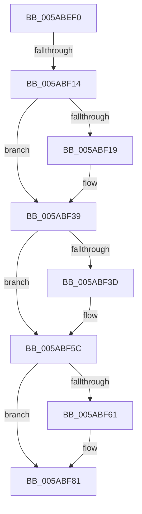

# _asan_alloca_poison

- RVA: `0x005ABEF0`–`0x005ABF92` (길이 `162` bytes)
- VA: `0x00000001405ABEF0`
- 실행 섹션: `.text`
- PDB 이름 있음: `예`; PDB Function 태그: `아니요`
- unwind 정보 RVA: `0x000C94BC`
- 디코드: `39`개 명령, `162/162` bytes 표시
- 미해석 바이트: `0` (있으면 어셈블리에 `.byte`로 보존)

> 이 문서는 커널 이미지의 기계어와 PDB 기호를 분석해 생성했습니다. 4번과 5번은 함수 원형과 자료형을 바이너리 사용 방식에서 추정한 C 해석이며 원본 소스 복구 결과는 아닙니다.

## 1. Dependencies

- 직접 호출 지점: **3**; 고유 호출 대상: **1**
- 직접 호출자로 확인된 함수: **0**
- RIP 상대 이미지 참조: **2**

### Outgoing calls
- `0x005ABF33` → [KeBugCheckEx](../4F/KeBugCheckEx_function_004FD660.md) (function, `0x004FD660`)
- `0x005ABF56` → [KeBugCheckEx](../4F/KeBugCheckEx_function_004FD660.md) (function, `0x004FD660`)
- `0x005ABF7B` → [KeBugCheckEx](../4F/KeBugCheckEx_function_004FD660.md) (function, `0x004FD660`)

### Direct callers
- 이 함수 시작 RVA로 연결되는 직접 call은 확인되지 않았습니다. 간접 호출은 완전히 역산할 수 없습니다.

### Static image references
- `0x005ABEF7` → RVA `0x00FCEC68` (`ALMOSTRO`; read)
- `0x005ABF85` → RVA `0x00FC52D8` (`ALMOSTRO`; read)

## 2. Other-region calls and transfers

- 다른 실행 섹션으로 향하는 call: **0**
- call이 아닌 외부 분기/꼬리 이동: **1**
  - `0x005ABF12` → [sub_005ABF92](Unknown_function_005ABF92.md) (`tail-transfer`)

## 3. Assembly (complete function range)

```asm
005ABEF0  40 53                           push rbx
005ABEF2  57                              push rdi
005ABEF3  48 83 EC 38                     sub rsp, 0x38
005ABEF7  80 3D 6A 2D A2 00 00            cmp byte ptr [rip + 0xa22d6a], 0
005ABEFE  48 8D 41 E0                     lea rax, [rcx - 0x20]
005ABF02  48 8B FA                        mov rdi, rdx
005ABF05  48 8B D9                        mov rbx, rcx
005ABF08  48 BA 00 00 00 00 00 80 FF FF   movabs rdx, 0xffff800000000000
005ABF12  74 7E                           je 0x1405abf92
005ABF14  48 3B C2                        cmp rax, rdx
005ABF17  73 20                           jae 0x1405abf39
005ABF19  BA 02 00 00 00                  mov edx, 2
005ABF1E  48 C7 44 24 20 00 00 00 00      mov qword ptr [rsp + 0x20], 0
005ABF27  4C 8B C8                        mov r9, rax
005ABF2A  B9 F1 01 00 00                  mov ecx, 0x1f1
005ABF2F  44 8D 42 FF                     lea r8d, [rdx - 1]
005ABF33  E8 28 17 F5 FF                  call 0x1404fd660
005ABF38  CC                              int3
005ABF39  A8 07                           test al, 7
005ABF3B  74 1F                           je 0x1405abf5c
005ABF3D  BA 02 00 00 00                  mov edx, 2
005ABF42  48 C7 44 24 20 08 00 00 00      mov qword ptr [rsp + 0x20], 8
005ABF4B  44 8B C2                        mov r8d, edx
005ABF4E  4C 8B C8                        mov r9, rax
005ABF51  B9 F1 01 00 00                  mov ecx, 0x1f1
005ABF56  E8 05 17 F5 FF                  call 0x1404fd660
005ABF5B  CC                              int3
005ABF5C  48 3B D8                        cmp rbx, rax
005ABF5F  73 20                           jae 0x1405abf81
005ABF61  BA 02 00 00 00                  mov edx, 2
005ABF66  48 C7 44 24 20 20 00 00 00      mov qword ptr [rsp + 0x20], 0x20
005ABF6F  4C 8B C8                        mov r9, rax
005ABF72  B9 F1 01 00 00                  mov ecx, 0x1f1
005ABF77  44 8D 42 01                     lea r8d, [rdx + 1]
005ABF7B  E8 E0 16 F5 FF                  call 0x1404fd660
005ABF80  CC                              int3
005ABF81  48 C1 E8 03                     shr rax, 3
005ABF85  48 03 05 4C 93 A1 00            add rax, qword ptr [rip + 0xa1934c]
005ABF8C  C7 00 81 81 81 81               mov dword ptr [rax], 0x81818181
```

## 4. C-style interpretation (structured pseudocode)

```c
__int64 __fastcall _asan_alloca_poison(__int64 a1, __int64 a2)
{
    __int64 result;
    __int64 v_rsp;
    unsigned __int64 v_stack_m28;

    v_rsp = (v_rsp) - (56);
    result = a1 - 32;
    if ((a1 - 32) < a2) {
        a2 = 2;
        v_stack_m28 = 0;
        a4 = a1 - 32;
        a1 = 497;
        a3 = a2 - 1;
        result = KeBugCheckEx(a1, a2, a3, a4);
    }
    if ((((unsigned __int8)(result)) & (7)) != 0) {
        a2 = 2;
        v_stack_m28 = 8;
        a3 = (unsigned int)(a2);
        a4 = result;
        a1 = 497;
        result = KeBugCheckEx(a1, a2, a3, a4);
    }
    if (a1 < result) {
        a2 = 2;
        v_stack_m28 = 32;
        a4 = result;
        a1 = 497;
        a3 = a2 + 1;
        result = KeBugCheckEx(a1, a2, a3, a4);
    }
    result = (result) >> (3);
    result = (result) + (*(unsigned __int64 *)(v_rip + 10589004));
    *(unsigned int *)(result) = 0x81818181ULL;
    return result;
}
```

## 5. (Beta) C Style

```c
int64_t _asan_alloca_poison(void *Arg1, int64_t Arg2)
{
    uint8_t *arg1 = (uint8_t *)Arg1;

    int64_t result;
    int64_t local_rsp;
    uint64_t v_stack_m28;

    local_rsp = (local_rsp) - (56);
    result = Arg1 - 32;
    if ((Arg1 - 32) < Arg2) {
        Arg2 = 2;
        v_stack_m28 = 0;
        a4 = Arg1 - 32;
        Arg1 = 497;
        a3 = Arg2 - 1;
        result = KeBugCheckEx(Arg1, Arg2, a3, a4);
    }
    if ((((uint8_t)(result)) & (7)) != 0) {
        Arg2 = 2;
        v_stack_m28 = 8;
        a3 = (uint32_t)(Arg2);
        a4 = result;
        Arg1 = 497;
        result = KeBugCheckEx(Arg1, Arg2, a3, a4);
    }
    if (Arg1 < result) {
        Arg2 = 2;
        v_stack_m28 = 32;
        a4 = result;
        Arg1 = 497;
        a3 = Arg2 + 1;
        result = KeBugCheckEx(Arg1, Arg2, a3, a4);
    }
    result = (result) >> (3);
    result = (result) + (*(uint64_t *)(v_rip + 0xA1934C));
    *(uint32_t *)(result) = 0x81818181ULL;
    return result;
}
```

### 관측된 메모리 오프셋

구조체 형식이 확인되지 않은 접근은 인자 기준의 오프셋으로만 기록했습니다.

| 기준 인자 | 오프셋 표현 | 폭 (bit) | 접근 |
|---|---:|---:|---|
| `Arg1` | `- 0x20` | `64` | `R` |

## 6. Execution-region graph

[열기: 2D/3D 그래프와 함수 탐색 컨트롤 패널](../../../control-panel.html?section=text&rva=0x005ABEF0&view=graph)

- 2D 그래프는 위에서 아래로 흐르고, 3D 그래프는 빈 공간을 드래그해 회전합니다. Shift+드래그는 이동, 휠은 확대·축소, 함수 노드 선택은 대상 보고서 이동입니다.

### Static fallback


